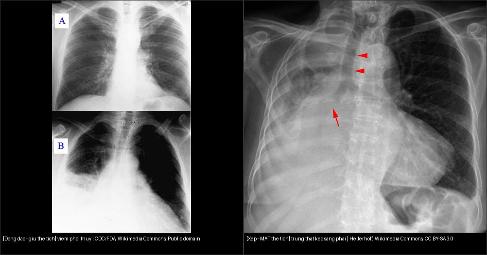

# 001 — Tổng quan hệ Ngực / Chest overview

**Tags:** `tong-quan`
**Mức chắc chắn (certainty):** tổng hợp y văn (literature synthesis) — cập nhật sau đợt 041/031/033 (7 bài ngực).

## Trục chính của hệ Ngực — học thuyết thể tích (volume-loss doctrine)
- **Đông đặc (consolidation):** tổn thương THAY khí trong phế nang nhưng **GIỮ thể tích** → **không** di lệch rãnh liên thùy/trung thất; thường có **phế quản hơi (air bronchogram)**.
- **Xẹp (atelectasis):** mất khí + **MẤT thể tích** → **rãnh liên thùy, trung thất và cơ hoành bị KÉO về phía tổn thương** (dấu chốt duy nhất); phế quản hơi có thể mất khi tắc trung tâm hoàn toàn.
- **Gợi ý nhanh:** bờ phổi tạng tách thành ngực 1–2 mm hoặc thấy đường màng phổi = tràn khí; meniscus khác nhau trên 2 bình diện = tràn dịch; mờ giới hạn theo rãnh + dấu silhouette = viêm thùy giữ thể tích.

*Trái: viêm phổi đông đặc — tổn thương gây mờ nhưng KHÔNG kéo trung thất/rãnh (giữ thể tích). Phải: xẹp gần toàn bộ phổi phải — trung thất KÉO SANG PHẢI (mất thể tích). Nguồn: CDC/FDA (Public domain) + Hellerhoff (CC BY-SA 3.0). Ảnh ghép letterbox.*

## Bảng so sánh phân biệt bắt buộc (hệ Ngực)
| Mẫu hình (pattern) | Vị trí (location) | Gamut chính (DDx) | Phân biệt nhanh | Bài chi tiết |
|---|---|---|---|---|
| Nốt (nodule) | Phổi (lung) | U hạt (granuloma), ung thư (cancer), hamartoma | Bờ gai (spiculation), kính mờ (ground-glass) | [020](../020-not-phoi/lesson.md) |
| Nốt/hạch nội phổi (cạnh rãnh) | Rốn & nội phổi | Hạch nội phổi (IPLN/PFN), K phổi, di căn cạnh rãnh | **Tam giác + dính rãnh = lành**; bờ gai + khấc + to lên = ác | [013](../013-hach-noi-phoi/lesson.md) |
| Nốt đơn độc + tiền sử K ngoài phổi | Phổi | Di căn đơn độc vs K phổi nguyên phát thứ hai (SPLC) | SUVmax **không** phân biệt (BCM 6,47 vs PLC 2,98); gai + múi + co kéo → nguyên phát (mổ) | [016](../016-not-phoi-tien-su-ung-thu/lesson.md) |
| Dày vách liên tiểu thùy | Mô kẽ/vách | Bạch mạch lan phổi (PLC), phù phổi, sarcoid, xơ UIP | **Dạng nốt = PLC** (M1a); trơn đối xứng + tim to + Kerley B = phù | [017](../017-bach-mach-lan-phoi/lesson.md) |
| Đông đặc (consolidation) | Phổi | Viêm phổi (pneumonia), nhồi máu phổi (pulmonary infarction), ung thư lepidic (lepidic adenocarcinoma) | Phế quản hơi (air bronchogram), giữ thể tích | [030](../030-dong-dac-xep-phoi/lesson.md) |
| Xẹp (atelectasis) | Phổi | Tắc (obstruction), chèn ép (compression) | Di lệch rãnh liên thùy (fissure) | [030](../030-dong-dac-xep-phoi/lesson.md) |
| Tràn dịch (effusion) | Màng phổi (pleura) | Dịch thấm (transudate), dịch tiết (exudate), máu (hemothorax) | Meniscus, tư thế nằm (decubitus) | [040](../040-tran-dich-mang-phoi/lesson.md) |
| Tràn khí (pneumothorax) | Màng phổi (pleura) | Tự phát (spontaneous), chấn thương (trauma), áp lực (tension) | Đường màng phổi + vô mạch; nằm ngửa tìm deep sulcus | [041](../041-tran-khi-mang-phoi/lesson.md) |
| Viêm thùy (lobar pneumonia) | Phổi | Phế cầu (pneumococcus), nhồi máu (infarction), xuất huyết | Phế quản hơi + giới hạn rãnh, không mất thể tích | [031](../031-viem-phoi-mau-hinh/lesson.md) |
| Viêm đa ổ (multifocal) | Phổi | Tụ cầu (staph), gram âm, hít (aspiration), lao | Nốt/đám 2 bên + hang + tree-in-bud | [031](../031-viem-phoi-mau-hinh/lesson.md) |
| Phù lan tỏa (edema/ARDS) | Phổi | Tim (cardiogenic), ARDS, xuất huyết (DAH), virus | Kerley B + tim to + tan nhanh = phù tim; ngoại vi + tim thường = ARDS | [033](../033-phu-phoi-ards/lesson.md) |
| Hang (cavity) | Phổi | Lao (TB), K hoại tử (SCC), áp-xe (abscess), nấm (aspergilloma) | Thành ≤ 4 mm lành / > 15 mm ác; liềm khí + di động = nấm | [025](../025-ton-thuong-phoi-tao-hang/lesson.md) |
| Xơ mô kẽ (fibrosis) | Phổi | UIP/IPF, NSIP, HP mạn | Tổ ong đáy-dưới màng phổi = UIP; chừa màng phổi 1–2 mm = NSIP | [035](../035-xo-mo-ke-UIP-NSIP/lesson.md) |
| Giãn PQ/kén khí | Đường thở | Giãn PQ, LCH, LAM, khí phế thũng | Nhẫn ngọc > 1,0; kén ≤ 2 mm; central dot = khí phế thũng | [050](../050-gian-phe-quan-ken-khi/lesson.md) |
| Khối trung thất | ITMIG 3 khoang | Thymoma, tăng sản, u quái, lymphoma, u thần kinh | SII > 20% = tăng sản; mỡ+vôi = u quái; bao mạch không tắc = lymphoma | [060](../060-khoi-trung-that-itmig/lesson.md) |
| Khuyết thuốc mạch | ĐMP/ĐMC | PE cấp/mạn, sarcoma, bóc tách, IMH, PAU | Góc nhọn = cấp; flap+2 lòng = bóc tách; liềm 50–70 HU = IMH | [070](../070-thuyen-tac-phoi-dmc-cap/lesson.md) |
| Đa nốt/kính mờ | Phổi | Trung tâm/bạch mạch/ngẫu nhiên; GGO/lát đá | Galaxy = sarcoid; tree-in-bud = lao; lát đá + mạn = PAP/NSIP | [021](../021-da-not-phoi/lesson.md), [032](../032-kinh-mo-lat-da/lesson.md) |
| Khối/u/dây ICU | Phổi-MP | Khối > 30 + TNM; mesothelioma rind; NKQ 3–5 cm | Hạch ≥ 10 mm; co rút = mesothelioma; khí máu lẫn = lạc chỗ | [022](../022-khoi-phoi-TNM/lesson.md), [042](../042-mang-phoi-u/lesson.md), [015](../015-ong-day-ICU/lesson.md) |
| SPL/khí TT/dịch MT | Toàn ngực | Trung tâm/vách/ngẫu nhiên; Macklin; Beck | Kerley 1–2 cm; thủng = dịch+sốt; RA collapse = tamponade | [011](../011-tieu-thuy-phoi/lesson.md), [061](../061-tran-khi-trung-that/lesson.md), [075](../075-tran-dich-mang-tim/lesson.md) |
| Nốt đơn độc ở người CÓ tiền sử ung thư | Phổi | Di căn đơn độc, K phổi nguyên phát mới, lành | mGGN/chồi gai/kéo màng phổi → nguyên phát; FDG âm không loại trừ | [016](../016-not-phoi-tien-su-ung-thu/lesson.md) |
| Dày vách liên tiểu thùy/mô kẽ | Phổi (mô kẽ) | PLC, phù, sarcoid, xơ, PAP | **Dạng nốt** = u/sarcoid; **trơn đối xứng** = phù; co kéo = xơ | [017](../017-bach-mach-lan-phoi/lesson.md), [011](../011-tieu-thuy-phoi/lesson.md) |
| Mờ theo trọng lực (đông đặc/kính mờ phân thùy phụ thuộc) | Phổi (đáy-sau, thường phải) | Viêm phổi hít sặc, viêm phổi hóa chất, dị vật đường thở | **Vị trí theo tư thế + bối cảnh rối loạn nuốt/nằm lâu/hôn mê** = hít sặc; mờ hai bên lan tỏa trong vài giờ = hóa chất | [081](../081-sac-va-roi-loan-nuot/lesson.md) |

## Bài liên quan chéo
- [081 – Sặc & rối loạn nuốt (VFSS/FEES, viêm phổi hít sặc, sonde dạ dày)](../081-sac-va-roi-loan-nuot/lesson.md) *(mới)*
- [010 – Giải phẫu ngực cắt lớp](../010-giai-phau-nguc-cat-lop/lesson.md)
- [020 – Nốt phổi](../020-not-phoi/lesson.md)
- [021 – Đa nốt phổi](../021-da-not-phoi/lesson.md) *(mới)*
- [032 – Kính mờ & lát đá](../032-kinh-mo-lat-da/lesson.md)
- [015 – Ống/dây ICU](../015-ong-day-ICU/lesson.md) *(mới)*
- [022 – Khối phổi & TNM](../022-khoi-phoi-TNM/lesson.md) *(mới)*
- [042 – U màng phổi](../042-mang-phoi-u/lesson.md)
- [011 – Tiểu thùy thứ cấp](../011-tieu-thuy-phoi/lesson.md) *(mới)*
- [061 – Tràn khí trung thất](../061-tran-khi-trung-that/lesson.md) *(mới)*
- [075 – Tràn dịch màng tim](../075-tran-dich-mang-tim/lesson.md)
- [012 – Hạch IASLC](../012-hach-trung-that/lesson.md) *(mới: trạm 1–10)*
- [013 – Hạch nội phổi trạm 11–14](../013-hach-noi-phoi/lesson.md) *(mới: nốt cạnh rãnh / IPLN)*
- [016 – Nốt phổi ở bệnh nhân có tiền sử ung thư](../016-not-phoi-tien-su-ung-thu/lesson.md) *(mới: di căn đơn độc vs K phổi nguyên phát thứ hai)*
- [017 – Bạch mạch lan phổi](../017-bach-mach-lan-phoi/lesson.md) *(mới: dày vách liên tiểu thùy, M1a)*
- [016 – Nốt phổi ở người có tiền sử ung thư (di căn vs K phổi mới)](../016-not-phoi-tien-su-ung-thu/lesson.md) *(mới)*
- [017 – Bạch mạch lan phổi (lymphangitic carcinomatosis)](../017-bach-mach-lan-phoi/lesson.md) *(mới)*
- [045 – Thành ngực & hoành](../045-thanh-nguc-hoanh/lesson.md) *(mới)*
- [051 – Tiểu PQ & khảm](../051-tieu-phe-quan/lesson.md) *(mới)*
- [052 – Khí phế thũng vs kén](../052-khi-phe-thung-kem/lesson.md) *(mới)*
- [080 – Chấn thương ngực](../080-chan-thuong-nguc/lesson.md) *(mới)*
- [025 – Hang & nấm phổi](../025-ton-thuong-phoi-tao-hang/lesson.md) *(mới)*
- [030 – Đông đặc – xẹp phổi](../030-dong-dac-xep-phoi/lesson.md)
- [031 – Viêm phổi mẫu hình](../031-viem-phoi-mau-hinh/lesson.md) *(mới)*
- [033 – Phù phổi & ARDS](../033-phu-phoi-ards/lesson.md)
- [035 – Xơ mô kẽ UIP vs NSIP](../035-xo-mo-ke-UIP-NSIP/lesson.md)
- [050 – Giãn PQ & kén khí](../050-gian-phe-quan-ken-khi/lesson.md)
- [060 – Khối trung thất ITMIG](../060-khoi-trung-that-itmig/lesson.md)
- [070 – PE & ĐMC cấp](../070-thuyen-tac-phoi-dmc-cap/lesson.md) *(mới)*
- [040 – Tràn dịch màng phổi](../040-tran-dich-mang-phoi/lesson.md)
- [041 – Tràn khí màng phổi](../041-tran-khi-mang-phoi/lesson.md) *(mới)*
- [018 – Chọc hút hạch trung thất dưới hướng dẫn siêu âm (EBUS-TBNA & EUS-B)](../018-EBUS-TBNA-EUS-hach-trung-that/lesson.md) *(mới: lấy mô hạch, giai đoạn N ấn bản 9 N2a/N2b)*

## Quy hoạch toàn diện Hệ Ngực (Master Curriculum 001–080)
> Đã viết có link; chưa viết là text dự kiến. ID ổn định, không đánh lại số.

**00x–01x — Tổng quan, Giải phẫu & Kỹ thuật/ICU**
- [001 – Tổng quan hệ Ngực](#) *(bài này)*
- [010 – Giải phẫu ngực cắt lớp & biến thể](../010-giai-phau-nguc-cat-lop/lesson.md) *(đã có)*
- 011 – Tiểu thùy phổi thứ cấp trên HRCT (Secondary pulmonary lobule, SPL) *(đã có — [bài học](../011-tieu-thuy-phoi/lesson.md))*
- 012 – Hạch trung thất IASLC & đường-dải trung thất X-quang (Mediastinal lines/stripes) *(đã có — [bài học](../012-hach-trung-that/lesson.md))*
- 013 – Hạch nội phổi (trạm 11–14) & nốt cạnh rãnh (Intrapulmonary lymph nodes / perifissural nodule) *(đã có — [bài học](../013-hach-noi-phoi/lesson.md))*
- 015 – Ống/dây ICU (lines/tubes) & giả ảnh ngực (artifacts) *(đã có — [bài học](../015-ong-day-ICU/lesson.md))*
- 016 – Nốt phổi đơn độc ở bệnh nhân có tiền sử ung thư ngoài phổi: di căn đơn độc vs K phổi nguyên phát thứ hai *(đã có — [bài học](../016-not-phoi-tien-su-ung-thu/lesson.md))*
- 017 – Bạch mạch lan phổi (lymphangitic carcinomatosis) & đường mạch bạch huyết trên HRCT *(đã có — [bài học](../017-bach-mach-lan-phoi/lesson.md))*
- 018 – Chọc hút hạch trung thất dưới hướng dẫn siêu âm (EBUS-TBNA & EUS-B): trạm nào ngả nào, Canada Lymph Node Score, lấy mẫu & giai đoạn N ấn bản 9 (N2a/N2b) *(đã có — [bài học](../018-EBUS-TBNA-EUS-hach-trung-that/lesson.md))*

**02x — Nốt, Khối & Hang**
- [020 – Nốt phổi đơn độc](../020-not-phoi/lesson.md) *(đã có)*
- 021 – Đa nốt phổi: trung tâm tiểu thùy / bạch mạch / ngẫu nhiên (Centrilobular, Perilymphatic, Random) *(đã có — [bài học](../021-da-not-phoi/lesson.md))*
- 022 – Khối phổi (> 30 mm) & TNM ung thư phổi (Lung cancer staging) *(đã có — [bài học](../022-khoi-phoi-TNM/lesson.md))*
- 025 – Hang & nấm phổi: dấu liềm khí (Cavitary lesions & Air-crescent sign) *(đã có — [bài học](../025-ton-thuong-phoi-tao-hang/lesson.md))*

**03x — Đông đặc, Xẹp & Mô kẽ**
- [030 – Đông đặc – Xẹp phổi](../030-dong-dac-xep-phoi/lesson.md) *(đã có)*
- [031 – Viêm phổi mẫu hình](../031-viem-phoi-mau-hinh/lesson.md) *(đã có)*
- 032 – Kính mờ (GGO) & lát đá (Crazy-paving) *(đã có — [bài học](../032-kinh-mo-lat-da/lesson.md))*
- [033 – Phù phổi & ARDS](../033-phu-phoi-ards/lesson.md) *(đã có)*
- 035 – Xơ mô kẽ UIP vs NSIP & tổ ong (Honeycombing) *(đã có — [bài học](../035-xo-mo-ke-UIP-NSIP/lesson.md))*

**04x — Màng phổi, Thành ngực & Cơ hoành**
- [040 – Tràn dịch màng phổi](../040-tran-dich-mang-phoi/lesson.md) *(đã có)*
- [041 – Tràn khí màng phổi](../041-tran-khi-mang-phoi/lesson.md) *(đã có)*
- 042 – Dày/vôi hóa/u màng phổi: trung biểu mô vs di căn (Mesothelioma) *(đã có — [bài học](../042-mang-phoi-u/lesson.md))*
- 045 – Thành ngực (dấu ngoài màng phổi) & thoát vị hoành (Extrapleural sign) *(đã có — [bài học](../045-thanh-nguc-hoanh/lesson.md))*

**05x — Đường thở & Kén khí**
- 050 – Giãn phế quản, tree-in-bud & kén khí (Bronchiectasis & cystic lung) *(đã có — [bài học](../050-gian-phe-quan-ken-khi/lesson.md))*
- 051 – Tiểu phế quản & khảm tưới máu (Small airways & mosaic) *(đã có — [bài học](../051-tieu-phe-quan/lesson.md))*
- 052 – Khí phế thũng vs đa kén khí: LAM, LCH, LIP, BHD (Emphysema vs cystic) *(đã có — [bài học](../052-khi-phe-thung-kem/lesson.md))*

**06x — Trung thất (ITMIG)**
- 060 – Khối trung thất 3 khoang ITMIG (Prevascular/Visceral/Paravertebral) *(đã có — [bài học](../060-khoi-trung-that-itmig/lesson.md))*
- 061 – Tràn khí trung thất (Pneumomediastinum) *(đã có — [bài học](../061-tran-khi-trung-that/lesson.md))*

**07x — Mạch ngực & Cấp cứu**
- 070 – Thuyên tắc phổi & hội chứng ĐMC cấp (PE & Acute aortic syndrome) *(đã có — [bài học](../070-thuyen-tac-phoi-dmc-cap/lesson.md))*
- 075 – Tràn dịch màng tim & chèn ép tim (Tamponade) *(đã có — [bài học](../075-tran-dich-mang-tim/lesson.md))*

**08x — Chấn thương**
- 080 – Chấn thương ngực kín (Blunt chest trauma) *(đã có — [bài học](../080-chan-thuong-nguc/lesson.md))*

> Không dùng để chẩn đoán độc lập khi chưa có người hướng dẫn.
