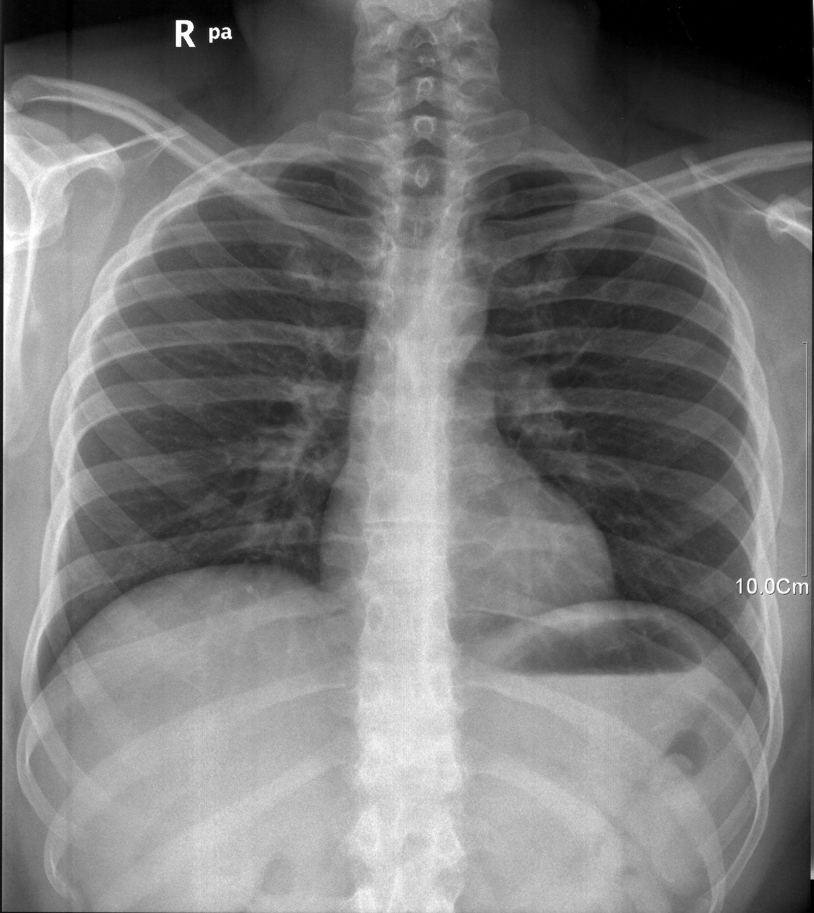
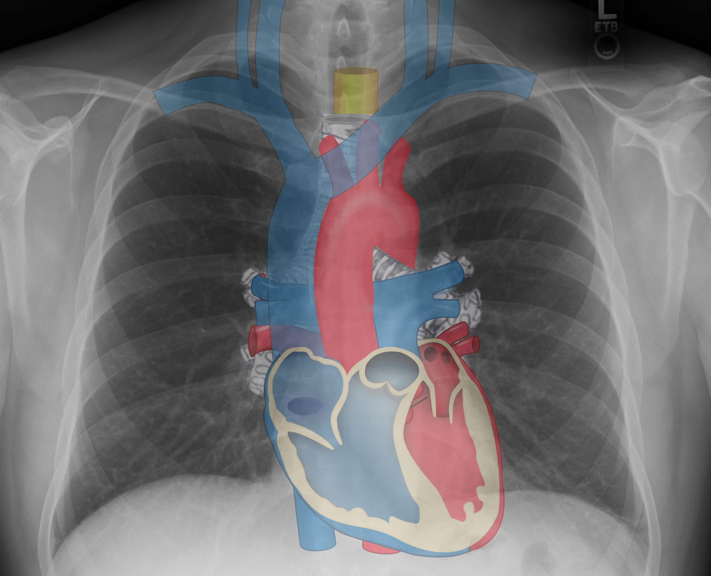
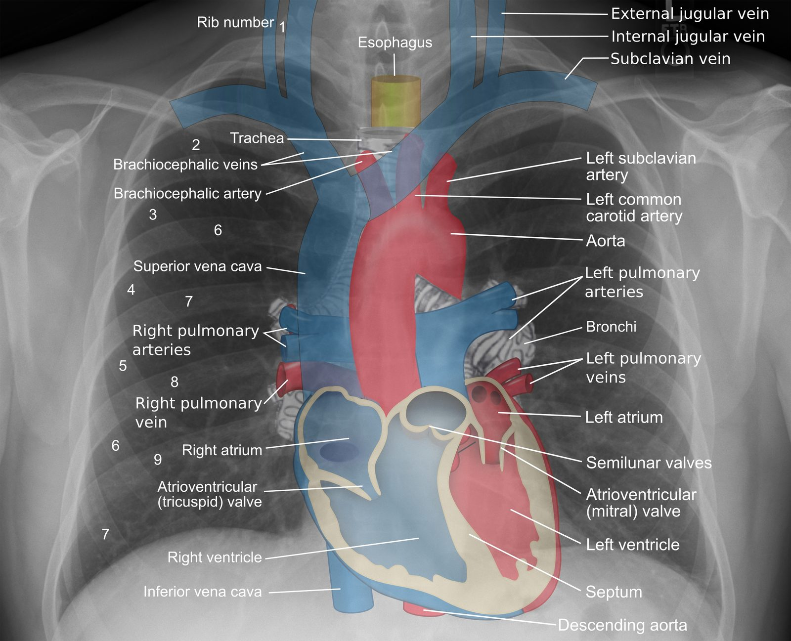

# 010 — Giải phẫu ngực cắt lớp & biến thể / Cross-sectional chest anatomy

**Tags:** `pattern:binh-thuong` `vung:nguc` `anatomy:nguc`
**Mức chắc chắn (certainty):** tổng hợp y văn (literature synthesis) — nhóm tự biên từ y văn mở, chưa gắn ca nguyên văn đơn lẻ.

## 1. Tổng quan — đọc phim ngực có hệ thống

- Phim ngực là ảnh **chồng hình (superimposition)**: mọi cấu trúc trên đường đi tia X đè lên nhau. Vì vậy phải đọc theo **checklist cố định** (ví dụ ABCDE: Airway-khí đạo, Bones-xương, Cardiac-tim, Diaphragm-cơ hoành, Effusion-tràn dịch, Fields-trường phổi) để không bỏ sót (satisfaction of search).
- TẠI SAO X-quang phân biệt được tổ chức: khí (air) cản quang kém → **đen**; mô mềm/dịch (soft tissue/fluid) → **xám-trắng**; xương/canxi (bone/calcium) → **trắng**; kim loại → trắng xóa. CT định lượng bằng **Hounsfield (HU)**: khí ≈ −1000 HU, mỡ (fat) ≈ −100 HU, nước ≈ 0 HU, mô mềm ≈ +40 HU, xương > +400 HU.

*X-quang ngực thẳng đứng (PA erect) bình thường — mốc để đối chiếu mọi bài bệnh lý. Nguồn: Ptrump16, CC BY-SA 4.0.*

## 2. Mốc giải phẫu phải thuộc (gamut vị trí)

- **Trung thất (mediastinum):** bờ tim phải = nhĩ phải (right atrium) + tĩnh mạch chủ trên (SVC); bờ tim trái = thất trái (left ventricle) + tiểu nhĩ; quai động mạch chủ (aortic arch) + cửa sổ aortopulmonary. **Mất bờ (silhouette) ở đâu → tổn thương kề đó** (mất bờ tim phải = thùy giữa; mất vòm hoành = thùy dưới).
- **Rốn phổi (hila):** rốn trái cao hơn phải ~1 khoang sườn; động mạch (artery) ngoài, phế quản (bronchus) trong. Rốn to/thưa → hạch (lymphadenopathy), tăng áp phổi (pulmonary hypertension).
- **Rãnh liên thùy (fissures):** trên phim thẳng chỉ thấy rãnh ngang (minor fissure) phải; rãnh chéo (major) thấy trên phim nghiêng. **Di lệch rãnh = chìa khóa xẹp phổi (bài 030).**
- **Góc sườn hoành (costophrenic angles):** nhọn, sâu; tù/mờ = tràn dịch sớm nhất (bài 040).

*Sơ đồ cấu trúc trung thất chồng trên phim ngực. Nguồn: Häggström (từ ảnh Stillwaterising PD + Gray's Anatomy PD), CC BY-SA 3.0.*

## 3. Bảng biến thể bình thường hay bị đọc nhầm

| Biến thể (variant) | Hình ảnh | Chốt vào (đây là bình thường khi...) | Chốt loại (phải nghĩ bệnh khi...) |
|---|---|---|---|
| Núm vú (nipple shadow) | Nốt tròn đều 2 bên, đối xứng | **Đối xứng 2 bên, có bờ, BN nữ/nam lớn tuổi** | Lệch 1 bên, gai, tăng kích thước → sang bài 020 |
| Thùy azygos (azygos lobe) | Đường cong cạnh trung thất trên phải + tĩnh mạch azygos | **Đường cong mịn, không triệu chứng** | Dày không đều, hạch kèm → bệnh lý |
| Tuyến ức (thymus) trẻ em | Bóng trung thất trên bè 2 bên ("cánh buồm") | **Trẻ < 3 tuổi, mềm mại, thay đổi theo hô hấp** | Khối cứng, vôi hóa, tuổi lớn → u trung thất |
| Xương sườn cổ (cervical rib) / canxi sụn sườn | Dải trắng đối xứng vùng đỉnh/cạnh ức | **Đối xứng, bờ đều, vỏ xương liên tục (cortex)** | Hủy xương, phản ứng màng xương (periosteal reaction) → tổn thương xương |

## 4. Protocol — khi nào chụp gì

- **X-quang ngực thẳng + nghiêng (PA + lateral):** cửa ngõ mọi triệu chứng hô hấp; PA đứng hít sâu là chuẩn (khí quản giữa, xương bả vai tách khỏi trường phổi, thấy ≥ 6 cung sườn trước).
- **CT ngực liều thấp (low-dose) / không cản quang:** nốt phổi (bài 020), mờ không tan, đánh giá mô kẽ.
- **Siêu âm màng phổi tại giường (POCUS):** tràn dịch (bài 040), dẫn lưu.

## 5. Cạm bẫy kỹ thuật

- **Phim AP nằm (supine):** tim bè to giả, mạch máu dồn đáy giả phù — luôn ghi tư thế khi đọc.
- **Hít vào kém:** đáy mờ giả đông đặc; đếm cung sườn sau (≥ 9–10 mới đạt).
- **Nếp áo, tóc, ECG leads, nếp da (skin fold):** đường thẳng vượt qua thành ngực ra ngoài trường phổi = giả tràn khí (pneumothorax); nếp da dừng ở thành ngực = thật trong phổi.

## 6. Tự lượng giá — Blind Quiz

**Ca 1 — Kể tên 5 cấu trúc tạo bờ trung thất trên phim dưới đây trước khi mở đáp án.**

<b>Bấm để hiện đáp án (bản annotated)</b>

- Đối chiếu từng bờ: SVC, nhĩ phải, thất trái, quai ĐMC, rốn phổi. Nguồn: Häggström, CC BY-SA 3.0.

**Ca 2 — Phim 010_binhthuong ở mục 1:** tự chạy checklist ABCDE rồi ghi: rốn bên nào cao hơn? Góc sườn hoành có nhọn không? Rãnh ngang phải thấy không?

<b>Bấm để hiện đáp án</b>

- Rốn trái cao hơn phải; góc sườn hoành nhọn 2 bên (không tràn dịch); rãnh ngang phải mờ — bình thường.

## Bài liên quan chéo
- [001 – Tổng quan hệ Ngực](../001-tong-quan-he-nguc/lesson.md)
- [020 – Nốt phổi](../020-not-phoi/lesson.md)
- [030 – Đông đặc – xẹp phổi](../030-dong-dac-xep-phoi/lesson.md)
- [040 – Tràn dịch màng phổi](../040-tran-dich-mang-phoi/lesson.md)

> Không dùng để chẩn đoán độc lập khi chưa có người hướng dẫn.
