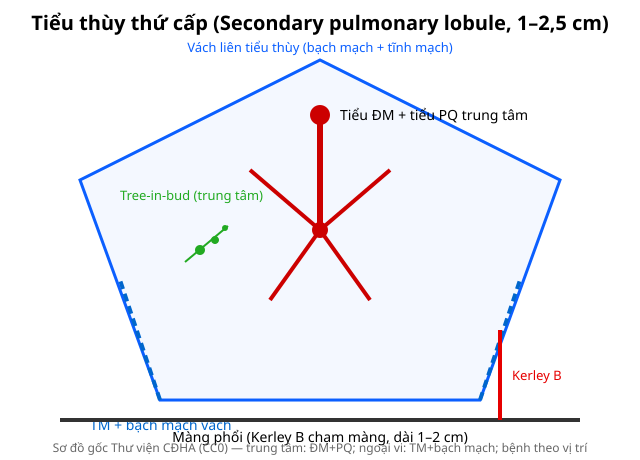
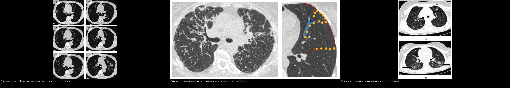
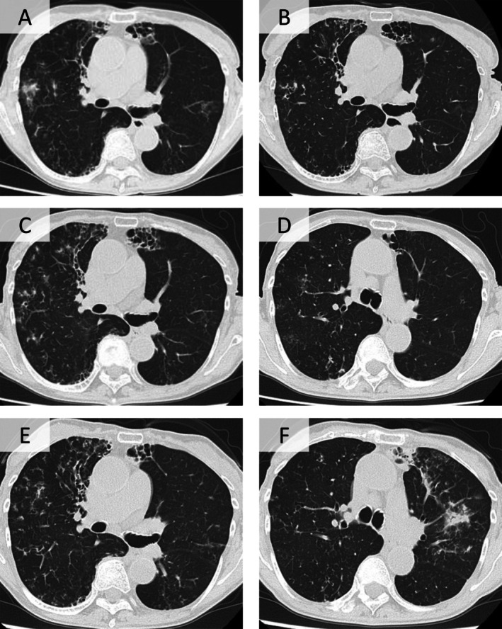
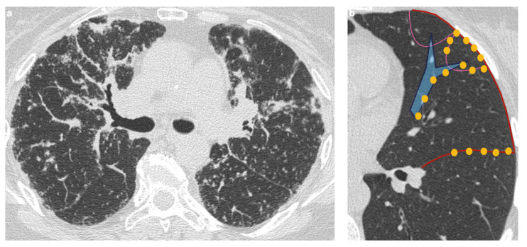
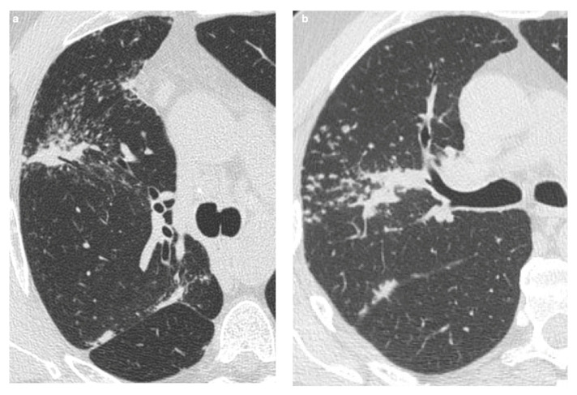
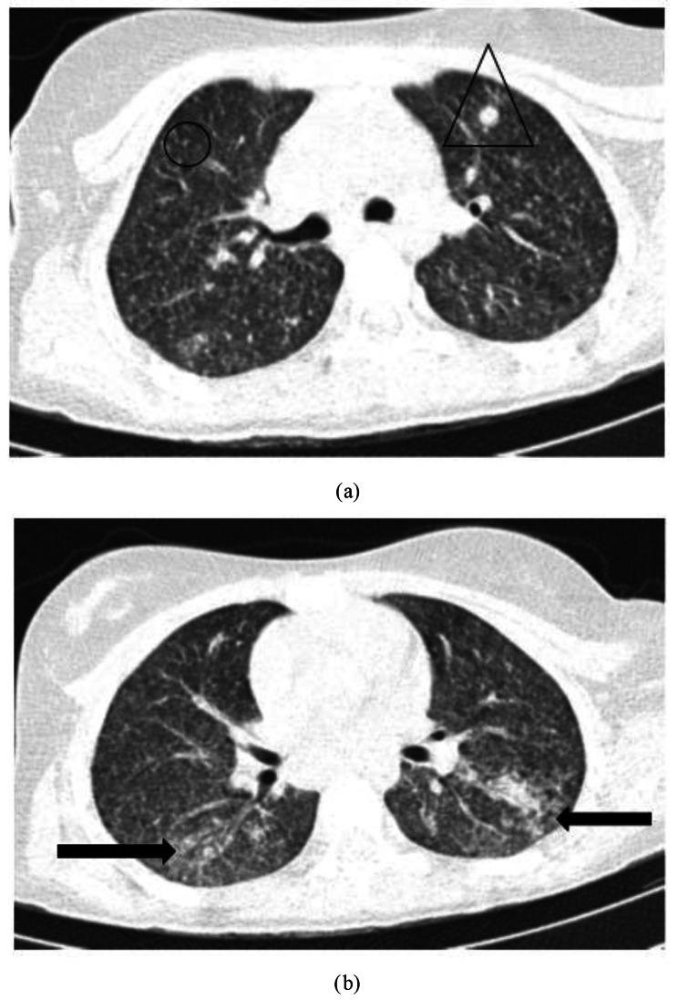

# 011 — Tiểu thùy phổi thứ cấp trên HRCT / Secondary pulmonary lobule

**Tags:** `pattern:vi-cau-truc` `vung:phoi` `anatomy:phoi`
**Mức chắc chắn (certainty):** tổng hợp y văn (literature synthesis) — nhóm tự biên từ y văn mở, chưa gắn ca nguyên văn đơn lẻ.

## 1. Tổng quan — đơn vị 1–2,5 cm quyết định mọi mẫu HRCT

- Tiểu thùy thứ cấp: đa diện **1–2,5 cm**, vách liên tiểu thùy chứa **tĩnh mạch + bạch mạch**; trung tâm có **tiểu động mạch + tiểu phế quản** đi cùng nhau.
- TẠI SAO vị trí trong tiểu thùy quyết định tên bệnh: viêm/nấm theo đường thở → **trung tâm** (tree-in-bud); ứ bạch mạch/sarcoid → **vách + dưới màng phổi** (Kerley, galaxy); máu → **ngẫu nhiên** (kê, di căn).
- Kerley B = vách liên tiểu thùy ứ dịch/dày: **dài 1–2 cm, vuông góc màng phổi, chạm màng ở đáy** (bài 033).

*Trung tâm: ĐM + PQ. Ngoại vi: TM + bạch mạch. Sơ đồ gốc Thư viện CĐHA, CC0.*

## 2. Gamut theo vị trí trong tiểu thùy

- **Trung tâm (centrilobular):** tree-in-bud (lao, MAC, hít), RB-ILD/DIP (hút thuốc), HP cấp — **chừa màng phổi vài mm**.
- **Bạch mạch (perilymphatic):** sarcoid (galaxy + hạch), lymphangitis K, bụi phổi — **dọc vách + dưới màng + quanh rốn**.
- **Ngẫu nhiên (random):** lao kê 1–3 mm, di căn máu, thuyên tắc NK — **chạm màng phổi**.
- **Nang/kén:** theo vách (LCH trên) vs ngẫu nhiên (LAM) — bài 050.

*Đối chiếu cùng mặt phẳng HRCT: **trái — tree-in-bud** nốt trung tâm nối thành chùm quanh ĐM–PQ (chừa màng phổi); **giữa — bạch mạch** nốt dọc vách liên tiểu thùy + dưới màng phổi + quanh rốn (sarcoid); **phải — ngẫu nhiên** nốt 1–3 mm rải rác chạm màng phổi (kê). Nguồn: Takahashi H et al., Respirology Case Reports 2026 (PMC13381721) + Baratella E et al., Medicina 2025 (PMC12734719) + Kamali M et al., BMC Pediatrics 2024 (PMC10983680), CC BY. Ảnh ghép letterbox.*

## 3. Bảng tra cứu nhanh

| Vị trí trong SPL | Dấu HRCT | Bệnh điển hình | Chốt phân biệt |
|---|---|---|---|
| Trung tâm | Tree-in-bud, nốt mờ, chừa màng | Lao, MAC, hít, RB-ILD | Chừa màng vài mm + hút thuốc/lao |
| Vách/bạch mạch | Kerley, nốt vách, galaxy | Sarcoid, lymphangitis K, phù | Galaxy + hạch = sarcoid; Kerley + tim to = phù |
| Ngẫu nhiên | Nốt đều chạm màng | Kê, di căn máu, NK huyết | Đều 2 phổi + ổ nguyên phát |
| Nang | Kén ≤ 2 mm / tổ ong tầng | LAM/LCH vs UIP (bài 035/050) | Thành + phân bố (bài 050) |

## 4. Protocol HRCT đọc tiểu thùy

- Lát mỏng 1–1,5 mm + MIP 5–10 mm (nốt/vessel) + MinIP (bẫy khí) + prone (loại xẹp đáy).
- Đọc theo trình tự: phân bố (trên-dưới, trung tâm-ngoại vi) → trong SPL (trung tâm/vách/ngẫu nhiên) → kèm (hạch, màng phổi, tim).

## 5. Cạm bẫy

- **Xẹp đáy giả kính mờ/nốt** — prone xác nhận.
- **Mạch cắt ngang** giả nốt trung tâm — MIP + cuộn MPR xem cuống.
- **Tuổi già** dày vách nhẹ lan tỏa — đừng gọi xơ bệnh lý khi không có tổ ong/giãn PQ do kéo.

## 6. Tự lượng giá — Blind Quiz

**Ca 1 — HRCT: nốt nhỏ nối thành chùm quanh ĐM–PQ, chừa màng phổi vài mm (bệnh nhân ho mạn + giãn phế quản).**

- Hỏi: phân bố trong tiểu thùy? Dấu hiệu tên gọi? Ba nguyên nhân thường gặp?

<b>Bấm để hiện đáp án</b>

- **Phân bố trung tâm (centrilobular):** nốt nhỏ nối thành **chùm dạng cành cây ra lá (tree-in-bud)** quanh ĐM–PQ ở trung tâm tiểu thùy, **chừa màng phổi vài mm**.
- **Nguyên nhân:** lao, MAC/NTM, hít sặc/viêm phổi hít; ca này là **Nocardia** trên nền giãn phế quản.
- Nguồn: Takahashi H et al., Respirology Case Reports 2026, Fig. 1, PMC13381721, CC BY 4.0.

**Ca 2 — HRCT: nốt mờ rải rác, tập trung DỌC VÁCH liên tiểu thùy + DƯỚI màng phổi + quanh rốn phổi (bệnh nhân trẻ, hạch rốn hai bên).**

- Hỏi: phân bố trong tiểu thùy? Chẩn đoán? Dấu hiệu chốt kèm theo?

<b>Bấm để hiện đáp án (findings + chẩn đoán)</b>

- **Findings:** **vi nốt phân bố BẠCH MẠCH** — men theo **vách liên tiểu thùy, dưới màng phổi và quanh bó mạch–phế quản (quanh rốn)** (a); hình (b) chồng sơ đồ: nốt (chấm vàng) nằm dọc **phế quản (đường xanh), vách liên tiểu thùy (đường đỏ)**.
- **Chẩn đoán:** **sarcoidosis phổi** — chốt bởi **hạch rốn phổi hai bên đối xứng** + phân bố bạch mạch; phân biệt lymphangitis K (một bên, dày vách + nốt), bụi phổi.
- Nguồn: Baratella E et al., Medicina 2025, Fig. 3, PMC12734719, CC BY 4.0.

**Ca 3 — HRCT (a) bệnh nhân sarcoid và (b) bệnh nhân lao: cùng một dấu hiệu ở vùng nốt trung tâm.**

- Hỏi: mô tả dấu hiệu (nốt lớn + các nốt vệ tinh)? Tên gọi? Vì sao quan trọng khi tầm soát K phổi?

<b>Bấm để hiện đáp án (findings + chẩn đoán)</b>

- **Findings:** **nốt lớn trung tâm + chùm nốt vệ tinh nhỏ hợp lại** → dấu **"galaxy sign"** (nhìn như thiên hà). Gặp ở **sarcoid (a)** và **lao (b)**.
- **Vì sao quan trọng:** trong **tầm soát K phổi**, nốt đặc vùng trên + vệ tinh dễ bị đọc là **u ác**; galaxy sign là **bắt chước lành tính (benign mimic)** → tránh sinh thiết/mổ oan, đối chiếu hạch rốn + bối cảnh.
- Nguồn: Baratella E et al., Medicina 2025, Fig. 8, PMC12734719, CC BY 4.0.

**Ca 4 — Trẻ 12 tuổi, HRCT: vô số nốt nhỏ đều hai phổi + đám đông đặc vá víu (bệnh nhân lao kê).**

- Hỏi: nốt có phân bố gì (trung tâm/vách/ngẫu nhiên)? Chẩn đoán? Phân biệt với sarcoid ở điểm nào?

<b>Bấm để hiện đáp án (findings + chẩn đoán)</b>

- **Findings:** các **vi nốt phân bố NGẪU NHIÊN** rải khắp hai phổi (**chạm màng phổi**) + đám **đông đặc vá víu** (a,b) = **lao kê (miliary TB)**.
- **Chốt:** **ngẫu nhiên = chạm màng phổi, đều hai phổi, không ưu thế vách** — khác **sarcoid (dọc vách + dưới màng + quanh rốn)**; kê gợi ý lao kê/di căn máu.
- Nguồn: Kamali M et al., BMC Pediatrics 2024, Fig. 3, PMC10983680, CC BY 4.0.

**Ca 5 — Ghép đối chiếu: bên nào là trung tâm, bên nào là bạch mạch, bên nào là ngẫu nhiên?**

<b>Bấm để hiện đáp án (findings + chẩn đoán)</b>

- **Trái — tree-in-bud:** nốt trung tâm nối thành chùm (chừa màng). **Giữa — bạch mạch:** nốt dọc vách + dưới màng + quanh rốn (sarcoid). **Phải — ngẫu nhiên:** nốt đều rải rác chạm màng (kê).
- **Chốt:** xác định **vị trí trong tiểu thùy** là bước quyết định tên bệnh; luôn kèm phân bố trục trên–dưới và bối cảnh. Nguồn: Takahashi 2026 (PMC13381721) + Baratella 2025 (PMC12734719) + Kamali 2024 (PMC10983680), CC BY 4.0.

**Ca 6 — Nhìn sơ đồ gốc, chỉ vị trí 4 tổn thương.**

- Hỏi: tree-in-bud nằm đâu? Kerley B chạm đâu? Nốt bạch mạch dọc đâu? Kê ngẫu nhiên chạm gì?

<b>Bấm để hiện đáp án</b>

- Tree-in-bud: trung tâm (quanh ĐM-PQ). Kerley B: vách, chạm màng phổi. Bạch mạch: dọc vách + dưới màng. Kê: ngẫu nhiên, chạm màng.

## Bài liên quan chéo
- [001 – Tổng quan hệ Ngực](../001-tong-quan-he-nguc/lesson.md)
- [021 – Đa nốt phổi](../021-da-not-phoi/lesson.md) (3 phân bố)
- [033 – Phù phổi & ARDS](../033-phu-phoi-ards/lesson.md) (Kerley B)
- [035 – Xơ mô kẽ UIP vs NSIP](../035-xo-mo-ke-UIP-NSIP/lesson.md) (vách xơ)

> Không dùng để chẩn đoán độc lập khi chưa có người hướng dẫn.
