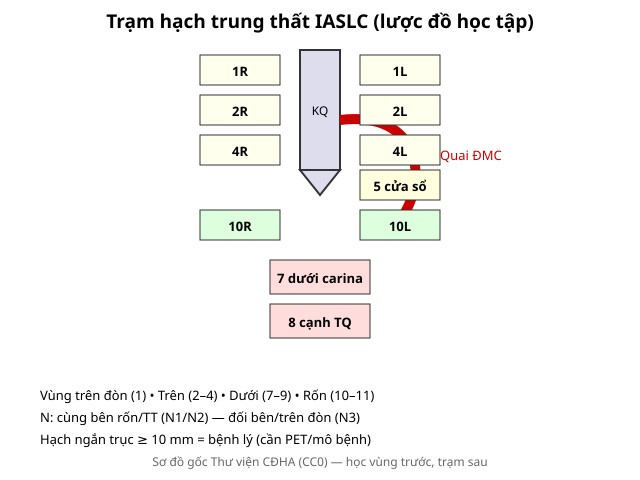

# 012 — Hạch trung thất IASLC & đường-dải / Lymph node stations & Mediastinal lines

**Tags:** `pattern:hach` `vung:trung-that` `score:IASLC`
**Mức chắc chắn (certainty):** tổng hợp y văn (literature synthesis) — nhóm tự biên từ y văn mở, chưa gắn ca nguyên văn đơn lẻ.

## 1. Tổng quan — học vùng trước, trạm sau + ngưỡng 10 mm

- IASLC chia hạch thành **vùng trên đòn (1), trên (2–4), dưới (7–9: dưới carina, cạnh thực quản), rốn (10–11)**. TẠI SAO vùng quyết định N: cùng bên rốn/trung thất = N1/N2 (còn mổ được chọn lọc); **đối bên hoặc trên đòn = N3** (không mổ triệt căn).
- Ngưỡng định lượng: trục ngắn **≥ 10 mm** = hạch bệnh lý (không đặc hiệu — viêm/lao/sarcoid đều to; PET/mô bệnh quyết định).
- Đường-dải trung thất X-quang: mất/bè đường cạnh khí quản, cửa sổ aortopulmonary, đường cạnh thực quản = hạch/u đấy (bài 010).

*Sơ đồ gốc Thư viện CĐHA, CC0.*

## 2. Gamut hạch to theo bối cảnh

- **K phổi + hút thuốc:** hạch cùng bên rốn/trung thất — N theo vùng (bài 022).
- **Trẻ + B symptoms + hạch nhiều nhóm:** lymphoma (bao mạch không tắc — bài 060).
- **Lao/sarcoid:** hạch vôi hóa (vỏ trứng lao/silic) + tree-in-bud (lao) hoặc galaxy + hạch đối xứng (sarcoid).
- **Phản ứng sau viêm:** hạch < 15 mm, tan theo viêm — đừng PET vội khi đang viêm cấp.

## 3. Bảng tra vùng-trạm

| Vùng (zone) | Trạm chính | N tương ứng | Chốt thực hành |
|---|---|---|---|
| Trên đòn (supraclavicular) | 1R/1L | **N3** (dù bên nào) | Hạch sờ được + K phổi = không mổ triệt căn |
| Trên (upper) | 2R/2L, 3a/3p, 4R/4L | N2 (cùng bên) / N3 (đối bên) | 4R là trạm sinh thiết đầu tay (EBUS) |
| Dưới (lower) | 7 dưới carina, 8 cạnh TQ, 9 dây chằng | N2 | 7 là trạm giữa — to gợi lan rộng |
| Rốn (hilar) | 10/11 | N1 | Viêm cũng to — so phim cũ |

## 4. Protocol

- **CT cản quang:** đo trục ngắn từng trạm ≥ 10 mm, ghi vùng; EBUS-TBNA trạm 4R/7/10 đầu tay.
- **PET-CT:** hạch bắt thuốc + tìm nguyên phát/di căn xa (giai đoạn 022).
- Hạch đơn độc không K: theo dõi + tìm lao/sarcoid trước khi sinh thiết.

## 5. Cạm bẫy

- **Hạch vôi hóa vỏ trứng** (silic/sarcoid) — lành tính, đừng PET vô ích.
- **Hạch phản ứng sau viêm/vắc-xin** — hỏi viêm gần đây, chụp lại 3 tháng.
- **Tĩnh mạch azygos thùy azygos** giả hạch cạnh khí quản — cuộn coronal xem mạch liên tục.

## 6. Tự lượng giá — Blind Quiz

**Ca 1 — Nhìn sơ đồ, trả lời trước khi mở đáp án.**

- Hỏi: hạch 4R cùng bên u thuộc N mấy? Hạch trên đòn đối bên thuộc N mấy? Ngưỡng mm?

<b>Bấm để hiện đáp án</b>

- 4R cùng bên = **N2**; trên đòn đối bên = **N3** (không mổ triệt căn); ngưỡng **≥ 10 mm** trục ngắn.

**Ca 2 — K phổi phải + hạch 4R 15 mm + hạch trái 12 mm:** N? Hướng xử trí? *(Quy tắc mục 1–4.)*

<b>Bấm để hiện đáp án</b>

- **N3** (đối bên) → toàn thân, không mổ triệt căn; EBUS hạch đối bên xác nhận mô bệnh.

## Bài liên quan chéo
- [001 – Tổng quan hệ Ngực](../001-tong-quan-he-nguc/lesson.md)
- [022 – Khối phổi & TNM](../022-khoi-phoi-TNM/lesson.md) (N theo vùng)
- [060 – Khối trung thất ITMIG](../060-khoi-trung-that-itmig/lesson.md) (lymphoma)

> Không dùng để chẩn đoán độc lập khi chưa có người hướng dẫn.
