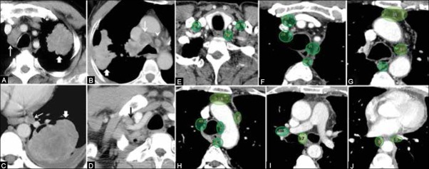
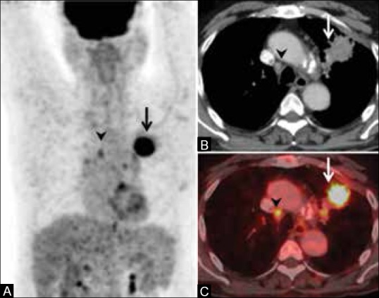
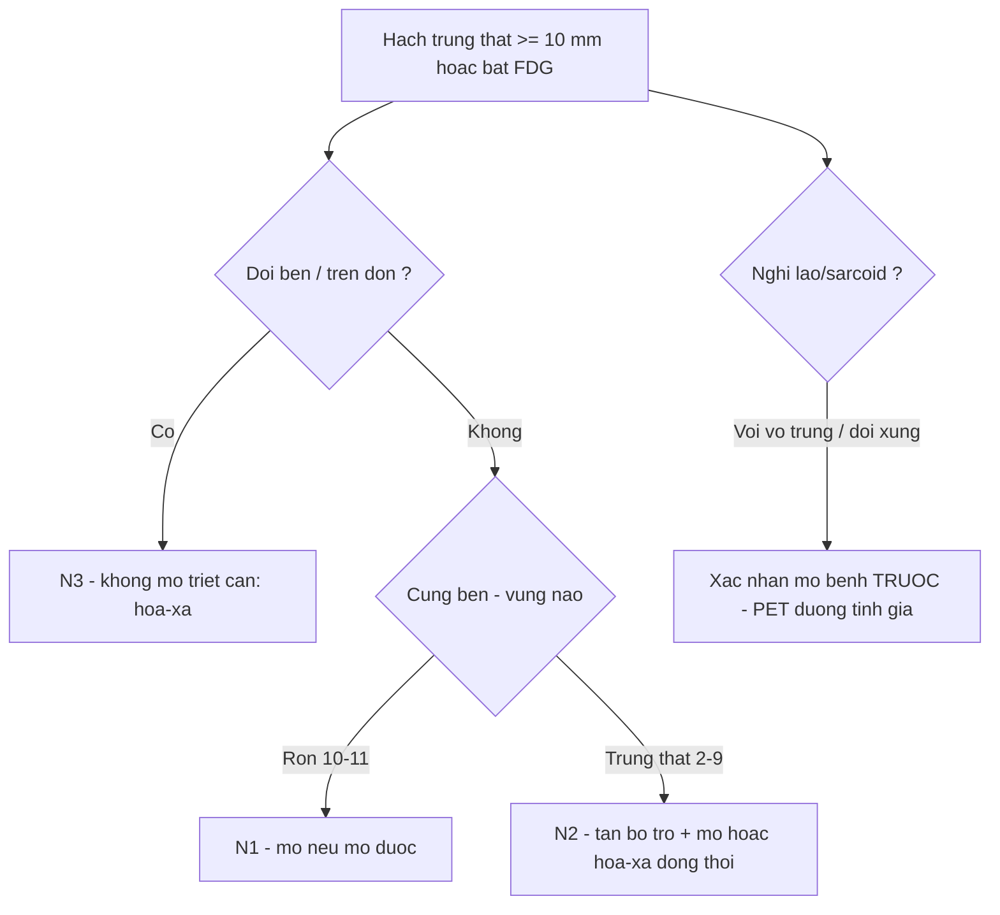
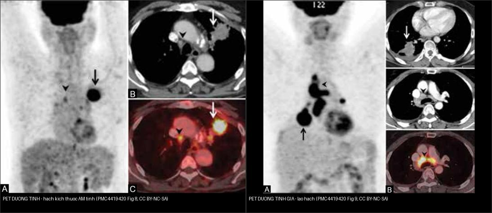

# 012 — Hạch trung thất IASLC & đường-dải / Lymph node stations & Mediastinal lines

**Tags:** `pattern:hach` `vung:trung-that` `score:IASLC` `protocol:PET-CT-nguc`
**Mức chắc chắn (certainty):** tổng hợp y văn (literature synthesis) — nhóm tự biên từ y văn mở, minh họa bằng ca trong bài tổng quan *Imaging of lung cancer* (Indian J Radiol Imaging 2015, CC BY-NC-SA 3.0).

## 1. Tổng quan — học vùng trước, trạm sau + ngưỡng 10 mm

- IASLC (International Association for the Study of Lung Cancer) chia hạch thành **vùng trên đòn (1), trên (2–4), dưới (7–9: dưới carina, cạnh thực quản), rốn (10–11)**. TẠI SAO vùng quyết định N: cùng bên rốn/trung thất = N1/N2 (còn mổ được chọn lọc); **đối bên hoặc trên đòn = N3** (không mổ triệt căn). Hạch **N1–N3** đều là **hạch vùng** (khác di căn xa M1).
- Ngưỡng định lượng: trục ngắn **≥ 10 mm** = hạch bệnh lý (không đặc hiệu — viêm/lao/sarcoid đều to; PET/mô bệnh quyết định). **Hạch < 10 mm vẫn có thể là di căn** (PET phát hiện hạch "âm tính về kích thước" — Hình 8).
- Đường-dải trung thất X-quang: mất/bè đường cạnh khí quản, cửa sổ aortopulmonary, đường cạnh thực quản = hạch/u đấy (bài 010). Trên CT, định khu bằng **mốc giải phẫu** (khí quản, quai ĐMC, carina, thực quản, dây chằng phổi) chứ không đoán cảm tính.

*Sơ đồ gốc Thư viện CĐHA, CC0.*

*Trạm hạch theo bản đồ IASLC (E–J) + ca thực (A–D). Nguồn: Purandare NC et al., Indian J Radiol Imaging 2015, PMC4419420 Fig. 7, CC BY-NC-SA 3.0. Ảnh giữ nguyên bản.*

- **Định khu nhanh trên CT (theo Fig. 7E–J):** **1** đáy cổ–trên đòn; **2** cạnh khí quản trên; **3a** trước mạch (prevascular) / **3p** sau khí quản; **4** cạnh khí quản dưới (4R/4L); **5** cửa sổ aortopulmonary; **6** cạnh ĐMC lên; **7** dưới carina; **8** cạnh thực quản; **9** dây chằng phổi; **10** rốn phổi.

## 2. Gamut hạch to theo bối cảnh

- **K phổi + hút thuốc:** hạch cùng bên rốn/trung thất — N theo vùng (bài 022). Hạch **N2 đa ổ** vẫn có thể xếp **bệnh lan rộng tại chỗ** (hóa-xạ đồng thời) tùy hội chẩn.
- **Trẻ + B symptoms + hạch nhiều nhóm:** lymphoma (bao mạch không tắc — bài 060).
- **Lao/sarcoid:** hạch vôi hóa (vỏ trứng lao/silic) + tree-in-bud (lao) hoặc galaxy + hạch đối xứng (sarcoid). **PET dương tính giả** nổi tiếng (Hình 9).
- **Phản ứng sau viêm:** hạch < 15 mm, tan theo viêm — đừng PET vội khi đang viêm cấp.

## 3. Bảng so sánh phân biệt (ma trận đối chiếu)

| Thực thể (entity) | Hình ảnh điển hình | Chốt vào (rule-in) | Chốt loại (rule-out) | Gợi ý xác nhận |
|---|---|---|---|---|
| Hạch K phổi (N1–N2) | Hạch cùng bên rốn/trung thất, trục ngắn **≥ 10 mm**, bắt thuốc, ± vôi | **K phổi + hạch cùng bên + SUVmax cao** | Hạch vôi vỏ trứng hai bên đối xứng → lao/sarcoid | EBUS-TBNA 4R/7/10; PET-CT toàn thân |
| Hạch K **N3** | Hạch **đối bên** trung thất/rốn hoặc **trên đòn (1)**, hoặc 2–4 đối bên | **Đối bên/trên đòn + K phổi cùng bệnh cảnh** | Hạch cùng bên đơn độc → N2 | Mô bệnh hạch đối bên/trên đòn (EBUS/vét hạch) |
| Lymphoma | Nhiều nhóm hạch, **bao/tách mạch không tắc**, đồng nhất | **Hạch nhiều ngăn + trẻ/B symptoms** | Tắc mạch/huyết khối → nghĩ K | Sinh thiết hạch to nhất, LDH |
| Lao / sarcoid | Hạch vôi hóa **vỏ trứng**, sarcoid **đối xứng** quanh rốn | **Vôi vỏ trứng + bối cảnh lao/sarcoid** | Bắt PET mạnh không loại được ác | AFB/GenXpert, nội soi phế quản, **PET dương tính giả** |
| Hạch viêm phản ứng | Hạch **< 15 mm**, không hoại tử, tan theo thời gian | **Bối cảnh viêm cấp + sốt + hồi quy** | Hạch to > 15 mm, hoại tử → sinh thiết | So phim cũ, chụp lại 3–6 tuần |

| Vùng (zone) | Trạm chính | N tương ứng | Chốt thực hành |
|---|---|---|---|
| Trên đòn (supraclavicular) | 1R/1L | **N3** (dù bên nào) | Hạch sờ được + K phổi = không mổ triệt căn |
| Trên (upper) | 2R/2L, 3a/3p, 4R/4L | N2 (cùng bên) / N3 (đối bên) | 4R là trạm sinh thiết đầu tay (EBUS) |
| Dưới (lower) | 7 dưới carina, 8 cạnh TQ, 9 dây chằng | N2 | 7 là trạm giữa — to gợi lan rộng |
| Rốn (hilar) | 10/11 | N1 | Viêm cũng to — so phim cũ |

*Hạch cạnh khí quản phải nhỏ (không đủ tiêu chuẩn kích thước) nhưng **bắt FDG** → mô bệnh xác nhận di căn **N3**. Nguồn: Purandare NC et al., Indian J Radiol Imaging 2015, PMC4419420 Fig. 8, CC BY-NC-SA 3.0.*

## 4. Protocol

- **CT cản quang:** đo **trục ngắn** từng trạm, ghi trạm + vùng; **hạch ≥ 10 mm** trục ngắn = nghi ngờ. Hạch trung thất mô tả theo **bản đồ IASLC** (Hình 7).
- **PET-CT:** **hạch bắt FDG** có thể **nâng giai đoạn** dù hạch **< 10 mm** (Fig. 8: N2→N3, đổi chiến lược không mổ triệt căn); cũng **tìm nguyên phát/di căn xa** (giai đoạn 022). **CẢNH BÁO: PET dương tính giả** do **lao/sarcoid** (Fig. 9) — luôn xác nhận **mô bệnh** trước khi đổi giai đoạn.
- **EBUS-TBNA/EUS:** sinh thiết **4R, 7, 10** đầu tay; hạch **trên đòn/đối bên** cần mô bệnh để xác nhận **N3**.
- **Hạch đơn độc không K:** theo dõi + tìm lao/sarcoid trước khi sinh thiết.
- **Xử trí theo giai đoạn N:** **N0–N1 sớm** → mổ; **N2** → hóa trị tân bổ trợ rồi mổ **hoặc** hóa-xạ đồng thời; **N3** → **hóa-xạ, không mổ triệt căn**.

## 5. Cạm bẫy

- **PET dương tính giả (lao/sarcoid/viêm):** hạch bắt FDG mạnh vẫn có thể lành — Fig. 9 là ca **lao hạch** bắt thuốc như di căn. **Luôn mô bệnh** trước khi đổi giai đoạn/xạ.
- **Hạch vôi hóa vỏ trứng** (silic/sarcoid) — lành tính, đừng PET vô ích.
- **Hạch < 10 mm vẫn có thể ác:** đừng loại chỉ vì "nhỏ"; nếu PET bắt thuốc ở trạm then chốt (đối bên/trên đòn) phải lấy mô bệnh.
- **Hạch phản ứng sau viêm/vắc-xin** — hỏi viêm gần đây, chụp lại 3 tháng.
- **Tĩnh mạch azygos thùy azygos** giả hạch cạnh khí quản — cuộn coronal xem mạch liên tục.
- **Trạm 3a (prevascular) vs 5/6:** mốc là **ĐMC lên/quai** — nhầm trạm đổi N và quyết định mổ; đọc trên trục + đối chiếu coronal.

## 6. Tự lượng giá — Blind Quiz

**Ca 1 — Nhìn sơ đồ, trả lời trước khi mở đáp án.**

- Hỏi: hạch 4R cùng bên u thuộc N mấy? Hạch trên đòn đối bên thuộc N mấy? Ngưỡng mm?

<b>Bấm để hiện đáp án</b>

- 4R cùng bên = **N2**; trên đòn đối bên = **N3** (không mổ triệt căn); ngưỡng **≥ 10 mm** trục ngắn.

**Ca 2 — CT ngực cản quang: hạch tô xanh ở nhiều trạm. Định khu trạm:**

- Hỏi: panel E–J lần lượt đánh dấu trạm nào? Trạm **7** nằm ở đâu? Vì sao trạm 10 = **N1**?

<b>Bấm để hiện đáp án</b>

- Trạm theo IASLC (E–J): **1** đáy cổ/trên đòn → **2** cạnh khí quản trên → **3a** trước mạch/3p sau khí quản → **4** cạnh khí quản dưới → **5** cửa sổ aortopulmonary → **6** cạnh ĐMC lên → **7 dưới carina** → **8** cạnh thực quản → **9** dây chằng phổi → **10** rốn phổi.
- **Trạm 10 = hạch rốn phổi = N1** (cùng bên, gần u nhất) — khác trạm 7 (trung thất, **N2**).
- Nguồn ảnh: Purandare NC et al., Fig. 7, CC BY-NC-SA 3.0.

**Ca 3 — Hạch cạnh khí quản phải nhỏ, chưa đủ 10 mm. PET/CT đổi gì?**

- Hỏi: hạch này có ác không nếu chỉ dựa vào CT? PET làm gì cho giai đoạn? Bước xác nhận?

<b>Bấm để hiện đáp án (findings + chẩn đoán)</b>

- Dấu hiệu (findings): u phổi **bắt FDG mạnh** (mũi tên); hạch cạnh khí quản **nhỏ, âm tính về kích thước** (mũi tên đầu) nhưng **bắt FDG** trên PET và ảnh fusion.
- Chẩn đoán (diagnosis): **di căn hạch N3** (mô bệnh qua trung thất soi xác nhận) — **đổi chiến lược sang hóa-xạ, không mổ triệt căn**.
- Bài học: **kích thước không loại trừ**; PET/CT phát hiện hạch ẩn → luôn **xác nhận mô bệnh**.
- Nguồn ảnh: Purandare NC et al., Fig. 8, CC BY-NC-SA 3.0.

**Ca 4 — Hạch trung thất bắt FDG nhiều ổ; nghĩ K hay không?**

- Hỏi: hai ca PET "bắt thuốc" khác nhau ở đâu? Vì sao không được kết luận ung thư chỉ bằng PET? Chốt?

<b>Bấm để hiện đáp án (findings + chẩn đoán)</b>

- **Phải = PET dương tính GIẢ:** hạch trung thất bắt FDG nhiều ổ nhưng **sinh thiết = lao** (tuberculosis) — nổi tiếng nhầm với di căn (Fig. 9).
- **Trái = PET dương tính THẬT:** hạch cạnh khí quản bắt FDG, mô bệnh = **di căn N3** (Fig. 8).
- Chốt: **PET chỉ là bản đồ chuyển hóa — quyết định giai đoạn/xử trí cần MÔ BỆNH** (EBUS/trung thất soi).
- Nguồn ảnh: Purandare NC et al., Fig. 8–9, CC BY-NC-SA 3.0. Ảnh ghép letterbox, giữ nguyên bản.

**Ca 5 — K phổi phải + hạch 4R 15 mm + hạch trái 12 mm:** N? Hướng xử trí? *(Quy tắc mục 1–4.)*

<b>Bấm để hiện đáp án</b>

- **N3** (đối bên) → toàn thân, không mổ triệt căn; EBUS hạch đối bên xác nhận mô bệnh.

## Bài liên quan chéo
- [001 – Tổng quan hệ Ngực](../001-tong-quan-he-nguc/lesson.md)
- [010 – Giải phẫu ngực cắt lớp](../010-giai-phau-nguc-cat-lop/lesson.md) (đường-dải trung thất)
- [022 – Khối phổi & TNM](../022-khoi-phoi-TNM/lesson.md) (N theo vùng)
- [060 – Khối trung thất ITMIG](../060-khoi-trung-that-itmig/lesson.md) (lymphoma)
- [070 – PE & ĐMC cấp](../070-thuyen-tac-phoi-dmc-cap/lesson.md) (PET-CT mạch ngực)

## Ảnh
- Tên file: `012_*`; nguồn + giấy phép từng ảnh trong `images/CREDITS.md`.
- Ảnh PMC4419420 (CC BY-NC-SA 3.0) giữ **nguyên bản** (không crop/kéo giãn); ảnh ghép dùng letterbox.
- AuntMinnie: chỉ dẫn link, không tải (xem `sources.md`).

> Không dùng để chẩn đoán độc lập khi chưa có người hướng dẫn.
