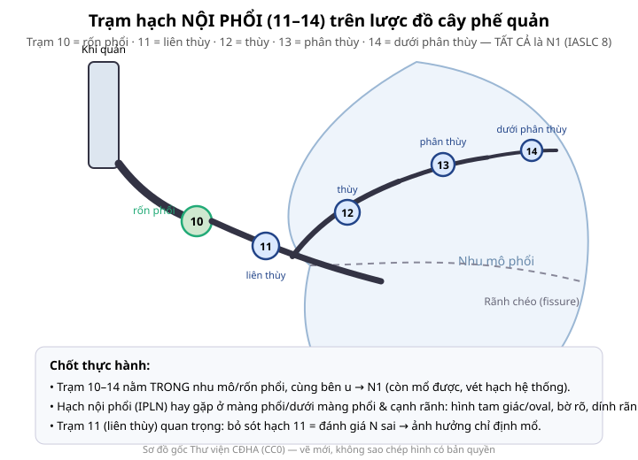
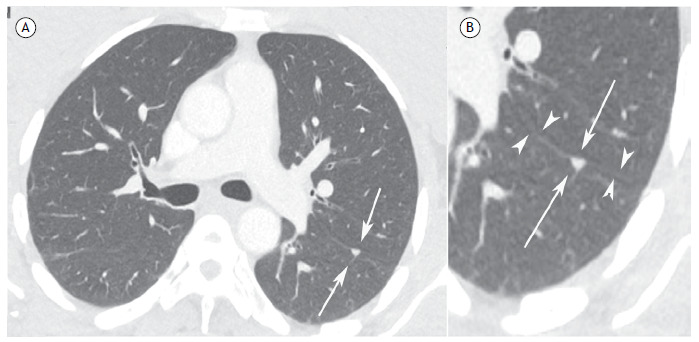
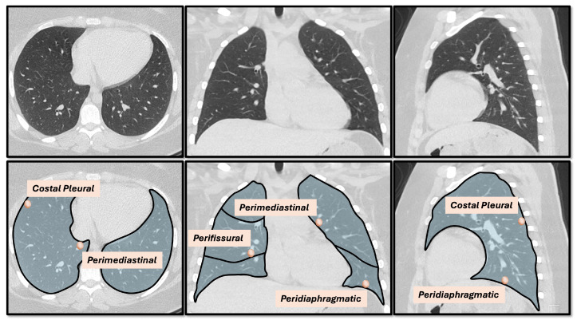
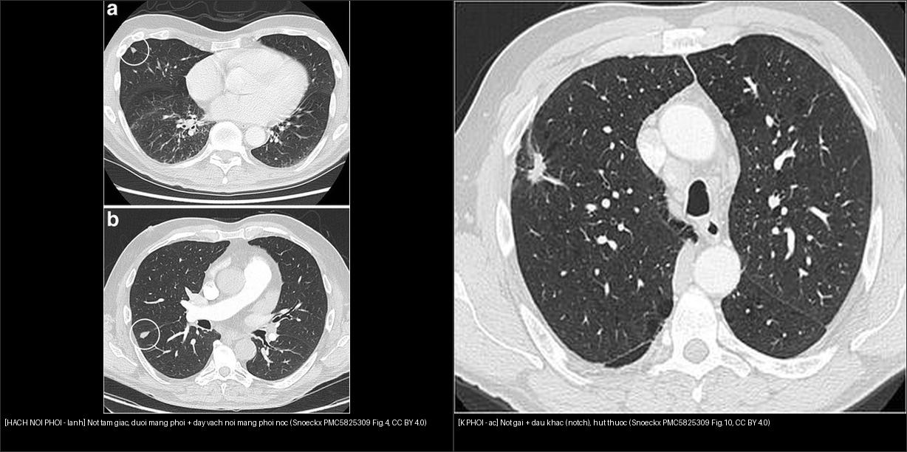
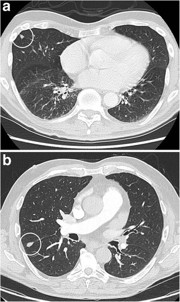
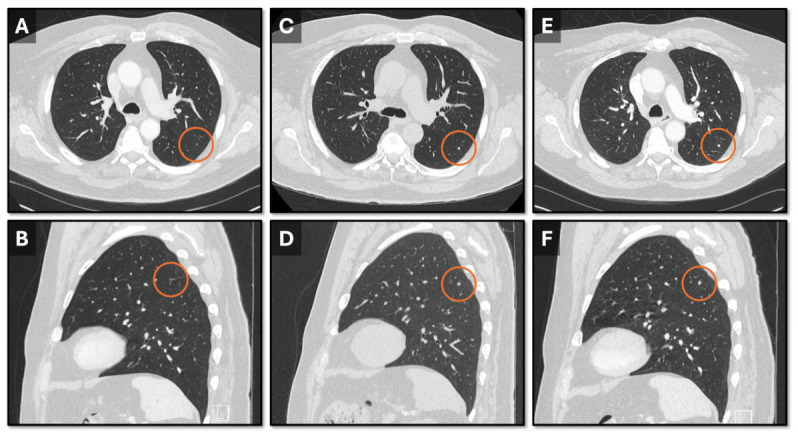

# 013 — Hạch nội phổi (trạm 11–14) & phân biệt hạch–nốt nhỏ / Intrapulmonary lymph nodes (stations 11–14) & the perifissural nodule

**Tags:** `pattern:hach` `pattern:not` `vung:phoi` `vung:ron-phoi` `score:IASLC` `score:Lung-RADS` `protocol:CT-nguc-lat-mong` `incidentaloma:not-canh-ranh`
**Mức chắc chắn (certainty):** tổng hợp y văn (literature synthesis) — nhóm tự biên từ y văn mở (ca nguyên văn Marchiori *J Bras Pneumol* 2025 CC BY + chùm ca Snoeckx *Insights Imaging* 2018 CC BY + Pappas *Diagnostics* 2026 CC BY).

## 1. Tổng quan — hạch nội phổi là gì + TẠI SAO nó "trông lành"

- **Hạch nội phổi (intrapulmonary lymph node — IPLN)**, còn gọi **nốt cạnh rãnh (perifissural nodule — PFN)**: hạch lympho nằm **trong nhu mô phổi** khác với hạch quanh phế quản (peribronchial) ở chỗ chia đôi phế quản trước nhánh thứ tư. Hạch nội phổi gặp ở **dưới màng phổi, ưu thế thùy dưới (72% ở thùy dưới — Mets 2018) và thường ở dưới mức carina** (Marchiori 2025; Schreuder 2020).
- **Trạm IASLC nội phổi 11–14** (theo bản đồ hạch IASLC 14 trạm, giữ nguyên ở ấn bản 8 và 9): **10** rốn phổi (hilar) → **11** liên thùy (interlobar) → **12** thùy (lobar) → **13** phân thùy (segmental) → **14** dưới phân thùy (subsegmental). **TẤT CẢ trạm 10–14 đều là N1** (di căn hạch phổi/rốn cùng bên) — N1 vẫn **mổ được** trong khi N2/N3 thì không (bài 012).
- **TẠI SAO hạch nội phổi trông lành (cơ chế hình ảnh):** hạch là **mô lympho có vỏ bao** (organized lymphoid tissue, encapsulated) → mật độ mô mềm đồng nhất (~30–60 HU), **bờ rõ nét, không hoại tử, không xâm lấn**. Vị trí của hạch theo **đường mạch bạch huyết vách liên tiểu thùy** và các điểm hội tụ vách tại **rãnh/màng phổi** → hình **tam giác, oval, dẹt (lentiform), đa giác** ép theo mặt phẳng màng phổi. Ngược lại u ác **xâm lấn mô xung quanh** → bờ gai (spiculation), **dấu khấc (notch sign)**, co kéo mạch (vessel convergence), **ngắt phế quản (bronchial interruption)** do phản ứng xơ hóa mô đệm (desmoplasia).
- **Ngưỡng định lượng nằm lòng:**
  - Nốt đặc "kiểu PFN" **không phải ung thư** qua theo dõi trung vị **~4,5 năm** — 262/1278 (**21%**) nốt đặc không vôi hóa là PFN, **0 ca tiến triển thành ung thư phổi** (Mets 2018, dân số 16.850 người).
  - PFN **có thể TO LÊN** (tốc độ tăng thể tích tương đương u ác, **VDT < 400 ngày**) mà vẫn lành — do thay đổi phản ứng/viêm (Mets 2018; Han 2021).
  - **~1/3 PFN ≥ 5 mm** và **~1/4 PFN ≥ 80 mm³** → kích thước một mình không loại được hạch nội phổi, và cũng không chốt ác.
- **TẠI SAO phải nhận ra:** đọc nhầm một IPLN là "nốt u" ở bệnh nhân **đã có K phổi nguyên phát** → **nâng giai đoạn sai (M1a) và loại mất khả năng mổ triệt căn** (Marchiori 2025).

*Sơ đồ gốc Thư viện CĐHA, CC0 — trạm 10–14 đều là N1; chú ý hạch 11 liên thùy.*

*Ô A: CT ngực cửa sổ phổi — nốt nhỏ hình **tam giác** ở vùng sau phổi trái, sát rãnh chéo (mũi tên). Ô B: phóng đại thấy rõ **hình tam giác** (mũi tên) và **dây vách mảnh nối vào rãnh chéo** (đầu mũi tên). Bệnh nhân 64 tuổi đang theo dõi ung thư biểu mô đại tràng, chụp CT tầm soát di căn. Nguồn: Marchiori E et al., *J Bras Pneumol* 2025, PMC12602066 Fig. 1, CC BY 4.0.*

## 2. Mẫu hình + gamut theo vị trí (nốt/nốt cạnh màng phổi)

- **Phân loại nốt cạnh màng phổi (juxtapleural nodule) theo vị trí giải phẫu** (Pappas 2026, thuật ngữ tham chiếu Lung-RADS v2022): **(1) cạnh rãnh (perifissural)** — hay nhất là IPLN; **(2) cạnh màng phổi sườn (costal pleural)**; **(3) cạnh trung thất (perimediastinal)**; **(4) cạnh cơ hoành (peridiaphragmatic)**. Định vị đúng khoang giúp gọi tên và lấy mẫu.
- **Gamut theo vị trí:**
  - **Dính rãnh / dưới màng phổi, hình tam giác–oval, bờ rõ:** IPLN (hạch nội phổi) — lành.
  - **Cạnh màng phổi sườn, đơn độc, bờ rõ:** IPLN; nhưng cũng gặp **di căn cạnh màng phổi** (hiếm) → cảnh giác khi có tiền sử ung thư (Pappas 2026: ca RCC dính rãnh).
  - **Cạnh trung thất:** IPLN/chuỗi bạch mạch trung thất; phân biệt với **hạch trung thất (trạm 4/5/6 — bài 012)**.
  - **Cạnh cơ hoành:** IPLN; phân biệt **nốt đáy phổi / tổn thương gan–lách đè lên**.
  - **Bờ gai + khấc + ngắt phế quản:** u ác nguyên phát (Snoeckx 2018).

*Hàng trên: CT ngực (axial, coronal, sagittal) có nốt cạnh màng phổi. Hàng dưới: sơ đồ gán nhãn **costal pleural / perimediastinal / perifissural / peridiaphragmatic** (thuật ngữ theo Lung-RADS v2022). Nguồn: Pappas IC et al., *Diagnostics* 2026, PMC13257318 Fig. 2, CC BY 4.0.*

## 3. Bảng so sánh phân biệt (ma trận đối chiếu)

| Thực thể (entity) | Hình ảnh điển hình (CT lát mỏng) | Chốt vào (rule-in) | Chốt loại (rule-out) | Gợi ý xác nhận |
|---|---|---|---|---|
| **Hạch nội phổi (IPLN/PFN)** | Nốt đặc **hình tam giác/oval/lentiform**, bờ rõ, **dính rãnh/màng phổi**, ± dây vách mảnh nối màng phổi; thùy dưới & dưới carina | **Hình tam giác + dính rãnh + bờ rõ đều** | Bờ gai/khấc, ngắt phế quản, không dính rãnh → nghĩ u | Theo dõi; không cần sinh thiết nếu điển hình |
| **K phổi nguyên phát** | Nốt **bờ gai**, **khấc (notch)**, co kéo mạch, ngắt phế quản, đặc/lobulated không đều | **Bờ gai + khấc + tăng kích thước** | Tam giác đều + dính rãnh → IPLN | PET-CT, sinh thiết; xem 022 |
| **Di căn cạnh rãnh (hiếm)** | Nốt cạnh rãnh **tròn, đặc**, **TO LÊN theo thời gian**, ngữ cảnh có K ngoài phổi | **Dạng tròn + tăng kích thước + tiền sử K** | Tam giác ổn định, dây vách → IPLN | Mô bệnh; Pappas 2026 (RCC 2→6 mm) |
| **Nốt bạch mạch khác (sarcoid/lao)** | Nốt **dọc vách + dưới màng phổi + quanh rốn**, galaxy; hạch rốn 2 bên (sarcoid) | **Phân bố bạch mạch + hạch rốn** | Nốt ngẫu nhiên đều cả sát màng → kê/di căn (021) | ACE, sinh thiết hạch |
| **Mimic màng phổi (dịch khu trú/dày màng phổi)** | Hình **thấu kính/liềm dọc thành ngực**, đậm độ dịch (0–20 HU), đổi theo tư thế | **Đậm độ dịch + ôm thành ngực, đổi hình** | Đậm độ mô mềm đều, cố định → nốt thật | Siêu âm màng phổi; Pappas 2026 (dịch khu trú giả nốt) |

*Trái: hai nốt **tam giác** dưới màng phổi/dính rãnh với **dây vách mảnh nối màng phổi** = hạch nội phổi (Snoeckx Fig. 4). Phải: nốt **bờ gai + dấu khấc** thùy trên phải 15 mm, mô bệnh = **ung thư phổi tế bào nhỏ** (Snoeckx Fig. 10). Nguồn: Snoeckx A et al., *Insights Imaging* 2018, PMC5825309, CC BY 4.0. Ảnh ghép letterbox, giữ nguyên bản.*

## 4. Protocol chụp + hệ phân độ/điểm chuẩn hóa

- **CT ngực lát mỏng 1–1,5 mm** + tái tạo **MIP 5–10 mm** (dễ thấy dây vách nối màng phổi, phân bố nốt); đo **trục ngắn** nốt/hạch, ghi **trạm IASLC** nếu là hạch.
- **PET-CT:** hạch/nốt nội phổi lành thường **không bắt FDG**; nhưng **PET dương tính giả** do viêm/lao/sarcoid vẫn xảy ra → không đổi giai đoạn chỉ bằng PET (bài 012). Hạch nội phổi **bắt FDG dù < 10 mm** vẫn có thể là N1 thật.
- **EBUS/EUS:** tiếp cận **hạch rốn 10–11** (N1) và hạch trung thất 4/7 (N2).
- **Xử trí theo giai đoạn N — bản đồ IASLC ấn bản 9 (hiệu lực 2025):** N descriptor N1 **không đổi** ("di căn hạch phổi/rốn cùng bên"); N2 **chia N2a (một trạm trung thất/dưới carina) và N2b (nhiều trạm)**; N3 **không đổi**. **Bản đồ 14 trạm giữ nguyên.** Đề xuất chia N1 thành N1a/N1b **không được chấp nhận** ở ấn bản 8 và 9 → **"điểm mù" phân giai đoạn N1** trên lâm sàng (Nakajima 2026; Kifjak 2025).
- **Điểm chuẩn hóa cho nốt cạnh rãnh:** **Lung-RADS v2022** coi nốt cạnh rãnh **điển hình bờ rõ, tam giác/oval** là **lành (không cần theo dõi thường quy)**; **Fleischner 2017** áp cho nốt đặc ≥ 6 mm không điển hình (bài 020).
- **Định nghĩa typical vs atypical PFN (đang còn tranh luận — Schreuder 2020):** có **4 định nghĩa khác nhau**; điểm chung là nốt **cách rãnh chính ≤ 5 mm**; **typical PFN phải dính rãnh**, **atypical PFN không ràng buộc khoảng cách rãnh** → tỷ lệ PFN "không điển hình" bị **đánh giá thấp**.

```mermaid
flowchart TD
  A["Nốt đặc <= 30 mm trên CT ngực"] --> B{"Cạnh rãnh/màng phổi? Bờ rõ?"}
  B -->|"Không"| Z["Theo 020: Fleischner 2017 / Lung-RADS v2022 theo kích thước"]
  B -->|"Có"| C{"Tam giác/oval/lentiform + dính rãnh + dây vách"}
  C -->|"Điển hình &#40;typical PFN&#41;"| D["Lành - Lung-RADS 1-2; KHÔNG theo dõi thường quy"]
  C -->|"Không điển hình &#40;atypical&#41;"| E{"Theo dõi 3-6 tháng: TO LÊN + dạng tròn/đặc?"}
  E -->|"Ổn định hoặc giảm"| F["Tiếp tục coi lành - so phim"]
  E -->|"To + tròn/đặc, có tiền sử K"| G["Nghi ác - PET-CT, sinh thiết"]
  D --> H["Đừng đếm là tổn thương M1a khi bệnh nhân đã có K phổi"]
```

## 5. Biến thể bình thường và cạm bẫy

- **Biến thể bình thường:** hạch nội phổi ở **dưới màng phổi, thùy dưới, dưới carina**, nhỏ, tam giác/oval — **gặp ở ~1/5 nốt đặc không vôi hóa** (Mets 2018). **Huyết khối/búi mạch cắt ngang** có thể giả nốt → cuộn MPR/đổi cửa sổ.
- **Cạm bẫy 1 — PFN TO LÊN không có nghĩa là ác:** nốt kiểu PFN tăng thể tích (kể cả **VDT < 400 ngày**) vẫn **lành** nếu giữ hình thái tam giác/dính rãnh. Nhưng **"thấy nó to lên thì phải nhìn lại hình thái"**, không theo dõi máy móc.
- **Cạm bẫy 2 — nốt cạnh rãnh VẪN CÓ THỂ LÀ DI CĂN:** ca **ung thư biểu mô tế bào thận (RCC)** biểu hiện nốt **cạnh rãnh trái, tròn, 2 → 4 → 6 mm** trong 23 tháng, mô bệnh = di căn (Pappas 2026). Chốt: **dạng tròn + lớn dần + tiền sử K ngoài phổi** → nghi ác dù "cạnh rãnh".
- **Cạm bẫy 3 — ranh giới typical/atypical mờ:** cùng một nốt có thể được xếp typical bởi người này, atypical bởi người khác (Han 2021: đồng thuận 3 bác sĩ chỉ **22,9% typical PFN**); đừng quá tin nhãn "PFN" nếu không có dây vách dính rãnh.
- **Cạm bẫy 4 — mimic màng phổi:** **dịch màng phổi khu trú** hoặc dày màng phổi có thể trông như "nốt cạnh màng phổi" (Pappas 2026) → kiểm tra đậm độ dịch và sự đổi hình theo tư thế.
- **Cạm bẫy 5 — bỏ sót hạch 11 liên thùy / 12–14:** hạch N1 không bị đánh giá đúng sẽ làm sai bậc N → **ảnh hưởng chỉ định mổ và cắt phổi tiết kiệm** (Nakajima 2026).
- **Satisfaction of search:** nốt "đập vào mắt" (thường là nốt lớn/đặc) có thể che nốt tam giác nhỏ ở thùy dưới → đọc theo vùng, dùng MIP.

## 6. Tự lượng giá — Blind Quiz

**Ca 1 — Nam 64 tuổi đang theo dõi ung thư đại tràng, CT ngực tầm soát di căn thấy nốt nhỏ vùng sau phổi trái. Mô tả hình dạng trước khi mở đáp án.**

- Gợi ý: bệnh cảnh có tiền sử ung thư ngoài phổi → cần phân biệt di căn cạnh màng phổi với hạch nội phổi lành.
- Hỏi: nốt hình gì? Dính cấu trúc nào? Có dây gì nối tới màng phổi? Đây là tổn thương di căn (M1a) hay lành?

<b>Bấm để hiện đáp án (findings + chẩn đoán)</b>

- **Dấu hiệu:** nốt nhỏ hình **tam giác** ở vùng sau phổi trái, **sát rãnh chéo** (mũi tên); phóng đại thấy **dây vách mảnh nối vào rãnh chéo** (đầu mũi tên).
- **Chẩn đoán: hạch nội phổi (IPLN / perifissural nodule) — LÀNH.** Vì **tam giác + bờ rõ + dính rãnh + dây vách** là hình thái gần như đặc trưng; theo dõi không đổi.
- **Phản biện nguồn:** đây là ca nguyên văn có tiền sử ung thư đại tràng, nên đáp án "lành" dựa trên **hình thái điển hình**, không dựa mô bệnh — nguồn gốc cũng lưu ý không cần mổ/tầm soát thêm khi hình thái điển hình.
- **Nguồn ảnh:** Marchiori E et al., *J Bras Pneumol* 2025, PMC12602066 Fig. 1, CC BY 4.0.

**Ca 2 — Hai nốt dưới màng phổi, một nốt dính rãnh. Gọi tên phân bố và chẩn đoán.**

- Hỏi: cả hai nốt có chung đặc điểm hình thái nào? Dây mảnh nối màng phổi là gì? Cần theo dõi/sinh thiết không?

<b>Bấm để hiện đáp án (findings + chẩn đoán)</b>

- **Dấu hiệu:** cả hai nốt đều **hình tam giác, bờ rõ**, nằm dưới màng phổi; một nốt có **dây vách mảnh nối vào màng phổi**.
- **Chẩn đoán: hạch nội phổi (IPLN) — hình thái "gần như đặc trưng" (virtually pathognomonic).** Theo dõi CT không đổi kích thước/hình thái → không cần mô bệnh.
- **Nguồn ảnh:** Snoeckx A et al., *Insights Imaging* 2018, PMC5825309 Fig. 4, CC BY 4.0.

**Ca 3 — Đọc nốt trên đối chiếu. Bên nào là ác? Dấu hiệu nào chốt?**

- Hỏi: khác biệt bờ và hình dạng giữa hai bên? Dấu hiệu nào quan trọng hơn kích thước?

<b>Bấm để hiện đáp án (findings + chẩn đoán)</b>

- **Trái = LÀNH:** nốt **tam giác**, bờ rõ, dính rãnh + dây vách → hạch nội phổi.
- **Phải = ÁC:** nốt **bờ gai (spiculated) + dấu khấc (notch sign)**, không dính rãnh; mô bệnh = **ung thư phổi tế bào nhỏ (SCLC)**.
- Chốt: **hình thái bờ (gai/khấc/ngắt phế quản) quan trọng hơn kích thước** — nốt nhỏ bờ gai vẫn ác, nốt lớn tam giác vẫn lành.
- **Nguồn ảnh:** Snoeckx A et al., *Insights Imaging* 2018, PMC5825309 Fig. 4 + Fig. 10, CC BY 4.0. Ảnh ghép letterbox.

**Ca 4 — Nốt cạnh rãnh ở bệnh nhân có tiền sử ung thư thận, theo dõi 23 tháng. Lành hay ác?**

- Hỏi: nốt tăng kích thước thế nào? Hình dạng gợi ý gì? Vì sao "cạnh rãnh" chưa đủ để loại ác?

<b>Bấm để hiện đáp án (findings + chẩn đoán)</b>

- **Dấu hiệu:** nốt cạnh rãnh trái **2 mm lúc đầu → 4 mm sau 17 tháng → 6 mm sau 23 tháng** (khoanh đỏ), **dạng tròn**.
- **Chẩn đoán: di căn của ung thư biểu mô tế bào thận (RCC)** đã được **mô bệnh xác nhận** — nghi ác do **tăng kích thước theo thời gian + hình dạng tròn** (khác tam giác).
- **Bài học:** *perifissural* KHÔNG đồng nghĩa *lành*; **dạng tròn + lớn dần + tiền sử K** phải sinh thiết.
- **Nguồn ảnh:** Pappas IC et al., *Diagnostics* 2026, PMC13257318 Fig. 5, CC BY 4.0.

**Ca 5 — Dùng sơ đồ: hạch ở trạm 11 và 13 cùng bên u thuộc N mấy? Xử trí?**

- Hỏi: trạm 10–14 là N gì? Khác trạm 7 thế nào? Vì sao không đánh giá hạch 12–14 lại quan trọng?

<b>Bấm để hiện đáp án</b>

- **Trạm 10–14 = N1** (di căn hạch phổi/rốn cùng bên) → **còn mổ được**.
- **Trạm 7 = N2** (trung thất) → tân bổ trợ/hóa-xạ theo trường hợp; ấn bản 9 chia N2a/N2b.
- Bỏ sót hạch 11 liên thùy/12–14 → **sai bậc N**, ảnh hưởng chỉ định mổ và mức cắt phổi tiết kiệm (Nakajima 2026: "điểm mù N1").
- Sơ đồ: tác phẩm gốc Thư viện CĐHA, CC0.

## Bài liên quan chéo
- [001 – Tổng quan hệ Ngực](../001-tong-quan-he-nguc/lesson.md)
- [012 – Hạch trung thất IASLC (trạm 1–10)](../012-hach-trung-that/lesson.md) (N2/N3, PET dương tính giả)
- [020 – Nốt phổi](../020-not-phoi/lesson.md) (Fleischner, Lung-RADS, nốt đơn)
- [021 – Đa nốt phổi](../021-da-not-phoi/lesson.md) (phân bố trung tâm tiểu thùy/bạch mạch/ngẫu nhiên)
- [022 – Khối phổi & TNM](../022-khoi-phoi-TNM/lesson.md) (giai đoạn T/N/M)
- [011 – Tiểu thùy thứ cấp](../011-tieu-thuy-phoi/lesson.md) (vách liên tiểu thùy — cơ sở "dây vách")

## Ảnh
- Tên file: `013_*`; nguồn + giấy phép từng ảnh trong `images/CREDITS.md`.
- Ảnh PMC12602066 + PMC5825309 + PMC13257318 (**CC BY 4.0**) giữ **nguyên bản**; ảnh ghép dùng letterbox (không crop/kéo giãn).
- Sơ đồ trạm 11–14: tác phẩm gốc Thư viện CĐHA, **CC0**.
- AuntMinnie: chỉ dẫn link (`sources.md`).

> Không dùng để chẩn đoán độc lập khi chưa có người hướng dẫn.
