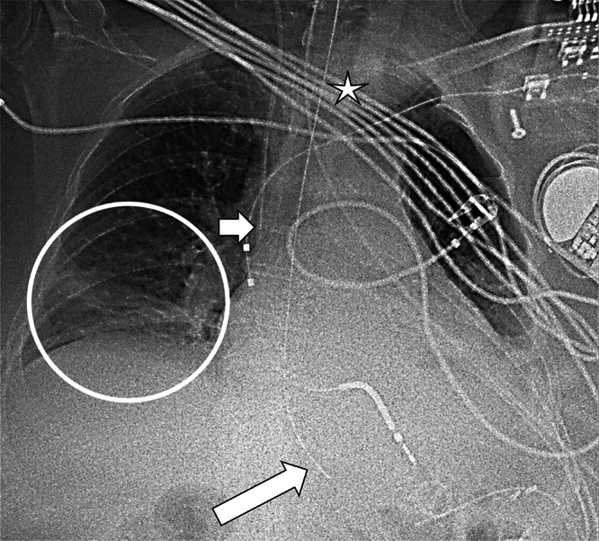
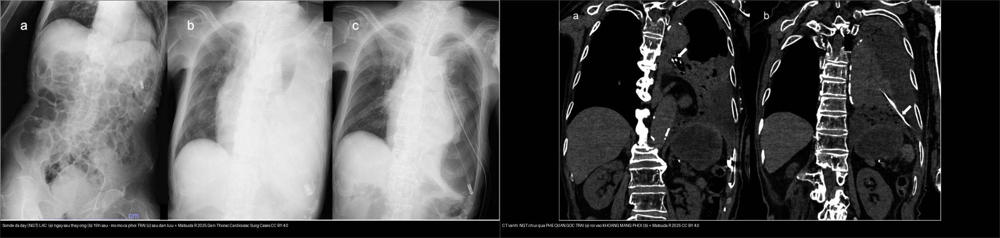
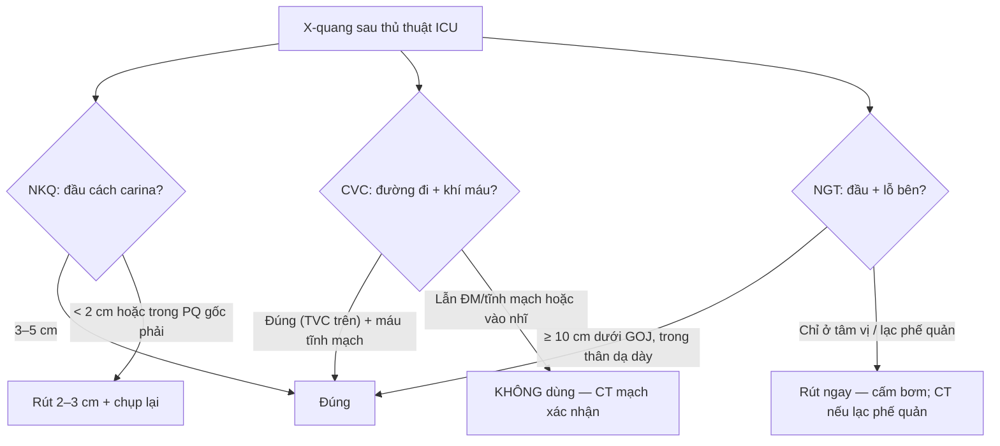
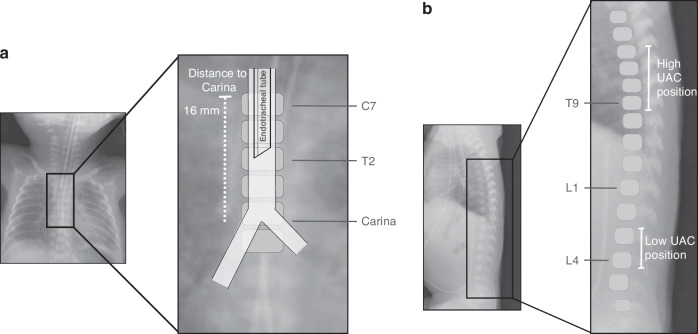
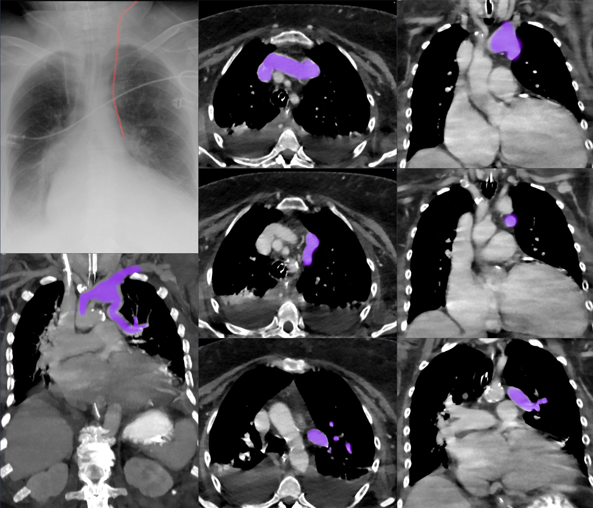

# 015 — Ống, dây ICU & giả ảnh / Thoracic lines, tubes & Artifacts

**Tags:** `pattern:ong-dây` `vung:nguc` `protocol:xq-ICU` `protocol:CT-nguc`
**Mức chắc chắn (certainty):** tổng hợp y văn (literature synthesis) — nhóm tự biên từ y văn mở CC BY; **các ca trong quiz là ca nguyên văn (verbatim case)** chép đúng tuổi – bệnh cảnh – chú thích gốc (J Belg Soc Radiol 2025, Gen Thorac Cardiovasc Surg Cases 2025, Pediatr Res 2026, Wikimedia).

## 1. Tổng quan — 3 đầu ống phải kiểm + con số

- Mọi phim ICU đọc **ống trước bệnh**: **NKQ (ETT)** — đầu cách carina **3–5 cm** (gập/ngửa cổ di chuyển ± 2 cm); **CVC** — đầu ở **tĩnh mạch chủ trên, trên nhĩ phải** (dưới xương đòn, trên carina); **sonde dạ dày (NGT)** — qua thực quản xuống **dưới cơ hoành + đầu ở dạ dày**, phải thấy rõ toàn bộ đường đi (không vào phế quản).
- TẠI SAO số quan trọng: **NKQ < 2 cm trên carina → tụt vào phế quản gốc phải** (phế quản phải dốc hơn) → xẹp phổi trái + căng phổi phải; **CVC vào nhĩ → loạn nhịp/thủng**; **NGT vào phổi → tràn khí/viêm phổi + cấm bơm ăn**.
- **Trẻ sinh cực non (22–23 tuần):** khí quản chỉ dài **20–22 mm (cricoid → carina)** → khoảng "an toàn" ở giữa khí quản (ngang T1) chỉ ~**10 mm**; độ sâu đặt trung vị tối ưu: **ETT 5,5 cm · UAC thấp 6,0 cm · UAC cao 9,6 cm · UVC 5,5 cm**; **ETT đặt đúng chỉ ~75%**, **cân nặng càng thấp càng dễ đặt QUÁ SÂU** (p = 0,018) (Naseh N et al. — Pediatr Res 2026, PMC13221281). → Luôn chụp X-quang kiểm tra sau đặt, ở trẻ nhỏ đặc biệt.
- **NGT "trong dạ dày" chưa đủ:** đầu sonde đặt ở **tâm vị, chỉ vừa qua cơ thắt thực quản dưới (LES)** là **chưa an toàn** — các **lỗ bên (side holes) nằm cách đầu vài cm về phía trên**, nên nếu lỗ bên còn **trên tâm vị**, dịch dạ dày có thể **trào ngược vào sonde rồi ra lại thực quản → hít sặc**. Khuyến cáo hiện hành: **đầu sonde ≥ 10 cm dưới khớp dạ dày–thực quản**; phương pháp NEX (mũi–tai–mỏm ức) **có thể đặt thiếu độ dài → cần dư thêm ~10 cm**, và **xác nhận bằng X-quang đặc biệt ở người nguy cơ cao** (Schueremans T, Hustings N — J Belg Soc Radiol 2025, PMC12594086).
- Khí máu **trộn động–tĩnh mạch** ở CVC mới đặt = chuông báo lạc chỗ vào mạch bất thường (ca PAPVR dưới).

*X-quang ngực nhiều thiết bị: **ngôi sao = NKQ**, **mũi tên ngắn = CVC cảnh trong**, **mũi tên dài = sonde dạ dày (NGT) — đầu chiếu DƯỚI cơ hoành**, vòng tròn = đông đặc thùy dưới phải kèm tràn dịch màng phổi nhỏ. Lưu ý: đầu NGT dưới cơ hoành **chưa đủ** để kết luận an toàn (xem cảnh báo mục 5). Nguồn: Schueremans T, Hustings N, J Belg Soc Radiol 2025 (PMC12594086), CC BY 4.0. Giữ nguyên bản.*

## 2. Gamut lạc chỗ

- **CVC cảnh trong trái:** dễ vào **tĩnh mạch vô danh đối diện/tĩnh mạch azygos**, hoặc mạch bất thường (**PAPVR — tĩnh mạch phổi đổ lạc một phần** vào vô danh trái — ca dưới): khí máu **lẫn động–tĩnh mạch**.
- **NKQ sâu:** vào **phế quản gốc phải → xẹp trái + căng phổi phải**; **nông quá → tuột ra khi ngửa cổ**; trẻ 22–23 tuần cực dễ sâu do khí quản ngắn.
- **NGT lạc:** vào **phế quản gốc trái → khoang màng phổi** (thủng màng phổi, mủ màng phổi rò) hoặc cuộn trong thực quản (không qua tâm vị). Cấm bơm mọi thứ qua sonde chưa xác nhận.
- **Dẫn lưu màng phổi:** đầu trong nhu mô (không vào khoang), kẹp/tắc, đặt dưới cơ hoành.

## 3. Bảng so sánh phân biệt (ma trận đối chiếu)

| Thực thể (entity) | Hình ảnh điển hình | Chốt vào (rule-in) | Chốt loại (rule-out) | Gợi ý xác nhận |
|---|---|---|---|---|
| **NKQ đúng vị trí** | Đầu ống **3–5 cm trên carina**, carina thấy rõ, hai phổi nở đều | **Đầu trên carina 3–5 cm + carina rõ + phổi nở đều** | Đầu < 2 cm hoặc trong phế quản gốc phải → SAI | X-quang tại giường sau đặt; ghi tư thế (ít gập cổ) |
| **NKQ quá sâu (1 bên)** | Đầu lệch **phế quản gốc phải** → **xẹp trái + căng giãn phải**, trung thất lệch | **Đầu lệch sang phải + xẹp phổi TRÁI mới** | Hai phổi nở đều → không sâu | Rút 2–3 cm, nghe lại, chụp kiểm tra |
| **CVC đúng** | Đầu ở **TVC trên/nhĩ phải**, **đường đi liền mạch**, khí máu tĩnh mạch | **Đường đi đúng + khí máu tĩnh mạch** | Khí máu lẫn ĐM/tĩnh mạch hoặc đường đi tận cùng nhĩ → SAI | X-quang ± CT; siêu âm tại giường |
| **CVC lạc (PAPVR)** | CVC cảnh trong trái "trông đúng" nhưng đầu vào **vô danh trái**; khí máu **lẫn** | **CVC trái + khí máu lẫn (như máu pha) + đường đi bất thường** | Loại trừ bằng CT mạch máu (PAPVR) | **CT mạch xác nhận trước khi dùng** — không dùng đường này |
| **NGT đúng (an toàn)** | Đường đi **qua thực quản → dưới cơ hoành**, **đầu ≥ 10 cm dưới khớp dạ dày–thực quản** trong **thân dạ dày** | **Đường đi rõ + đầu sâu trong dạ dày (≥ 10 cm dưới GOJ)** | Đầu chỉ ở tâm vị/cạnh LES → lỗ bên còn trên GOJ → nguy cơ hít sặc | X-quang; CT khi cần; đánh giá toàn bộ lỗ bên |
| **NGT lạc vào phế quản** | Sonde đi **phế quản gốc trái → khoang màng phổi**; **mờ cả phổi trái** sau thay sonde; mủ/rò màng phổi | **Đường đi sonde nằm trong phế quản/màng phổi + mờ phổi mới** | Đường đi đúng xuống dạ dày → không lạc | **CT (vành)** xác nhận; rút ngay + xử trí màng phổi |
| **Dẫn lưu màng phổi đúng** | Ống trong **khoang màng phổi**, lỗ bên trong, phổi giãn ra + hết dịch/khí | **Ống trong khoang + phổi giãn** | Ống trong nhu mô/dưới cơ hoành → SAI | X-quang/CT; kiểm tra kẹp-tắc |

*Trái: X-quang — (a) ngay sau thay sonde; (b) **19 giờ sau: mờ mờ cả phổi TRÁI**; (c) sau dẫn lưu màng phổi. Phải: **CT vành — sonde chui qua PHẾ QUẢN GỐC TRÁI (a) rồi vào KHOANG MÀNG PHỔI (b)**. Nguồn: Matsuda R et al., Gen Thorac Cardiovasc Surg Cases 2025 (PMC11912723), CC BY 4.0. Ảnh ghép letterbox, giữ tỉ lệ.*

## 4. Protocol phim ICU

- **X-quang ngực tại giường là bắt buộc sau MỌI thủ thuật** (đặt/rút/đổi ống) và **ghi rõ tư thế** (AP nằm làm tim bè, mạch dồn về đáy giả bệnh).
- **Đọc theo thứ tự ống → dây → da → bệnh:** 3 đầu ống (NKQ/CVC/NGT) → dẫn lưu → dây monitor (giả nốt/đường) → nếp da/tóc (giả tràn khí) → **cuối cùng mới đọc bệnh lý nhu mô**.
- **Trẻ cực non (≤ 23 tuần):** dùng **độ sâu đặt chuẩn hóa** (ETT 5,5 cm; UAC thấp 6,0/cao 9,6; UVC 5,5 cm), **luôn chụp X-quang xác nhận**; nhớ **cân nặng thấp → dễ đặt quá sâu**.
- **Nghi lạc chỗ đặc biệt (CVC khí máu lẫn, NGT lạc phế quản):** chuyển **CT ngực** (mạch máu với CVC; vành với NGT) để xác nhận trước khi dùng đường truyền/cho ăn.

## 5. Cạm bẫy

- **"Đầu NGT dưới cơ hoành = an toàn" là SAI:** đầu ở tâm vị (chỉ vừa qua LES) vẫn làm **lỗ bên nằm trên khớp dạ dày–thực quản → trào ngược → hít sặc** (Schueremans T, Hustings N 2025). Phải đánh giá **cả vị trí lỗ bên + toàn bộ đường đi**, mục tiêu **đầu ≥ 10 cm dưới GOJ**.
- **CVC "trông đúng đường" vẫn có thể lạc** (PAPVR): **khí máu lẫn động–tĩnh mạch là chuông báo** — không dùng đường truyền trước khi CT mạch xác nhận.
- **ECG leads, dây monitor** đè trường phổi giả nốt/đường — nhìn kỹ vật ngoài thân; **nếp da/tóc** giả tràn khí (bài 041).
- **Tư thế AP** giả tim to/phù phổi (bài 010/033) — luôn đọc theo tư thế.
- **Satisfaction of search:** thấy ống đúng vị trí rồi dừng — vẫn phải quét biến chứng (tràn khí màng phổi sau đặt CVC, xẹp phổi do NKQ sâu, mờ phổi sau thay NGT).

## 6. Tự lượng giá — Blind Quiz

**Ca 1 — Bệnh nhân ICU nhiều thiết bị. Nhìn X-quang, kiểm tra từng đầu ống trước khi đọc bệnh.**

- Gợi ý lâm sàng (clinical context): bệnh nhân ICU thở máy, có NKQ – CVC cảnh trong – sonde dạ dày.
- Câu hỏi: Xác định NKQ, CVC, NGT? Đầu NGT ở đâu — đã an toàn chưa? Vì sao còn phải cảnh giác?

<b>Bấm để hiện đáp án (findings + chẩn đoán)</b>

- Dấu hiệu (findings): **ngôi sao = NKQ**; **mũi tên ngắn = CVC cảnh trong**; **mũi tên dài = NGT, đầu chiếu dưới cơ hoành**; **vòng tròn = đông đặc thùy dưới phải + tràn dịch màng phổi nhỏ**.
- Chẩn đoán (diagnosis)/kết luận: các đầu ống trông đúng vị trí "kinh điển", **NHƯNG đầu NGT dưới cơ hoành chưa đủ để loại trừ nguy cơ hít sặc** — cần xác định **đầu ≥ 10 cm dưới khớp dạ dày–thực quản** và kiểm tra **lỗ bên** (ca gốc CT cho thấy đầu ở tâm vị, chỉ vừa qua LES → vẫn trào ngược).
- Nguồn ảnh: Schueremans T, Hustings N., *J Belg Soc Radiol* 2025 (PMC12594086), CC BY 4.0.

**Ca 2 — Bệnh nhân vừa thay sonde dạ dày; 19 giờ sau mờ cả phổi trái. Nhìn ảnh, chuyện gì xảy ra?**

- Câu hỏi: Đường đi sonde ở đâu? Vì sao phổi trái mờ? Xử trí?

<b>Bấm để hiện đáp án (findings + chẩn đoán)</b>

- Dấu hiệu (findings): (a) ngay sau thay sonde; (b) **19 giờ sau: mờ rõ cả phổi TRÁI**; (c) sau dẫn lưu màng phổi. **CT vành: sonde chui qua PHẾ QUẢN GỐC TRÁI (a) rồi vào KHOANG MÀNG PHỔI (b)**.
- Chẩn đoán (diagnosis): **sonde dạ dày lạc vào phế quản gốc trái → thủng màng phổi → mủ màng phổi rò (fistulous empyema)** — vì sonde đi nhầm đường qua phế quản vào khoang màng phổi.
- Xử trí: **rút sonde ngay, dẫn lưu màng phổi + kháng sinh, sửa chữa rò** (ca gốc phải mổ). Cấm bơm khi chưa xác nhận vị trí.
- Nguồn ảnh: Matsuda R et al., *Gen Thorac Cardiovasc Surg Cases* 2025 (PMC11912723), CC BY 4.0.

**Ca 3 — Trẻ sinh 22 tuần, đặt NKQ trong hồi sức. X-quang kiểm tra độ sâu:**

- Câu hỏi: Đầu NKQ cách carina bao nhiêu là hợp lý ở trẻ cực non? Vì sao trẻ này dễ đặt quá sâu?

<b>Bấm để hiện đáp án (findings + chẩn đoán)</b>

- Dấu hiệu (findings): khí quản trẻ 22–23 tuần chỉ dài **20–22 mm (cricoid → carina)**; minh họa cho thấy đầu NKQ **cách carina ~16 mm** đo trên phim, khoảng an toàn giữa khí quản (ngang **T1**) chỉ ~**10 mm**; kèm vị trí **UAC cao/thấp**.
- Kết luận: **cân nặng càng thấp → càng dễ đặt NKQ QUÁ SÂU**; độ sâu trung vị tối ưu **ETT 5,5 cm**, **ETT đặt đúng chỉ ~75%** → luôn chụp X-quang xác nhận, điều chỉnh ngay nếu quá sâu.
- Nguồn ảnh: Naseh N et al., *Pediatr Res* 2026 (PMC13221281), CC BY 4.0.

**Ca 4 — CVC cảnh trong trái mới đặt, khí máu lẫn động–tĩnh mạch. Kết luận?**

- Câu hỏi: đầu catheter ở đâu? Vì sao khí máu lẫn? Có dùng được đường này không?

<b>Bấm để hiện đáp án (findings + chẩn đoán)</b>

- Dấu hiệu (findings): đầu CVC vào **tĩnh mạch vô danh trái** do **tĩnh mạch phổi đổ lạc một phần (PAPVR)** — X-quang + CT annotated.
- Chẩn đoán/kết luận: máu lẫn nên **KHÔNG dùng** đường này; **đặt lại vị trí khác + CT mạch xác nhận**.
- Nguồn ảnh: Hellerhoff, Wikimedia Commons, CC BY-SA 4.0.

## Bài liên quan chéo
- [001 – Tổng quan hệ Ngực](../001-tong-quan-he-nguc/lesson.md)
- [010 – Giải phẫu ngực cắt lớp](../010-giai-phau-nguc-cat-lop/lesson.md) (carina, rốn phổi)
- [041 – Tràn khí màng phổi](../041-tran-khi-mang-phoi/lesson.md) (biến chứng thủ thuật)
- [613 – Viêm tiểu phế quản ở nhũ nhi](../613-viem-tieu-phe-quan-nhi/lesson.md) (nếp da/dây giả tổn thương ở trẻ)

## Ảnh
- Ảnh **CC BY 4.0** (Europe PMC) và **CC BY-SA 4.0** (Wikimedia) — attribution từng ảnh trong `images/CREDITS.md`.
- Ảnh ghép giữ nguyên tỉ lệ (letterbox), không crop/kéo giãn.

> Không dùng để chẩn đoán độc lập khi chưa có người hướng dẫn.
