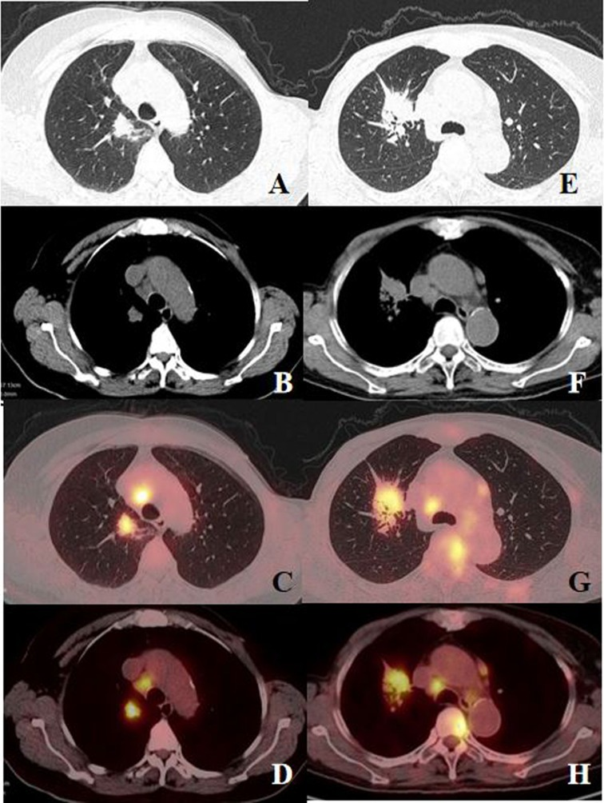
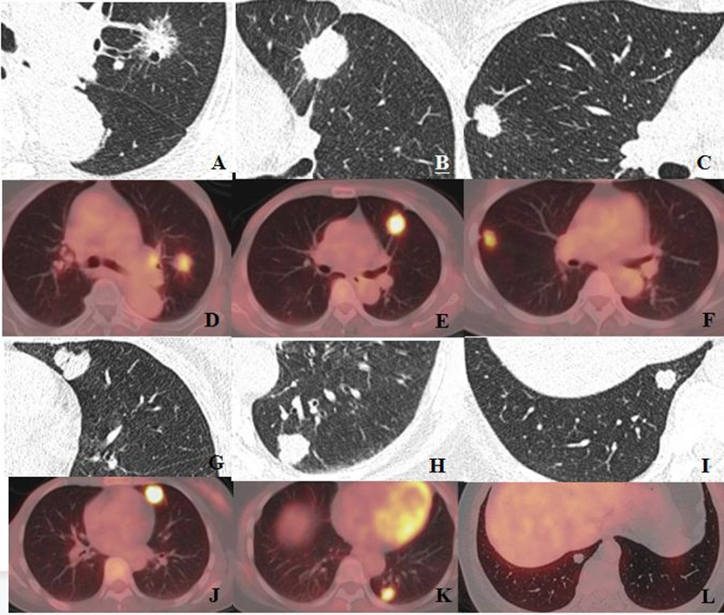
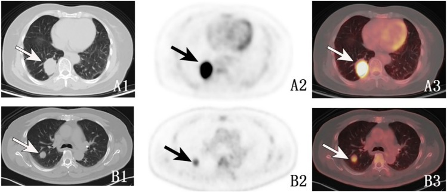
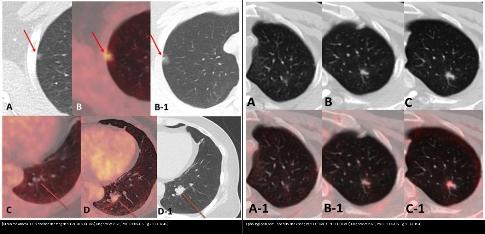
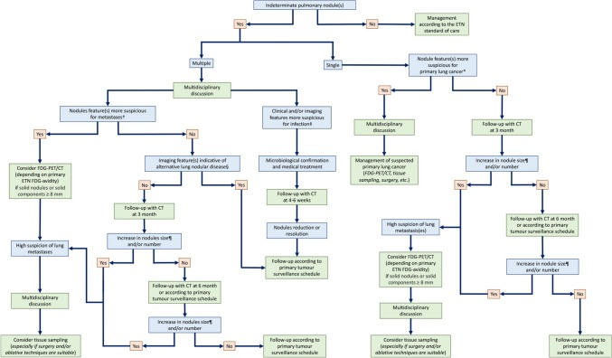
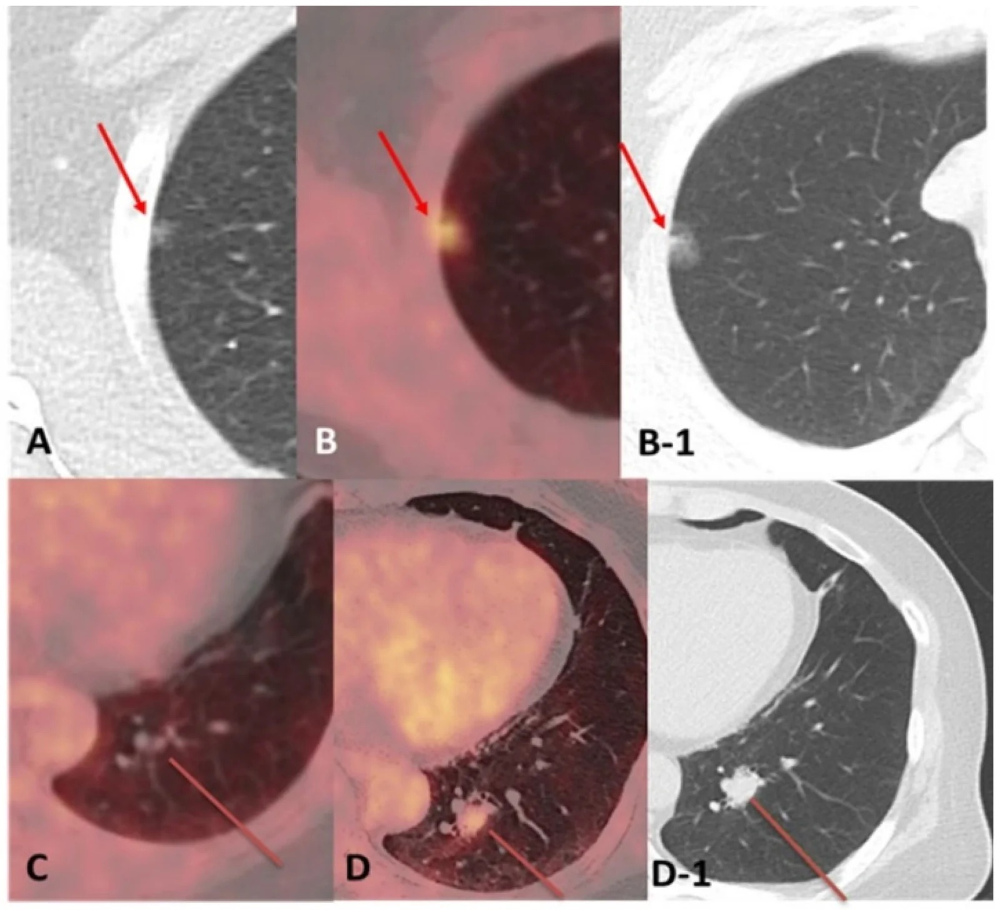
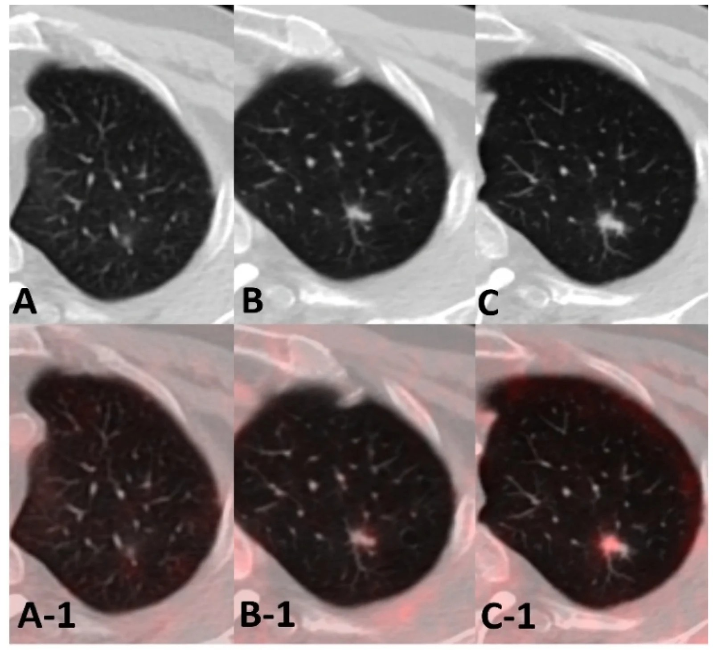
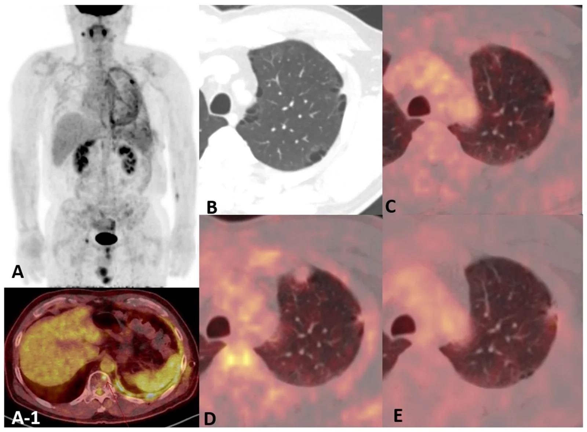

# 016 — Nốt phổi đơn độc ở bệnh nhân CÓ tiền sử ung thư ngoài phổi: di căn đơn độc vs K phổi nguyên phát thứ hai / Solitary pulmonary nodule in patients with extrapulmonary malignancy

**Tags:** `pattern:not` `pattern:not-co-tien-su-ung-thu` `vung:phoi` `score:Lung-RADS` `protocol:PET-CT-nguc` `incidentaloma:not-tien-su-ung-thu`
**Mức chắc chắn (certainty):** tổng hợp y văn (literature synthesis) — nhóm tự biên từ y văn mở (ca nguyên văn Lee *Diagnostics* 2026 CC BY; Xue *BMC Pulm Med* 2024 CC BY-NC-ND; Liu *Ann Nucl Med* 2025 CC BY; Cicchetti *Radiol Med* 2025 CC BY).

## 1. Tổng quan bệnh học – cơ chế hình ảnh (TẠI SAO bối cảnh thay đổi mọi thứ)

- **Vấn đề lâm sàng:** một nốt phổi đơn độc (solitary pulmonary nodule — SPN) mới xuất hiện ở người **đã có ung thư ngoài phổi (extra-thoracic neoplasm — ETN)** là bối cảnh **khác hẳn** nốt tình cờ ở người khỏe: **xác suất ác trước chụp (pre-test probability) đã cao sẵn**, nên CT hình thái và FDG đều **không thể một mình chốt lành/ác** (Lee 2026).
- **Hai đáp án cạnh tranh quyết định điều trị hoàn toàn ngược nhau:**
  - **Di căn đơn độc (solitary pulmonary metastasis — PM):** phẫu thuật ít vai trò, điều trị **toàn thân** (bậc M1 = giai đoạn IV nếu là cùng nguồn).
  - **Ung thư phổi nguyên phát thứ hai / đồng thì (second primary lung cancer — SPLC, metachronous/synchronous):** **điều trị triệt căn — mổ** (nếu còn mổ được), điều trị như NSCLC giai đoạn theo TNM.
  - → Chốt sai hướng = **bỏ mất cơ hội mổ** (coi SPLC là di căn) hoặc **mổ oan** (coi di căn là nguyên phát).
- **TẠI SAO PET/CT có thể "dương tính giả" và "âm tính giả" cùng lúc** (cơ chế vật lý + sinh học):
  - FDG phản ánh **chuyển hóa glucose** (GLUT1 + hexokinase), không phản ánh "ác/lành" trực tiếp → **ổ viêm/nhiễm trùng** (đại thực bào, bạch cầu) bắt FDG rất mạnh → **dương tính giả** (Lee 2026: nốt giả viêm được theo dõi rồi xác nhận ác; di căn cholangiocarcinoma **đồng tồn tại với nhiễm mycobacteria không lao NTM**).
  - Ngược lại, tổn thương **nhỏ**, **hiệu ứng thể tích một phần (partial-volume)**, **di động hô hấp**, **mật độ tế bào thấp** → **di căn "ẩn" trên PET** (metabolically occult) dù thấy rõ trên CT (Lee 2026). Di căn **tuyến giáp biệt hóa** còn có thể **bắt iod mà KHÔNG bắt FDG** (Lee 2026, dấu thyroglobulin tăng).
- **Số liệu định lượng nằm lòng:**
  - **Mô hình FDG PET/CT + đặc điểm lâm sàng (120 BN ung thư vú có SPN mới, Xue 2024):** **CEA** (p = 0,005) và **CA15-3** (p = 0,001) khác biệt giữa K phổi nguyên phát (PLC) và di căn ung thư vú (BCM); các yếu tố dự báo hình ảnh gồm **SUVmax của SPN, dấu múi (lobulation), dấu co kéo màng phổi (pleural indentation)**.
  - **Phản trực giác:** BCM có thể **SUVmax CAO hơn** PLC (ví dụ trong bài: BCM SUVmax **6,47** — TLG 6,48, MTV 3,33; hạch rốn SUVmax **7,72**, so với PLC SUVmax **2,98** — TLG **34,3**, MTV 4,65) → **SUVmax một mình không phân biệt được**.
  - **Mô hình gộp đa thông số (84 BN, nốt đơn độc + ETN, Liu 2025):** kết hợp **SUVpeak + TLG + energy + múi + gai** cho **Se 76,2% – Sp 83,8% – AUC 0,826** (IDI 0,176); thông số **energy** đơn độc mạnh nhất (**1.039.358,1 vs 92.011,0**, p = 0,001).
  - **Thời gian nhân đôi thể tích (VDT)** của u ác điển hình **20–400 ngày** — vẫn là công cụ theo dõi kinh điển khi PET mơ hồ.
- **Hình thái trên CT lát mỏng (Xue 2024, Fig. 4):** **kính mờ hỗn hợp (mixed GGN — mGGN)**, **gai (spiculation)**, **co kéo màng phổi (pleural indentation)**, **múi (lobulation)** → gặp nhiều ở **PLC**; **di căn ung thư vú (BCM)** thường **tròn và đặc, ít dấu hình thái**.

*(A–D) Bệnh nhân 63 tuổi **di căn ung thư vú**: nốt phổi đơn độc SUVmax **6,47** (TLG 6,48; MTV 3,33), hạch rốn SUVmax 7,72. (E–H) Bệnh nhân 67 tuổi **K phổi nguyên phát**: nốt SUVmax **2,98** nhưng TLG **34,3** (khối tích lớn). Nguồn: Xue Y et al., *BMC Pulm Med* 2024, PMC11607836 Fig. 2, CC BY-NC-ND 4.0 (giữ nguyên bản).*

*(A–F) **PLC**: mGGN (A), dấu gai (B, C), co kéo màng phổi (B, C), múi (C). (G–L) **BCM**: nốt **tròn, đặc**, ít dấu hình thái. Nguồn: Xue Y et al., *BMC Pulm Med* 2024, PMC11607836 Fig. 4, CC BY-NC-ND 4.0 (giữ nguyên bản).*

## 2. Mẫu hình + chẩn đoán phân biệt theo cơ chế lan (Gamut)

- **Con đường lan của ung thư ngoài phổi tới phổi (Cicchetti 2025):**
  - **Di căn đường máu (hematogenous)** — hay gặp nhất: nhiều nốt tròn, phân bố **ngẫu nhiên** (random), ưu thế đáy; **có thể đơn độc** (một nốt) → đây chính là bài toán 016.
  - **Lan bạch mạch (lymphangitic carcinomatosis)** — *xem [017](../017-bach-mach-lan-phoi/lesson.md)*.
  - **Di căn nội phế quản (endobronchial)** — hiếm, gây xẹp phổi.
  - **Di căn qua màng phổi/đường thở** — gieo màng phổi, di căn trong lòng phế nang.
- **Gamut theo bối cảnh "nốt mới ở người đã có K ngoài phổi"** — gợi nhớ **MISS**:
  - **M** — **Metastasis** (di căn đơn độc; phân bố ngẫu nhiên, tròn, ± mGGN/bán đặc/hang "giả nhiễm trùng").
  - **I** — **Infection** (lao, NTM, nấm — **bắt FDG mạnh**, có thể **đồng tồn tại với di căn thật**).
  - **S** — **Second primary lung cancer** (SPLC/đồng thì/dị thì; **dấu gai + co kéo + mGGN**).
  - **S** — **Sarcoid-like reaction / thuốc** (viêm phổi tổ chức do thuốc — organizing pneumonia, phản ứng giống sarcoid khi dùng immunotherapy — **tự thoái triển** khi ngừng thuốc).
- **Gamut theo hình thái nốt bất thường:** nốt **hang/bán đặc** ở người ung thư **không mặc định là nhiễm trùng** — **di căn cũng có thể** dạng hang/bán đặc (Lee 2026); **nốt "giả viêm" có thể là ác**; **nốt kính mờ (GGN)** có thể là **di căn không điển hình** (melanoma) hoặc **adenocarcinoma nguyên phát**.

*Bệnh nhân nữ 71 tuổi, 96 tháng sau cắt ung thư cổ tử cung: khối đơn độc thùy dưới phổi phải **30 × 39 mm** (A1) với **tăng chuyển hóa glucose** rõ (A2, A3). Ở nốt đơn độc có ung thư ngoài phổi, bài toán luôn là **SPLC (mổ) vs PM (toàn thân)**. Nguồn: Liu H et al., *Ann Nucl Med* 2025, PMC12095392 Fig. 1, CC BY 4.0.*

## 3. Bảng so sánh phân biệt (ma trận đối chiếu)

| Thực thể (entity) | Hình ảnh điển hình (PET/CT + CT lát mỏng) | Chốt vào (rule-in) | Chốt loại (rule-out) | Gợi ý xác nhận |
|---|---|---|---|---|
| **Di căn đơn độc (SM)** | Nốt **tròn, đặc**, bờ tương đối đều, phân bố **ngẫu nhiên**; có thể bán đặc/hang; FDG ± (có thể **ẩn** nếu nhỏ) | **Hình thái "hiền" + ổn định trên phim cũ + bối cảnh K lan rộng** | **Gai + co kéo màng phổi + mGGN tăng dần** → nghi nguyên phát | So phim cũ (interval evolution); sinh thiết nếu đổi xử trí; VDT |
| **K phổi nguyên phát thứ hai (SPLC)** | Nốt **bờ gai, dấu múi, co kéo màng phổi, mGGN**; ưu thế thùy trên | **Gai + múi + co kéo + phân thùy mới, không khớp di căn cũ** | Tròn đều + bối cảnh di căn lan tỏa → nghĩ di căn | Mô bệnh (mô học khác nguồn/khác dòng tế bào); PET/CT giai đoạn |
| **Di căn GGN/bán đặc không điển hình** | **GGN mới, to lên chậm**; FDG thường **ÂM** (bẫy âm tính giả) | **Tiền sử K (melanoma...) + GGN mới to lên** | "GGN = lành" là **sai**; không được tự động gọi lành | Mô bệnh (di căn melanoma/adeno); theo dõi 1 năm |
| **Nhiễm trùng giả u (lao/NTM/nấm)** | Nốt/đám **bắt FDG mạnh**, ± hang, ± tree-in-bud; **có thể đồng tồn tại với di căn** | **FDG dương mạnh + hình thái viêm + bối cảnh miễn dịch** | Không loại được ác chỉ vì "bắt FDG mạnh" | AFB/PCR, cấy nấm; **sinh thiết cả ổ vẫn cần khi đổi xử trí** |
| **Viêm phổi tổ chức do thuốc / giống sarcoid** | **Đám mờ đa ổ ngoại vi (OP)**, hạch trung thất, nốt dưới màng phổi; **tự tan khi ngừng thuốc** | **Bối cảnh vừa bắt đầu immunotherapy/liệu pháp; thoái triển theo thời gian** | Tồn tại/to lên dù ngừng thuốc → nghi ác | Theo dõi chuỗi; HRCT; sinh thiết khi nghi ngờ |

*Trái: **di căn melanoma** — nốt **kính mờ đặc/bán đặc** thùy trên (CT + PET/CT), to lên rồi được mổ, mô bệnh = di căn. Phải: **K phổi nguyên phát** — nốt **dưới đặc, KHÔNG bắt FDG**, sau 2 năm xuất hiện nhân đặc + bờ gai → adenocarcinoma nguyên phát. Cùng tiền sử K ngoài phổi, cùng "nốt mờ", hai kết cục ngược nhau. Nguồn: Lee N et al., *Diagnostics* 2026, PMC13605315 Fig. 7 + Fig. 8, CC BY 4.0. Ảnh ghép letterbox, giữ nguyên bản.*

## 4. Protocol chụp + hệ phân độ/điểm chuẩn hóa

- **PET/CT toàn thân (FDG) là xét nghiệm trung tâm** — vừa định vị nốt, vừa **phát hiện di căn nơi khác** (đổi giai đoạn M), vừa gợi ý nguồn.
- **CT ngực lát mỏng 1–1,5 mm** (cửa sổ phổi + trung thất) để mô tả hình thái: gai, múi, co kéo, mGGN, thành hang.
- **Luôn so phim cũ (prior imaging)** — "diễn tiến theo khoảng (interval evolution)" là dữ kiện mạnh nhất; hệ số mọc/VDT: ác điển hình **20–400 ngày**.
- **Đo đa thông số PET:** SUVmax, **SUVpeak**, **TLG (total lesion glycolysis)**, **MTV**, ± radiomics (energy). Mô hình gộp (Liu 2025) cho **AUC 0,826** tốt hơn từng thông số đơn.
- **Hệ phân độ:** với nốt tình cờ nói chung dùng **Lung-RADS v2022 / Fleischner 2017** ([020](../020-not-phoi/lesson.md)); **nhưng ở người đã có K ngoài phổi, ngưỡng hành động phải thấp hơn** — không thể chờ "theo dõi 12 tháng" máy móc.
- **Lấy mô:** EBUS-TBNA / EUS (hạch, tổn thương gần trung thất), sinh thiết xuyên thành ngực dưới CT (tổn thương ngoại vi), hoặc sinh thiết qua nội soi/phẫu thuật. **Cryobiopsy** đường thở hữu ích khi hình ảnh giống bệnh mô kẽ ([017](../017-bach-mach-lan-phoi/lesson.md)).

```mermaid
flowchart TD
  A["Nốt phổi mới ở BN CÓ K ngoài phổi"] --> B["CT ngực lát mỏng + PET/CT toàn thân"]
  B --> C{"So phim cũ: TO LÊN / mới xuất hiện?"}
  C -->|"Ổn định nhiều năm"| D["Theo dõi định kỳ - nguy cơ thấp hơn"]
  C -->|"Mới hoặc to lên"| E{"Hình thái: gai + múi + co kéo + mGGN?"}
  E -->|"Có &#40;nghi nguyên phát&#41;"| F["Cân nhắc SPLC - sinh thiết, TNM, khả năng MỔ"]
  E -->|"Không &#40;tròn/đặc&#41;"| G{"Bắt FDG?"}
  G -->|"Dương mạnh"| H["Di căn hoặc nhiễm trùng/viêm - lấy mô phân biệt"]
  G -->|"Âm / nhẹ"| I["Không được gọi lành - vẫn sinh thiết hoặc theo dõi sát"]
  H --> J["Kết quả mô học quyết định: toàn thân (di căn) vs triệt căn (nguyên phát)"]
  F --> J
  I --> J
```

*Lưu đồ đề xuất xử trí **nốt phổi không xác định (IPN)** ở người có ung thư ngoài lồng ngực — chỉ nên coi là hướng dẫn, cần điều chỉnh theo từng ca. Nguồn: Cicchetti G et al., *Radiol Med* 2025, PMC12185656 Fig. 11, CC BY 4.0.*

## 5. Biến thể bình thường và cạm bẫy

- **Cạm bẫy 1 — "FDG âm = lành":** sai. **Di căn ẩn chuyển hóa** (PET-occult) gặp ở nốt nhỏ, hiệu ứng thể tích một phần, di động hô hấp, mật độ tế bào thấp; **di căn tuyến giáp biệt hóa bắt iod mà không bắt FDG** (Lee 2026).
- **Cạm bẫy 2 — "bán đặc/hang = nhiễm trùng":** sai. **Di căn có thể bán đặc hoặc hang**, giống septic emboli/nấm (Lee 2026); **nốt kiểu viêm có thể là ác**; **diễn tiến lên–xuống (waxing–waning) không loại trừ ác**.
- **Cạm bẫy 3 — nhiễm trùng và di căn ĐỒNG TỒN TẠI:** một ổ có thể vừa nhiễm vừa ung thư (Lee 2026: di căn cholangiocarcinoma + NTM) → tin tưởng một kết quả cấy dương không loại trừ được ác.
- **Cạm bẫy 4 — thuốc điều trị ung thư:** **viêm phổi tổ chức do thuốc** (immunotherapy) tạo đám mờ ngoại vi rồi **tự tan khi ngừng thuốc** — dễ nhầm là tiến triển; ngược lại, **phản ứng giống sarcoid** xuất hiện khi điều trị (Cicchetti 2025).
- **Cạm bẫy 5 — mGBM/mGGN:** "GGN = lành" là quy tắc chỉ đúng ở **người không ung thư**; ở người đã có K, GGN mới **phải được coi là nghi ngờ** cho tới khi chứng minh ngược.
- **Satisfaction of search:** có sẵn một tổn thương "chắc chắn di căn" dễ che nốt nguyên phát thứ hai → **đọc lại toàn bộ phổi có hệ thống** và luôn so giai đoạn cũ.

## 6. Tự lượng giá — Blind Quiz

**Ca 1 — Nam có tiền sử melanoma ngón chân, CT phổi thấy nốt mờ thùy trên phải. Nhìn hình trước khi mở đáp án.**

- Gợi ý: bệnh nhân ung thư ngoài phổi, nốt mới **kính mờ**, không điển hình.
- Hỏi: mô tả hình thái nốt (đặc? kính mờ? bắt FDG?). 3 chẩn đoán phân biệt. Nốt có thể tự mọc lên lành không?

<b>Bấm để hiện đáp án (findings + chẩn đoán)</b>

- **Dấu hiệu:** **GGN thùy trên phải** (A, mũi tên); trên PET/CT (B) **bắt FDG nhẹ không rõ**; theo dõi 1 năm nốt **TO LÊN** (B, B-1) rồi được mổ.
- **Chẩn đoán: di căn melanoma** (mô bệnh xác nhận) — GGN là **biểu hiện di căn không điển hình**; "kính mờ nhỏ" **không** đồng nghĩa lành trong bối cảnh K.
- **Nguồn ảnh:** Lee N et al., *Diagnostics* 2026, PMC13605315 Fig. 7, CC BY 4.0.

**Ca 2 — Nam đang theo dõi lymphoma, nốt **bán đặc** thùy trên trái, PET không thấy bắt FDG. Chẩn đoán?**

- Hỏi: vì sao PET âm mà vẫn phải theo dõi? Sau 2 năm điều gì xuất hiện? Chẩn đoán cuối?

<b>Bấm để hiện đáp án (findings + chẩn đoán)</b>

- **Dấu hiệu:** nốt **bán đặc (subsolid)** thùy trên trái, **không bắt FDG rõ** (A, A-1); sau **2 năm** xuất hiện **nhân đặc + bờ gai** (B, B-1).
- **Chẩn đoán: K phổi nguyên phát — adenocarcinoma** (mô bệnh). Đây là **SPLC**, không phải di căn lymphoma → **điều trị triệt căn**, không phải toàn thân.
- **Bài học:** **PET âm không loại trừ ác**; **nhân đặc mới trong GGN cũ** là dấu hiệu chuyển dạng cần mổ/chẩn đoán.
- **Nguồn ảnh:** Lee N et al., *Diagnostics* 2026, PMC13605315 Fig. 8, CC BY 4.0.

**Ca 3 — Đọc đối chiếu: bên nào là di căn, bên nào là nguyên phát? Dấu hiệu nào chốt (không chỉ dựa vào FDG)?**

- Hỏi: hai bên khác nhau ở mức FDG và hình thái thế nào? Vì sao **SUVmax** không phân biệt được?

<b>Bấm để hiện đáp án (findings + chẩn đoán)</b>

- **Trái = DI CĂN melanoma:** GGN bán đặc có **thành phần bắt FDG** (B), to lên theo thời gian → mổ ra là **di căn**.
- **Phải = K PHỔI NGUYÊN PHÁT:** nốt dưới đặc **không bắt FDG**, sau đó **xuất hiện nhân đặc + bờ gai** → **adenocarcinoma**.
- **Chốt:** **hình thái (gai/múi/nhân đặc) + diễn tiến theo thời gian** quan trọng hơn mức FDG; trong bối cảnh K ngoài phổi **hai thực thể đều có thể "kính mờ"**, phải sinh thiết/mổ khi đổi xử trí.
- **Nguồn ảnh:** Lee N et al., *Diagnostics* 2026, PMC13605315 Fig. 7 + Fig. 8, CC BY 4.0. Ảnh ghép letterbox.

**Ca 4 — Nam có tiền sử lymphoma và ung thư dạ dày, PET/CT thấy tổn thương màng phổi bắt FDG kèm tràn dịch, và một ổ bắt FDG cột sống T11. Bệnh chính là gì?**

- Hỏi: tổn thương màng phổi là di căn của K dạ dày/lymphoma hay một bệnh mới? Ổ T11 nói lên điều gì?

<b>Bấm để hiện đáp án (findings + chẩn đoán)</b>

- **Dấu hiệu:** PET/CT (A, A-1) tổn thương **màng phổi trái bắt FDG** + **tràn dịch màng phổi** + ổ **bắt FDG thân đốt T11** (mũi tên đỏ); so phim CT cũ phát hiện tổn thương màng phổi đã có từ trước.
- **Chẩn đoán: K phổi nguyên phát dị thì (metachronous primary lung cancer)** — **không phải** di căn đơn thuần; ổ T11 là **di căn xương** đi kèm.
- **Bài học:** sự **tồn tại ổ "không khớp"** với mô hình di căn quen thuộc + **hình thái màng phổi/u** gợi ý phải tìm một **ung thư nguyên phát mới**, đồng thời vẫn đánh giá di căn toàn thân.
- **Nguồn ảnh:** Lee N et al., *Diagnostics* 2026, PMC13605315 Fig. 6, CC BY 4.0.

## Bài liên quan chéo
- [001 – Tổng quan hệ Ngực](../001-tong-quan-he-nguc/lesson.md)
- [020 – Nốt phổi](../020-not-phoi/lesson.md) (Fleischner 2017, Lung-RADS v2022)
- [013 – Hạch nội phổi & nốt cạnh rãnh](../013-hach-noi-phoi/lesson.md) (nốt cạnh rãnh ở người có K)
- [021 – Đa nốt phổi](../021-da-not-phoi/lesson.md) (phân bố ngẫu nhiên/bạch mạch/trung tâm tiểu thùy)
- [022 – Khối phổi & TNM](../022-khoi-phoi-TNM/lesson.md) (giai đoạn T/N/M)
- [017 – Bạch mạch lan phổi](../017-bach-mach-lan-phoi/lesson.md) (lan bạch mạch, M1a)

## Ảnh
- Tên file: `016_not-phoi_*`; nguồn + giấy phép từng ảnh trong `images/CREDITS.md`.
- Ảnh **CC BY 4.0** (PMC13605315, PMC12095392, PMC12185656) và **CC BY-NC-ND 4.0** (PMC11607836) giữ **nguyên bản** (không crop/ghép); ảnh ghép dùng `tools/make_composite.py` (letterbox nền đen, giữ aspect).
- AuntMinnie: chỉ dẫn link (`sources.md`).

> Không dùng để chẩn đoán độc lập khi chưa có người hướng dẫn.
