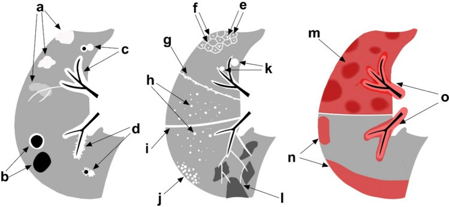
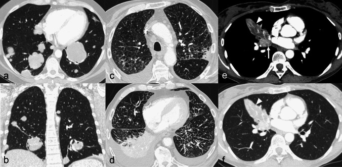
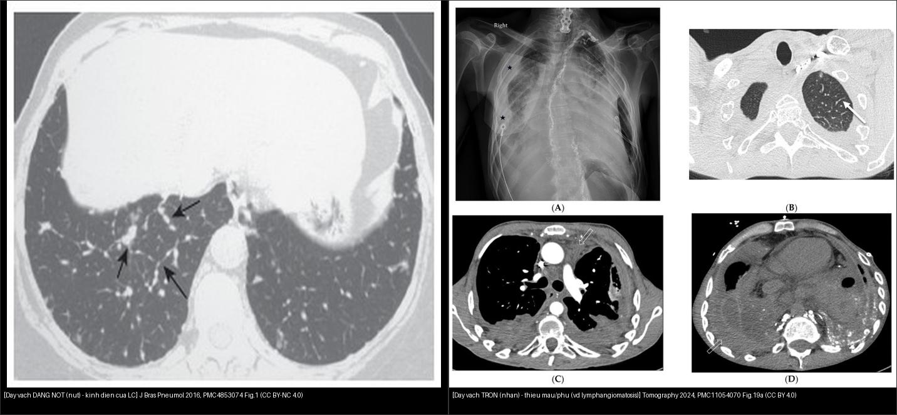
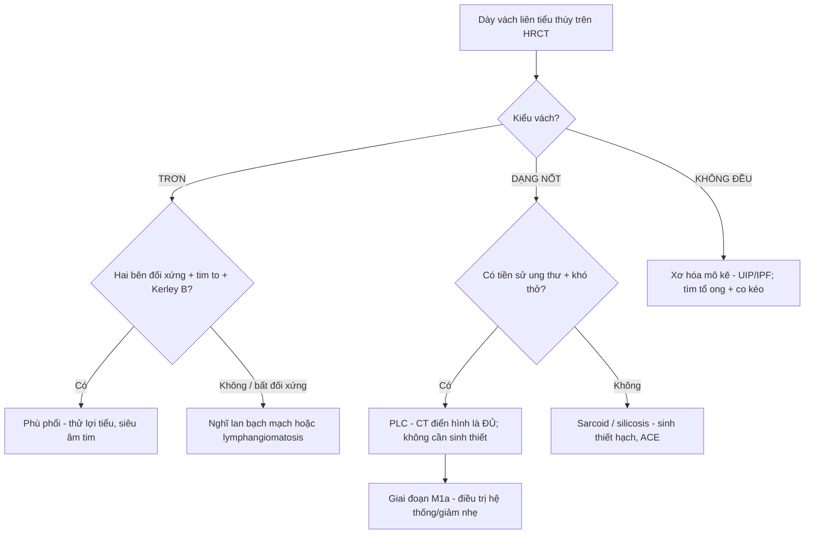
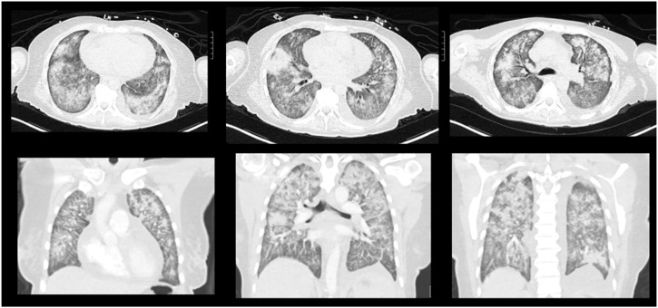
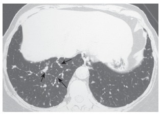
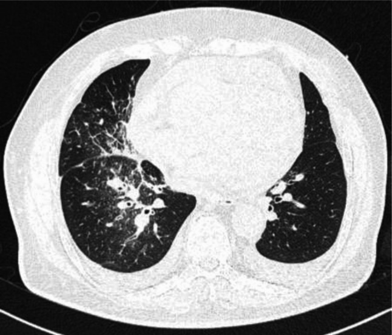
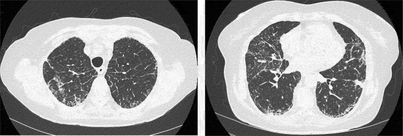
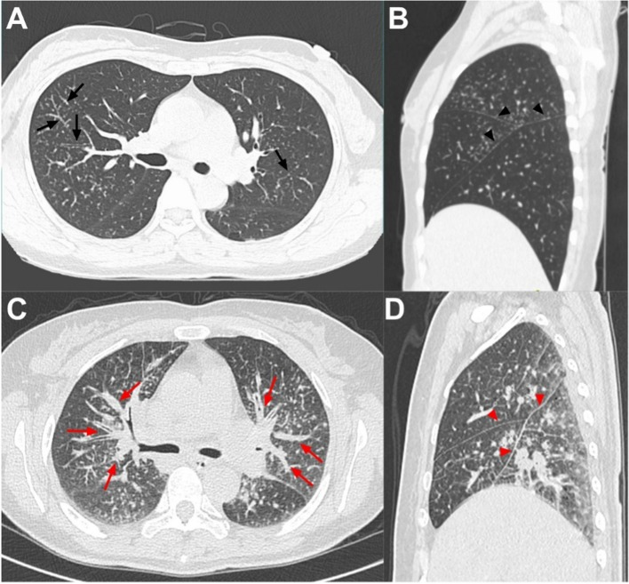

# 017 — Bạch mạch lan phổi (lymphangitic carcinomatosis) & đường mạch bạch huyết trên HRCT / Pulmonary lymphangitic carcinomatosis & the lymphatic pathways

**Tags:** `pattern:day-vach-lien-tieu-thuy` `pattern:bach-mach` `vung:phoi` `protocol:HRCT` `incidentaloma:day-vach`
**Mức chắc chắn (certainty):** tổng hợp y văn (literature synthesis) — nhóm tự biên từ y văn mở (ca nguyên văn Marchiori *J Bras Pneumol* 2016 CC BY-NC; Galbreath *Respir Med Case Rep* 2025 CC BY-NC-ND; Olesen *Eur Clin Respir J* 2024 CC BY-NC; Tang *J Cardiothorac Surg* 2026 CC BY-NC-ND; Ji *Discover Oncology* 2023 CC BY; Donuru *Tomography* 2024 CC BY).

## 1. Tổng quan bệnh học – cơ chế hình ảnh (TẠI SAO "vách dày")

- **Giải phẫu nền:** **vách liên tiểu thùy (interlobular septum)** là vỏ bao của **tiểu thùy thứ cấp (secondary pulmonary lobule)**, chứa **tĩnh mạch phổi + mạch bạch huyết**. Mạch bạch huyết phổi chạy **dọc tĩnh mạch, bao quanh phế quản–mạch máu (bronchovascular sheath), trong vách liên tiểu thùy và dưới màng phổi** (Marchiori 2016).
- **Bệnh học của bạch mạch lan phổi (pulmonary lymphangitic carcinomatosis — PLC):** tế bào ung thư tới phổi **theo đường máu**, rồi **lan ngược dòng trong mạch bạch huyết (retrograde lymphatic spread)** và **thâm nhiễm mô kẽ**; hậu quả là **giãn mạch bạch huyết + dày mô kẽ + phù** → **khó thở tiến triển** (Tang 2026).
- **TẠI SAO vách "dày":** mạch bạch huyết bị tắc/nhồi đầy tế bào u → **phù dịch + xơ hóa mô kẽ quanh vách** → vách dày. Khi tế bào u **xếp thành chuỗi trong lòng mạch bạch huyết**, vách dày **không đều, lấm tấm hạt** → **dày vách liên tiểu thùy dạng nốt (nodular ILST)** — dấu hiệu đặc trưng nhất của PLC (Marchiori 2016).
- **Ba kiểu dày vách liên tiểu thùy (ILST) trên HRCT (Donuru 2024):**
  - **Trơn (smooth) — hay gặp nhất, ít đặc hiệu nhất:** phù phổi, bệnh phổi do protein (PAP), **lan bạch mạch của u**, lymphangiomatosis.
  - **Dạng nốt (nodular):** **lan bạch mạch của u (PLC)**, sarcoidosis, bụi phổi silic (silicosis).
  - **Không đều/gai (irregular):** **xơ hóa mô kẽ** — UIP/IPF, sarcoid xơ.
- **Số liệu định lượng nằm lòng:**
  - **Trong ca khó thở + có tiền sử ung thư, CT điển hình của PLC là chẩn đoán xác định — KHÔNG cần sinh thiết phổi** (Marchiori 2016).
  - **Mô hình phân biệt PLC với sarcoid phổi ở BN ung thư (114 BN: 56 PS, 58 PLC; Ji 2023):** 5 biến (vùng hạch bị ảnh hưởng, **dày lan bao phế quản–mạch máu**, dày vách liên tiểu thùy, tràn dịch màng phổi, **tăng chuyển hóa dưới màng phổi**) cho **AUC 0,973 (KTC 95% 0,925–0,994), Se 87,50%, Sp 98,28%**, PLR 50,75, NLR 0,13. Các ung thư gây PLC hay gặp nhất: **vú và dạ dày**.
  - **Kerley B 1–2 cm** (vuông góc màng phổi, ngoại vi — tương ứng vách liên tiểu thùy dày) và **Kerley A 2–6 cm** (hướng về rốn phổi) là biểu hiện X-quang của ILST.
  - PLC là **di căn giai đoạn M1a**, tiên lượng xấu (ca Galbreath 2025: vào hospice **1 tháng** sau chẩn đoán; ca Tang 2026 sống được **41 tháng** — hiếm gặp nhờ phẫu thuật giảm nhẹ + hóa–miễn dịch).

*Sơ đồ các mẫu tổn thương phổi trên CT: đám mờ (a), kén/hang (b), dày lan bao phế quản–mạch máu (c, d), dày kẽ quanh phế quản–mạch trung tâm tiểu thùy (e), **dày vách liên tiểu thùy (f)**, dày màng phổi dạng nốt (g). Nguồn: Ji Y et al., *Discover Oncology* 2023, PMC10713927 Fig. 1, CC BY 4.0.*

## 2. Mẫu hình + chẩn đoán phân biệt theo kiểu dày vách (Gamut)

- **Hình thái vách** là trục định hướng đầu tiên, nhưng **bối cảnh + phân bố + tổn thương đi kèm** mới quyết định (Donuru 2024):
  - **Dạng nốt (nodular) + cao tuổi/có ung thư + khó thở:** nghi **PLC** hàng đầu (Marchiori 2016).
  - **Dạng trơn (smooth) hai bên đối xứng + tim to + tràn dịch:** **phù phổi** (đáp ứng nhanh với lợi tiểu).
  - **Nốt dọc bạch mạch + hạch rốn hai bên + dấu galaxy:** **sarcoidosis** (phải phân biệt với **phản ứng giống sarcoid** do điều trị ung thư).
  - **Dạng trơn + màng phổi/trung thất + dày kẽ lan tỏa ở người trẻ/trung niên:** **lymphangiomatosis / giãn mạch bạch huyết**.
  - **Không đều (irregular) + tổ ong đáy–dưới màng phổi + giãn phế quản co kéo:** **xơ hóa UIP/IPF**.
- **Phân bố gợi ý PLC:** có thể **một bên hoặc bất đối xứng**, ưu thế **đáy phổi**; kèm **dày bao phế quản–mạch máu**, **nốt dưới màng phổi**, **tràn dịch màng phổi**, hạch trung thất (Ji 2023).
- **Đường lan khác của di căn phổi (Cicchetti 2025):** di căn **đường máu (nốt tròn ngẫu nhiên)**, **lan bạch mạch (PLC)**, **nội phế quản** — phân biệt để định hướng sinh thiết và giai đoạn (**PLC = M1a**).

*Các kiểu hình/kiểu phân bố của di căn tới phổi: nốt đặc ngẫu nhiên (di căn đường máu), **lan bạch mạch** và di căn nội phế quản. Nguồn: Cicchetti G et al., *Radiol Med* 2025, PMC12185656 Fig. 1, CC BY 4.0.*

## 3. Bảng so sánh phân biệt (ma trận đối chiếu)

| Thực thể (entity) | Hình ảnh điển hình (HRCT lát mỏng) | Chốt vào (rule-in) | Chốt loại (rule-out) | Gợi ý xác nhận |
|---|---|---|---|---|
| **Bạch mạch lan phổi (PLC)** | **Dày vách dạng NỐT**, dày bao phế quản–mạch máu, nốt dưới màng phổi, ± tràn dịch, phân bố bất đối xứng | **Khó thở + tiền sử ung thư (vú/dạ dày) + vách dạng nốt** | Phù hai bên đối xứng đáp ứng lợi tiểu → nghĩ phù phổi | CT điển hình + bối cảnh ung thư là **đủ** (không cần sinh thiết); TBB/cryobiopsy nếu mơ hồ |
| **Phù phổi (edema)** | Dày vách **TRƠN**, hai bên đối xứng, Kerley B, **tim to**, tràn dịch hai bên, mờ quanh rốn | **Đối xứng + tim to + Kerley B + đáp ứng lợi tiểu nhanh** | Bất đối xứng + vách dạng nốt → nghi PLC | Siêu âm tim, thử lợi tiểu, X-quang chuỗi |
| **Sarcoidosis phổi** | Nốt dọc bạch mạch (quanh phế quản–mạch, dưới màng phổi, **dấu galaxy**), **hạch rốn hai bên**, dày vách dạng nốt | **Hạch rốn hai bên + galaxy + nốt nội bạch mạch** | Phân bố một bên + tiền sử K + PLC điển hình → nghi PLC | Mô hình PET/CT (Ji 2023); sinh thiết hạch, ACE |
| **Lymphangiomatosis / giãn bạch mạch** | **Dày vách TRƠN** + nốt dọc bạch mạch + tràn dịch **nhiều ngăn**, dày màng phổi; tiến triển | **Trơn + tràn dịch dạng ngăn + dày màng phổi** | Dạng nốt + bối cảnh ung thư → nghi PLC | Mô bệnh, miễn dịch; gen (nếu trẻ) |
| **Xơ hóa UIP/IPF** | Dày vách **KHÔNG ĐỀU** + **tổ ong** đáy–dưới màng phổi + **giãn phế quản co kéo**, mất thể tích | **Tổ ong + co kéo + mất thể tích** | Dạng nốt + khối/tràn dịch bất đối xứng → nghi PLC | Theo dõi chuỗi; MDT; sinh thiết khi cần |

*Trái: **vách dày dạng NỐT (nút)** — kinh điển của **lan bạch mạch ung thư (PLC)**. Phải: **vách dày TRƠN (nhẵn)** — hay gặp trong **phù phổi / lymphangiomatosis** (ví dụ diffuse pulmonary lymphangiomatosis). Kiểu dày + phân bố + tổn thương kèm là khóa phân biệt. Nguồn: Marchiori E et al., *J Bras Pneumol* 2016, PMC4853074 Fig. 1 (CC BY-NC 4.0) + Donuru A et al., *Tomography* 2024, PMC11054070 Fig. 19a (CC BY 4.0). Ảnh ghép letterbox, giữ nguyên bản.*

## 4. Protocol chụp + hệ phân độ/điểm chuẩn hóa

- **HRCT ngực lát mỏng 1–1,5 mm**, thì **hít vào** (± thì **thở ra** để đánh giá ứ khí/mosaic); tái tạo MPR để theo vách liên tiểu thùy.
- **X-quang ngực:** tìm **Kerley A/B** (biểu hiện của vách liên tiểu thùy dày) — hữu ích tuyến đầu, ít nhạy.
- **PET/CT toàn thân (FDG):** vừa định vị di căn ngoài phổi, vừa giúp phân biệt **PLC vs sarcoid phổi** ở BN ung thư (mô hình Ji 2023: **AUC 0,973**; chú ý yếu tố **tăng chuyển hóa dưới màng phổi** và **vùng hạch**).
- **Lấy mô:** chỉ cần khi hình ảnh **không điển hình** — **TBB/cryobiopsy qua nội soi phế quản** (Olesen 2024 dùng cryobiopsy để xác chẩn), **EBUS-TBNA** khi có hạch; nếu CT điển hình + bối cảnh ung thư thì **không cần sinh thiết** (Marchiori 2016).
- **Điều trị:** PLC là **bệnh toàn thân, giai đoạn M1a** → **điều trị giảm nhẹ/hệ thống** (hóa trị, hóa–miễn dịch theo loại u); không có điều trị triệt căn, tiên lượng xấu (Tang 2026; Galbreath 2025).
- **Hệ phân độ:** không có "RADS" riêng cho PLC; dùng **phân giai đoạn TNM (M1a)** và **Recist 1.1** để theo dõi đáp ứng.

## 5. Biến thể bình thường và cạm bẫy

- **Cạm bẫy 1 — PLC giả bệnh mô kẽ (ILD):** CT có thể chỉ là **dày vách + lưới mờ + giãn phế quản co kéo** giống ILD → **chẩn đoán muộn** (Galbreath 2025: khó thở dai dẳng, hình ảnh giống viêm/ILD; Olesen 2024: nghi ILD, cryobiopsy mới ra lymphangitis carcinomatosa).
- **Cạm bẫy 2 — "trơn" KHÔNG loại trừ PLC:** PLC có thể biểu hiện dày vách **trơn** (± đám đông đặc kèm theo, Galbreath 2025) chứ không luôn dạng nốt → đừng loại PLC chỉ vì vách nhẵn.

*Bệnh nhân ung thư vú di căn: CT ngực chỉ **đông đặc mờ rải rác (multifocal airspace consolidation)** kèm **dày vách liên tiểu thùy TRƠN** — hình ảnh **không đặc hiệu, giống bệnh phổi khác**; sinh thiết đường thở mới chẩn đoán **PLC (HER2+)**. Đây là kiểu PLC "trơn" điển hình gây chẩn đoán muộn. Nguồn: Galbreath IM et al., *Respir Med Case Rep* 2025, PMC12722033 Fig. 1, CC BY-NC-ND 4.0 (nguyên bản).*
- **Cạm bẫy 3 — phản ứng giống sarcoid ở người đang điều trị ung thư:** cả **PLC và sarcoid phổi** đều bắt FDG và đều dày vách/nốt bạch mạch → cần mô hình/ngữ cảnh (Ji 2023); đừng gọi "sarcoid-like" một cách dễ dãi khi chưa loại PLC.
- **Cạm bẫy 4 — một bên/bất đối xứng:** dày vách **một bên** hoặc **bất đối xứng** hướng nhiều tới **PLC** hơn là phù phổi (vốn đối xứng).
- **Cạm bẫy 5 — không đáp ứng lợi tiểu:** nếu hình ảnh "giống phù" mà **không cải thiện với lợi tiểu**, phải nghĩ tới **PLC** và tìm ung thư ẩn.
- **Satisfaction of search:** có sẵn một ổ di căn đặc rõ dễ che các dải/vách dày tinh tế → đọc vách liên tiểu thùy hệ thống theo từng vùng.

## 6. Tự lượng giá — Blind Quiz

**Ca 1 — Nữ 52 tuổi, cắt dạ dày vì ung thư 1 năm trước, khó thở tăng dần. HRCT thấy vách dày ở đáy phổi phải. Chẩn đoán?**

- Hỏi: vách dày kiểu gì (trơn/nốt/không đều)? Kiểu này gợi nhóm bệnh nào? Cần sinh thiết phổi không?

<b>Bấm để hiện đáp án (findings + chẩn đoán)</b>

- **Dấu hiệu:** **dày vách liên tiểu thùy dạng nốt** ở đáy phổi, rõ hơn ở **đáy phổi phải** (mũi tên). Đây là **tổn thương chủ đạo** (không kèm đông đặc/kính mờ nổi bật).
- **Chẩn đoán: bạch mạch lan phổi (lymphangitic carcinomatosis — LC)** từ ung thư dạ dày. Vì **dày vách dạng nốt + khó thở + tiền sử K** → trong bối cảnh này **CT điển hình là đủ**, **không cần sinh thiết phổi**.
- **Nguồn ảnh:** Marchiori E et al., *J Bras Pneumol* 2016, PMC4853074 Fig. 1, CC BY-NC 4.0 (nguyên bản).

**Ca 2 — Bệnh nhân ung thư phổi có hang, khó thở và tràn dịch màng tim. CT ngực cho thấy gì ngoài khối u?**

- Hỏi: các dấu hiệu mô kẽ? Phân bố chủ yếu ở đâu? Điều này đổi giai đoạn bệnh thế nào?

<b>Bấm để hiện đáp án (findings + chẩn đoán)</b>

- **Dấu hiệu:** **dày kẽ trục (axial interstitial thickening)** ưu thế **phổi phải giữa–dưới**, **dày vách liên tiểu thùy**, viêm bạch mạch do **tắc dẫn lưu lympho**, và **tràn dịch màng phổi hai bên**.
- **Chẩn đoán: K phổi có hang tiến triển + bạch mạch lan phổi (PLC)** — đây là **di căn giai đoạn M1a**, tiên lượng xấu (bệnh nhân được điều trị giảm nhẹ + hóa–miễn dịch, sống 41 tháng — trường hợp sống dài hiếm).
- **Nguồn ảnh:** Tang H et al., *J Cardiothorac Surg* 2026, PMC13479452 Fig. 2, CC BY-NC-ND 4.0 (nguyên bản).

**Ca 3 — Nữ 78 tuổi, ho khan và khó thở nặng 3 tháng, X-quang có thay đổi kẽ hai bên. Sinh thiết lạnh đường thở cho kết quả ngoài dự đoán. Đó là gì?**

- Hỏi: hình ảnh giống bệnh gì? Vì sao dễ chẩn đoán nhầm? Xác chẩn bằng cách nào?

<b>Bấm để hiện đáp án (findings + chẩn đoán)</b>

- **Dấu hiệu:** **lưới không đều (irregular reticulation)** (trái) và **giãn phế quản co kéo + đông đặc dưới màng phổi** (phải) — **rất giống bệnh mô kẽ (ILD)**.
- **Chẩn đoán: viêm bạch mạch ung thư (lymphangitis carcinomatosa)** từ **adenocarcinoma vú** — xác chẩn nhờ **cryobiopsy đường thở** (không phải ILD).
- **Bài học:** hình ảnh "ILD" ở người lớn tuổi có thể là **PLC**; khi nghi ngờ phải **sinh thiết** để tránh chậm điều trị.
- **Nguồn ảnh:** Olesen SR et al., *Eur Clin Respir J* 2024, PMC11188942 Fig. 2, CC BY-NC 4.0 (nguyên bản).

**Ca 4 — Đọc đối chiếu: bên nào là PLC, bên nào là phù/lymphangiomatosis? Dấu hiệu chốt?**

- Hỏi: khác biệt về bề mặt vách? Kèm dấu hiệu nào giúp định hướng?

<b>Bấm để hiện đáp án (findings + chẩn đoán)</b>

- **Trái = PLC:** vách dày **dạng nốt/nút** (bề mặt lấm tấm do tế bào u trong mạch bạch huyết) — kinh điển của **lan bạch mạch ung thư**.
- **Phải = vách dày TRƠN:** hình **nhẵn** — gặp trong **phù phổi / lymphangiomatosis** (ví dụ diffuse pulmonary lymphangiomatosis, người 29 tuổi).
- **Chốt:** **kiểu bề mặt vách** (nốt vs trơn vs không đều) là bước định hướng đầu; **bối cảnh ung thư + phân bố bất đối xứng** nghiêng về PLC.
- **Nguồn ảnh:** Marchiori E et al., *J Bras Pneumol* 2016, PMC4853074 Fig. 1 (CC BY-NC 4.0) + Donuru A et al., *Tomography* 2024, PMC11054070 Fig. 19a (CC BY 4.0). Ảnh ghép letterbox.

**Ca 5 — Bệnh nhân ung thư có nốt bạch mạch và hạch. Sarcoid hay PLC? Vì sao?**

- Hỏi: dấu hiệu phân biệt trên CT? Vì sao cả hai đều bắt FDG?

<b>Bấm để hiện đáp án (findings + chẩn đoán)</b>

- **Dấu hiệu:** (A, B) **sarcoid phổi** — **dày bao phế quản–mạch máu** (mũi tên đen) + **dày màng phổi dạng nốt** (tam giác đen), bệnh nhân ung thư nội mạc tử cung 46 tuổi; (C, D) **bạch mạch lan phổi (PLC)** — bệnh nhân ung thư buồng trứng 54 tuổi, dày vách/nốt bạch mạch kèm tổn thương phù hợp di căn.
- **Chẩn đoán:** hai thực thể **chồng lấp hình ảnh**; mô hình PET/CT 5 yếu tố (Ji 2023) phân biệt được với **AUC 0,973 / Se 87,5% / Sp 98,3%** — cả hai đều **bắt FDG**, nên **không dùng mức FDG đơn thuần**, mà dùng **vùng hạch + dày bao phế quản–mạch + vách + tràn dịch + tăng chuyển hóa dưới màng phổi**.
- **Nguồn ảnh:** Ji Y et al., *Discover Oncology* 2023, PMC10713927 Fig. 2, CC BY 4.0.

## Bài liên quan chéo
- [001 – Tổng quan hệ Ngực](../001-tong-quan-he-nguc/lesson.md)
- [011 – Tiểu thùy thứ cấp](../011-tieu-thuy-phoi/lesson.md) (cơ sở giải phẫu vách liên tiểu thùy)
- [021 – Đa nốt phổi](../021-da-not-phoi/lesson.md) (phân bố bạch mạch/ngẫu nhiên/trung tâm tiểu thùy)
- [032 – Kính mờ & lát đá](../032-kinh-mo-lat-da/lesson.md) (PAP, crazy-paving)
- [035 – Xơ mô kẽ UIP vs NSIP](../035-xo-mo-ke-UIP-NSIP/lesson.md) (dày vách KHÔNG đều, tổ ong)
- [033 – Phù phổi & ARDS](../033-phu-phoi-ards/lesson.md) (vách TRƠN, Kerley B, tim to)
- [016 – Nốt phổi ở bệnh nhân có tiền sử ung thư](../016-not-phoi-tien-su-ung-thu/lesson.md) (di căn đơn độc vs nguyên phát)

## Ảnh
- Tên file: `017_bach-mach_*`; nguồn + giấy phép từng ảnh trong `images/CREDITS.md`.
- Ảnh **CC BY 4.0** (PMC10713927, PMC12185656, PMC11054070) giữ **nguyên bản**; **CC BY-NC** (PMC4853074, PMC11188942) và **CC BY-NC-ND** (PMC12722033, PMC13479452) giữ **nguyên bản**; ảnh ghép dùng `tools/make_composite.py` (letterbox nền đen, giữ aspect).
- AuntMinnie: chỉ dẫn link (`sources.md`).

> Không dùng để chẩn đoán độc lập khi chưa có người hướng dẫn.
