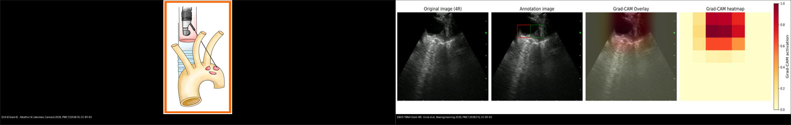
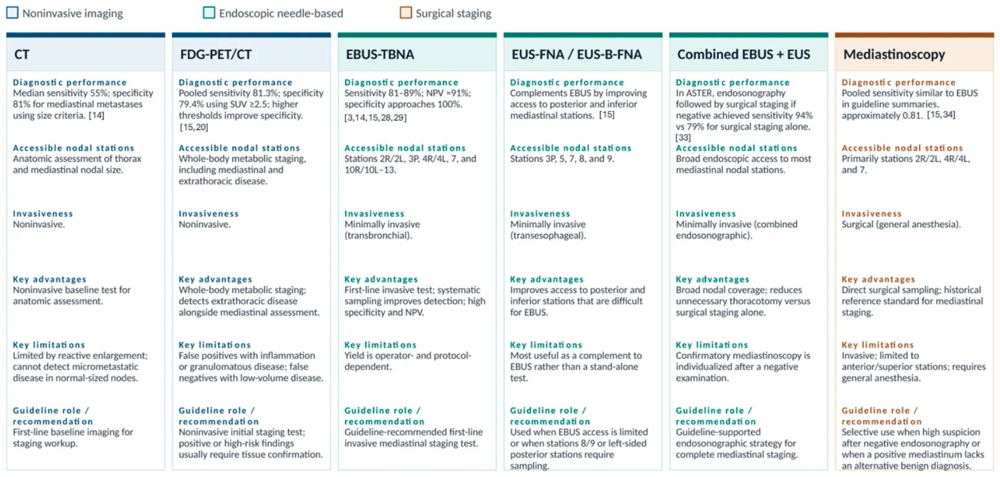
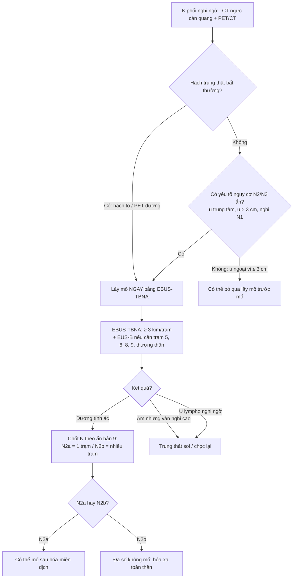
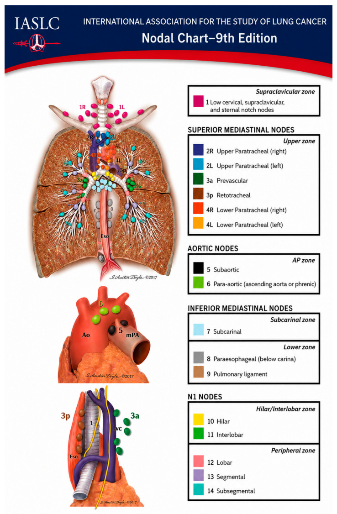
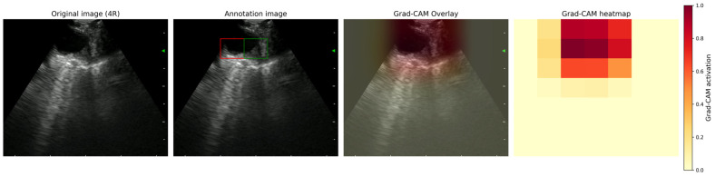
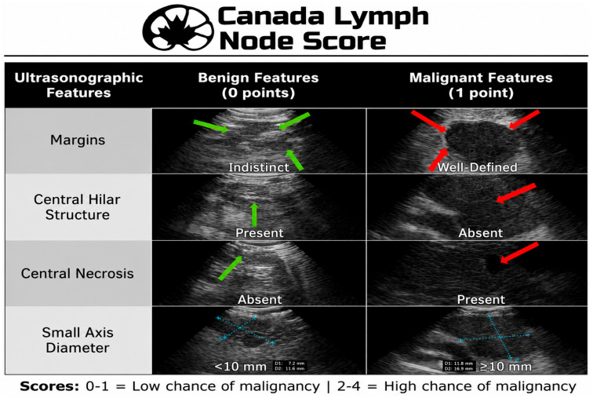
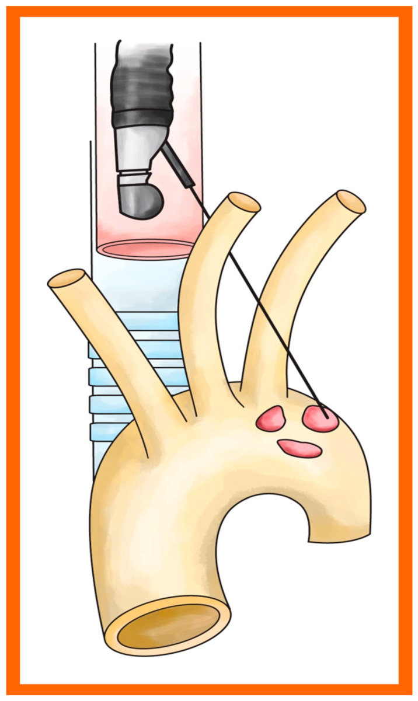
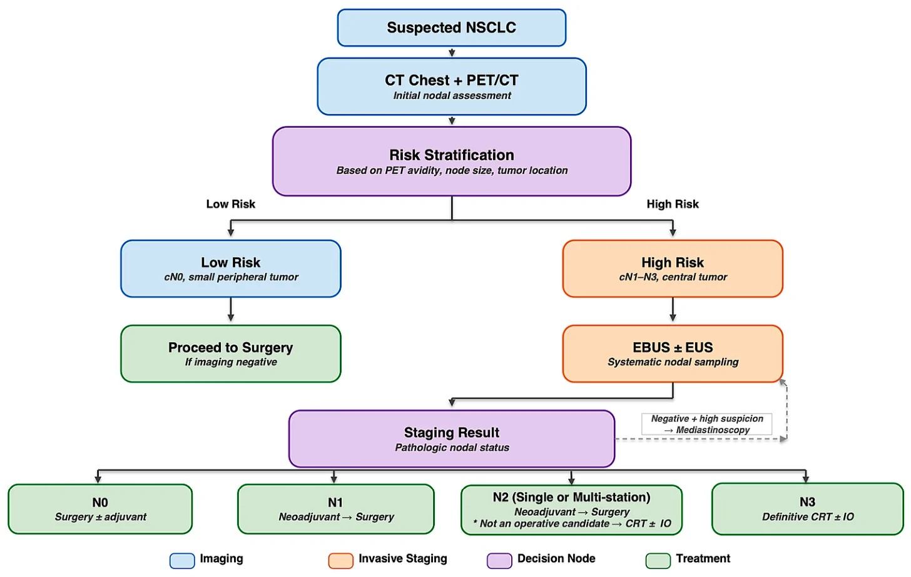
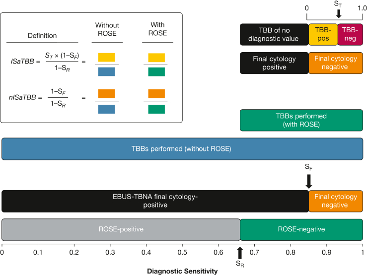

# 018 — Chọc hút hạch trung thất dưới hướng dẫn siêu âm: EBUS-TBNA & EUS-B / Endosonographic mediastinal nodal staging

**Tags:** `pattern:hach` `vung:trung-that` `score:IASLC` `score:CLNS` `protocol:EBUS-TBNA` `protocol:EUS-B` `incidentaloma:hach-trung-that`
**Mức chắc chắn (certainty):** tổng hợp y văn (literature synthesis) — nhóm tự biên từ các bài tổng quan CC BY 4.0 (Europe PMC: Alkathiri & Liberman *Cancers* 2026, PMC13204510; Haimi & Rajaram *Cancers* 2026, PMC13510314; Ervik et al. *Bioengineering* 2026, PMC12938215), không gắn một ca nguyên văn đơn lẻ; số liệu giữ đúng nguồn, chỗ chưa kiểm chứng ghi "chưa rõ".

## 1. Tổng quan bệnh học – cơ chế hình ảnh

- **Vì sao phải lấy mô hạch (tissue confirmation):** giai đoạn hạch (N) quyết định khả năng mổ, phác đồ hóa–miễn dịch và tiên lượng. CT và PET/CT **định vị** hạch nhưng **không xác định bản chất mô** → "hạch to" trên ảnh vẫn cần kim/sinh thiết chứng minh ác hay lành. Với **thuốc chống ung thư miễn dịch**, sai giai đoạn = sai phác đồ và sai chỉ định mổ.
- **Ngưỡng định lượng của hình ảnh (chốt của "cửa 1"):**
  - **CT:** đường kính trục ngắn **≥ 1 cm** (10 mm) là ngưỡng bất thường kinh điển — nhưng chỉ có **Se trung bình ~55%** và **Sp ~81%** (Haimi & Rajaram 2026): không phân biệt được hạch viêm tăng sản với di căn và **bỏ sót vi di căn ở hạch bình thường về kích thước**.
  - **PET/CT:** **dương tính giả** do viêm/u hạt (sarcoid, lao) và **âm tính giả** ở hạch **< 1 cm** (vi di căn). Nâng ngưỡng lên **tỉ lệ hạch/máu trung thất > 1,7** hoặc **SUV hạch > 3,9** thì cải thiện **Sp lên 79–90%** mà vẫn giữ **Se ~91%**.
  - **Nguy cơ hạch ẩn (occult N2) khi hạch nhỏ/bình thường:** **u trung tâm 20–25%** có N2/N3 dù hạch không to; ngược lại **u ngoại vi ≤ 3 cm** + CT và PET/CT âm → nguy cơ thấp, có thể **không bắt buộc** lấy mô trước mổ.
- **Cơ chế hình ảnh của siêu âm nội soi (TẠI SAO thấy được hạch):** đầu dò **cong (convex-probe)** áp sát vách khí quản/thực quản phát sóng âm tần số cao → hạch (tổ chức mềm giàu tế bào, ít khí) hồi âm trung bình–giàu, **phân biệt được với mặt phế quản đầy khí (không hồi âm)**; kim đi trong **kênh song song** nên quan sát được **toàn bộ đường kim** theo thời gian thực. Tín hiệu "cứng" trên siêu âm đàn hồi (elastography) và mẫu "mạch máu–trung tâm" (central hilar structure) là các **đặc điểm vật lý của mô**, không phải mô bệnh.
- **Nguyên lý 2 ngả (TẠI SAO cần cả EBUS và EUS):** cùng một đầu dò đặt ở **khí quản** (EBUS-TBNA) hoặc **thực quản** (EUS-B-FNA) sẽ "nhìn" hai vùng giải phẫu khác nhau. Vì thực quản nằm **sau–trái** khí quản, EUS-B với tới được **khoang chủ–phổi (trạm 5), cạnh chủ (trạm 6), cạnh thực quản (8), dây chằng phổi (9), thượng đòn 3p** và cả **tuyến thượng thận/tạng trong ổ bụng** (nơi đánh dấu M1) — những chỗ EBUS **không tới được**.
- **Ấn bản TNM 9 (2024–2025) — TẠI SAO đổi tên hạch:** N2 (di căn hạch trung thất **cùng bên**) được chia **N2a = MỘT trạm** và **N2b = NHIỀU trạm**, phản ánh **khác biệt tiên lượng**: N2a sống thêm tốt hơn, tiếp cận cả mổ sau hóa–miễn dịch; N2b đa số **không còn là ứng viên mổ** (điều trị toàn thân ± xạ). **N1 giữ nguyên**, **N3 giữ nguyên** (trạm 2/4 đối bên, rốn phổi đối bên, trạm 1/thượng đòn–dưới đòn). Việc đếm **đủ số trạm** vì thế không còn là "chi tiết kỹ thuật" mà là **yêu cầu phân giai đoạn**.

## 2. Mẫu hình + chẩn đoán phân biệt theo vị trí (gamut)

Với hạch trung thất nghi ngờ trên CT/PET/CT, câu hỏi thực hành là **"trạm nào? ngả nào tới được? lấy bao nhiêu?"**:

- **N1 (trong phổi) — trạm 10, 11, 12, 13, 14:** EBUS với tới 10, 11, 12 (rốn phổi/gian thùy). Xem bài 013.
- **N2 cùng bên — trạm 2R/2L (dưới khí quản trên), 4R/4L (cạnh khí quản dưới), 3p (sau khí quản), 7 (dưới carina):** EBUS-TBNA là ngả ưu tiên; **trạm 5 (khoang chủ–phổi) và 6 (cạnh chủ)** chỉ tới được bằng **EUS-B**.
- **N3 — trạm 1 (thượng đòn/dưới đòn), 2/4 đối bên, rốn phổi đối bên:** hạch thượng đòn quan sát được **bằng cả hai ngả** (EBUS qua khí quản, EUS-B qua thực quản) nhưng **sinh thiết ở trạm 1 phải do trung tâm giàu kinh nghiệm** thực hiện.
- **Dưới hoành (đánh dấu M1):** EUS/EUS-B với tới **trạm thân tạng (celiac), tuyến thượng thận hai bên, thùy gan trái** → một mũi kim có thể **đổi giai đoạn từ III sang IV** (và cứu bệnh nhân khỏi mổ vô ích).
- **Khối trung thất không phải K phổi:** u lympho (EBUS **kém nhạy** cho lymphoma: **Se ~57–61%**, âm tính **không loại trừ** → vẫn cần trung thất soi), u hạt (sarcoid, lao — **dương tính giả**), nang/những thực thể khác. Xem bài 060.

## 3. Bảng so sánh phân biệt (ma trận đối chiếu)

| Ngả lấy mô (modality) | Hình ảnh / cách tiếp cận | Chốt vào (rule-in) | Chốt loại (rule-out) | Gợi ý xác nhận |
|---|---|---|---|---|
| **EBUS-TBNA** (kim xuyên vách khí quản–phế quản) | Siêu âm cong, thời gian thực; tới trạm **1, 2R/2L, 3p, 4R/4L, 7, 10, 11, 12** | **Hạch hồi âm trung bình nằm cạnh vách khí quản/phế quản + kim ± đường ngắm** | Không tới được **trạm 5, 6, 8, 9, thượng thận, gan trái** — thiếu mẫu các vùng này **không loại trừ** di căn vùng đó | ≥ 3 lần kim/trạm; ROSE; mẫu cho mô bệnh + phân tử |
| **EUS-B-FNA** (cùng đầu dò EBUS, đặt trong thực quản) | Siêu âm 180°, tới trạm **2L, 4L, 5, 6, 7, 3p, 8R/L, 9R/L, celiac, thượng thận, gan trái** | **Hạch nằm ngoài khí quản, sát thực quản** (đặc biệt trạm 5/6) — nơi EBUS "mù" | Chỉ dùng EUS **bỏ sót trạm trên khí quản (1, 2R, 4R)** | Phối hợp EBUS + EUS-B hệ thống (một đầu dò, một ca gây mê) |
| **Trung thất soi (mediastinoscopy)** | Phẫu thuật mở; chủ yếu trạm cạnh khí quản + dưới carina | Khi 2 ngả nội soi **âm nhưng vẫn nghi cao**; nghi **u lympho** | Bỏ sót trạm 5, 6, 8, 9 (sau/lệch bên) | "Tiêu chuẩn vàng" cũ, **Se không 100%**; mù ca mới 14% |
| **CT (trục ngắn ≥ 1 cm)** | Kích thước hạch | Hạch **≥ 1 cm** = cờ gợi ý cần lấy mô | Hạch **< 1 cm KHÔNG loại trừ** (Se 55%) | Chỉ để chọn hạch cần chọc, không chứng minh bản chất |
| **PET/CT** | SUV, tỉ lệ hạch/máu trung thất | **SUV > 3,9** hoặc **hạch/máu > 1,7** → Sp 79–90%, Se 91% | **Âm tính giả hạch < 1 cm**; dương tính giả do sarcoid/lao | Luôn lấy mô xác nhận trước điều trị toàn thân |

*Trái: **EUS-B** kim tới hạch **trạm 6 (cạnh chủ)** qua thực quản — vùng EBUS không với tới. Phải: **EBUS-TBNA** hạch **trạm 4R** với các đặc điểm siêu âm (margins, cấu trúc rốn hạch, hoại tử trung tâm). Ảnh ghép letterbox, giữ nguyên tỉ lệ. Nguồn: Alkathiri & Liberman *Cancers* 2026 (PMC13204510, CC BY 4.0) + Ervik et al. *Bioengineering* 2026 (PMC12938215, CC BY 4.0).*

### Thang điểm Canada cho hạch trên siêu âm (Canada Lymph Node Score, CLNS)

Bốn đặc điểm siêu âm, **mỗi đặc điểm 1 điểm, tối đa 4 điểm** — dùng **ngay lúc làm thủ thuật** để quyết định chọc lại / chuyển trung thất soi:

| Đặc điểm siêu âm | Lành (0 điểm) | Ác (1 điểm) | Chốt vào (rule-in) | Chốt loại (rule-out) |
|---|---|---|---|---|
| Bờ hạch (margins) | **Mờ, hòa lẫn xung quanh** | **Rõ nét** | Bờ rõ | Bờ mờ |
| Cấu trúc rốn hạch (central hilar structure) | **Còn** | **Mất** | Mất cấu trúc rốn | Còn cấu trúc rốn |
| Hoại tử trung tâm (central necrosis) | **Không** | **Có** | Có hoại tử | Không hoại tử |
| Đường kính trục ngắn | **< 10 mm** | **≥ 10 mm** | ≥ 10 mm | < 10 mm |

- Phân nhóm: **0–1 điểm = nguy cơ thấp**; **2–4 điểm = nguy cơ cao** (theo hình minh họa gốc).
- Điểm vận hành thường dùng **≥ 3** (nghiên cứu đa trung tâm Canada: 140 bệnh nhân, 300 hạch, 12 chuyên gia, mô bệnh là chuẩn vàng): **Se 31,5% · Sp 96,3% · PPV 86,5% · NPV 65,4%** → **rất đặc hiệu để "chốt vào" ác tính**, ít dùng để loại trừ.
- **Cạm bẫy:** CLNS là công cụ **siêu âm**, không thay mô bệnh; điểm thấp **không loại trừ** ác (Se thấp) → nếu nghi cao vẫn chọc lại/chuyển trung thất soi.

## 4. Protocol chụp + hệ phân độ/điểm chuẩn hóa

- **Trước thủ thuật:** CT ngực cản quang đa thì + **PET/CT** (chọn hạch đích, loại hạch "giả"); đánh giá **nguy cơ N2/N3 ẩn** (u trung tâm, u **> 3 cm**, nghi N1). Với hạch dương PET/CT **và** bệnh nhân có yếu tố nguy cơ → **đi thẳng nội soi lấy mô**, không cần xác nhận thêm bằng hình ảnh.
- **Gây mê:** thường **an thần sâu/mê ngắn**; nguy cơ **giảm oxy máu** ở bệnh nhân suy hô hấp → theo dõi oxy, chọn thuốc an thần phù hợp.
- **Kỹ thuật lấy mẫu:**
  - **≥ 3 lần kim cho mỗi trạm** (được xem là tối ưu cho "có chẩn đoán"); **lấy thêm trạm** để phân biệt **N2a vs N2b** (một trạm vs nhiều trạm).
  - **Khi cần xét nghiệm phân tử (EGFR/ALK/ROS1...):** tăng số lần kim/trạm; **dịch rửa kim (needle rinse) là mẫu tốt hơn** cho giải trình tự; tránh nhiễm bẩn, tránh mẫu hoại tử.
  - **ROSE (đọc tế bào học tại chỗ):** **không được chứng minh tăng tỉ lệ có chẩn đoán**, nhưng **giảm số lần kim và số tiêu bản**, có thể giảm số ca phải làm lại.

*Bảng so sánh CT, FDG-PET/CT, EBUS-TBNA và EUS-FNA cho giai đoạn hạch trung thất NSCLC (giá trị gần đúng tổng hợp từ y văn trong bài gốc). Nguồn: Haimi & Rajaram, Cancers 2026 (PMC13510314), CC BY 4.0.*

- **Tai biến:** nội soi siêu âm **1–2% biến chứng, tử vong ~0,04%** (chủ yếu giảm oxy thoáng qua, chảy máu nhẹ); **trung thất soi 2–3%, tử vong ~0,08%** (chấn thương mạch lớn). EUS hướng dẫn sinh thiết phổi ghi nhận **không có tràn khí màng phổi/biến chứng thực quản** ở một loạt bệnh nhân (độ chính xác 94,5%).
- **Hiệu suất định lượng (chốt):** phối hợp **EBUS + EUS-B một đầu dò** nâng **độ nhạy giai đoạn trung thất từ 82% → 92%**; gộp chung endosonography (**Se 91%, Sp 100%, NPV 96%, độ chính xác 97%**) còn **phát hiện thêm N2/N3/M1 ở 14% ca vốn được trung thất soi coi là âm** → tránh mổ vô ích. So với một ngả đơn, phối hợp có thể tăng Se **tới 21%**.

- **Ấn bản TNM 9 (chỉ liệt kê phần N để đọc đúng):** N1 — di căn hạch **rốn phổi cùng bên và/hoặc nội phổi** (không đổi); **N2a** — **một trạm** trung thất cùng bên; **N2b** — **nhiều trạm** trung thất cùng bên; **N3** — trạm **đối bên** (2/4), hạch rốn phổi đối bên, hoặc **trạm 1/thượng đòn**.

## 5. Biến thể bình thường và cạm bẫy

- **Hạch nhỏ nhưng vẫn ác (micrometastasis):** ngưỡng 1 cm và PET đều bỏ sót — **âm tính hình ảnh không loại trừ**; nhớ yếu tố nguy cơ ẩn để quyết định lấy mô.
- **Âm tính giả khi chọc:** hạch **hoại tử** (lấy đúng vùng xơ/hang), **xơ sau hóa–xạ**, **ít mẫu**, **tay nghề người làm**; tránh lấy vào vùng hoại tử, lấy thêm trạm.
- **Dương tính giả do u hạt:** sarcoid/lao làm hạch to + ngấm PET và có thể đủ điểm trên CLNS → **luôn cần mô bệnh**.
- **"Đường kim" không chỉ có 1:** hạch có **mạch máu trong rốn** — không nhầm mạch máu với hạch; dùng Doppler/elastography để chọn vị trí an toàn (đặc biệt trạm 1, 4L cạnh ĐMC/cung ĐMC).
- **U lympho:** EBUS **không đủ loại trừ** (Se 57–61%) → âm tính mà nghi ngờ cao phải **trung thất soi**.
- **Đừng quên tầng dưới hoành:** chỉ cần EUS-B một mũi vào **thượng thận/gan trái/celiac** có thể chuyển **M0 → M1**, đổi hoàn toàn chiến lược.
- **Bẫy phân đoạn:** với ấn bản 9, **đếm trạm** (một hay nhiều trạm) quan trọng không kém việc có mô ác.

## 6. Tự lượng giá — Blind Quiz

**Ca 1 — Bản đồ hạch IASLC ấn bản 9. Trước khi mở đáp án, chỉ ra 3 trạm EBUS KHÔNG tới được.**

- Gợi ý lâm sàng: u phổi trái, cần xác nhận giai đoạn N.
- Câu hỏi: Kể tên các trạm **chỉ EUS-B tới được**? Trạm nào là **N3** khi dương tính?

<b>Bấm để hiện đáp án (findings + chẩn đoán)</b>

- Bản đồ chia 4 nhóm: **thượng đòn (1)**, **trung thất trên (2R/2L, 3a, 3p, 4R/4L)**, **khoang chủ (5, 6)**, **trung thất dưới (7, 8, 9)** + **N1 (10–14)**.
- **Trạm 5 (khoang chủ–phổi) và 6 (cạnh chủ)** — EBUS không tới, phải **EUS-B**. Trạm **8 (cạnh thực quản)** và **9 (dây chằng phổi)** cũng thuộc EUS-B.
- **N3:** trạm **1** (thượng đòn/dưới đòn), trạm **2/4 đối bên**, rốn phổi đối bên.
- Nguồn ảnh: Alkathiri & Liberman, *Cancers* 2026 (PMC13204510), CC BY 4.0.

**Ca 2 — Kim trong hạch trạm 4R trên EBUS. Đọc các đặc điểm siêu âm.**

<b>Bấm để hiện đáp án (findings + chẩn đoán)</b>

- Ảnh gốc là **siêu âm EBUS hạch trạm 4R** (bên trái) — khối hồi âm trung bình nằm sát vách khí quản; các panel còn lại là bản chú giải và bản đồ nhiệt của mô hình học sâu (minh họa vùng quan tâm mà thuật toán "nhìn").
- Điểm cần đọc cho **CLNS**: bờ hạch, **cấu trúc rốn hạch**, **hoại tử trung tâm**, **trục ngắn ≥ 10 mm**.
- Nguồn ảnh: Ervik et al., *Bioengineering* 2026 (PMC12938215), CC BY 4.0.

**Ca 3 — Thang điểm Canada: hạch nào đáng nghi ác?**

<b>Bấm để hiện đáp án (findings + chẩn đoán)</b>

- 4 tiêu chí, mỗi tiêu chí 1 điểm: **trục ngắn ≥ 10 mm**, **bờ rõ**, **mất cấu trúc rốn hạch**, **có hoại tử trung tâm**.
- **0–1 điểm = nguy cơ thấp; 2–4 điểm = nguy cơ cao.** Điểm vận hành **≥ 3** rất **đặc hiệu** (Sp 96,3%) nhưng **kém nhạy** (Se 31,5%) → dùng để **chốt vào ác**, không dùng để loại trừ.
- Nguồn ảnh: Alkathiri & Liberman, *Cancers* 2026 (PMC13204510), CC BY 4.0.

**Ca 4 — Vì sao phải bổ sung EUS-B?**

<b>Bấm để hiện đáp án (findings + chẩn đoán)</b>

- Minh họa **kim xuyên thực quản tới hạch cạnh chủ (trạm 6)** — vùng **EBUS mù**. Phối hợp EBUS + EUS-B nâng **độ nhạy từ 82% → 92%** (một đầu dò, một ca thủ thuật).
- Nguồn ảnh: Alkathiri & Liberman, *Cancers* 2026 (PMC13204510), CC BY 4.0.

**Ca 5 — Lưu đồ quyết định: bệnh nhân nào cần lấy mô NGAY?**

<b>Bấm để hiện đáp án (findings + chẩn đoán)</b>

- **Hạch dương trên hình ảnh** → lấy mô **ngay**.
- **Hạch âm nhưng có yếu tố nguy cơ N2/N3 ẩn** (u **trung tâm** — nguy cơ 20–25%; u **> 3 cm**; nghi N1) → **vẫn lấy mô**.
- **U ngoại vi ≤ 3 cm + CT/PET âm** → nguy cơ thấp, có thể **không** lấy mô trước mổ.
- Nguồn ảnh: Haimi & Rajaram, *Cancers* 2026 (PMC13510314), CC BY 4.0.

**Ca 6 — Đọc tế bào học tại chỗ (ROSE) giúp gì?**

<b>Bấm để hiện đáp án (findings + chẩn đoán)</b>

- ROSE **không được chứng minh tăng tỉ lệ có chẩn đoán**, nhưng **giảm số lần kim/số tiêu bản** và có thể **giảm số ca phải làm lại**; hữu ích để **đủ mẫu cho xét nghiệm phân tử**.
- Nguồn ảnh: Gerbino et al., *CHEST Pulmonary* 2026 (PMC13419112), **CC BY-NC-ND 4.0 — giữ nguyên bản, không cắt/ghép**.

## Bài liên quan chéo
- [001 – Tổng quan hệ Ngực](../001-tong-quan-he-nguc/lesson.md)
- [012 – Hạch trung thất IASLC & đường–dải](../012-hach-trung-that/lesson.md) (vùng–trạm, ngưỡng 10 mm)
- [013 – Hạch nội phổi (trạm 11–14) & nốt cạnh rãnh](../013-hach-noi-phoi/lesson.md)
- [022 – Khối phổi & TNM](../022-khoi-phoi-TNM/lesson.md)
- [060 – Khối trung thất ITMIG](../060-khoi-trung-that-itmig/lesson.md)
- [041 – Tràn khí màng phổi](../041-tran-khi-mang-phoi/lesson.md) (biến chứng thủ thuật ngực)

## Ảnh
- 7 ảnh + 1 ảnh ghép trong `images/`, nguồn & giấy phép từng ảnh ở `images/CREDITS.md`.
- Tải từ Europe PMC (bài **CC BY 4.0**, riêng ROSE là **CC BY-NC-ND 4.0** giữ nguyên bản). Radiopaedia/AuntMinnie chỉ dẫn link trong `sources.md`.

> Không dùng để chẩn đoán độc lập khi chưa có người hướng dẫn.
