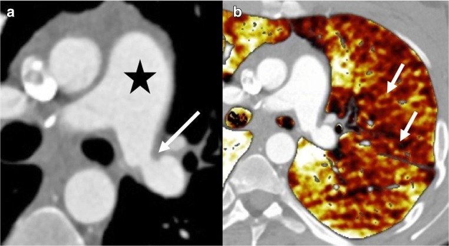
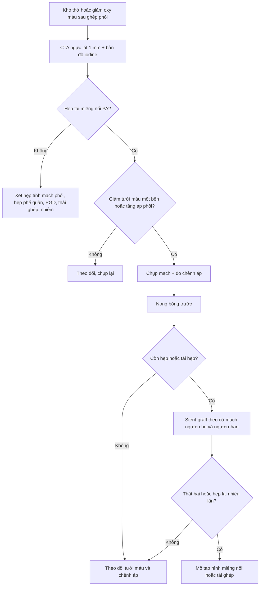

# 019 — Hẹp miệng nối động mạch phổi sau ghép phổi: 3,66% ca ghép, vận tốc đỉnh 2,6 m/s, giảm tưới máu một bên trên bản đồ iodine / Anastomotic pulmonary artery stenosis after lung transplantation

**Tags:** `pattern:hep-dong-mach-phoi` `pattern:khong-tuoi-mau` `pattern:tang-ap-dong-mach-phoi` `pattern:phi-dai-that-phai` `vung:phoi` `vung:dong-mach-phoi` `vung:trung-that` `protocol:CTA` `protocol:TEE` `protocol:stent-graft`
**Mức chắc chắn (certainty):** tổng hợp y văn (literature synthesis) — ghép **tổng quan hình ảnh biến chứng sau ghép phổi** (Habre C et al., *Insights Imaging* 2018, **PMC6206387**, CC BY 4.0), **phân tích gộp 34 bài** về tắc/hẹp động mạch phổi sau ghép (**PMID 33760790**, *Transplantation* 2021), **loạt 354 ca ghép** can thiệp nội mạch (**PMID 25851200**, *JVIR* 2015), **loạt 5 ca stent-graft** (**PMID 24510277**, *Cardiovasc Intervent Radiol* 2014), **ca nong bóng áp lực cao** (**PMC7326661**, *J Cardiol Cases* 2020), **ca nong bóng rồi đặt stent** (**PMID 19289997**, *Ann Transplant* 2009) và **nghiên cứu TEE trong mổ** (**PMID 9149574**, *Anesthesiology* 1997). Số nào nguồn không nêu ghi **"chưa rõ"**, không bịa.

> **Câu chốt:** hẹp miệng nối **động mạch phổi** là biến chứng **hiếm nhưng chết người** của ghép phổi — **điểm hiện mắc 3,66%** qua 34 nghiên cứu, **76% phải can thiệp lại khẩn**, **23% tử vong trong viện** ở nhóm được chẩn đoán (14/62). Dấu hiệu chốt trên CT là **chênh đường kính ngay tại đường khâu + giảm tưới máu cả một bên phổi trên bản đồ iodine**, kèm **giãn thân động mạch phổi và các buồng tim phải**. Điều trị: **nong bóng trước, stent-graft khi hẹp đàn hồi/tái hẹp, mổ khi thất bại** — tỷ lệ thành công kỹ thuật **100%**, hết triệu chứng **92%**, hẹp trong stent **9%**.

## 1. Tổng quan bệnh học – cơ chế hình ảnh

### 1.1 Vì sao miệng nối bị hẹp (TẠI SAO)

- **Đây là chỗ nối hai mạch khác cỡ.** Động mạch phổi (PA) của người cho và người nhận thường **lệch đường kính**; khâu vòng liên tục để "khớp" hai cỡ mạch tạo ra **nếp gấp niêm mạc và hẹp ngay tại đường khâu**. Tổng quan CT ghi rõ dấu hiệu chốt là **"significant difference of the pulmonary arterial diameter between donor and receiver"** (PMC6206387).
- **Bốn cơ chế chồng lấp:**
  1. **Lệch cỡ (size mismatch)** + kỹ thuật khâu → hẹp cơ học sớm;
  2. **Huyết khối tại miệng nối** (dòng chảy rối, mô phơi, tăng đông sau mổ);
  3. **Phù miệng nối** trong **0–2 tuần** đầu (bảng thời điểm của PMC6206387 xếp hẹp PA vào **0–2 tuần**);
  4. **Tăng sinh nội mạc (intimal hyperplasia) + xơ hóa** về sau — hẹp tiến triển **hàng tuần đến hàng tháng** (loạt stent chẩn đoán **trung vị ngày 44, khoảng 22–84**; loạt JVIR can thiệp **trung bình 6,7 tháng** sau ghép).
- **Vì sao hẹp nhỏ lại gây hậu quả lớn — vật lý Poiseuille:** sức cản mạch **tỷ lệ nghịch với bán kính lũy thừa 4** (R ∝ 1/r⁴). Giảm **50% đường kính** (bán kính còn 1/2) làm sức cản tăng **~16 lần**. Vì vậy một hẹp "chỉ 50%" tại miệng nối đủ làm **tăng áp lực động mạch phổi, giảm tưới máu phổi ghép và suy thất phải**.
- **Vì sao giảm tưới máu lại thấy được trên CT:** bản đồ iodine của **CT hai năng lượng (dual-energy)** phân tách iodine theo hệ số suy giảm ở hai mức năng lượng; vùng phổi nhận ít máu có **nồng độ iodine thấp** → hiện **màu nhạt hơn hẳn** so với bên đối diện. Ảnh đơn năng lượng thấp **40–50 keV** cũng làm nổi iodine, giúp thấy chênh lệch tưới máu rõ hơn.
- **Vì sao bệnh nhân khó thở chứ không chỉ "thiếu máu một bên":** phổi ghép bị **mất tuần hoàn phế quản** và **mất bạch mạch**, nên khả năng bù trừ kém; hẹp PA → **V/Q mismatch + tăng áp phổi** → khó thở khi gắng sức, đau ngực kiểu màng phổi, giảm oxy máu; nếu là ghép một bên, máu **dồn sang phổi bản địa** và phổi ghép càng thiếu tưới máu.

### 1.2 Ngưỡng định lượng nằm lòng

| Đại lượng | Ngưỡng / con số | Ý nghĩa | Nguồn |
|---|---|---|---|
| Điểm hiện mắc hẹp/tắc PA sau ghép | **3,66%** (34 bài) | Không hiếm như tên gọi "biến chứng hiếm" | PMID 33760790 |
| Vận tốc đỉnh qua chỗ hẹp (siêu âm tim) | **2,60 ± 0,58 m/s** | Gợi ý hẹp có ý nghĩa | PMID 33760790 |
| Đường kính PA bị hẹp dự báo kết cục xấu | **0,78 ± 0,40 cm** | Càng nhỏ càng nặng | PMID 33760790 |
| Can thiệp lại khẩn | **76% (47/62)** | Phần lớn không chờ được | PMID 33760790 |
| Tử vong trong viện ở ca được chẩn đoán | **23% (14/62)** | Chẩn đoán muộn = mất phổi/mất bệnh nhân | PMID 33760790 |
| Hẹp PA có ý nghĩa trong loạt 354 ca ghép | **12/19 ca chụp mạch vì suy hô hấp (≈ 3,4% của 354 ca ghép)** | Xác suất thực hành | PMID 25851200 |
| Thành công kỹ thuật stent | **100%**; hết triệu chứng **92%**; hẹp trong stent **9%** | Stent là lựa chọn bền | PMID 25851200 |
| Stent-graft: chẩn đoán muộn | **trung vị 44 ngày (22–84)** | Hẹp có thể xuất hiện sau khi ra viện | PMID 24510277 |
| Tưới máu phổi ghép sau can thiệp | **+26% (IQR 13–37)** | Đo bằng xạ hình định lượng | PMID 24510277 |
| SpO₂ sau can thiệp | **+8% (IQR 4–9)** | Cải thiện oxy máu | PMID 24510277 |
| Nong bóng áp lực cao ở ghép một bên | Tưới máu **7% → 58%** tổng lưu lượng | Nong bóng đơn thuần có thể đủ | PMC7326661 |
| Đường kính miệng nối PA phải bình thường trên TEE | **1,0–1,7 cm (trung bình 1,26 ± 0,24 cm)** | Mốc so sánh | PMID 9149574 |

## 2. Mẫu hình + chẩn đoán phân biệt theo vị trí và thời điểm (gamut)

**Câu hỏi thực hành:** bệnh nhân ghép phổi **khó thở/giảm oxy máu** — tổn thương ở **động mạch phổi**, **tĩnh mạch phổi**, **đường thở**, **nhu mô** hay do **thải ghép/nhiễm**?

- **Theo thời điểm (bảng của PMC6206387):**
  - **0–2 tuần:** phù/tổn thương miệng nối PA, hẹp PA sớm, huyết khối PA, **rối loạn chức năng mảnh ghép nguyên phát (PGD)**, lệch cỡ phổi–lồng ngực, bục miệng nối phế quản.
  - **2 tuần – 6 tháng:** **thải ghép cấp**, nhiễm khuẩn/virus/nấm, **hẹp phế quản**, **hẹp tĩnh mạch phổi**, hẹp PA muộn do tăng sinh nội mạc.
  - **> 6 tháng:** **CLAD** (BOS/RAS/AFOP), nhiễm muộn, **PTLD**.
- **Theo cơ chế mạch:**
  - **Hẹp PA tại miệng nối:** chênh đường kính tại đường khâu, **giảm tưới máu cả bên phổi ghép**, giãn thân PA/thất phải.
  - **Hẹp tĩnh mạch phổi (bài 099):** hẹp tại lỗ đổ về nhĩ trái → **phù thùy, dày vách liên tiểu thùy, tràn dịch tái phát**; có thể **kèm** hẹp PA cùng bên — đừng dừng khi thấy một tổn thương.
  - **Huyết khối PA:** khuyết thuốc **trong lòng** mạch, không phải hẹp thành tại đường khâu.
  - **Thuyên tắc phổi:** khuyết thuốc cấp tính, thường nhiều nhánh, bối cảnh tăng đông/giảm vận động.
  - **PGD:** phù phổi hai bên/đám mờ trong **72 giờ đầu**, không có hẹp khu trú.
  - **Hẹp phế quản:** khó thở + **thở rít một bên**, xẹp phổi/thông khí quá mức; CT thấy hẹp đường thở, không phải mạch.
  - **Lệch cỡ phổi–lồng ngực:** xẹp phổi dưới, không hẹp mạch.
  - **Nhiễm trùng:** đông đặc/kính mờ, sốt, dịch phế quản; **có thể cùng tồn tại** với hẹp PA.
  - **Thải ghép cấp:** kính mờ, dày vách, tràn dịch; chẩn đoán mô học.

**Mnemonic "PASS" cho khó thở sau ghép phổi:** **P**erfusion (hẹp PA/tĩnh mạch), **A**irway (hẹp/bục phế quản), **S**ize (lệch cỡ), **S**ystemic (thải ghép/nhiễm/PGD).

## 3. Bảng so sánh phân biệt (ma trận đối chiếu)

| Thực thể (entity) | Hình ảnh điển hình | Chốt vào (rule-in) | Chốt loại (rule-out) | Gợi ý xác nhận |
|---|---|---|---|---|
| **Hẹp PA tại miệng nối** | CTA: chênh đường kính tại đường khâu; **giảm tưới máu cả bên** trên bản đồ iodine; giãn thân PA/thất phải | **Chênh đường kính ngay tại đường khâu + giảm tưới máu một bên** | Tổn thương lan tỏa hai bên không tương ứng miệng nối → nghĩ PGD/nhiễm | CTA lát ≤ 1 mm + bản đồ iodine; TEE cho PA phải; chụp mạch + đo chênh áp |
| **Hẹp tĩnh mạch phổi (099)** | Hẹp tại lỗ đổ nhĩ trái; **phù thùy, dày vách liên tiểu thùy, tràn dịch tái phát** | **Hẹp lỗ đổ + phù thùy cùng bên** | Giãn thân PA đơn thuần không có hẹp tĩnh mạch → không phải PVS | CTA thì tĩnh mạch; TEE; chụp tĩnh mạch phổi |
| **Huyết khối PA** | Khuyết thuốc **trong lòng** tại/vượt miệng nối | **Khuyết thuốc di động trong lòng mạch** | Hẹp thành đối xứng tại đường khâu → hẹp miệng nối | CTA đa thì; siêu âm tim; xét nghiệm tăng đông |
| **Thuyên tắc phổi** | Khuyết thuốc nhiều nhánh, cấp tính | **Nhiều khuyết thuốc + bối cảnh tăng đông** | Hẹp khu trú đúng miệng nối → hẹp miệng nối | CTA; D-dimer; siêu âm tim |
| **PGD** | Phù phổi/đám mờ **trong 72 giờ**, hai bên | **Khởi phát < 72 giờ + phù lan tỏa** | Hẹp khu trú tại miệng nối → không phải PGD | Chẩn đoán loại trừ; đáp ứng hỗ trợ |
| **Hẹp phế quản** | Hẹp đường thở tại miệng nối, xẹp phổi/thông khí quá mức | **Hẹp đường thở + thở rít một bên** | Mạch phổi bình thường tại miệng nối → không phải hẹp PA | Nội soi phế quản; CT lát mỏng |
| **Lệch cỡ phổi–lồng ngực** | Xẹp phổi dưới, dấu đuôi sao chổi, không hẹp mạch | **Phổi nhỏ hơn lồng ngực + xẹp thùy dưới** | Hẹp mạch rõ tại đường khâu → không phải lệch cỡ đơn thuần | CT; so sánh thể tích |

*Trái (a): CTA ngực — hẹp động mạch phổi trái tại miệng nối (mũi tên trắng), thân động mạch phổi giãn (ngôi sao). Phải (b): bản đồ tưới máu CT hai năng lượng — vùng màu vàng nhạt (mũi tên) là phổi trái **giảm tưới máu** lan rộng. Nguồn: Habre C et al., Insights Imaging 2018 (PMC6206387), Fig. 5, CC BY 4.0.*

## 4. Protocol chụp + phân độ và quyết định can thiệp

### 4.1 Protocol

- **CTA ngực là bước chốt:** lát cắt **≤ 1 mm**, bơm thuốc cản quang theo bơm theo dõi (bolus tracking) ở động mạch phổi; dựng **MPR dọc trục mạch** và **MIP** để đo đường kính tại **đúng đường khâu**, so với đoạn mạch **trước/sau miệng nối** và với **cỡ mạch người cho**.
- **CT hai năng lượng (nếu có):** dựng **bản đồ iodine** để thấy **giảm tưới máu một bên** — đây là dấu hiệu gián tiếp mạnh khi hẹp khó đo (PMC6206387). Ảnh đơn năng lượng **40–50 keV** làm nổi iodine.
- **Siêu âm tim qua thực quản (TEE):** đo **vận tốc đỉnh** và chênh áp qua miệng nối; bình thường đường kính miệng nối PA phải **1,0–1,7 cm**. **Cạm bẫy:** nghiên cứu 18 ca cho thấy **không quan sát được miệng nối PA trái nào (0/9)** bằng TEE một mặt phẳng (PMID 9149574) → **TEE bình thường không loại trừ hẹp PA trái**; phải CTA.
- **Xạ hình tưới máu phổi (99mTc):** định lượng **phần trăm lưu lượng** cho từng phổi — dùng theo dõi trước/sau can thiệp (ca PMC7326661: **7% → 58%**).
- **Chụp mạch phổi (DSA):** tiêu chuẩn vàng, đo **chênh áp** và can thiệp ngay trong cùng buổi.

### 4.2 Phân độ và ngưỡng can thiệp

- **Phân độ theo mức hẹp đường kính** (dùng trong thực hành, chưa có hệ phân độ thống nhất cho PA sau ghép): nhẹ **< 50%**, vừa **50–70%**, nặng **> 70%**; kèm **giảm tưới máu một bên** và **tăng áp phổi**.
- **Ngưỡng can thiệp thực hành:** **có triệu chứng + hẹp ≥ 50%** hoặc **chênh áp đáng kể qua miệng nối**; ca minh họa có **CTA hẹp 50%** và **gradient TEE 40 mmHg** mới được nong bóng (PMID 19289997). Ca nong bóng áp lực cao được chỉ định khi **giảm tưới máu nặng (7% lưu lượng)** (PMC7326661).
- **Thứ tự can thiệp:** **nong bóng trước** (đặc biệt hẹp sớm do phù) → **stent-graft** khi hẹp đàn hồi/tái hẹp hoặc hẹp muộn do tăng sinh nội mạc → **mổ tạo hình/tái ghép** khi nội mạch thất bại.
- **Vì sao stent-graft:** stent thường có thể bị mô nội mạc mọc qua lưới; **stent-graft phủ** ngăn tăng sinh nội mạc trong lòng, nhưng **không được che nhánh thùy/phân thùy của động mạch phổi** và phải chọn cỡ theo **đường kính người cho/người nhận** (PMID 24510277).

## 5. Biến thể bình thường và cạm bẫy

- **Lệch cỡ sinh lý người cho–người nhận:** động mạch phổi người cho nhỏ hơn người nhận **không đồng nghĩa hẹp bệnh lý**. Chỉ gọi hẹp khi có **chênh đường kính khu trú tại đường khâu**, **giảm tưới máu cùng bên** hoặc **chênh áp**. Đo tại 3 điểm (trước, tại, sau miệng nối) và ghi rõ mm.
- **TEE bình thường không loại trừ hẹp PA trái:** 0/9 miệng nối PA trái quan sát được bằng TEE một mặt phẳng (PMID 9149574). Nếu lâm sàng nghi mà TEE âm → **CTA**.
- **Giảm tưới máu trên bản đồ iodine không đặc hiệu:** xẹp phổi, viêm phổi, thuyên tắc phổi, tràn khí cũng gây giảm tưới máu. Luôn đọc **cửa sổ nhu mô** kèm bản đồ.
- **Hẹp sớm do phù có thể hồi phục:** trong **0–2 tuần** đầu, phù miệng nối làm hẹp; **nong bóng** hợp lý hơn đặt stent ngay, và cần chụp lại trước khi kết luận thất bại.
- **Bỏ sót tổn thương thứ hai:** hẹp PA và **hẹp tĩnh mạch phổi cùng bên** có thể cùng tồn tại (bài 099) — đọc cả hai phía của tuần hoàn phổi.
- **Suy hô hấp sau ghép phổi luôn đa yếu tố:** PGD, thải ghép, nhiễm, hẹp đường thở có thể **chồng lên** hẹp mạch; đừng dừng ở một phát hiện ("satisfaction of search").

## 6. Tự lượng giá — Blind Quiz

**Ca 1 — 3 tháng sau ghép một bên phổi trái, khó thở và đau ngực.**

- Gợi ý lâm sàng: khó thở tăng dần, đau ngực kiểu màng phổi, SpO₂ thấp hơn trước; không sốt.
- Câu hỏi: Dấu hiệu chính trên (a) và (b)? Ba chẩn đoán phân biệt? Bước tiếp theo?

<b>Bấm để hiện đáp án (findings + chẩn đoán)</b>

- **Dấu hiệu:** (a) hẹp khu trú **động mạch phổi trái tại miệng nối** (mũi tên), **thân động mạch phổi giãn** (ngôi sao); (b) **giảm tưới máu lan rộng phổi trái** trên bản đồ iodine (vùng vàng nhạt, mũi tên).
- **Chẩn đoán:** **hẹp miệng nối động mạch phổi sau ghép phổi** — hẹp làm tăng sức cản (R ∝ 1/r⁴), dồn máu sang phổi bản địa và tăng áp thất phải.
- **Bước tiếp theo:** chụp mạch phổi đo chênh áp + **nong bóng**, đặt **stent-graft** nếu hẹp đàn hồi/tái hẹp; định lượng tưới máu bằng xạ hình trước/sau.
- **Nguồn ảnh:** Habre C et al., Insights Imaging 2018 (PMC6206387), Fig. 5, CC BY 4.0.

## Bài liên quan chéo
- [099 – Hẹp tĩnh mạch phổi sau cô lập tĩnh mạch & sau ghép phổi](../099-hep-tinh-mach-phoi-sau-ablation-ghep-phoi/lesson.md) *(phía tĩnh mạch của cùng miệng nối)*
- [001 – Tổng quan hệ Ngực](../001-tong-quan-he-nguc/lesson.md)
- [096 – Phình động mạch phổi thật & hội chứng Hughes–Stovin](../096-phinh-dong-mach-phoi-that-hughes-stovin/lesson.md)
- [098 – Barotrauma & tràn khí màng phổi áp lực ở bệnh nhân thở máy](../098-barotrauma-tran-khi-ap-luc-tho-may/lesson.md)
- [1789 – Viêm phổi do CMV ở người ghép tạng](../1789-viem-phoi-do-cmv-o-nguoi-ghep-tang/lesson.md)
- [1826 – Viêm phổi do thuốc ức chế mTOR](../1826-viem-phoi-do-thuoc-uc-che-mtor/lesson.md)

> Không dùng để chẩn đoán độc lập khi chưa có người hướng dẫn.
