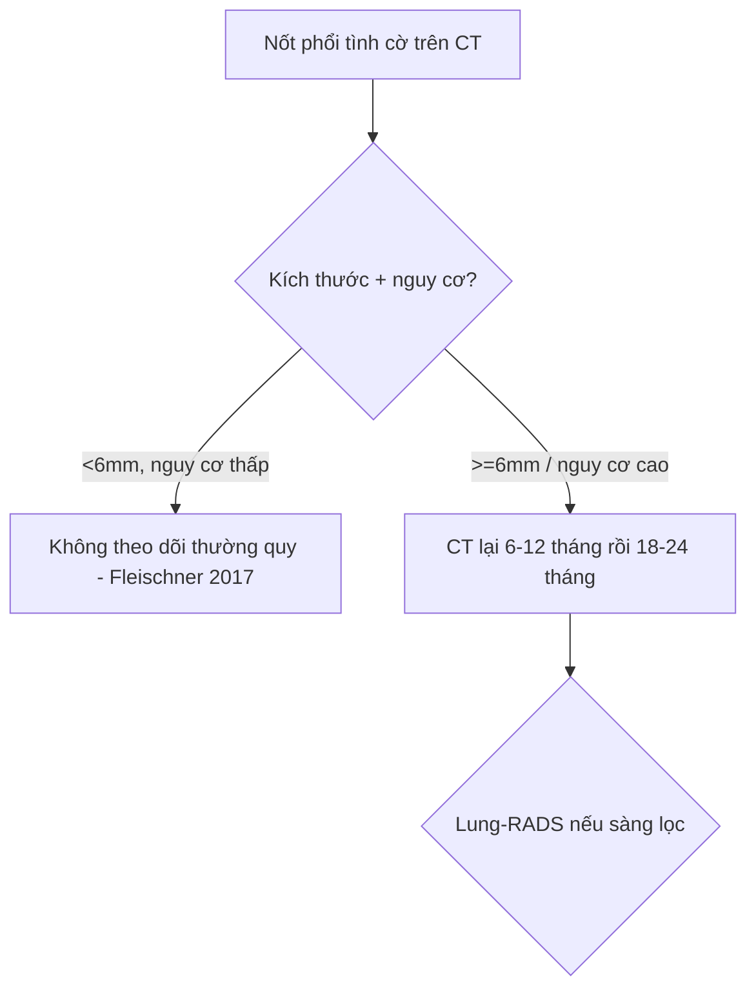

# 020 — Nốt phổi / Pulmonary nodule

**Tags:** `pattern:not` `vung:phoi` `score:Lung-RADS` `protocol:Fleischner` `incidentaloma:not-phoi`
**Mức chắc chắn (certainty):** tổng hợp y văn (literature synthesis) — khung khởi tạo, chưa có ca nguyên văn.

## 1. Tổng quan bệnh học – cơ chế hình ảnh
- Bệnh học (pathology) + sinh lý bệnh (pathophysiology) ngắn gọn.
- Vì sao lên hình như vậy trên X-quang (radiograph) / CT (computed tomography) / MRI (magnetic resonance imaging) / siêu âm (ultrasound).

## 2. Mẫu hình + chẩn đoán phân biệt theo vị trí (gamut)
- Liệt kê mẫu hình (pattern) → gamut (danh sách phân biệt) theo vị trí (location).
- Ví dụ: nốt (nodule) phổi → gamut theo vùng: trung tâm / ngoại vi / màng phổi (pleura).

## 3. Bảng so sánh phân biệt
| Thực thể (entity) | Hình ảnh điển hình (US/CT/MRI theo thì) | Chốt vào (rule-in) | Chốt loại (rule-out) | Gợi ý xác nhận |
|---|---|---|---|
| ... | ... | ... | ... |

## 4. Protocol chụp + hệ phân độ/điểm chuẩn hóa
- Protocol (giao thức) chụp: chỉ định, thông số, thuốc cản quang (contrast).
- Hệ phân độ (grading/scoring system): ví dụ BI-RADS, Lung-RADS, TI-RADS, LI-RADS, PI-RADS, Fleischner, Bosniak — phiên bản + ngưỡng xử trí.

## 5. Biến thể bình thường và cạm bẫy
- Biến thể bình thường (normal variant) dễ nhầm.
- Cạm bẫy (pitfall) kỹ thuật / giả ảnh (artifact) / thỏa mãn tìm kiếm (satisfaction of search).

## 6. Tự lượng giá 3 câu
1. ...
2. ...
3. ...

Đáp án

1. ...

## Bài liên quan chéo
- [ID – Tên](../NN-slug/lesson.md)

## Ảnh
- Ảnh local: `images/NNN_slug_Modality_SourceID.jpg` — xem `images/CREDITS.md` để rõ nguồn + giấy phép (license) từng ảnh.
- Không tải được (paywall / cấm): dẫn link gốc ở đây + trong `sources.md`.

> Không dùng để chẩn đoán độc lập khi chưa có người hướng dẫn.
