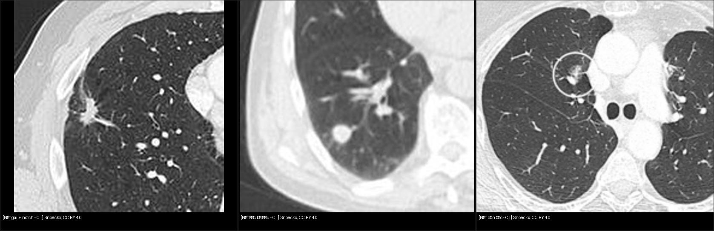
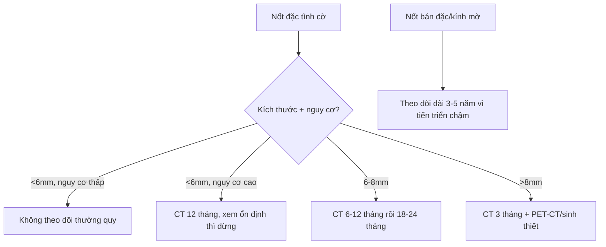
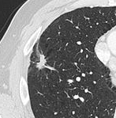

# 020 — Nốt phổi / Pulmonary nodule

**Tags:** `pattern:not` `vung:phoi` `score:Lung-RADS` `protocol:Fleischner` `incidentaloma:not-phoi`
**Mức chắc chắn (certainty):** tổng hợp y văn (literature synthesis) — nhóm tự biên từ y văn mở (Fleischner 2017, Lung-RADS), chưa gắn ca nguyên văn đơn lẻ.

## 1. Tổng quan — nốt là gì, vì sao phải theo dõi

- **Nốt phổi (pulmonary nodule):** tổn thương tròn/mờ ≤ **30 mm**; > 30 mm gọi là **khối (mass)**, nguy cơ ác cao hẳn. Phân 3 dạng: **đặc (solid)**, **bán đặc (part-solid)** (nhân đặc + quầng kính mờ (ground-glass)), **kính mờ thuần (pure ground-glass)**.
- Ngưỡng định lượng nhớ nằm lòng: mỡ trong hamartoma **−40 đến −120 HU** (đo ở cửa sổ trung thất); nhân đặc trong nốt bán đặc **≥ 6 mm** là ngưỡng hành động (Lung-RADS 4A); thời gian nhân đôi thể tích (VDT) ác tính điển hình **20–400 ngày** (< 20 ngày nghĩ viêm; nốt bán đặc lepidic có thể chậm hơn nhiều; hạch trong phổi cũng có VDT trùng ác tính).
- Số liệu hình thái (Snoeckx 2018): gai (spiculation) giá trị dự báo dương tới **90%**; nhưng **21–33%** nốt ác vẫn bờ nhẵn — bờ đều không loại trừ ung thư; vôi hóa trong SPN ác chỉ **~2%** (ung thư phổi nói chung tới 13%); PET-CT hạn chế khi nốt **< 8 mm**, adenocarcinoma lepidic, carcinoid (bắt thuốc thấp/âm tính giả).
- TẠI SAO hình thái quyết định: gai (spiculation) = mô u xâm lấn mô kẽ (desmoplasia) kéo co; quầng kính mờ = lan theo vách phế nang (lepidic) của adenocarcinoma; vôi hóa (calcification) dạng bỏng ngô (popcorn) = hamartoma lành; mỡ (fat, HU âm) trong nốt = hamartoma.
- 2 câu hỏi mọi nốt: **(1) đặc điểm ác tính? (2) bệnh nhân nguy cơ cao?** (hút thuốc (smoking), tuổi, tiền sử ung thư (cancer history), phơi nhiễm).

## 2. Gamut theo vị trí + hình thái

- **Ngoại vi/màng phổi (peripheral/subpleural):** u hạt (granuloma) lao/nấm, viêm khớp dạng thấp (rheumatoid nodule), nhồi máu (infarct), ung thư nguyên phát.
- **Trung tâm/quanh phế quản:** di căn (metastasis — nhiều nốt 2 bên, đáy phổi), lao, sarcoidosis (theo bó mạch-phế quản).
- **Bờ gai + notch + co kéo màng phổi (pleural tag):** ác tính; **bờ nhẵn + vôi hóa trung tâm/lớp (central/laminated) + ổn định ≥ 2 năm:** lành tính.

*Trái: nốt gai + notch. Giữa: nốt đặc bờ đều. Phải: nốt bán đặc (chi tiết từng ca xem `images/CREDITS.md`). Nguồn: Snoeckx et al., CC BY 4.0. Ảnh ghép letterbox.*

## 3. Bảng so sánh phân biệt

| Thực thể (entity) | Hình ảnh điển hình (CT cửa sổ phổi) | Chốt vào (rule-in) | Chốt loại (rule-out) | Gợi ý xác nhận |
|---|---|---|---|---|
| Ung thư nguyên phát (primary lung cancer) | Đặc/bán đặc, **gai + notch + co kéo màng phổi**, lớn dần | **Gai rõ + lớn lên ở lần chụp sau** | Vôi hóa bỏng ngô/mỡ trong nốt → hamartoma | PET-CT (SUV cao), sinh thiết |
| U hạt lao/nấm (granuloma) | Nhỏ, bờ đều, **vôi hóa trung tâm/lớp**, vệ tinh (satellite) | **Vôi hóa đặc + ổn định ≥ 2 năm** | Lớn nhanh, gai mới xuất hiện | Tiền sử lao, IGRA |
| Hamartoma | Vôi hóa **bỏng ngô** và/hoặc **mỡ** trong nốt | **Mỡ (HU âm) hoặc vôi hóa bỏng ngô** | Không có 2 dấu trên → đừng chốt hamartoma | CT lát mỏng đo HU |
| Di căn (metastasis) | **Nhiều nốt 2 bên**, đáy phổi, kích thước đa dạng | **Tiền sử ung thư ngoài phổi + nốt nhiều** | Nốt đơn độc không tiền sử → nghĩ nguyên phát/u hạt | So sánh phim cũ, toàn thân |
| Viêm (infection/inflammation) | Quanh phế quản, kính mờ, halo | **Sốt + tan sau kháng sinh** | Tồn tại > 3 tháng không đổi → không còn là viêm cấp | CT lại 3 tháng |

## 4. Protocol + Fleischner & Lung-RADS

- **Phát hiện:** CT ngực liều thấp lát mỏng (≤ 1,5 mm), cửa sổ phổi; đo **đường kính trung bình** 2 chiều. So sánh **phim cũ** là bước giá trị nhất.
- **Fleischner 2017** (nốt tình cờ, BN ≥ 35 tuổi, không ung thư/không suy giảm miễn dịch). Nốt đặc: < 6 mm nguy cơ thấp → không theo dõi thường quy; < 6 mm nguy cơ cao → CT 12 tháng (ổn định thì dừng); 6–8 mm → CT 6–12 tháng rồi 18–24 tháng; > 8 mm → CT 3 tháng + PET-CT/sinh thiết. Nốt bán đặc/kính mờ ≥ 6 mm: CT 3–6 tháng rồi hàng năm tới **5 năm** (tiến triển chậm, đánh giá nhân đặc chứ không chỉ kích thước):

- **Lung-RADS** (sàng lọc BN nguy cơ cao, LDCT hàng năm): 1–2 âm tính/lành → sàng lọc tiếp; 3 (nghi ngờ nhẹ, vd nốt đặc ≥ 6–<8mm) → CT 6 tháng; 4A/4B/4X (nghi ngờ, càng cao càng ác) → PET-CT/sinh thiết. Ghi rõ phiên bản khi kết luận.

## 5. Biến thể bình thường và cạm bẫy

- **Hạch trong phổi (intrapulmonary lymph node):** nốt dưới màng phổi, dẹt, có rãnh — lành tính, hay gặp đáy phổi.
- **U hạt vôi hóa** sau lao: đừng đốt PET-CT vô ích khi đã ổn định 2 năm.
- **Giả nốt:** núm vú, mạch máu cắt ngang (đổi lát xem cuống mạch — vessel continuity), xẹp đĩa nhìn chếch.
- **Sai lầm lớn nhất:** không so phim cũ; đo khác lát cắt rồi kết luận "lớn lên".

## 6. Tự lượng giá — Blind Quiz

**Ca 1 — Nam 61 tuổi, hút thuốc nặng, nốt 15mm thùy trên phải tình cờ. Mô tả trước khi mở đáp án.**

- Hỏi: bờ nốt thế nào? Có notch không? Hạch cạnh khí quản? 3 phân biệt + chốt?

<b>Bấm để hiện đáp án</b>

- Dấu hiệu: nốt đặc 15mm, **bờ gai (spiculation) + notch rõ**, hạch cạnh khí quản (paratracheal) to.
- Chẩn đoán: **nghi ác cao — mô bệnh gốc: ung thư phổi tế bào nhỏ (SCLC)** (Fig. 10, Snoeckx 2018 — giữ nguyên chú thích gốc, đã đối chiếu PMC5825309).
- ⚠️ Phản biện: SCLC ngoại vi đơn độc 15 mm là **không điển hình** (SCLC ~90% trung tâm, khối lớn + hạch sớm). Gặp nốt gai ngoại vi, xác suất trước kiểm vẫn là NSCLC (adeno/SCC) — mô bệnh mới quyết định, không đoán mô bệnh từ hình thái.
- Nguồn: Snoeckx et al., Insights into Imaging 2018, CC BY 4.0.

**Ca 2 — Đối chiếu:** mở `composite_not-ba-dang.jpg` ở mục 2, xếp 3 nốt theo nguy cơ tăng dần rồi đối chiếu bảng mục 3.

<b>Bấm để hiện đáp án</b>

- Nguy cơ tăng dần: nốt đặc bờ đều < nốt bán đặc < nốt gai + notch. Lưu ý: nốt bờ đều vẫn ác được (ca SCC 15mm) — bờ đều không loại trừ ung thư.

## Bài liên quan chéo
- [001 – Tổng quan hệ Ngực](../001-tong-quan-he-nguc/lesson.md)
- [010 – Giải phẫu ngực cắt lớp](../010-giai-phau-nguc-cat-lop/lesson.md)
- [030 – Đông đặc – xẹp phổi](../030-dong-dac-xep-phoi/lesson.md)

> Không dùng để chẩn đoán độc lập khi chưa có người hướng dẫn.
