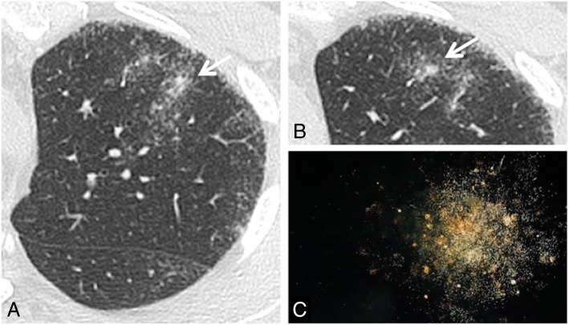

# 021 — Đa nốt phổi: trung tâm tiểu thùy / bạch mạch / ngẫu nhiên / Multiple nodules distribution

**Tags:** `pattern:not-da-o` `vung:phoi`
**Mức chắc chắn (certainty):** tổng hợp y văn (literature synthesis) — nhóm tự biên từ y văn mở, chưa gắn ca nguyên văn đơn lẻ.

## 1. Tổng quan — phân bố quyết định gamut

- Nốt đơn (bài 020) hỏi "lành hay ác"; đa nốt hỏi **"phân bố nào"** trước: **trung tâm tiểu thùy (centrilobular)** = đường thở; **bạch mạch (perilymphatic)** = vách/màng phổi/rốn; **ngẫu nhiên (random)** = máu.
- TẠI SAO: lao/nhầy lấp tiểu PQ → nốt trung tâm + tree-in-bud; sarcoid/lao lan bạch mạch → nốt vách + màng phổi + galaxy; lao kê/di căn máu → nốt ngẫu nhiên đều 2 phổi cả sát màng phổi.
- Ngưỡng: nốt vệ tinh (satellite) quanh hang/tổn thương chính + tree-in-bud = hoạt tính lao; galaxy > 1 cm + vệ tinh = sarcoid.

## 2. Gamut 3 phân bố

- **Trung tâm tiểu thùy:** lao nội phế quản, MAC, viêm tiểu PQ, hít — **tree-in-bud**, chừa màng phổi (cách màng vài mm).
- **Bạch mạch:** sarcoid (galaxy, hạch rốn 2 bên), lao bạch mạch, bụi phổi — nốt **dọc vách + dưới màng phổi + quanh rốn**.
- **Ngẫu nhiên:** lao kê (kê 1–3 mm đều), di căn máu (đa kích thước, đáy), thuyên tắc nhiễm khuẩn (feeding vessel, hang nhanh).

*Nhân đặc trung tâm + nốt nhỏ quanh (sarcoid) + hình thiên hà đối chiếu. Nguồn: Chiarenza et al., Insights into Imaging 2019 Fig. 15, CC BY 4.0.*

## 3. Bảng so sánh

| Thực thể (entity) | Hình ảnh điển hình (HRCT) | Chốt vào (rule-in) | Chốt loại (rule-out) | Gợi ý xác nhận |
|---|---|---|---|---|
| Lao (trung tâm) | Tree-in-bud + nốt vệ tinh quanh hang, trên | **Tree-in-bud + hang trên** | Nốt dọc vách/màng phổi → bạch mạch | AFB/PCR |
| Sarcoid (bạch mạch) | **Galaxy > 1 cm** + nốt vách/màng phổi + hạch rốn 2 bên | **Galaxy + hạch rốn đối xứng** | Ngẫu nhiên đều + không hạch → kê/di căn | ACE, sinh thiết hạch |
| Lao kê/di căn (ngẫu nhiên) | Nốt **ngẫu nhiên đều** cả sát màng phổi | **Đều 2 phổi + chạm màng phổi** | Chừa màng vài mm → trung tâm tiểu thùy | Tìm ổ nguyên phát, máu |
| Thuyên tắc NK | Nốt ngoại vi + **feeding vessel** + hang nhanh | **Mạch nuôi + sốt + ổ nhiễm** | Không mạch nuôi → u hạt thường | Cấy máu, siêu âm tim |

## 4. Protocol

- HRCT lát mỏng 1–1,5 mm + MIP 5–10 mm (đếm nốt, thấy tree-in-bud/vessel rõ hơn).
- Nghi lao kê: X-quang chưa thấy không loại trừ — HRCT nhạy hơn nhiều.
- Nghi di căn: CT toàn thân tìm nguyên phát + PET.

## 5. Cạm bẫy

- **Nốt cạnh mạch cắt ngang** giả nốt trung tâm — cuộn MPR xem cuống mạch.
- **Galaxy lao cũng có** (kèm tree-in-bud) — đừng chốt sarcoid khi có tree-in-bud.
- **Miliary TB X-quang sớm bình thường** — lâm sàng nặng + X-quang mờ nhạt = chụp HRCT.

## 6. Tự lượng giá — Blind Quiz

**Ca 1 — Nhìn HRCT, gọi phân bố trước.**

- Hỏi: nhân trung tâm + nốt quanh là dấu gì? Bạch mạch hay ngẫu nhiên? Kèm hạch rốn thì nghĩ gì?

<b>Bấm để hiện đáp án</b>

- **Galaxy sign — sarcoid (bạch mạch):** nhân > 1 cm + nốt vệ tinh dọc vách; hạch rốn 2 bên đối xứng củng cố.
- Nguồn: Chiarenza et al., Fig. 15, CC BY 4.0.

**Ca 2 — Sốt + tree-in-bud thùy trên + hang nhỏ:** phân bố nào? Chẩn đoán đầu? *(Không ảnh local — dẫn link Radiopaedia theo quy tắc.)*

<b>Bấm để hiện đáp án</b>

- **Trung tâm tiểu thùy — lao nội phế quản:** tree-in-bud + hang trên + nốt vệ tinh = hoạt tính.

## Bài liên quan chéo
- [001 – Tổng quan hệ Ngực](../001-tong-quan-he-nguc/lesson.md)
- [020 – Nốt phổi](../020-not-phoi/lesson.md) (nốt đơn)
- [031 – Viêm phổi mẫu hình](../031-viem-phoi-mau-hinh/lesson.md) (lao, tree-in-bud)

> Không dùng để chẩn đoán độc lập khi chưa có người hướng dẫn.
