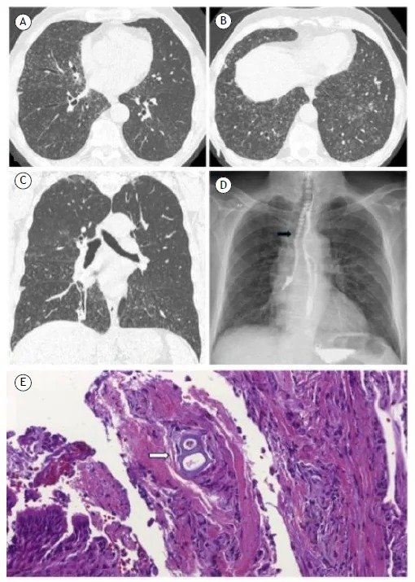
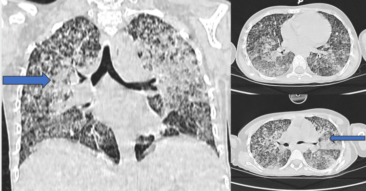
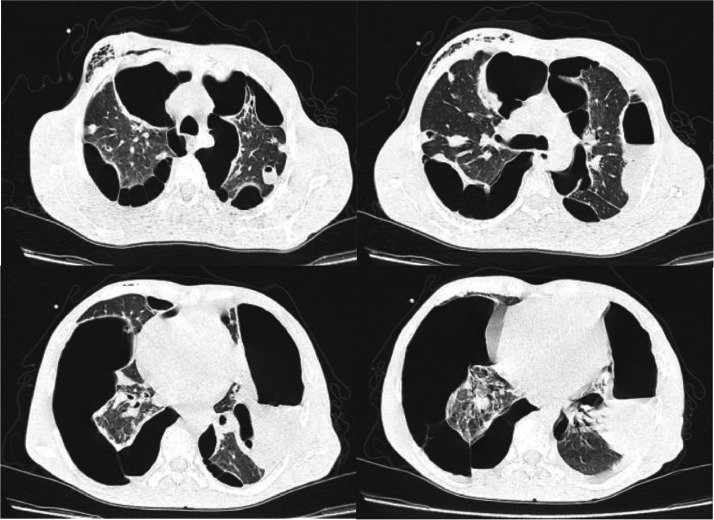
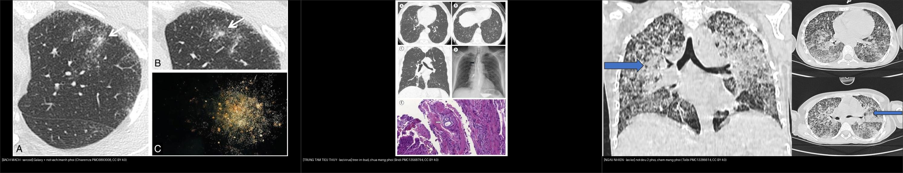

# 021 — Đa nốt phổi: trung tâm tiểu thùy / bạch mạch / ngẫu nhiên / Multiple nodules distribution

**Tags:** `pattern:not-da-o` `vung:phoi`
**Mức chắc chắn (certainty):** tổng hợp y văn (literature synthesis) — nhóm tự biên từ y văn mở, chưa gắn ca nguyên văn đơn lẻ.

## 1. Tổng quan — phân bố quyết định gamut

- Nốt đơn (bài 020) hỏi "lành hay ác"; đa nốt hỏi **"phân bố nào"** trước: **trung tâm tiểu thùy (centrilobular)** = đường thở; **bạch mạch (perilymphatic)** = vách/màng phổi/rốn; **ngẫu nhiên (random)** = máu.
- TẠI SAO: lao/nhầy lấp tiểu PQ → nốt trung tâm + tree-in-bud; sarcoid/lao lan bạch mạch → nốt vách + màng phổi + galaxy; lao kê/di căn máu → nốt ngẫu nhiên đều 2 phổi cả sát màng phổi.
- Ngưỡng: nốt vệ tinh (satellite) quanh hang/tổn thương chính + tree-in-bud = hoạt tính lao; galaxy > 1 cm + vệ tinh = sarcoid.

## 2. Gamut 3 phân bố

- **Trung tâm tiểu thùy:** lao nội phế quản, MAC, viêm tiểu PQ, hít — **tree-in-bud**, chừa màng phổi (cách màng vài mm).
- **Bạch mạch:** sarcoid (galaxy, hạch rốn 2 bên), lao bạch mạch, bụi phổi — nốt **dọc vách + dưới màng phổi + quanh rốn**.
- **Ngẫu nhiên:** lao kê (kê 1–3 mm đều), di căn máu (đa kích thước, đáy), thuyên tắc nhiễm khuẩn (feeding vessel, hang nhanh).

*Nhân đặc trung tâm + nốt nhỏ quanh (sarcoid) + hình thiên hà đối chiếu. Nguồn: Chiarenza et al., Insights into Imaging 2019 Fig. 15, CC BY 4.0.*

*Panel A–C: vô số **vi nốt trung tâm tiểu thùy** hai bên tạo **tree-in-bud**, **chừa màng phổi** (viêm tiểu phế quản hít sặc lan tỏa). Nguồn: Bridi G et al., *Respir Res Clin Pract* 2026, PMC13568794 Fig. 1, CC BY 4.0.*

*Phân bố **ngẫu nhiên**: vi nốt đều hai phổi **chạm cả màng phổi** và cả vùng đáy — lao kê (miliary TB). Nguồn: Talbi H et al., *Cureus* 2026, PMC13286614 Fig. 1, CC BY 4.0.*

*Phân bố **ngẫu nhiên theo mạch máu** (thuyên tắc nhiễm khuẩn): nốt/hang **ngoại vi hai bên**, kèm tràn khí màng phổi phải (bệnh cảnh viêm nội tâm mạc). Nguồn: Nasreddine F et al., *Radiol Case Rep* 2026, PMC13393430 Fig. 1, CC BY-NC-ND 4.0 (giữ nguyên bản).*

*Ba phân bố cạnh nhau: **bạch mạch** (galaxy/sarcoid) — **trung tâm tiểu thùy** (tree-in-bud) — **ngẫu nhiên** (lao kê). Nguồn: Chiarenza et al., PMC6893008 (CC BY 4.0) + Bridi G et al., PMC13568794 (CC BY 4.0) + Talbi H et al., PMC13286614 (CC BY 4.0). Ảnh ghép letterbox.*

## 3. Bảng so sánh

| Thực thể (entity) | Hình ảnh điển hình (HRCT) | Chốt vào (rule-in) | Chốt loại (rule-out) | Gợi ý xác nhận |
|---|---|---|---|---|
| Lao (trung tâm) | Tree-in-bud + nốt vệ tinh quanh hang, trên | **Tree-in-bud + hang trên** | Nốt dọc vách/màng phổi → bạch mạch | AFB/PCR |
| Sarcoid (bạch mạch) | **Galaxy > 1 cm** + nốt vách/màng phổi + hạch rốn 2 bên | **Galaxy + hạch rốn đối xứng** | Ngẫu nhiên đều + không hạch → kê/di căn | ACE, sinh thiết hạch |
| Lao kê/di căn (ngẫu nhiên) | Nốt **ngẫu nhiên đều** cả sát màng phổi | **Đều 2 phổi + chạm màng phổi** | Chừa màng vài mm → trung tâm tiểu thùy | Tìm ổ nguyên phát, máu |
| Thuyên tắc NK | Nốt ngoại vi + **feeding vessel** + hang nhanh | **Mạch nuôi + sốt + ổ nhiễm** | Không mạch nuôi → u hạt thường | Cấy máu, siêu âm tim |

## 4. Protocol

- HRCT lát mỏng 1–1,5 mm + MIP 5–10 mm (đếm nốt, thấy tree-in-bud/vessel rõ hơn).
- Nghi lao kê: X-quang chưa thấy không loại trừ — HRCT nhạy hơn nhiều.
- Nghi di căn: CT toàn thân tìm nguyên phát + PET.

## 5. Cạm bẫy

- **Nốt cạnh mạch cắt ngang** giả nốt trung tâm — cuộn MPR xem cuống mạch.
- **Khoảng cách tới màng phổi là mấu chốt phân bố:** trung tâm tiểu thùy **chừa màng phổi ~2–5 mm**; **ngẫu nhiên chạm màng phổi** — đừng gọi "trung tâm tiểu thùy" khi nốt sát màng phổi.
- **Galaxy lao cũng có** (kèm tree-in-bud) — đừng chốt sarcoid khi có tree-in-bud.
- **Thuyên tắc nhiễm khuẩn đổi RẤT nhanh:** nốt → hang → tràn khí trong vài ngày; chụp lại sớm, đừng "chờ ổn định".
- **Miliary TB X-quang sớm bình thường** — lâm sàng nặng + X-quang mờ nhạt = chụp HRCT.

## 6. Tự lượng giá — Blind Quiz

**Ca 1 — Nhìn lưới 3 phân bố, gọi tên từng phân bố TRƯỚC khi mở đáp án.**

- Hỏi: mỗi ô là phân bố nào? Dấu hiệu nào chốt phân bố (bạch mạch / trung tâm tiểu thùy / ngẫu nhiên)?

<b>Bấm để hiện đáp án (findings + chẩn đoán)</b>

- **Ô 1 = phân bố bạch mạch** (galaxy/sarcoid): nốt **dọc vách + quanh rốn + dưới màng phổi**, nhân trung tâm > 1 cm có nốt vệ tinh.
- **Ô 2 = phân bố trung tâm tiểu thùy** (tree-in-bud): vi nốt **cách màng phổi vài mm**, gắn nhánh phế quản/động mạch nhỏ hình "cây ra chồi".
- **Ô 3 = phân bố ngẫu nhiên** (lao kê): vi nốt **đều hai phổi, chạm cả màng phổi**, phân bố theo mạch máu.
- Nguồn ảnh: Chiarenza et al., PMC6893008 + Bridi G et al., PMC13568794 + Talbi H et al., PMC13286614 (đều CC BY 4.0).

**Ca 2 — Sốt nhẹ kéo dài, HRCT vi nốt hai bên. Phân bố nào? Nốt có chạm màng phổi không?**

- Hỏi: nốt nằm ở đâu so với màng phổi? Có nhánh nào gắn vào nốt? DDx ưu tiên?

<b>Bấm để hiện đáp án (findings + chẩn đoán)</b>

- **Dấu hiệu:** vô số **vi nốt trung tâm tiểu thùy** hai bên tạo **tree-in-bud**, **chừa màng phổi** vài mm, tập trung quanh nhánh phế quản–động mạch nhỏ.
- **Chẩn đoán (phân bố): trung tâm tiểu thùy = bệnh đường thở nhỏ** → lao nội phế quản (hoạt tính), MAC, viêm tiểu phế quản hít sặc.
- Nguồn ảnh: Bridi G et al., *Respir Res Clin Pract* 2026, PMC13568794 Fig. 1, CC BY 4.0 (ca viêm tiểu phế quản hít sặc lan tỏa).

**Ca 3 — Nam trẻ, gầy sút, sốt. CT ngực vi nốt đều 2 phổi. Phân bố nào? Chẩn đoán?**

- Hỏi: nốt phân bố theo cấu trúc nào? Có chạm màng phổi? Nghĩ bệnh gì? Xác nhận?

<b>Bấm để hiện đáp án (findings + chẩn đoán)</b>

- **Dấu hiệu:** vi nốt **đều hai phổi, chạm cả màng phổi**, không ưu thế trung tâm tiểu thùy hay vách → **phân bố ngẫu nhiên (theo mạch máu)**.
- **Chẩn đoán: lao kê (miliary TB)** — nốt 1–3 mm rải đều; xác nhận bằng AFB/PCR + CT ngực. (DDx: di căn máu — thường đa kích thước hơn, đáy).
- Nguồn ảnh: Talbi H et al., *Cureus* 2026, PMC13286614 Fig. 1, CC BY 4.0.

**Ca 4 — Bệnh nhân sốt + tiếng thổi tim, CT ngực nốt/hang ngoại vi hai bên. Phân bố? Cơ chế?**

- Hỏi: vì sao nốt **ngoại vi**? Dấu hiệu nào gợi **mạch máu** chứ không phải màng phổi? Biến chứng thấy trên ảnh?

<b>Bấm để hiện đáp án (findings + chẩn đoán)</b>

- **Dấu hiệu:** nhiều nốt/hang **ngoại vi hai bên**, + **tràn khí màng phổi phải** và dày màng phổi.
- **Chẩn đoán: thuyên tắc phổi nhiễm khuẩn (septic pulmonary emboli)** từ viêm nội tâm mạc — nốt phân bố **ngẫu nhiên theo mạch máu**, nhanh hoại tử thành hang, hay vỡ gây tràn khí.
- **Cơ chế:** mảnh sùi nhiễm khuẩn theo dòng máu; hang do hoại tử + nốt **thường đổi nhanh qua vài ngày**.
- Nguồn ảnh: Nasreddine F et al., *Radiol Case Rep* 2026, PMC13393430 Fig. 1, CC BY-NC-ND 4.0 (giữ nguyên bản).

**Ca 5 — Nhìn HRCT, gọi phân bố trước.**

- Hỏi: nhân trung tâm + nốt quanh là dấu gì? Bạch mạch hay ngẫu nhiên? Kèm hạch rốn thì nghĩ gì?

<b>Bấm để hiện đáp án</b>

- **Galaxy sign — sarcoid (bạch mạch):** nhân > 1 cm + nốt vệ tinh dọc vách; hạch rốn 2 bên đối xứng củng cố.
- Nguồn: Chiarenza et al., Fig. 15, CC BY 4.0.

## Bài liên quan chéo
- [001 – Tổng quan hệ Ngực](../001-tong-quan-he-nguc/lesson.md)
- [011 – Tiểu thùy thứ cấp](../011-tieu-thuy-phoi/lesson.md) (trung tâm tiểu thùy vs bạch mạch)
- [013 – Hạch nội phổi trạm 11–14](../013-hach-noi-phoi/lesson.md) (nốt đơn cạnh rãnh)
- [020 – Nốt phổi](../020-not-phoi/lesson.md) (nốt đơn)
- [031 – Viêm phổi mẫu hình](../031-viem-phoi-mau-hinh/lesson.md) (lao, tree-in-bud)

> Không dùng để chẩn đoán độc lập khi chưa có người hướng dẫn.
