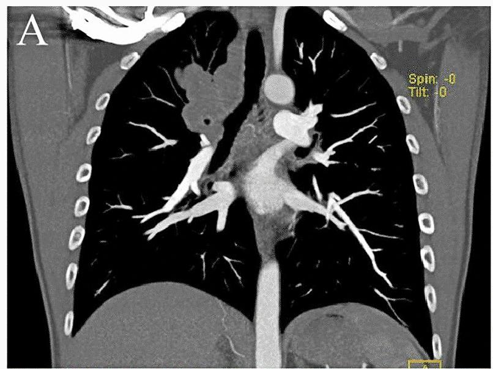
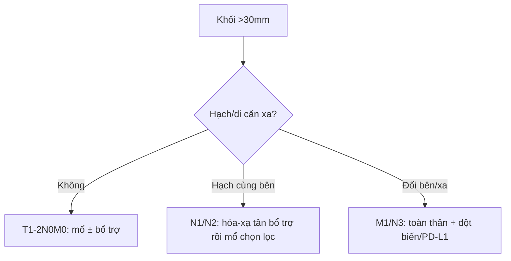

# 022 — Khối phổi (> 30 mm) & TNM ung thư phổi / Pulmonary mass & Lung cancer staging

**Tags:** `pattern:khoi` `vung:phoi` `score:TNM`
**Mức chắc chắn (certainty):** tổng hợp y văn (literature synthesis) — nhóm tự biên từ y văn mở, chưa gắn ca nguyên văn đơn lẻ.

## 1. Tổng quan — > 30 mm là thế giới khác + TNM 9

- **Khối (mass) > 30 mm:** xác suất ác cao hẳn nốt; câu hỏi chuyển từ "theo dõi hay không" sang **"giai đoạn mấy + mổ được không"**.
- TNM 9 (số nhớ nằm lòng): T1 ≤ 30 mm (a ≤ 10, b 11–20, c 21–30 mm); **T2 31–50 mm**; T3 51–70 mm hoặc xâm lấn thành ngực/carina; T4 > 70 mm hoặc carina/khí quản/tim/mạch lớn/cột sống. N: cùng bên rốn/trung thất (N1/N2) vs đối bên/trên đòn (N3). M: trong ngực đối bên (M1a), 1 ổ ngoài ngực (M1b), đa ổ (M1c).
- TẠI SAO kích thước quyết định: thể tích u ∝ tải đột biến + xác suất di căn hạch/xa; hạch to ngắn trục **≥ 10 mm** là ngưỡng bệnh lý (không đặc hiệu, cần PET/mô bệnh).

## 2. Gamut khối theo vị trí + bối cảnh

- **Trung tâm + hút thuốc + ho máu:** SCC (hang, Golden S — bài 030), SCLC (khối lớn + hạch sớm).
- **Ngoại vi + không hút thuốc:** adeno (kính mờ/bán đặc — bài 020), hamartoma (mỡ/vôi bỏng ngô), viêm tổ chức hóa.
- **Trẻ + nhiều hạch + B symptoms:** lymphoma (bao mạch không tắc — bài 060).
- **Nhanh + sốt + mủ:** áp-xe/viêm hoại tử (mức dịch — bài 025), nhồi máu bội nhiễm.

*CT coronal: khối thùy trên phải + hạch rốn/trung thất (panel A cắt từ figure gốc). Nguồn: Liu et al., Orphanet J Rare Dis 2023, CC BY 4.0.*

## 3. Bảng so sánh

| Thực thể (entity) | Hình ảnh điển hình | Chốt vào (rule-in) | Chốt loại (rule-out) | Gợi ý xác nhận |
|---|---|---|---|---|
| K phổi nguyên phát | Khối + hạch cùng bên, hang SCC / kính mờ adeno | **Khối > 30 + hạch + hút thuốc** | Mỡ/vôi bỏng ngô → hamartoma | PET-CT + sinh thiết + đột biến (EGFR/ALK/PD-L1) |
| Di căn đến phổi | **Nhiều nốt/khối 2 bên**, pháo đài (cannonball) | **Tiền sử K ngoài phổi + đa ổ** | Đơn độc không tiền sử → nguyên phát | CT toàn thân, so phim cũ |
| Lymphoma | Bao mạch không tắc + hạch nhiều nhóm + trẻ | **Bao mạch + B symptoms + tuổi trẻ** | Xâm lấn/tắc mạch → K xâm lấn | Sinh thiết hạch |
| Viêm/áp-xe giả u | Mức dịch + sốt + tan sau kháng sinh | **Tan sau điều trị + cấy (+)** | Tồn tại > 8 tuần → u | (nối bài 025/031) |

## 4. Protocol + flowchart giai đoạn

- **CT cản quang ngực-bụng + PET-CT toàn thân + MRI não** (adeno/SCLC giai đoạn đầy đủ); đo trục dài khối + trục ngắn hạch (≥ 10 mm).
- Ngưỡng mổ: I–IIIA (N2 đơn trạm chọn lọc) → hội chẩn đa chuyên khoa; IV → toàn thân.

## 5. Cạm bẫy

- **Hạch viêm/phản ứng ≥ 10 mm** sau viêm/lao — PET cũng bắt giả; mô bệnh quyết định.
- **Xẹp phổi sau khối** làm u trông to hơn — đo nhân đặc, đừng đo cả vùng xẹp.
- **Khối đỉnh + hội chứng Pancoast** (đau tay, Horner) — MRI đám rối cánh tay, đừng chỉ CT.

## 6. Tự lượng giá — Blind Quiz

**Ca 1 — Khối thùy trên phải + hạch. Đo và xếp TNM sơ bộ.**

- Hỏi: khối hay nốt (> 30 mm)? Hạch nhóm nào? T/N sơ bộ?

<b>Bấm để hiện đáp án</b>

- **Khối thùy trên phải + hạch rốn/trung thất** — kích thước khối (> 30 mm) + hạch cùng bên gợi ít nhất T2N1–2; cần PET + mô bệnh hoàn tất.
- ⚠️ Phản biện: ca gốc là **histiocytosis ALK+ hiếm** (không phải K phổi điển hình) — minh họa "khối + hạch", không suy ra mô bệnh từ hình thái.
- Nguồn: Liu et al., CC BY 4.0 (toàn figure A–F trong CREDITS).

**Ca 2 — Khối + hạch đối bên + 1 ổ thượng thận:** TNM? Hướng xử trí? *(Không ảnh local — suy luận từ mục 4.)*

<b>Bấm để hiện đáp án</b>

- **M1b/N3 — giai đoạn IV:** toàn thân (đột biến/PD-L1), không mổ triệt căn.

## Bài liên quan chéo
- [001 – Tổng quan hệ Ngực](../001-tong-quan-he-nguc/lesson.md)
- [020 – Nốt phổi](../020-not-phoi/lesson.md) (≤ 30 mm)
- [060 – Khối trung thất ITMIG](../060-khoi-trung-that-itmig/lesson.md) (lan trung thất)

> Không dùng để chẩn đoán độc lập khi chưa có người hướng dẫn.
