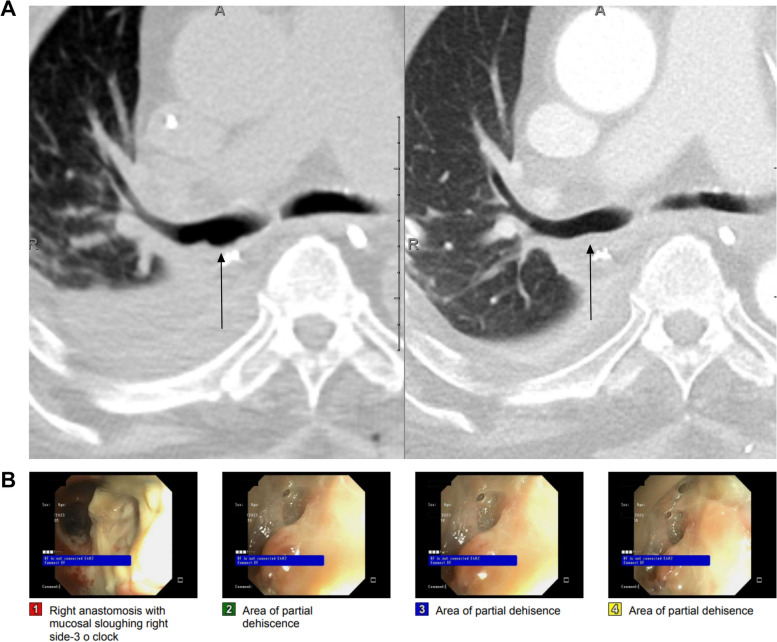
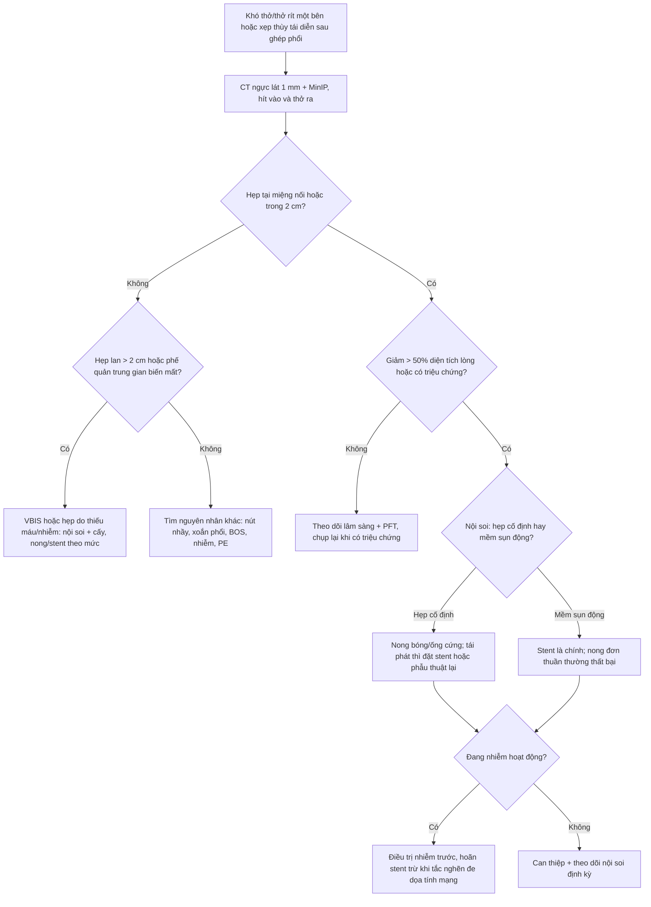
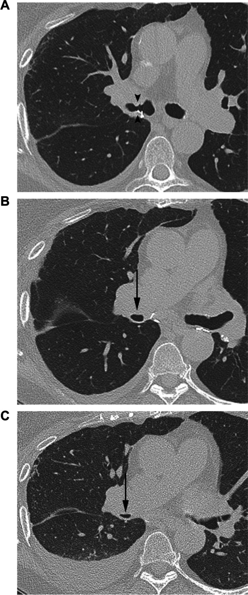
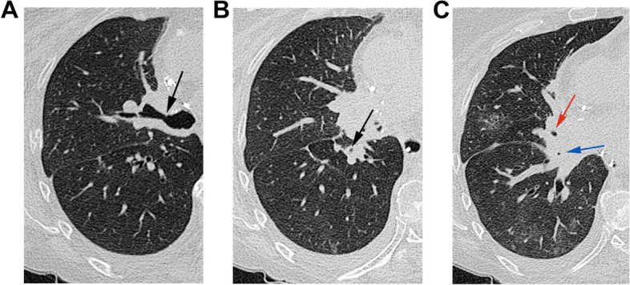
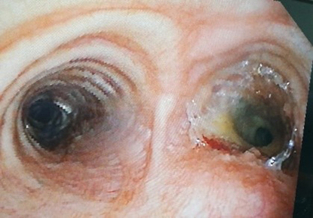

# 023 — Hẹp miệng nối phế quản sau ghép phổi: thiếu máu miệng nối, "phế quản biến mất" và ngưỡng can thiệp / Bronchial anastomotic stenosis after lung transplantation

**Tags:** `pattern:hep-duong-tho` `pattern:hep-mieng-noi` `pattern:xep-phoi` `pattern:mat-phang-khi` `vung:phe-quan` `vung:duong-tho` `vung:phoi` `protocol:CT-nguc-lat-mong` `protocol:noi-soi-phe-quan` `score:ISHLT-airway`

**Mức chắc chắn (certainty):** tổng hợp y văn (literature synthesis) — số liệu từ tổng quan ảnh học biến chứng ghép phổi *J Cardiothorac Surg* 2024 (PMC11067284, CC BY), đoàn hệ 342 ca *JHLT Open* 2026 (PMC12857399), đoàn hệ 651 bệnh nhân/1.191 miệng nối *Transpl Int* 2023 (PMC10613691), loạt can thiệp nội soi 14 ca (PMC11407335), khảo sát đa trung tâm về hệ phân độ ISHLT 2018 (PMC13279507). Nhóm **không có bệnh nhân của mình**.

> **Câu chốt:** hẹp miệng nối phế quản là **bệnh của thiếu máu miệng nối**, không phải "sẹo xấu": động mạch phế quản của mảnh ghép **không được nối lại**, nên miệng nối sống nhờ **dòng ngược từ động mạch phổi** cho tới khi tân mạch hình thành (**tới 6 tuần**). Vì thế biến chứng đi theo **trình tự thời gian**: **hoại tử/tách miệng nối trong tháng đầu → hẹp 2–3 tháng → mềm sụn (malacia) < 4 tháng**. Trên CT, **giảm > 50% diện tích lòng** tại vùng **trong 2 cm quanh miệng nối** là ngưỡng có ý nghĩa; nhưng **nội soi phế quản vừa xác nhận vừa điều trị**, và **chỉ can thiệp khi có triệu chứng/tắc nghẽn có ý nghĩa** — không điều trị một con số trên phim.

## 1. Tổng quan bệnh học – cơ chế hình ảnh

### 1.1 Vì sao miệng nối phế quản bị thiếu máu
- Mảnh ghép phổi mất **nguồn máu động mạch phế quản** (thường không nối lại); miệng nối sống bằng **dòng ngược chậm từ tuần hoàn phổi** + **tân mạch** mọc vào trong **khoảng 6 tuần** (PMC11067284). Bất kỳ yếu tố nào làm giảm dòng này — **tụt áp, thiếu dịch, thông khí kéo dài, nhiễm khuẩn, PGD (primary graft dysfunction), thuốc ức chế mTOR** — đều đẩy tới hoại tử rồi hẹp.
- Trình tự mô bệnh: **thiếu máu → hoại tử niêm mạc/sụn → tách (dehiscence) → tổ chức hạt → xơ hẹp**; hẹp là **di chứng của quá trình lành**, nên hẹp **không xuất hiện ngay** mà sau **2–3 tháng** (PMC11067284).
- **Nhánh phải (bronchus intermedius)** hay bị nhất vì **lòng hẹp nhất** (PMC11067284).

### 1.2 TẠI SAO hình ảnh trông như vậy (vật lý + mô bệnh)
| Dấu hiệu | Cơ chế | Cách đọc |
|---|---|---|
| **Hẹp khu trú tại miệng nối trên CT** | Xơ + tổ chức hạt co kéo thành phế quản; sụn có thể mất | Đo **diện tích lòng** ở lát mỏng **1 mm**, so với phế quản **ngay dưới miệng nối** và bên đối diện; **> 50% giảm diện tích = có ý nghĩa** (PMC11067284) |
| **Hẹp do mềm sụn (malacia)** | Sụn hoại tử mất độ cứng → thành trước sa vào khi thở ra | Chỉ thấy khi **chụp thì thở ra**: **> 50% giảm diện tích lòng khi thở ra** (PMC11067284) → cần **CT 2 thì hít vào–thở ra** hoặc nội soi động |
| **"Phế quản biến mất" (vanishing bronchus intermedius)** | Xơ lan dọc phế quản thùy/phân thùy, không chỉ tại miệng nối | Hẹp **> 2 cm cách miệng nối**; gặp ở **2,5–3%** ca ghép, thường **~6 tháng** sau ghép (PMC11067284) |
| **Khí ngoài lòng phế quản quanh miệng nối** | Tách miệng nối → khí vào trung thất/mô dưới da | Đây là dấu của **dehiscence**, thường **trong tháng đầu**; khí đơn thuần không đồng nghĩa tách toàn bộ |
| **Xẹp phổi/khoang khí sau hẹp** | Hẹp → giảm thông khí → xẹp thùy, ứ nhầy, viêm phổi tái diễn | Xẹp **một thùy tái diễn cùng bên ghép** là dấu gián tiếp của hẹp |

### 1.3 Ngưỡng định lượng cần nhớ
- Biến chứng đường thở sau ghép: **2–18%**, tử vong **2–4%** (đồng thuận **ISHLT 2018**); hẹp là loại **thường gặp nhất — 67%** các biến chứng (PMC10613691).
- Đoàn hệ 1.191 miệng nối: **6,4%** miệng nối có biến chứng có ý nghĩa lâm sàng; **trung vị sống 101 tháng** so với **136 tháng** ở người không biến chứng (**p = 0,044**) (PMC10613691).
- Đoàn hệ 342 ca: **9,9%** hẹp cần can thiệp; yếu tố nguy cơ độc lập: **nam (OR 2,77; KTC 95% 1,13–6,79)**, **PGD (OR 3,45; 1,23–9,69)**, **cấy đường thở dương tính trước khi hẹp (OR 3,97; 1,67–9,48 — đặc biệt *Pseudomonas* và Gram âm)**; **không** làm tăng tử vong/thải ghép/CLAD trong đoàn hệ này (PMC12857399) — mâu thuẫn với PMC10613691, nêu rõ vì sao: khác định nghĩa "biến chứng có ý nghĩa" và cỡ mẫu.
- 145 ca ghép hai phổi: **33,1%** có biến chứng đường thở; nhóm này có **điểm vận mạch–co bóp cao hơn (18,0 vs 13,0; p = 0,021)** và **lactate cao hơn (9,1 vs 6,8; p = 0,017)** (PMC12240133) → tụt áp/thời gian thiếu tưới máu là đòn bẩy phòng ngừa.
- Tách miệng nối: **1–10%**, chủ yếu **tháng đầu**; mềm sụn: **1–4%**, trong **4 tháng** (PMC11067284).
- Can thiệp nội soi (27 phiên ở 14 bệnh nhân): **74,1%** phiên đạt thông thoáng, **81,5%** dùng nong bóng/ống cứng, **57,4%** bệnh nhân đạt thông thoáng lâu dài (PMC11407335).

## 2. Mẫu hình + chẩn đoán phân biệt theo vị trí (gamut)

### 2.1 Theo vị trí so với miệng nối
- **Tại miệng nối (< 2 cm)**: hẹp xơ sau lành tách, tổ chức hạt, hẹp do chỉ khâu, mềm sụn vùng quanh nối.
- **Xa miệng nối (> 2 cm)**: **VBIS** (phế quản trung gian), hẹp do thiếu máu lan, hẹp sau nhiễm (kể cả *Aspergillus*), tái phát bệnh nền.
- **Toàn bộ cây phế quản bên ghép**: mềm sụn lan tỏa, hẹp do thải ghép mạn (BOS — bronchiolitis obliterans syndrome) — khác hẳn hẹp đường thở lớn.

### 2.2 Gamut theo hình thái
- **Hẹp cố định (fixed)**: xơ, hẹp không đổi giữa 2 thì → nong/stent.
- **Hẹp động (dynamic)**: mềm sụn, sa thành trước khi thở ra → stent là lựa chọn chính, nong đơn thuần thất bại.
- **Tắc hoàn toàn**: nút nhầy (mucus plug), hẹp độ d (100%), xoắn phổi (torsion) — cấp cứu.
- **Không hẹp nhưng có khí ngoài lòng**: tách miệng nối, rò phế quản–màng phổi.

## 3. Bảng so sánh phân biệt (ma trận đối chiếu)

| Thực thể (entity) | Hình ảnh điển hình | Chốt vào (rule-in) | Chốt loại (rule-out) | Gợi ý xác nhận |
|---|---|---|---|---|
| **Hẹp miệng nối xơ (anastomotic stenosis)** | Hẹp **khu trú ≤ 2 cm** quanh miệng nối, thành dày, **giảm > 50% diện tích lòng**, không đổi giữa 2 thì | **Hẹp cố định tại miệng nối + xẹp/ứ nhầy đầu xa** | Hẹp **lan dọc > 2 cm** hoặc **thay đổi theo thì thở** → nghĩ VBIS/mềm sụn | Nội soi: vòng xơ, không phải nút nhầy; nong bóng |
| **Mềm sụn (malacia)** | Thành trước **sa vào khi thở ra**, lòng phế quản **giảm > 50% khi thở ra**, hồi phục khi hít vào | **Khác biệt hít vào–thở ra** trên CT 2 thì | Hẹp **như nhau 2 thì** → hẹp xơ cố định | Nội soi động; CT 2 thì |
| **Tách miệng nối (dehiscence)** | **Khí ngoài lòng** quanh miệng nối, bờ phế quản không liên tục, tràn khí trung thất/màng phổi, **tháng đầu** | **Khí quanh miệng nối + rò khí kéo dài** | Khí **không quanh miệng nối** (do thở máy/chấn thương) → không phải tách | Nội soi; CT mô mềm |
| **Nút nhầy (mucus plug)** | Tắc lòng phế quản **hình ống/ngón tay**, đậm độ mô mềm, **không dày thành**, thay đổi giữa các lần chụp | Tắc **trong lòng**, thành mỏng, di chuyển/theo thời gian | Dày thành + hẹp cố định → hẹp thực thể | Hút qua nội soi; chụp lại sau làm sạch |
| **Xoắn phổi (torsion)** | **Phế quản + mạch "thắt"** đột ngột, phổi **tăng đậm đặc**, màng phổi dày, **trung thất lệch** | Thắt cả **phế quản và mạch** cùng lúc, bệnh cảnh tối cấp | Chỉ hẹp phế quản, mạch bình thường → hẹp đường thở | CTA; mổ cấp |
| **Tái phát bệnh nền / hẹp do nhiễm** | Hẹp **lan, bờ không đều**, có nốt/dày niêm mạc, bệnh cảnh nhiễm | Hẹp tiến triển **ngoài vùng miệng nối**, đờm/soi có nấm, vi khuẩn | Hẹp **đúng vòng miệng nối, đối xứng** → hẹp xơ | Soi + rửa phế quản lấy bệnh phẩm |
| **Hẹp đường thở nhỏ (BOS/CLAD)** | Bẫy khí, giãn phế quản, giảm đậm độ, **không hẹp đường thở lớn** | **FEV1 giảm** + hình ảnh đường thở nhỏ | Hẹp **đường thở lớn** thấy rõ trên CT → can thiệp nội soi được | PFT + HRCT thì thở ra |

*Trên (A): hai lát CT phổi cách nhau 1 tuần sau ghép — bờ sau miệng nối phải mất liên tục, khí ngoài lòng (mũi tên). Dưới (B): nội soi xác nhận vùng tách một phần. Ảnh nguyên bản, không crop, từ Friedlander S và cs, *J Cardiothorac Surg* 2024, CC BY (PMC11067284), Fig. 2.*

## 4. Protocol chụp + hệ phân độ/điểm chuẩn hóa

### 4.1 Protocol
- **CT ngực lát mỏng ≤ 1 mm**, tái tạo **MinIP** (thickness tối thiểu 2–5 mm) theo trục phế quản để thấy hẹp dọc; **hít vào tối đa + thở ra tối đa** khi nghi mềm sụn.
- Đọc **hai cửa sổ**: phổi (lòng phế quản, xẹp, ứ nhầy) và trung thất (khí ngoài lòng, thành phế quản, hạch, mạch).
- **Đo diện tích lòng** trên lát vuông góc trục phế quản, **so với phế quản lành ngay dưới** và bên đối diện; báo **% giảm diện tích** chứ không chỉ "hẹp".
- **Nội soi phế quản ống mềm** là **chuẩn xác nhận** và là **cửa điều trị** (nong, gắp nút, đốt, đặt stent) — CT định hướng, nội soi quyết định.
- Đánh giá kèm: **PFT** (FEV1), **cấy/rửa phế quản** (nhiễm là yếu tố nguy cơ và chống chỉ định tương đối của stent), **siêu âm tim** nếu nghi tăng áp phổi.

### 4.2 Hệ phân độ ISHLT 2018 (Adult and Pediatric Airway Complications)
Bảng phân độ theo **loại (I/D/S/M) × vị trí (a/b/c) × mức độ (a–d)** — bảng dưới trích đúng ngưỡng (PMC13279507):

| Loại | Vị trí | Mức độ |
|---|---|---|
| **I — thiếu máu/hoại tử** | a. quanh miệng nối (< 1 cm); b. lan > 1 cm tới đường thở lớn; c. lan > 1 cm vào phế quản thùy/phân thùy | a. thiếu máu < 50% chu vi; b. thiếu máu 50–100%; c. hoại tử < 50%; d. hoại tử 50–100% |
| **D — tách** | a. phần sụn; b. phần màng; c. cả hai | a. 0–25% chu vi; b. > 25–50%; c. > 50–75%; d. > 75% |
| **S — hẹp** | a. tại miệng nối; b. miệng nối + thùy/phân thùy; c. chỉ thùy/phân thùy | a. giảm 0–25% diện tích; b. > 25–50%; c. > 50 đến < 100%; d. tắc 100% |
| **M — mềm sụn** | a. quanh miệng nối (< 1 cm); b. lan tỏa | (đánh giá động học theo thì thở ra) |

- **Hẹp độ c (giảm > 50% diện tích)** là ngưỡng thực hành để xem xét can thiệp (PMC11067284); độ d = tắc hoàn toàn là **cấp cứu**.
- **Phản biện:** chỉ **41,2% quốc gia** trong khảo sát dùng hệ này ở **100% trung tâm**, và **59,6%** trung tâm muốn sửa lại hệ phân độ (PMC13279507) → dùng để **chuẩn hóa báo cáo**, không thay thế đánh giá lâm sàng.

## 5. Biến thể bình thường và cạm bẫy

- **Hẹp nhẹ không triệu chứng:** giảm **0–25% (độ a)** có thể chỉ là **biến thể lành sau nối**, đừng can thiệp; chỉ theo dõi PFT và chụp lại khi triệu chứng.
- **Không chụp thì thở ra → bỏ sót mềm sụn:** hẹp động chỉ lộ khi **thở ra**; CT một thì hít vào có thể báo "bình thường".
- **Nút nhầy giả hẹp:** nút nhầy **đậm độ mô mềm trong lòng**, thành phế quản **mỏng, không dày**; hẹp thật có **thành dày + hẹp cố định**. Chụp lại sau khi hút/nội soi để tránh đặt stent oan.
- **Xẹp thùy do hẹp vs do tắc nút:** xẹp **tái diễn cùng một thùy** là dấu gián tiếp của hẹp; nhưng nguyên nhân có thể là **nút nhầy** — cần nội soi trước khi kết luận.
- **Khí trung thất sau mổ ghép là bình thường trong vài ngày đầu**; chỉ gọi **tách miệng nối** khi khí **quanh miệng nối, kéo dài, kèm rò khí/xẹp phổi**.
- **Sai số đo:** đo trên mặt phẳng chéo làm lòng phế quản trông hẹp hơn; luôn **tái tạo vuông góc trục** và so với phế quản liền kề, không đo một lát duy nhất.
- **Đặt stent khi còn nhiễm hoạt động:** làm tăng mô hạt, nhiễm stent và di chuyển — điều trị nhiễm trước; stent chỉ khi **tắc nghẽn đe dọa tính mạng** hoặc sau khi kiểm soát nhiễm.
- **Nhầm với tái phát bệnh nền:** hẹp **lan ngoài vùng miệng nối, bờ không đều** phải lấy bệnh phẩm (nấm, vi khuẩn, tế bào) trước khi quy cho "hẹp xơ".

## 6. Tự lượng giá — Blind Quiz (bấm để hiện đáp án)

**Ca 1 — nam 67 tuổi, ghép hai phổi vì COPD, khó thở + thở rít bên phải 3 tháng sau ghép**

- Bối cảnh: FEV1 giảm 25% so với mốc 6 tuần; không sốt, CRP bình thường.
- Câu hỏi: (1) Dấu hiệu ở hình A? (2) Hình B và C khác nhau vì sao? (3) Can thiệp gì và vì sao không chỉ nong?

<b>Bấm để hiện đáp án (findings + chẩn đoán)</b>

- Dấu hiệu: **A** — hẹp khu trú phế quản phải tại miệng nối (đầu mũi tên), thành dày, giảm > 50% diện tích lòng; **B** (hít vào) phế quản trung gian còn thông; **C** (thở ra) **sa thành trước, gần như mất lòng** = mềm sụn động.
- Chẩn đoán: **hẹp miệng nối + mềm sụn (malacia)** — hẹp động, không chỉ xơ cố định.
- Vì sao không chỉ nong: nong bóng xử lý được vòng xơ nhưng **không giữ được thành mềm sụn**; cần **stent** (silicone/kim loại có màng hoặc stent phân hủy sinh học) ± đốt mô hạt.
- Nguồn ảnh: Friedlander S và cs, *J Cardiothorac Surg* 2024, CC BY (PMC11067284), Fig. 3.

**Ca 2 — nữ 61 tuổi, ghép hai phổi vì thiếu alpha-1 antitrypsin, ho kéo dài, X-quang có xẹp thùy giữa tái diễn**

- Bối cảnh: không sốt; cấy đờm *Pseudomonas aeruginosa* dương tính 2 lần trước đó.
- Câu hỏi: Hẹp ở đâu? Có phải hẹp miệng nối không? Hướng xử trí khác gì ca 1?

<b>Bấm để hiện đáp án (findings + chẩn đoán)</b>

- Dấu hiệu: **A** hẹp phế quản thùy trên phải; **B** hẹp phế quản trung gian; **C** hẹp phế quản thùy giữa phải (mũi tên đỏ) và nhánh dưới (mũi tên xanh) — **nhiều vị trí, ngoài miệng nối**.
- Chẩn đoán: **hẹp phế quản không tại miệng nối (non-anastomotic), dạng VBIS/thiếu máu lan** — gặp ở **2,5–3%** ca ghép, thường ~6 tháng sau ghép; nhiễm *Pseudomonas* là yếu tố nguy cơ (OR 3,97).
- Hướng xử trí: khó nong đơn thuần vì hẹp lan và tái phát; cần **nội soi + cấy/kháng sinh theo kháng sinh đồ**, nong ± stent, và theo dõi PFT; không đặt stent khi còn nhiễm hoạt động nếu không tắc nghẽn đe dọa tính mạng.
- Nguồn ảnh: Friedlander S và cs, *J Cardiothorac Surg* 2024, CC BY (PMC11067284), Fig. 4.

**Ca 3 — nam 45 tuổi, hẹp phế quản phải tái phát sau 2 lần nong, đã từng đặt stent phân hủy sinh học**

- Bối cảnh: khó thở tăng dần, thở rít; CT cho thấy hẹp tại miệng nối phải.
- Câu hỏi: Hình nội soi mô tả gì? Vì sao stent phân hủy sinh học có thể thất bại? Bước tiếp theo?

<b>Bấm để hiện đáp án (findings + chẩn đoán)</b>

- Dấu hiệu: **hẹp phế quản phải** (bên phải ảnh) còn **stent phân hủy sinh học cũ** đã tiêu một phần; lòng phế quản hẹp không đều, niêm mạc xơ.
- Vì sao thất bại: stent phân hủy sinh học mất lực đỡ theo thời gian trong khi **quá trình xơ vẫn tiếp diễn**; hẹp tái phát sau khi stent tiêu — cần đánh giá lại bằng CT + nội soi trước khi đặt stent mới.
- Bước tiếp theo: **nội soi + nong, cân nhắc stent mới (silicone hoặc kim loại có màng)**, kiểm soát nhiễm, và **phẫu thuật tái tạo/ghép lại** nếu hẹp tái phát nhiều lần.
- Nguồn ảnh: *J Cardiothorac Surg* 2025 (PMC11776313), CC BY-NC-ND 4.0, Fig. 5 — ảnh **nguyên bản, không crop/ghép**.

## Bài liên quan chéo
- [019 — Hẹp miệng nối động mạch phổi sau ghép phổi](../019-hep-mieng-noi-dong-mach-phoi-sau-ghep-phoi/lesson.md)
- [049 — Theo dõi sau cắt thùy phổi bẩm sinh](../049-theo-doi-sau-cat-thuy-phoi-bam-sinh/lesson.md)
- [099 — Hẹp tĩnh mạch phổi sau ablation & sau ghép phổi](../099-hep-tinh-mach-phoi-sau-ablation-ghep-phoi/lesson.md)
- [670 — BOS sau ghép tế bào gốc/ghép phổi: bệnh của đường thở nhỏ](../670-bos-sau-ghep-te-bao-goc-ghep-phoi-o-tre/lesson.md)
- [061 — Tràn khí trung thất](../061-tran-khi-trung-that/lesson.md)

> **Disclaimer y tế:** bài học dùng cho mục đích học tập, **không dùng để chẩn đoán độc lập** khi chưa có người hướng dẫn. Chỉ định nong/stent thuộc về kíp ghép phổi và nội soi can thiệp.
