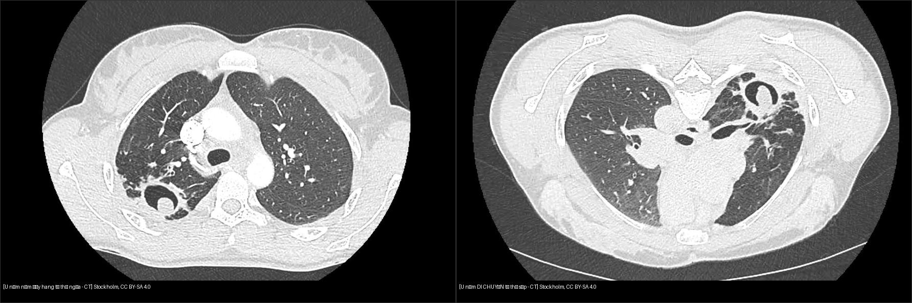
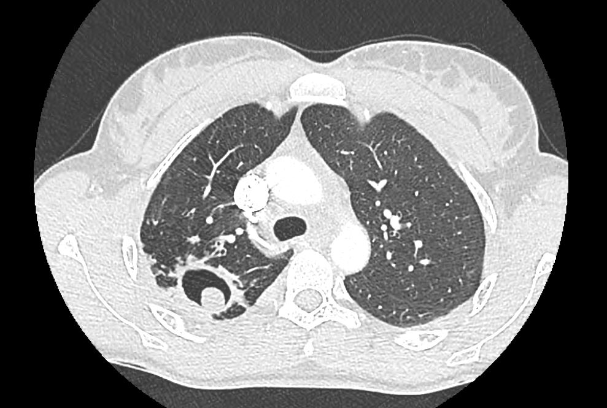
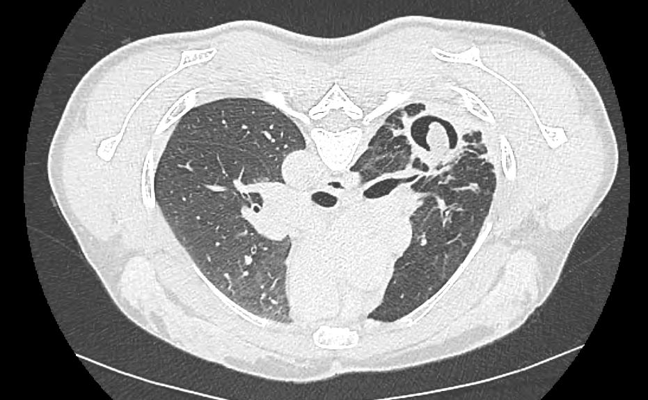
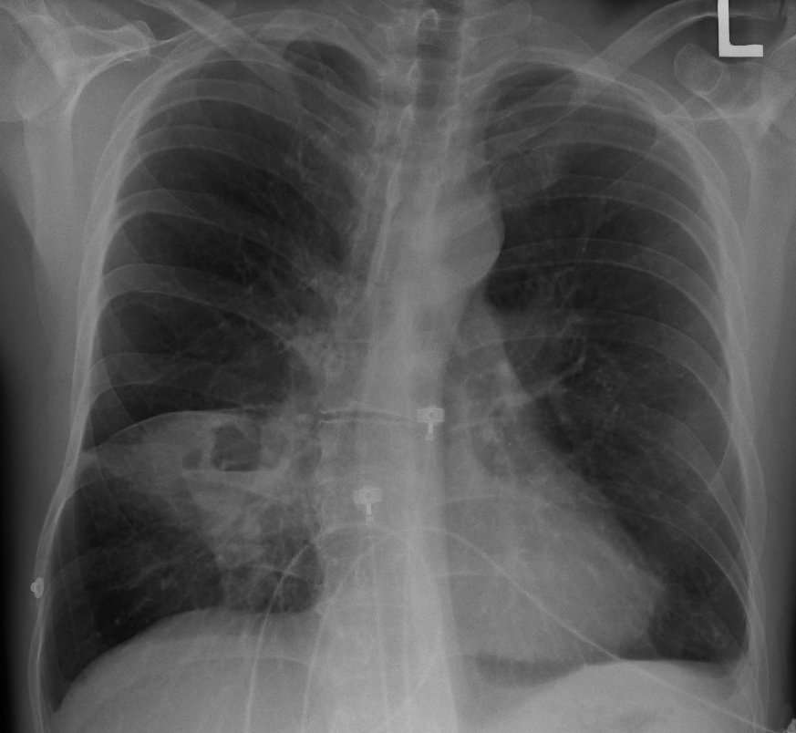
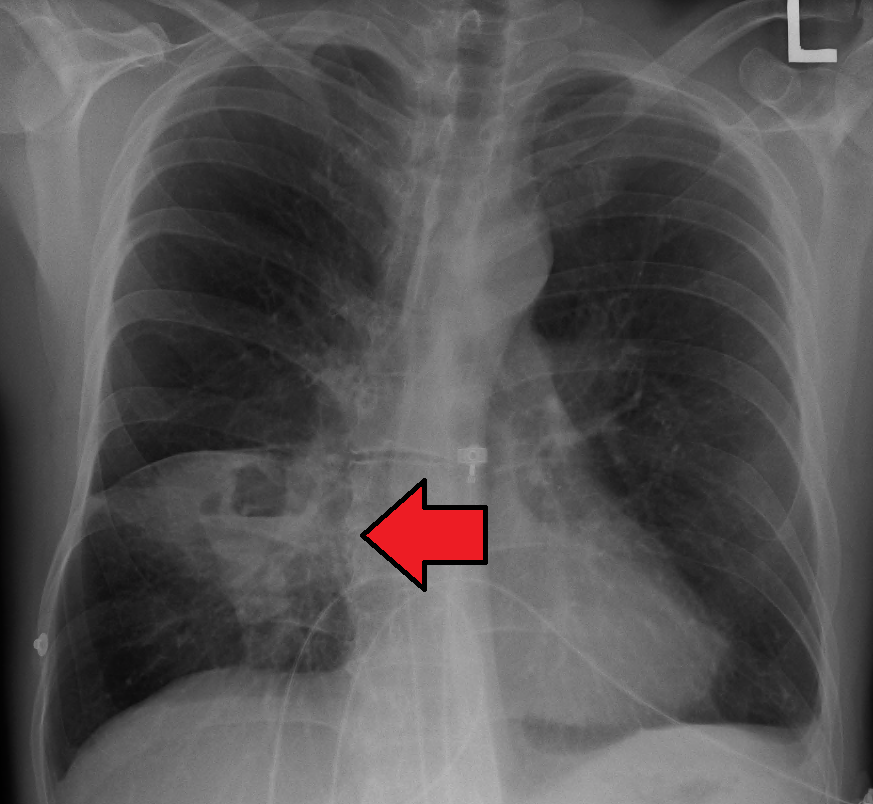

# 025 — Hang & nấm phổi: dấu liềm khí / Cavitary lesions & Air-crescent sign

**Tags:** `pattern:hang` `vung:phoi`
**Mức chắc chắn (certainty):** tổng hợp y văn (literature synthesis) — nhóm tự biên từ y văn mở, chưa gắn ca nguyên văn đơn lẻ.

## 1. Tổng quan — hang hình thành thế nào + ngưỡng thành hang

- **Hang (cavity):** vùng khí trong tổn thương/nốt/khối do hoại tử thải ra ngoài qua phế quản. 3 câu hỏi mọi hang: **(1) thành dày bao nhiêu? (2) có mức khí-dịch? (3) trong hang có gì di động?**
- Ngưỡng định lượng nằm lòng (đo tại **điểm dày nhất của thành hang — maximum wall thickness**, theo Woodring): thành mỏng đều **≤ 4 mm → ~92% lành tính**; thành dày gồ ghề **> 15 mm → ~95% ác tính** (điển hình ung thư biểu mô vảy — SCC hoại tử trung tâm); **5–15 mm là vùng chồng lấp**, không kết luận một mình.
- TẠI SAO thành dày gợi ác: u phát triển không đều + hoại tử trung tâm thiếu máu → bờ trong gồ ghề, lệch tâm; lao/áp-xe viêm lan đều → thành mỏng đều hơn.

## 2. Mẫu hình + chẩn đoán phân biệt theo số lượng & cơ chế (Gamut)

- **Hang đơn độc:** lao (thùy trên/đỉnh-sau + nốt vệ tinh), K hoại tử SCC (thành dày lệch tâm), áp-xe vi khuẩn (mức dịch + sốt hôi), aspergilloma (hang có sẵn + khối di động).
- **Đa hang:** nhiễm trùng tạo mủ (viêm phổi hoại tử đa ổ), thuyên tắc nhiễm khuẩn (septic emboli — nốt ngoại vi đa dạng + feeding vessel), tự miễn u hạt GPA/Wegener (hang đa ổ + xoang/thận), di căn hoại tử SCC.
- Gợi nhớ **CAVITY**: **C**ancer (SCC), **A**utoimmune (GPA), **V**ascular (septic emboli), **I**nfection (TB/bacteria/fungi), **T**rauma, **Y**outh-congenital (kén bẩm sinh bội nhiễm).

## 3. Bảng so sánh phân biệt (ma trận đối chiếu)

| Thực thể (entity) | Hình ảnh điển hình | Chốt vào (rule-in) | Chốt loại (rule-out) | Gợi ý xác nhận |
|---|---|---|---|---|
| Hang lao (TB) | Thùy trên/đỉnh-sau, thành mỏng đều, **nốt vệ tinh + tree-in-bud**, thường không mức dịch-khí | **Tree-in-bud + nốt vệ tinh + vị trí trên** | Thành > 15 mm gồ ghề + không nốt vệ tinh → nghĩ K | AFB/PCR, CT lát mỏng |
| K phổi hoại tử (SCC) | Thành **dày > 15 mm, lệch tâm, bờ trong gồ ghề**, không nốt vệ tinh | **Thành dày lệch tâm + tiền sử hút thuốc + tuổi** | Thành ≤ 4 mm đều + nốt vệ tinh → lao | Sinh thiết, PET-CT |
| Áp-xe vi khuẩn | **Mức khí-dịch rõ**, thành dày đều, đông đặc quanh, **góc nhọn với màng phổi** | **Sốt cao + hôi miệng + mức dịch ngang** | Góc tù + split pleura → mủ màng phổi (bài 040), không phải áp-xe | Kháng sinh, dẫn lưu nếu > 6 cm/kéo dài |
| Aspergilloma (Monod) | Khối nấm trong hang có sẵn + **di động ngửa↔sấp** | **Khối di chuyển khi đổi tư thế** | Dính thành mọi tư thế → u/nấm dính, cần mô bệnh | CT ngửa-sấp, tiền sử hang lao cũ, miễn dịch bình thường |

*Trái: tư thế ngửa — khối nấm nằm đáy hang, liềm khí phía trên. Phải: tư thế sấp — khối ĐÃ DI CHUYỂN. Nguồn: Stockholm, CC BY-SA 4.0. Ảnh ghép letterbox.*

### Monod sign vs Air-crescent sign thực thụ (đọc chuẩn xác)
- **Monod sign:** khối u nấm (*aspergilloma*) nằm trong **hang có sẵn** (lao cũ) ở người **miễn dịch bình thường**, **di động khi đổi tư thế ngửa ↔ sấp** — nghiệm pháp CT 2 tư thế là chốt.
- **Air-crescent sign thực thụ:** gặp trong nấm *Aspergillus* **xâm lấn mạch máu (angioinvasive)** ở BN **giảm bạch cầu hạt nặng**; xuất hiện khi bạch cầu hồi phục làm mảnh phổi hoại tử tách khỏi thành — **dấu hiệu tiên lượng tốt**, không cần hang từ trước.
- Cạm bẫy: liềm khí cũng gặp trong nhồi máu phổi khỏi, máu tụ — bối cảnh quyết định.

## 4. Protocol

- **CT ngực lát mỏng + 2 tư thế (ngửa-sấp)** khi nghi u nấm trong hang; đo thành hang điểm dày nhất, ghi mm.
- **X-quang:** phát hiện hang + mức dịch; CT mới đo thành và tìm nốt vệ tinh/tree-in-bud.
- Hang + ho máu: CTA tìm động mạch phế quản giãn (**~90%** nguồn chảy máu) + bắt buộc tìm **giả phình Rasmussen (Rasmussen aneurysm — giả phình nhánh động mạch phổi sát thành hang lao, ~10%)** để không nút mạch sót nguồn.

## 5. Cạm bẫy

- **Hang lao cũ xơ hóa** dễ đọc nhầm tổn thương mới — so phim cũ, tìm tree-in-bud hoạt tính.
- **Áp-xe vs mủ màng phổi (tiêu chuẩn hình học):** áp-xe hình cầu nên chiều dài mức khí-dịch trên phim **thẳng và nghiêng bằng nhau**; mủ màng phổi hình thấu kính dẹt nên mức dịch **dài ngắn khác nhau** trên 2 bình diện. Kèm: áp-xe góc nhọn + vượt rãnh; mủ màng phổi góc tù + split pleura (bài 040).
- **Vùng 5–15 mm:** không chốt lành/ác một mình — cộng bối cảnh + PET/sinh thiết.

## 6. Tự lượng giá — Blind Quiz

**Ca 1 — BN HIV+, hang thùy trên phải. Nhìn phim ngửa, mô tả trước.**

- Hỏi: trong hang có gì? Liềm khí ở đâu? 3 phân biệt + nghiệm pháp xác nhận?

<b>Bấm để hiện đáp án</b>

- Khối đặc trong hang + liềm khí phía trên — nghĩ **aspergilloma trong hang lao cũ**. Nghiệm pháp: chụp thêm tư thế sấp xem khối có di chuyển (Monod).
- Đối chiếu phim sấp:

- Khối ĐÃ DI CHUYỂN theo trọng lực → **u nấm tự do, không phải u dính thành**.
- Nguồn: Stockholm, CC BY-SA 4.0.

**Ca 2 — Sốt cao, ho hôi, X-quang có hang mức dịch:**

<b>Bấm để hiện đáp án</b>

- **Áp-xe phổi vi khuẩn:** hang + mức khí-dịch ngang + đông đặc quanh, góc nhọn với màng phổi (khác mủ màng phổi góc tù).
- Nguồn: Doc James, CC BY-SA 4.0.

## Bài liên quan chéo
- [001 – Tổng quan hệ Ngực](../001-tong-quan-he-nguc/lesson.md)
- [020 – Nốt phổi](../020-not-phoi/lesson.md) (nốt hang trung tâm)
- [031 – Viêm phổi mẫu hình](../031-viem-phoi-mau-hinh/lesson.md) (áp-xe, lao)
- [040 – Tràn dịch màng phổi](../040-tran-dich-mang-phoi/lesson.md) (áp-xe vs mủ màng phổi)

> Không dùng để chẩn đoán độc lập khi chưa có người hướng dẫn.
