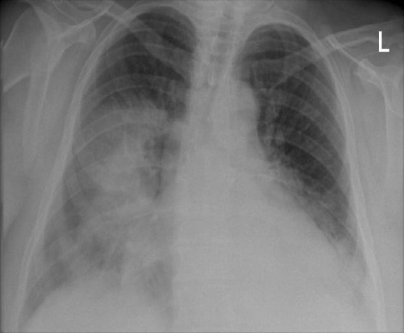
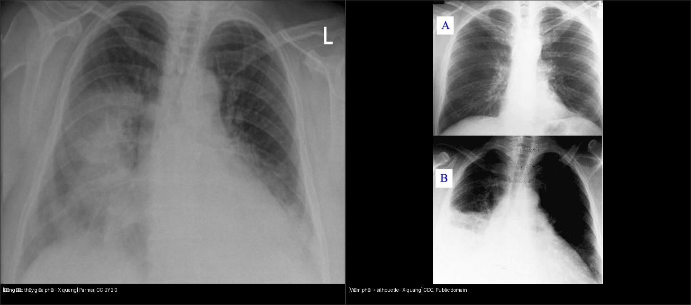
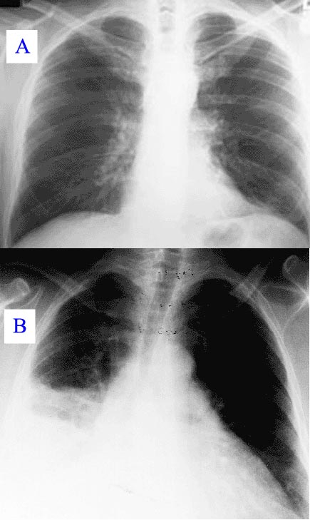
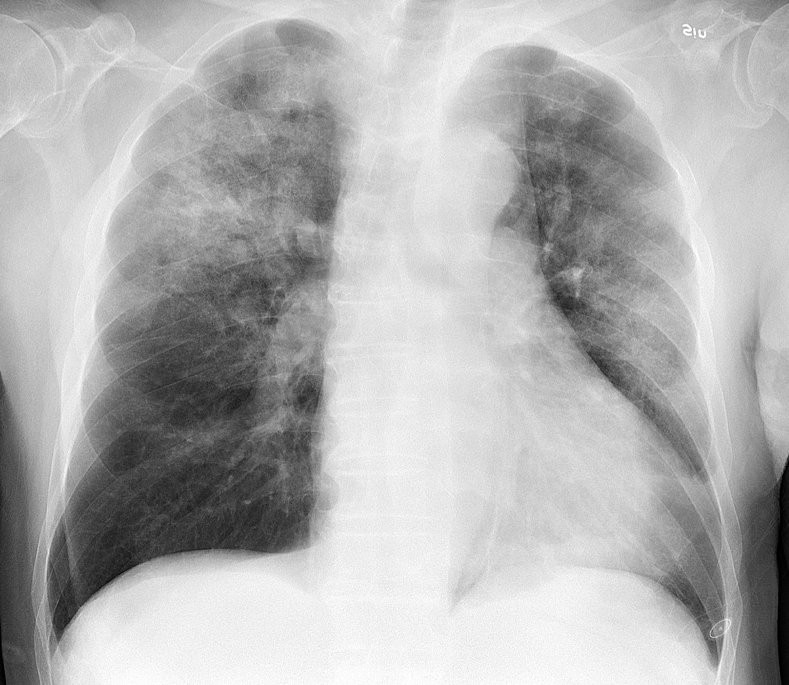
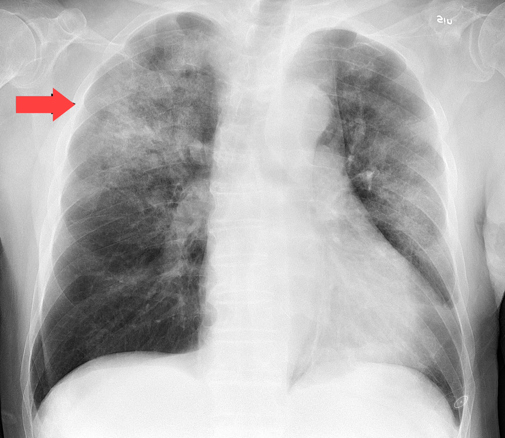

# 030 — Đông đặc – xẹp phổi / Consolidation – atelectasis

**Tags:** `pattern:dong-dac` `vung:phoi`
**Mức chắc chắn (certainty):** tổng hợp y văn (literature synthesis) — nội dung do nhóm tự biên từ y văn mở, chưa gắn ca nguyên văn đơn lẻ.

## 1. Tổng quan bệnh học – cơ chế hình ảnh

- **Đông đặc (consolidation):** phế nang (alveoli) chứa đầy dịch/mủ/máu/tế bào thay vì khí. Tia X bị suy giảm → **mờ đều (opacity)**, nhưng **phế quản vẫn còn khí → hiện hình nhánh đen trong vùng trắng: phế quản hơi (air bronchogram)**. Đây là chốt phân biệt quan trọng nhất với xẹp phổi.
- **Xẹp phổi (atelectasis):** phế nang **mất thể tích (volume loss)** — do tắc (obstruction, vd dị vật/u), chèn ép (compression, vd tràn dịch), co kéo (cicatricial) hoặc thiếu surfactant. Phim mất khí + **kéo lệch cấu trúc lân cận: rãnh liên thùy (fissure) di lệch, trung thất (mediastinum) kéo về bên xẹp, cơ hoành (diaphragm) nâng cao, khoảng liên sườn (intercostal spaces) hẹp lại**.
- TẠI SAO cùng trắng mà khác nhau: đông đặc = **lấp đầy (filling) không mất thể tích**; xẹp = **mất thể tích (loss)** → mọi dấu hiệu "kéo lệch" đều thuộc về xẹp.

*X-quang ngực thẳng (PA): đông đặc thùy giữa (middle lobe) phải + đáy 2 bên. Nguồn: Parmar, CC BY 2.0 (xem `images/CREDITS.md`).*

## 2. Mẫu hình + chẩn đoán phân biệt theo vị trí (gamut)

- **Đông đặc thùy (lobar):** viêm phổi (pneumonia) điển hình, nhồi máu phổi (infarction), xuất huyết (hemorrhage), ung thư dạng viêm (adenocarcinoma thể lepidic).
- **Đông đặc đa ổ/loang lổ (multifocal/patchy):** viêm phổi hít (aspiration), viêm phổi virus, phù phổi (edema), xuất huyết lan tỏa (DAH).
- **Xẹp thùy/đoạn:** tắc trong lòng (u, dị vật, nút nhầy — mucus plug) vs chèn ép ngoài (tràn dịch màng phổi (pleural effusion), hạch (lymphadenopathy)).
- **Xẹp dạng đĩa (plate/disc atelectasis):** đáy phổi, sau mổ, dải mờ mỏng song song cơ hoành — lành tính, dễ nhầm sẹo (scar).

## 3. Bảng so sánh phân biệt (ma trận đối chiếu)

| Thực thể (entity) | Hình ảnh điển hình (X-quang/CT) | Chốt vào (rule-in) | Chốt loại (rule-out) | Gợi ý xác nhận |
|---|---|---|---|---|
| Đông đặc viêm phổi (pneumonia) | Mờ đều, giới hạn theo thùy/đoạn, **phế quản hơi (+)** | **Phế quản hơi hiện rõ trong vùng mờ, thể tích giữ nguyên** | Có kéo lệch rãnh liên thùy → nghĩ xẹp kèm theo, không phải đông đặc thuần | Lâm sàng sốt + CRP, CT cửa sổ phổi (lung window) |
| Xẹp tắc (obstructive atelectasis) | Mờ đặc + **mất thể tích** | **Rãnh liên thùy di lệch về phía mờ, trung thất kéo sang** | Phế quản hơi lan tỏa trong vùng mờ → ủng hộ đông đặc hơn | CT tìm điểm tắc, soi phế quản (bronchoscopy) nếu nghi u |
| Phù phổi (edema) | Mờ lan tỏa 2 bên, đối xứng, cánh bướm (bat-wing) | **Phân bố trung tâm + đường Kerley B + tim to (cardiomegaly)** | Mờ khu trú 1 thùy + phế quản hơi → nghĩ viêm hơn | NT-proBNP, đáp ứng lợi tiểu (diuretics) |
| Ung thư dạng đông đặc | Mờ dai dẳng không đáp ứng kháng sinh (non-resolving) | **Giãn phế quản trong tổn thương, hẹp dần (tapering), hạch (+)** | Tan hoàn toàn sau 6–8 tuần → lành tính | CT lại sau điều trị, sinh thiết (biopsy) nếu còn |

*Trái: đông đặc thùy giữa phải (Parmar, CC BY 2.0). Phải: viêm phổi Q fever kèm dấu silhouette (CDC, public domain). Ảnh ghép letterbox giữ tỷ lệ.*

## 4. Protocol chụp + hệ phân độ/điểm chuẩn hóa

- **X-quang ngực (chest radiograph):** thẳng (PA) + nghiêng (lateral) là đủ cho đa số. Tư thế nằm (supine/AP) làm giả dày tổ chức — ghi rõ tư thế khi đọc.
- **CT ngực liều thấp/không cản quang (non-contrast):** khi mờ không tan, nghi u tắc, hoặc cần phân biệt đông đặc/xẹp chồng lấp.
- Không có RADS riêng cho đông đặc/xẹp; dùng ngưỡng lâm sàng: mờ không tan sau **6–8 tuần** điều trị → chụp lại + nghĩ ác tính.

## 5. Biến thể bình thường và cạm bẫy

- **Dấu silhouette (silhouette sign):** mất bờ tim/cơ hoành khi tổn thương cùng đậm độ và tiếp giáp — là bạn (định vị thùy: mất bờ tim phải = thùy giữa; mất vòm hoành = thùy dưới) nhưng cũng là cạm bẫy che tổn thương sau bóng tim.

*Minh họa dấu silhouette (mất bờ cấu trúc kề). Nguồn: CDC/FDA, public domain.*

- **Xẹp đĩa đáy phổi** sau mổ/nằm lâu: dải mỏng, tự hết khi vận động — đừng đọc thành viêm.
- **Phim AP nằm** làm trung thất bè ra, mạch máu dồn đáy → giả phù/phì đại tim.

## 6. Tự lượng giá — Blind Quiz

**Ca 1 — BN 88 tuổi, sốt + mệt + ho nhẹ 1 tuần. Nhìn ảnh, chưa đọc đáp án vội.**

- Hỏi: mờ ở đâu? Có phế quản hơi không? Có dấu kéo lệch thể tích không? 3 phân biệt + dấu chốt?

<b>Bấm để hiện đáp án</b>

- Dấu hiệu (findings): mờ loang lổ đa ổ (multifocal patchy consolidation), chủ yếu thùy trên (upper lobe) phải; **không có di lệch rãnh liên thùy → ủng hộ đông đặc, không phải xẹp thuần**.
- Chẩn đoán (diagnosis): **đông đặc viêm phổi (cúm A + H. influenzae)** — xem bản annotated có mũi tên dưới đây.
- Đối chiếu bản annotated:

- Nguồn ảnh: Mikael Häggström, CC0 (xem `images/CREDITS.md`).

**Ca 2 — Phân biệt nhanh:** mở ảnh ghép `composite_dongdac-vs-xep.jpg` ở mục 3, tự trả lời: bên nào có phế quản hơi? Bên nào mất thể tích? Rồi đối chiếu bảng mục 3.

## Bài liên quan chéo
- [001 – Tổng quan hệ Ngực](../001-tong-quan-he-nguc/lesson.md)
- [020 – Nốt phổi](../020-not-phoi/lesson.md)
- [040 – Tràn dịch màng phổi](../040-tran-dich-mang-phoi/lesson.md)

> Không dùng để chẩn đoán độc lập khi chưa có người hướng dẫn.
