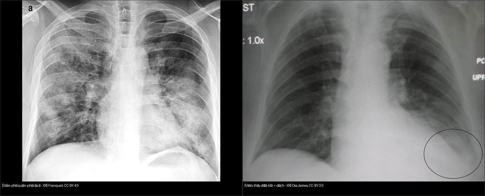
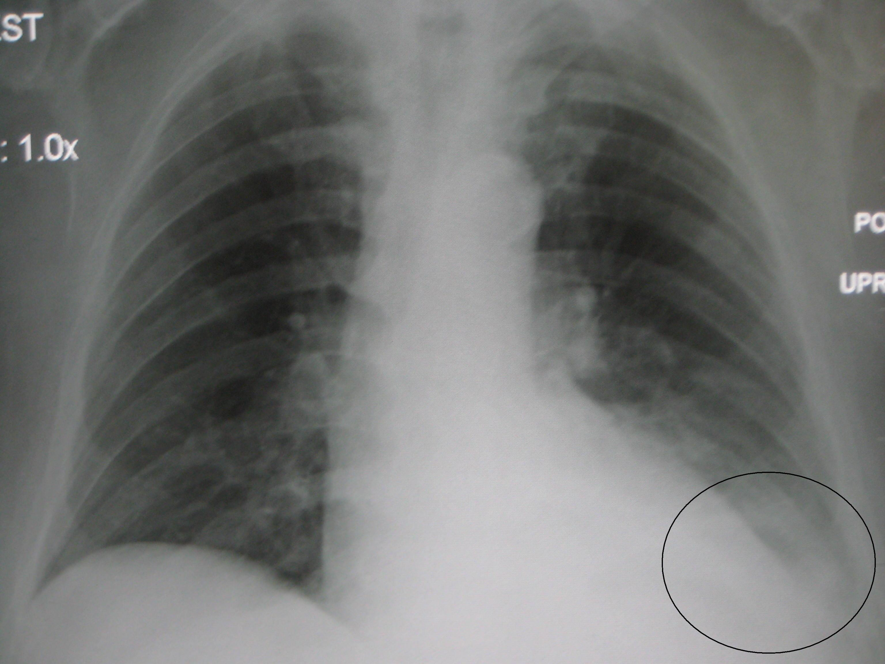
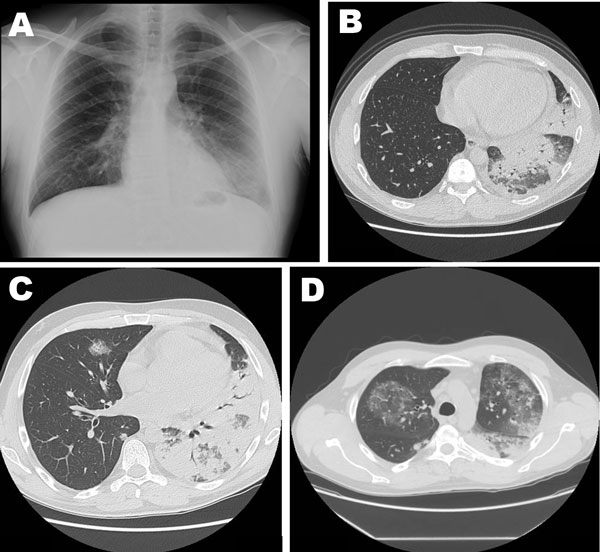

# 031 — Viêm phổi theo mẫu hình / Pneumonia patterns

**Tags:** `pattern:dong-dac` `vung:phoi`
**Mức chắc chắn (certainty):** tổng hợp y văn (literature synthesis) — nhóm tự biên từ y văn mở, chưa gắn ca nguyên văn đơn lẻ.

## 1. Tổng quan — 3 con đường viêm vào phổi

- **Viêm thùy (lobar):** vi khuẩn lấp đầy phế nang theo đường lỗ Kohn — **mờ đều 1 thùy/đoạn + phế quản hơi**, giới hạn bởi rãnh liên thùy (điển hình phế cầu (pneumococcus)).
- **Viêm phế quản-phổi (bronchopneumonia):** viêm quanh tiểu phế quản lan ra nang kề — **nốt mờ đa ổ 2 bên + kính mờ loang lổ** (tụ cầu (staph), gram âm (Pseudomonas), hít (aspiration) — thùy trên khi nằm, đáy khi đứng).
- **Viêm kẽ/vi rút (interstitial/viral):** dày vách + kính mờ lan tỏa — lưới-nốt, không phế quản hơi điển hình.
- TẠI SAO phân 3 mẫu: gợi tác nhân (lobar→phế cầu; đa ổ hoại tử→tụ cầu/gram âm; kẽ→virus/Pneumocystis) + tiên lượng biến chứng (áp xe (abscess), tràn mủ (empyema) ở bài 040).

*Trái: viêm phế quản-phổi đa ổ (Franquet, CC BY 4.0). Phải: viêm thùy dưới trái + dịch (Doc James, CC BY 3.0). Ảnh ghép letterbox.*

## 2. Gamut theo mẫu + bối cảnh

- **Mờ thùy + phế quản hơi + sốt cấp:** viêm thùy điển hình; phân biệt nhồi máu (đau ngực màng phổi, đờm máu), xuất huyết.
- **Đa ổ 2 bên + hang (cavitation):** tụ cầu huyết khối (septic emboli), lao, nấm — tìm ổ nhiễm ngoài phổi.
- **Đông đặc không tan 6–8 tuần:** ung thư dạng viêm, lao, viêm tổ chức hóa (organizing pneumonia).
- **Kính mờ lan tỏa + suy hô hấp:** virus, Pneumocystis (quanh rốn, đỉnh ít), phù (bài 033), xuất huyết lan tỏa.

## 3. Bảng so sánh phân biệt

| Thực thể (entity) | Hình ảnh điển hình | Chốt vào (rule-in) | Chốt loại (rule-out) | Gợi ý xác nhận |
|---|---|---|---|---|
| Viêm thùy (lobar) | Mờ đều 1 thùy + **phế quản hơi**, giới hạn rãnh | **Phế quản hơi + sốt cấp + bạch cầu tăng** | Kéo lệch thể tích → xẹp kèm (bài 030) | Kháng sinh theo phác đồ, CT lại nếu không tan |
| Viêm phế quản-phổi | Nốt/đám đa ổ 2 bên, dày thành phế quản | **Đa ổ + đờm mủ + yếu tố hít/nằm lâu** | Mờ đều 1 thùy đơn độc → nghĩ thùy hơn | Cấy đờm/máu, điều chỉnh kháng sinh |
| Áp xe phổi (abscess) | Hang có **mức khí-dịch**, thành dày | **Mức khí-dịch trong hang + sốt hôi miệng** | Hang khô không mức + thành mỏng → lao/nấm cũ | CT, dẫn lưu nếu lớn |
| Lao tiến triển | Hang thùy trên + **nốt cây nụ (tree-in-bud)** + hạch | **Tree-in-bud + hang trên + tiếp xúc** | Tan nhanh sau kháng sinh thường → vi khuẩn | AFB/PCR, cách ly |

## 4. Protocol

- **X-quang đứng PA + nghiêng:** đủ cho viêm cộng đồng; nghiêng định vị thùy (mất bờ tim/vòm hoành).
- **CT:** biến chứng (hang, empyema), không tan, suy giảm miễn dịch, tìm ổ thuyên tắc nhiễm khuẩn.
- **Theo dõi:** mờ **không tan sau 6–8 tuần** → chụp lại + soi/sinh thiết loại trừ ác tính (nhất là người hút thuốc).

## 5. Cạm bẫy

- **Viêm thùy dưới phải + mất vòm hoành** dễ đọc nhầm tràn dịch — tìm phế quản hơi và meniscus (bài 040).
- **Viêm đỉnh sau xương đòn** dễ bỏ sót — so 2 đỉnh + phim cũ.
- **Ăn sặc thầm (silent aspiration) người già:** đa ổ đáy, tái đi tái lại — hỏi nuốt, đánh giá thần kinh.

## 6. Tự lượng giá — Blind Quiz

**Ca 1 — Sốt + ho đờm mủ. Nhìn phim, mô tả trước.**

- Hỏi: thùy nào? Có dịch kèm không? Mẫu thùy hay đa ổ?

<b>Bấm để hiện đáp án</b>

- **Viêm thùy dưới trái + tràn dịch ít cùng bên** (viêm cạnh màng phổi). Phế quản hơi trong vùng mờ, không mất thể tích → không phải xẹp thuần.
- Nguồn: Doc James, CC BY 3.0.

**Ca 2 — BN suy giảm miễn dịch, khó thở tăng dần:**

<b>Bấm để hiện đáp án</b>

- **Viêm phổi Legionella nặng:** đông đặc thùy + phế quản hơi + kính mờ lan rộng + dịch ít — mẫu hỗn hợp, tiến triển nhanh sang ARDS (nối bài 033).
- Nguồn: CDC, public domain.

## Bài liên quan chéo
- [001 – Tổng quan hệ Ngực](../001-tong-quan-he-nguc/lesson.md)
- [030 – Đông đặc – xẹp phổi](../030-dong-dac-xep-phoi/lesson.md) (cơ chế lấp đầy)
- [033 – Phù phổi & ARDS](../033-phu-phoi-ards/lesson.md) (kính mờ lan tỏa)
- [040 – Tràn dịch màng phổi](../040-tran-dich-mang-phoi/lesson.md) (tràn mủ cạnh viêm)

> Không dùng để chẩn đoán độc lập khi chưa có người hướng dẫn.
