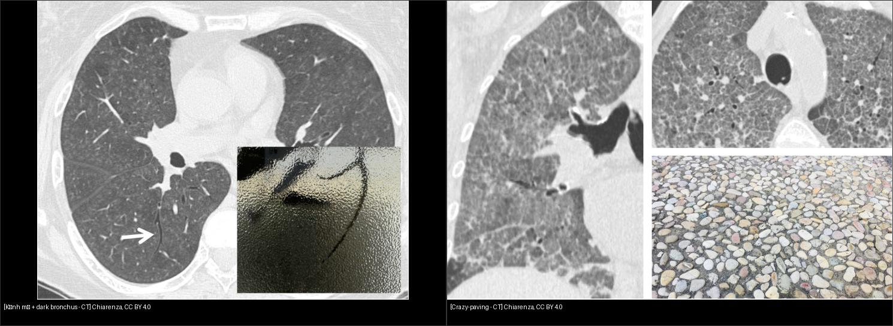
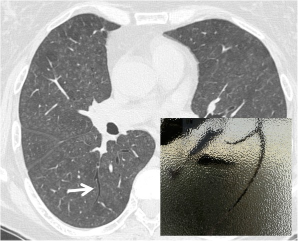
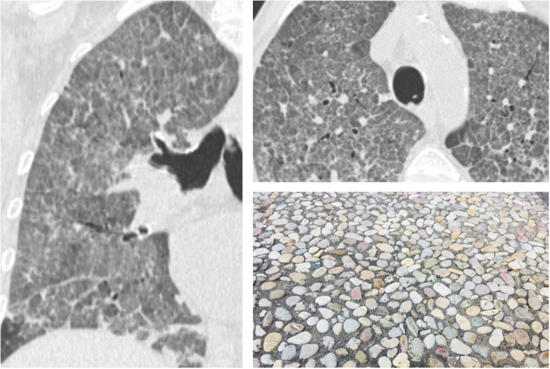

# 032 — Kính mờ & lát đá / Ground-glass opacity & Crazy-paving

**Tags:** `pattern:kinh-mo` `vung:phoi` `protocol:HRCT`
**Mức chắc chắn (certainty):** tổng hợp y văn (literature synthesis) — nhóm tự biên từ y văn mở, chưa gắn ca nguyên văn đơn lẻ.

## 1. Tổng quan — kính mờ là lấp một phần, lát đá là hai lớp chồng nhau

- **Kính mờ (GGO):** tăng đậm độ nhưng **còn thấy mạch-phế quản** = lấp một phần nang / dày kẽ nhẹ / tăng tưới máu. TẠI SAO còn thấy mạch: nang vẫn còn khí một phần.
- **Lát đá (crazy-paving):** kính mờ **+ lưới dày vách liên + trong tiểu thùy chồng lên** = 2 lớp bệnh (nang + kẽ). Gốc: protein phế nang (PAP), sau mở rộng: PJP, ARDS, xuất huyết, lepidic adeno, NSIP.
- **Dark bronchus:** PQ đen hơn nền kính mờ quanh — kính mờ quá nhẹ/lan tỏa không nhận ra nếu thiếu vùng phổi lành đối chiếu.

*Trái: kính mờ + dark bronchus. Phải: lát đá (kính mờ + lưới vách). Nguồn: Chiarenza et al., CC BY 4.0. Ảnh ghép letterbox.*

## 2. Gamut kính mờ theo cấp/mạn + phân bố

- **Cấp lan tỏa:** phù (tim to, Kerley — bài 033), ARDS (ngoại vi, tim thường), xuất huyết (ho máu), virus/PJP (suy giảm miễn dịch).
- **Bán cấp khu trú:** COP (vành ngược — bài 031), HP (bẫy khí thở ra), xuất huyết khu trú.
- **Mạn:** NSIP (đối xứng + chừa màng phổi — bài 035), DIP/RB (hút thuốc, trên), lepidic adeno (tồn tại, nhân đặc tăng dần — bài 020).

## 3. Bảng so sánh

| Thực thể (entity) | Hình ảnh điển hình (HRCT) | Chốt vào (rule-in) | Chốt loại (rule-out) | Gợi ý xác nhận |
|---|---|---|---|---|
| PJP | Kính mờ **lan tỏa + dark bronchus**, suy giảm miễn dịch, ít dịch/hạch | **Kính mờ đều + suy giảm MD + LDH tăng** | Tim to + Kerley → phù tim | PCR/IF đờm, cotrimoxazole |
| Protein phế nang | **Lát đá lan tỏa đối xứng** (kinh điển) | **Lát đá đều + sữa rửa PQ** | Lệch + cấp tính → ARDS/xuất huyết | Rửa PQ (milky), anti-GM-CSF |
| ARDS/xuất huyết | Kính mờ/đông đặc **ngoại vi + phụ thuộc**, cấp | **Ho máu + Hb giảm / P/F giảm** | Đối xứng đều + mạn → PAP/NSIP | (nối bài 033) |
| NSIP/lepidic | Kính mờ **tồn tại + chừa màng phổi / nhân đặc tăng dần** | **Tồn tại > 3 tháng + bối cảnh mô liên kết/u** | Tan nhanh → viêm/phù cấp | (nối bài 035/020) |

## 4. Protocol HRCT kính mờ

- Lát mỏng 1–1,5 mm + **prone** (loại xẹp đáy giả) + **thở ra** (bẫy khí HP).
- Kính mờ tồn tại > 3 tháng → theo dõi nhân đặc (lepidic) + hội chẩn mô liên kết.
- Nghi PAP: rửa phế quản nang (BAL sữa) + anti-GM-CSF.

## 5. Cạm bẫy

- **Xẹp đáy do thở kém** giả kính mờ — prone xác nhận (xem bài 035).
- **Kính mờ lan tỏa nhẹ** không nhận ra nếu thiếu phổi lành — tìm dark bronchus.
- **Lát đá ≠ PAP duy nhất** — ARDS/PJP/xuất huyết đều có; bối cảnh + cấp/mạn quyết định.

## 6. Tự lượng giá — Blind Quiz

**Ca 1 — Suy giảm miễn dịch, khó thở tăng dần:**

- Hỏi: PQ đen hơn nền là dấu gì? Kính mờ lan tỏa + không dịch/hạch → nghĩ gì đầu?

<b>Bấm để hiện đáp án</b>

- **Dark bronchus trong kính mờ lan tỏa — PJP:** kính mờ đều + suy giảm miễn dịch + ít hạch/dịch.
- Nguồn: Chiarenza et al., Fig. 8, CC BY 4.0.

**Ca 2 — Kính mờ + lưới vách chồng nhau lan tỏa:**

<b>Bấm để hiện đáp án</b>

- **Crazy-paving:** kính mờ + dày vách — kinh điển protein phế nang; cấp tính nghĩ ARDS/PJP/xuất huyết theo bối cảnh.
- Nguồn: Chiarenza et al., Fig. 6, CC BY 4.0.

## Bài liên quan chéo
- [001 – Tổng quan hệ Ngực](../001-tong-quan-he-nguc/lesson.md)
- [031 – Viêm phổi mẫu hình](../031-viem-phoi-mau-hinh/lesson.md) (COP, PJP)
- [033 – Phù phổi & ARDS](../033-phu-phoi-ards/lesson.md) (kính mờ cấp)
- [035 – Xơ mô kẽ UIP vs NSIP](../035-xo-mo-ke-UIP-NSIP/lesson.md) (kính mờ mạn)

> Không dùng để chẩn đoán độc lập khi chưa có người hướng dẫn.
