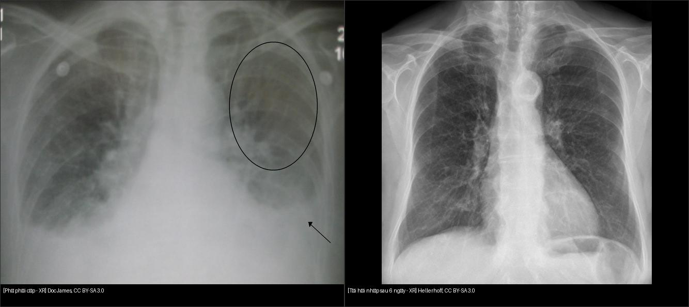
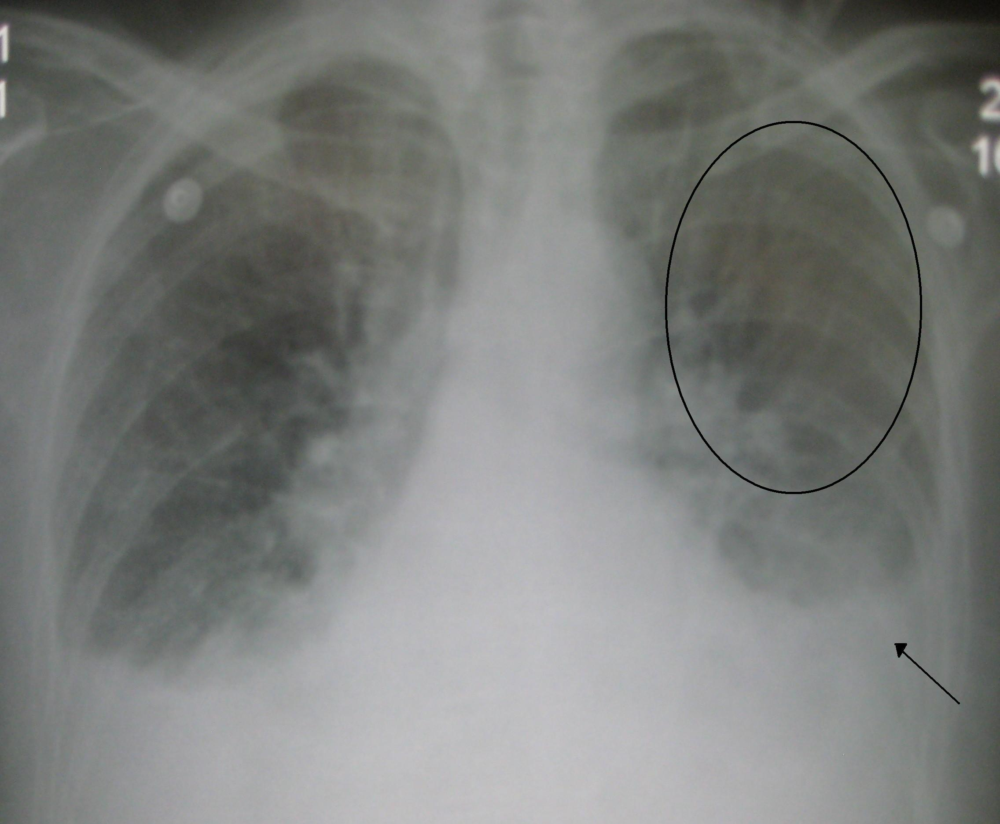
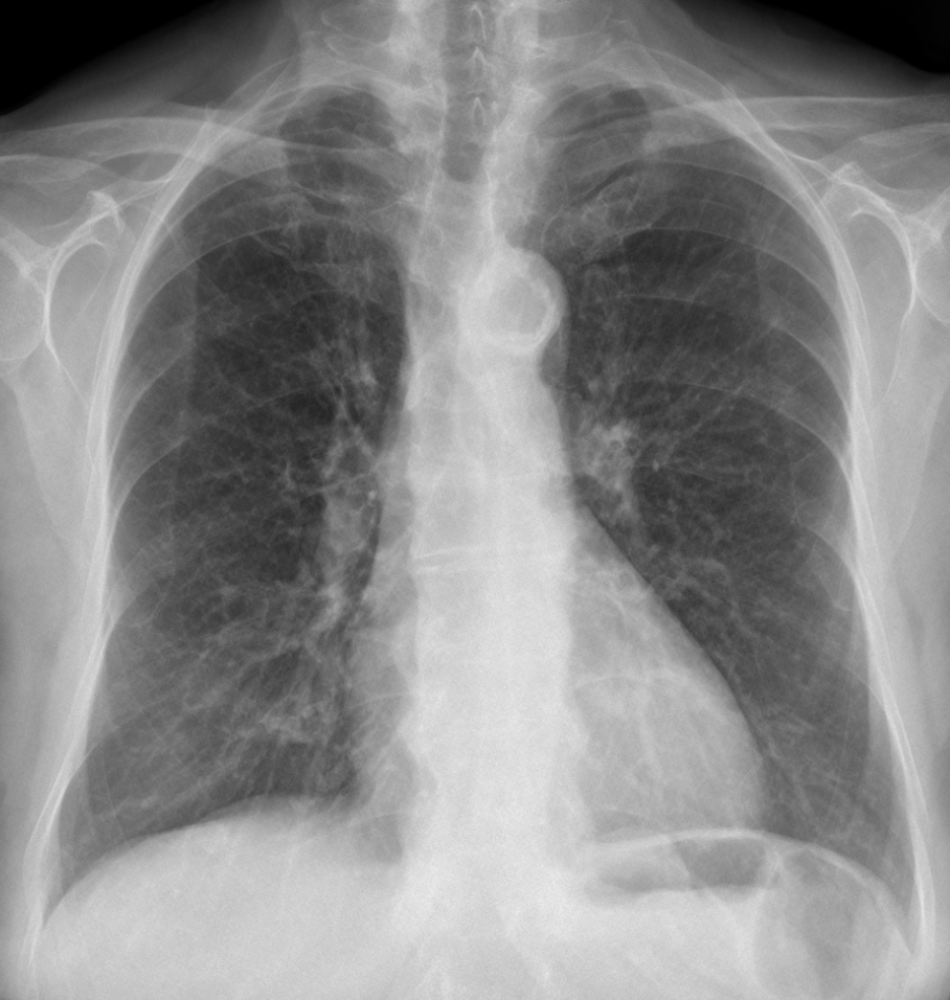

# 033 — Phù phổi & ARDS / Pulmonary edema & ARDS

**Tags:** `pattern:mo-ke` `vung:phoi`
**Mức chắc chắn (certainty):** tổng hợp y văn (literature synthesis) — nhóm tự biên từ y văn mở, chưa gắn ca nguyên văn đơn lẻ.

## 1. Tổng quan — nước vào phổi theo 2 đường

- **Phù tim (cardiogenic):** tăng áp tĩnh mạch phổi → dịch thoát kẽ trước (cuffing, Kerley B) rồi tràn nang (cánh bướm (bat-wing) trung tâm, **tái phân bố lên đỉnh (redistribution)**, tim to, dịch màng phổi).
- **ARDS (không do tim):** tổn thương màng phế nang-mao mạch → phù **ngoại vi, loang lổ, không đối xứng**, tim bình thường, không đáp ứng lợi tiểu nhanh; chẩn đoán theo **Berlin (P/F + thời gian + loại trừ tim)**.
- TẠI SAO phân biệt được trên phim: phù tim **đối xứng + trung tâm + có dấu tim**; ARDS **ngoại vi + không đều + không dấu tim**. TẠI SAO tan nhanh khi lợi tiểu: dịch kẽ-nang chưa xơ hóa → hồi phục trong ngày (minh chứng bằng cặp phim trước-sau dưới đây).

*Trái: phù phổi cấp. Phải: cùng BN sau tái hồi nhập 6 ngày — mờ tan gần hết. Nguồn: Doc James + Hellerhoff, CC BY-SA 3.0. Ảnh ghép letterbox.*

## 2. Gamut mờ lan tỏa 2 bên

- **Phù tim:** cánh bướm + Kerley B + tim to + dịch 2 đáy — đáp ứng lợi tiểu trong giờ-ngày.
- **ARDS:** sau viêm phổi/viêm tụy/chấn thương, mờ ngoại vi, P/F giảm, không đáp ứng lợi tiểu.
- **Xuất huyết lan tỏa (DAH):** ho máu + thiếu máu + suy thận (Wegener/Goodpasture) — kính mờ lan tỏa không Kerley.
- **Viêm phổi virus/Pneumocystis:** kính mờ lan tỏa + lâm sàng nhiễm trùng/suy giảm miễn dịch (nối bài 031).

## 3. Bảng so sánh phân biệt

| Thực thể (entity) | Hình ảnh điển hình | Chốt vào (rule-in) | Chốt loại (rule-out) | Gợi ý xác nhận |
|---|---|---|---|---|
| Phù tim (cardiogenic) | Cánh bướm + **Kerley B + tim to + tái phân bố đỉnh** | **Tim to + Kerley B + tan nhanh sau lợi tiểu** | Tim bình thường + ngoại vi không đều → ARDS | NT-proBNP, siêu âm tim |
| ARDS | Mờ ngoại vi loang lổ 2 bên, **tim bình thường** | **P/F ≤ 300 + khởi phát < 1 tuần + loại trừ tim** | Có Kerley B + tim to → phù tim hơn | Berlin criteria, bảo vệ phổi |
| Xuất huyết lan tỏa | Kính mờ/đông đặc lan tỏa + **ho máu + Hb giảm** | **Ho máu + suy thận + ANCA (+)** | Kerley B + dịch màng phổi nhiều → phù tim | Soi phế quản (BAL máu), miễn dịch |
| Viêm phổi virus | Kính mờ lan tỏa + **sốt + test (+)** | **Dịch tễ + PCR (+)** | Tim to + Kerley → phù tim kèm | PCR, CT HRCT |

## 4. Protocol

- **X-quang tại giường (portable/AP):** theo dõi hằng ngày ICU; nhớ hiệu ứng AP nằm làm tim bè giả.
- **Siêu âm phổi:** đường B (B-lines) lan tỏa = hội chứng kẽ-nang; theo dõi đáp ứng lợi tiểu theo giờ.
- **CT HRCT (khi không rõ):** phù tim = dày vách nhẵn + dịch; ARDS = kính mờ/đông đặc vùng phụ thuộc + ít Kerley; xơ hóa nền (nối bài 034).

## 5. Cạm bẫy

- **Phim AP nằm:** tim to giả + mạch đáy nổi giả phù — so phim đứng cũ.
- **Điện cực ECG, dây monitor** đè lên trường phổi giả nốt — nhìn kỹ vật ngoài thân.
- **Phù một bên sau chọc dịch nhanh (re-expansion):** đừng đọc viêm lan — hỏi thủ thuật vừa làm.
- **Phù không đối xứng do nằm nghiêng lâu:** dịch dồn bên thấp — đổi tư thế chụp lại.

## 6. Tự lượng giá — Blind Quiz

**Ca 1 — Khó thở cấp, nghe ran ẩm 2 đáy. Mô tả phim trước.**

- Hỏi: tim có to không? Tái phân bố đỉnh? Kerley/dịch đáy? Chẩn đoán + xử trí đầu?

<b>Bấm để hiện đáp án</b>

- **Phù phổi cấp do tim:** tim to + tái phân bố lên đỉnh (vòng tròn) + dịch ít 2 đáy (mũi tên) — bộ 3 kinh điển.
- Xử trí: ngồi cao chân thõng + Oxy + lợi tiểu + giãn mạch; tìm nguyên nhân (NMCT, cơn THA, rối loạn nhịp).
- Nguồn: Doc James, CC BY-SA 3.0.

**Ca 2 — Cùng BN sau 6 ngày điều trị:**

<b>Bấm để hiện đáp án</b>

- Mờ tan gần hết sau tái hồi nhập — **tính hồi phục nhanh là chốt phân biệt phù tim với xơ/ARDS**, đừng vội kết luận viêm mạn.
- Nguồn: Hellerhoff, CC BY-SA 3.0.

## Bài liên quan chéo
- [001 – Tổng quan hệ Ngực](../001-tong-quan-he-nguc/lesson.md)
- [031 – Viêm phổi mẫu hình](../031-viem-phoi-mau-hinh/lesson.md) (kính mờ nhiễm trùng)
- [034 – Bệnh phổi kẽ (dự kiến)](../034-benh-phoi-ke/lesson.md) (Kẻo nhầm xơ mạn)
- [040 – Tràn dịch màng phổi](../040-tran-dich-mang-phoi/lesson.md) (dịch kèm phù)

> Không dùng để chẩn đoán độc lập khi chưa có người hướng dẫn.
