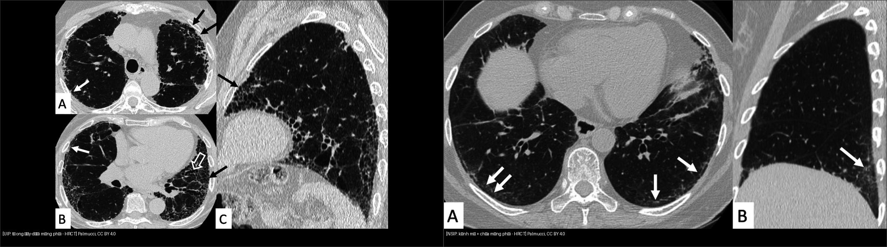
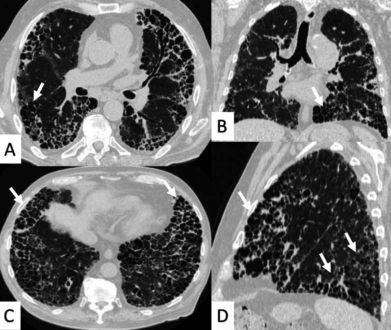
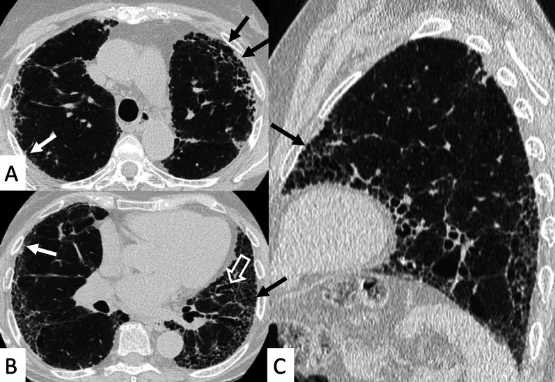
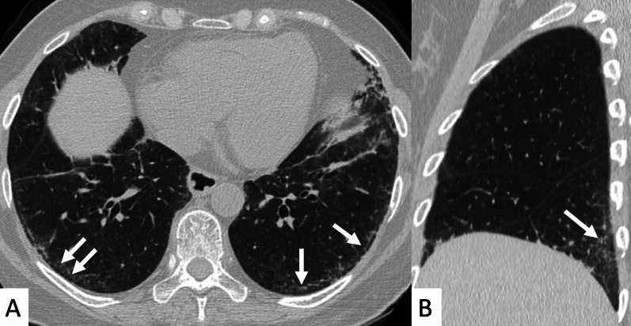

# 035 — Xơ mô kẽ UIP vs NSIP & tổ ong / Fibrosing ILD: UIP vs NSIP & Honeycombing

**Tags:** `pattern:mo-ke` `pattern:kinh-mo` `vung:phoi` `protocol:HRCT`
**Mức chắc chắn (certainty):** tổng hợp y văn (literature synthesis) — nhóm tự biên từ y văn mở, chưa gắn ca nguyên văn đơn lẻ.

## 1. Tổng quan — xơ hóa mô kẽ theo 2 kiểu + HRCT đọc thế nào

- **Tiểu thùy thứ cấp** lại xuất hiện: xơ hóa quanh bạch mạch ngoại vi → dày vách + tổ ong dưới màng phổi (UIP); viêm nang lan tỏa → kính mờ đều (NSIP).
- **Tổ ong (honeycombing):** nang khí xếp tầng dưới màng phổi, **chung vách dày 1–3 mm**, đường kính 3–10 mm — sẹo xơ cuối đường, không hồi phục. Có tổ ong điển hình + phân bố đáy-dưới màng phổi = UIP, khỏi sinh thiết trong bối cảnh IPF.
- **Giãn phế quản do kéo (traction bronchiectasis):** phế quản bị xơ co kéo giãn không hồi phục — dấu xơ hóa (khác giãn phế quản viêm có thể hồi phục một phần).
- HRCT chuẩn xơ: lát mỏng **1–1,5 mm**, cửa sổ phổi, 3 bình diện (axial + coronal + sagittal) + **thở ra** tìm bẫy khí (air-trapping) loại trừ viêm tiểu phế quản.

## 2. Gamut xơ hóa theo phân bố

- **Đáy + dưới màng phổi + tổ ong:** UIP/IPF (nam lớn tuổi, hút thuốc, ran Velcro đáy, tiến triển).
- **Đáy + đối xứng + chừa màng phổi:** NSIP (bệnh mô liên kết: xơ cứng bì, viêm đa cơ; đáp ứng steroid tốt hơn UIP).
- **Trên + trung tâm:** sarcoid (bạch mạch, hạch), HP mạn (bẫy khí, chừa đáy).
- **Kính mờ cấp + mới:** phù, xuất huyết, viêm phổi (nối bài 031/033) — không phải xơ mạn.

*Trái: UIP — tổ ong + lưới đáy-dưới màng phổi. Phải: NSIP — kính mờ đáy + chừa sát màng phổi. Nguồn: Palmucci et al., CC BY 4.0. Ảnh ghép letterbox.*

## 3. Bảng so sánh sống còn UIP vs NSIP

| Thực thể (entity) | Hình ảnh điển hình (HRCT) | Chốt vào (rule-in) | Chốt loại (rule-out) | Gợi ý xác nhận |
|---|---|---|---|---|
| UIP / IPF | **Tổ ong bắt buộc** + lưới + giãn PQ do kéo, **đáy + dưới màng phổi**, ít kính mờ | **Tổ ong đáy-dưới màng phổi + tuổi/hút thuốc + ran Velcro** | Kính mờ lan rộng át lưới + chừa màng phổi → NSIP | Hội chẩn đa chuyên khoa (MDD); sinh thiết khi không điển hình |
| NSIP (xơ) | **Kính mờ đối xứng + lưới**, **chừa sát dưới màng phổi 1–2 mm**, hiếm tổ ong | **Subpleural sparing + bệnh mô liên kết + đáp ứng steroid** | Tổ ong lan rộng đáy → UIP | Kháng thể, PFTs, theo dõi đáp ứng |
| HP mạn (phân biệt) | Bẫy khí + nốt trung tâm tiểu thùy + **chừa đáy**, xơ giữa-trên | **Bẫy khí thì thở ra + tiền sử kháng nguyên chim/nấm** | Tổ ong đáy thuần → UIP | Hỏi phơi nhiễm, BAL lympho |
| Tổ chức hóa (OP) | Đông đặc ngoại vi + **vành ngược (atoll)**, di chuyển | **Atoll + đáp ứng steroid nhanh** | Tổ ong cố định → xơ mạn | (nối bài 031) |

*Tổ ong lan rộng — giai đoạn cuối xơ hóa, không còn chỉ định sinh thiết chẩn đoán. Nguồn: Palmucci et al., CC BY 4.0.*

## 4. Protocol HRCT xơ

- Lát mỏng 1–1,5 mm, không cản quang thường quy; coronal/sagittal bắt buộc (đánh giá phân bố đáy-đỉnh).
- Thì thở ra: bẫy khí (HP, sarcoid) vs xẹp đáy (atelectasis).
- Theo dõi: UIP tiến triển → giãn PQ do kéo tăng + tổ ong lan; NSIP đáp ứng → kính mờ giảm.

## 5. Cạm bẫy

- **Xẹp đáy phổi do thở kém** giả kính mờ đáy — hít sâu + lát prone xác nhận (xẹp mất khi sấp, xơ không mất).
- **Giãn PQ do kéo vs giãn PQ viêm:** do kéo đi kèm tổ ong/lưới xơ cùng vùng; viêm có dày thành + nút nhầy.
- **Tổ ong vs kén khí/khí phế thũng cạnh vách:** tổ ong xếp tầng chung vách dày dưới màng phổi; kén LAM/LCH rải rác + thành mỏng (nối bài 050).
- **UIP + ung thư:** xơ là nền sinh ung thư — nốt mới trong vùng xơ phải theo dõi như nốt thường (nối bài 020).

## 6. Tự lượng giá — Blind Quiz

**Ca 1 — Nam lớn tuổi, khó thở tăng dần, ran Velcro đáy. Mô tả HRCT trước.**

- Hỏi: phân bố đâu? Có tổ ong không? Kính mờ nhiều hay ít? Chẩn đoán + bước tiếp?

<b>Bấm để hiện đáp án</b>

- Tổ ong + lưới + giãn PQ do kéo, **đáy + dưới màng phổi**, ít kính mờ → **UIP điển hình (IPF)** — đủ tiêu chuẩn hình ảnh, hội chẩn MDD, không cần sinh thiết.
- Nguồn: Palmucci et al., Insights into Imaging 2022 Fig. 1, CC BY 4.0.

**Ca 2 — Nữ xơ cứng bì, khó thở nhẹ:**

<b>Bấm để hiện đáp án</b>

- Kính mờ đối xứng đáy + **chừa sát dưới màng phổi 1–2 mm** (viền đen giữa kính mờ và màng phổi) → **NSIP xơ** — đáp ứng steroid/ức chế miễn dịch tốt hơn UIP.
- Nguồn: Palmucci et al., Fig. 10, CC BY 4.0.

## Bài liên quan chéo
- [001 – Tổng quan hệ Ngực](../001-tong-quan-he-nguc/lesson.md)
- [031 – Viêm phổi mẫu hình](../031-viem-phoi-mau-hinh/lesson.md) (kính mờ cấp)
- [033 – Phù phổi & ARDS](../033-phu-phoi-ards/lesson.md) (Kerley, tiểu thùy)
- [050 – Giãn PQ & kén khí (đã có)](../050-gian-phe-quan-ken-khi/lesson.md) (tổ ong vs kén)

> Không dùng để chẩn đoán độc lập khi chưa có người hướng dẫn.
