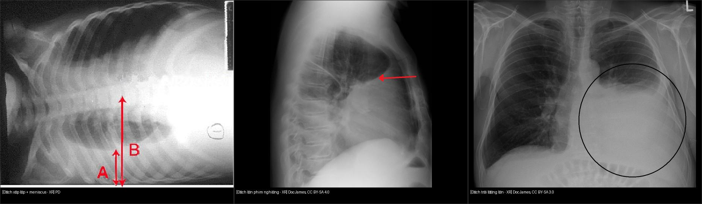
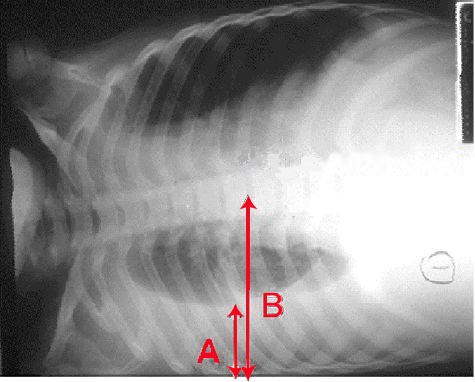

# 040 — Tràn dịch màng phổi / Pleural effusion

**Tags:** `pattern:tran-dich` `vung:mang-phoi`
**Mức chắc chắn (certainty):** tổng hợp y văn (literature synthesis) — nhóm tự biên từ y văn mở, chưa gắn ca nguyên văn đơn lẻ.

## 1. Tổng quan — dịch ở đâu, vì sao trắng

- Khoang màng phổi (pleural space) bình thường chỉ có vài mL dịch bôi trơn. Dịch tích lại khi **tăng tạo (tim, viêm, u, tắc bạch huyết)** hoặc **giảm hấp thu**. Dịch tự do (free fluid) chảy theo trọng lực: đứng → đáy + góc sườn hoành; nằm → lớp sau lưng (chụp nằm thấy phổi "mờ đều" giả).
- TẠI SAO trắng: dịch cùng đậm độ mô mềm → che góc sườn hoành, tạo **meniscus (mặt khum lõm lên trên)** ở phim đứng — khác với dày màng phổi. Phân biệt thấm/tiết (transudate/exudate) bằng **Light (protein/LDH dịch/máu)** trên chọc dịch, không phân biệt được chắc chắn chỉ bằng hình ảnh.

*Nguồn: PD + Doc James CC BY-SA. Ảnh ghép letterbox. Chi tiết xem `images/CREDITS.md`.*

## 2. Gamut theo phân bố

- **Tự do 1 bên:** suy tim (thường phải), viêm phổi cạnh (parapneumonic), u (ác tính, di căn), tắc mạch phổi (nhồi máu kèm).
- **2 bên:** suy tim, suy thận, giảm albumin — nghĩ toàn thân trước.
- **Khu trú (loculated)/rãnh liên thùy:** viêm cũ, mủ màng phổi (empyema), chấn thương; giả u (pseudotumor) nằm gọn trong rãnh — tan khi hết suy tim.
- **Kèm khí (hydropneumothorax):** mức khí-dịch (air-fluid level) ngang — khác meniscus cong.

## 3. Bảng so sánh phân biệt

| Thực thể (entity) | Hình ảnh điển hình | Chốt vào (rule-in) | Chốt loại (rule-out) | Gợi ý xác nhận |
|---|---|---|---|---|
| Dịch tự do (free effusion) | Tù góc sườn hoành, **meniscus cong lõm lên**, phim nghiêng/decubitus dịch di chuyển | **Lớp dịch di động theo tư thế trên decubitus/POCUS** | Không di chuyển + bờ lồi → nghĩ khu trú/dày màng | Siêu âm tại giường, chọc dịch (Light) |
| Dày/dính màng phổi (pleural thickening) | Vệt trắng sát thành ngực, góc tù | **Không đổi theo tư thế, bờ trong lồi** | Meniscus di động → dịch tự do | CT cửa sổ trung thất, tiền sử lao/mủ cũ |
| Xẹp thùy dưới + dịch ít | Mờ đáy + mất thể tích | **Di lệch rãnh + trung thất kéo về** (xem bài 030) | Meniscus thuần không mất thể tích → dịch đơn thuần | CT phân giải |
| Mủ màng phổi (empyema) | Dịch khu trú + dày lá thành, tách đôi (split pleura sign trên CT) | **Sốt + dịch vách hóa (septation) trên siêu âm** | Dịch trong, không vách, hết khi điều trị suy tim | Dẫn lưu + kháng sinh |

## 4. Protocol

- **X-quang đứng PA + nghiêng (lateral):** nghiêng nhạy hơn (thấy ~50 mL ở góc sau); phim nằm ngửa cần ≥ 200–300 mL mới mờ một bên.
- **Decubitus (nằm nghiêng bên bệnh):** lớp dịch ≥ 10 mm đo được → chọc được an toàn.
- **Siêu âm màng phổi (POCUS):** phân biệt dịch tự do/vách hóa, hướng dẫn chọc — làm tại giường.
- **CT có cản quang:** nghi empyema (split pleura), u màng phổi, dịch khu trú khó chọc.

## 5. Biến thể bình thường và cạm bẫy + Dịch màng phổi vs cổ trướng trên CT ngang

- **Mỡ ngoài màng phổi (extrapleural fat):** vệt mờ đối xứng người béo — đừng đọc dịch 2 bên.
- **Phim AP nằm:** một bên trắng đều do dịch lớp sau — so sánh 2 bên + chụp decubitus xác nhận.
- **Giả u trong rãnh (pseudotumor):** khối thấu kính trong rãnh liên thùy ở BN suy tim — tan sau lợi tiểu, đừng sinh thiết vội.
- **Nếp da/tóc dài:** đường thẳng ra ngoài thành ngực — đừng đọc tràn khí kèm.
- **Định lượng HU dịch:** dịch thấm ~0–15 HU; dịch tiết cao hơn; **máu màng phổi (hemothorax) 35–70 HU** — đo HU trước khi gọi tên dịch.

### Phân biệt dịch màng phổi vs cổ trướng (ascites) trên CT cắt ngang
Cùng là dịch, vị trí tương đối với cơ hoành mới quyết định tên:
- **Dấu crus lệch (displaced crus sign):** dịch màng phổi nằm sau-trong, **đẩy trụ cơ hoành (crus) ra trước**, tách khỏi cột sống; cổ trướng ôm gan/lách, crus vẫn áp cột sống.
- **Dấu bare area:** dịch ở vùng trần của gan phải (bare area — ngoài phúc mạc, cổ trướng không vào được) = **tràn dịch màng phổi**.
- **Meniscus vs ôm tạng:** dịch màng phổi tạo mặt khum + khu trú trên vòm hoành; cổ trướng lan quanh gan/lách, vào rãnh Morrison, dưới vòm hoành.

## 6. Tự lượng giá — Blind Quiz

**Ca 1 — Nhìn phim dưới, mô tả trước khi mở đáp án.**

- Hỏi: dịch bên nào? Tự do hay khu trú? Dấu meniscus có không? Bước tiếp theo?

<b>Bấm để hiện đáp án</b>

- Dấu hiệu: mờ đáy phổi phải, **mặt khum meniscus**, mũi tên A chỉ dịch xếp lớp (layering) — dịch tự do.
- Chẩn đoán: **tràn dịch màng phổi phải tự do**. Bước tiếp: siêu âm + chọc dịch làm Light.
- Nguồn: Wikimedia Commons, public domain.

**Ca 2 — So sánh phim nghiêng vs phim đứng:** mở `040_trandich-nghieng_XR_Wikimedia-DocJames-CCBYSA40.png` (nghiêng) và `040_trandich-lon_XR_Wikimedia-DocJames-CCBYSA30.png` (đứng, dịch trái lớn). Cái nào thấy dịch ít nhạy hơn? Vì sao phim nghiêng phát hiện sớm?

<b>Bấm để hiện đáp án</b>

- Phim nghiêng nhạy hơn (góc sườn hoành sau sâu, thấy từ ~50 mL). Dịch lớn làm mờ toàn bộ nửa ngực + đẩy trung thất.

## Bài liên quan chéo
- [001 – Tổng quan hệ Ngực](../001-tong-quan-he-nguc/lesson.md)
- [010 – Giải phẫu ngực cắt lớp](../010-giai-phau-nguc-cat-lop/lesson.md)
- [030 – Đông đặc – xẹp phổi](../030-dong-dac-xep-phoi/lesson.md) (phân biệt dịch vs xẹp đáy)

> Không dùng để chẩn đoán độc lập khi chưa có người hướng dẫn.
