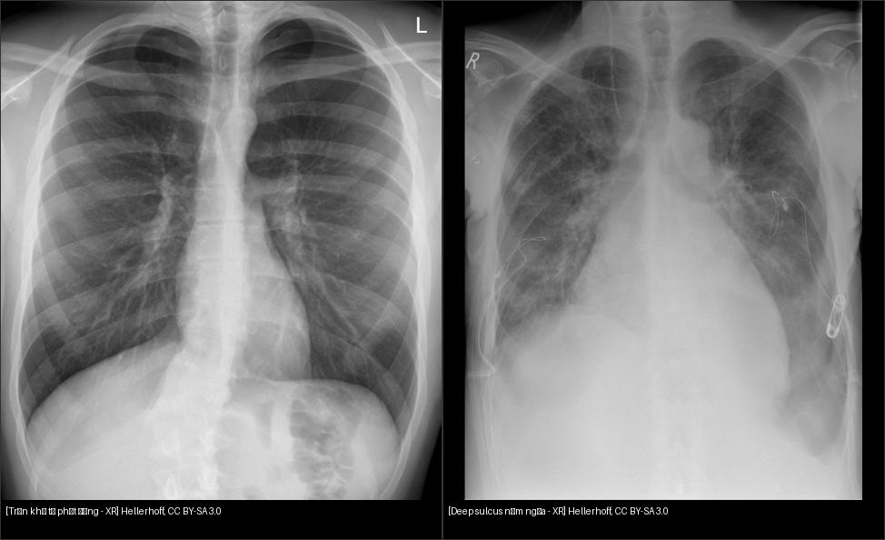
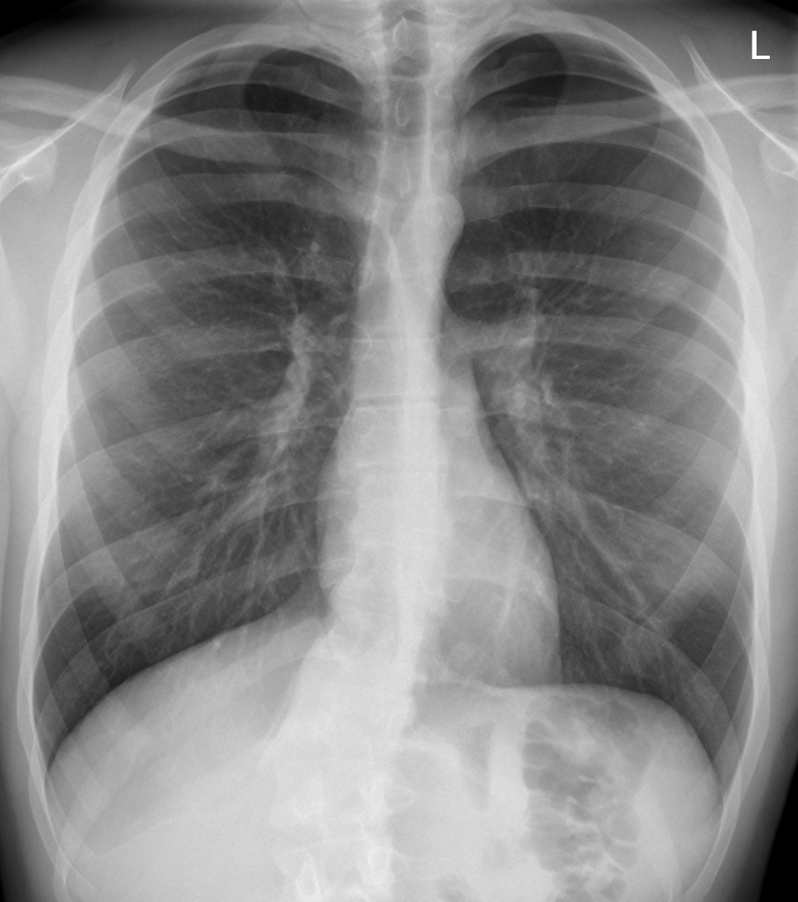
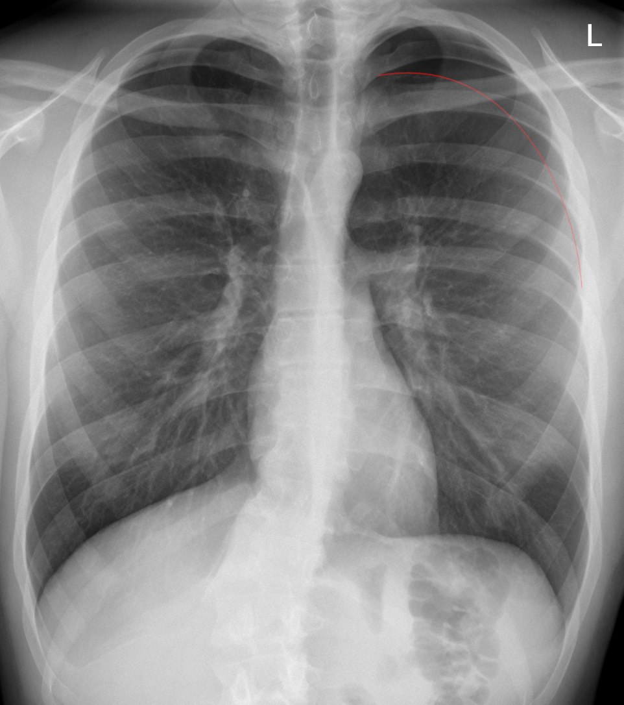

# 041 — Tràn khí màng phổi / Pneumothorax

**Tags:** `pattern:tran-khi` `vung:mang-phoi`
**Mức chắc chắn (certainty):** tổng hợp y văn (literature synthesis) — nhóm tự biên từ y văn mở, chưa gắn ca nguyên văn đơn lẻ.

## 1. Tổng quan — khí lọt vào đâu, vì sao xẹp

- Khoang màng phổi bình thường áp âm, phổi dính sát thành ngực. Khi khí lọt vào (vỡ bóng (bleb/bulla), chấn thương (trauma), thủ thuật (iatrogenic)), phổi **xẹp thụ động theo độ chun (elastic recoil)** — trên phim thấy **đường màng phổi tạng (visceral pleural line)** + ngoài đường đó **không còn mạch máu phổi (avascular)**.
- TẠI SAO phim thở ra nhạy hơn: thở ra phổi co nhỏ, khí màng phổi tương đối nhiều lên → đường màng phổi lộ rõ. TẠI SAO phim nằm ngửa khó đọc: khí dồn lên **trước + đáy** thay vì đỉnh → dấu duy nhất có thể chỉ là **rãnh sâu (deep sulcus)**.
- **Tràn khí áp lực (tension):** van một chiều → đẩy trung thất sang đối diện + xẹp tĩnh mạch (tụt huyết áp) — **chẩn đoán lâm sàng, dẫn lưu ngay, không chờ CT**.

## 2. Gamut theo bối cảnh

- **Tự phát nguyên phát (primary spontaneous):** thanh niên cao gầy, vỡ bleb đỉnh — tái phát cao.
- **Thứ phát (secondary):** COPD, lao, nang (cyst), Pneumocystis — phổi đã bệnh, dung nạp kém, ngưỡng dẫn lưu thấp.
- **Chấn thương/thủ thuật:** gãy xương sườn, chọc dịch, đặt catheter tĩnh mạch trung tâm, thở máy áp lực dương.
- **Giả tràn khí:** nếp da (skin fold — đường vượt ra ngoài thành ngực), tóc, áo, bóng dạ dày trái cao, kén khí khổng lồ (giant bulla — thành cong theo phổi, có mạch bên trong).

*Trái: tràn khí tự phát phim đứng. Phải: deep sulcus phim nằm ICU. Nguồn: Hellerhoff, CC BY-SA 3.0. Ảnh ghép letterbox.*

## 3. Bảng so sánh phân biệt

| Thực thể (entity) | Hình ảnh điển hình | Chốt vào (rule-in) | Chốt loại (rule-out) | Gợi ý xác nhận |
|---|---|---|---|---|
| Tràn khí đứng (upright) | Đường màng phổi tạng + vùng vô mạch ngoại vi | **Thấy đường màng phổi + mất mạch ngoài đường đó** | Còn mạch tới tận thành ngực → không phải tràn khí | Thở ra, nghiêng bên bệnh |
| Tràn khí nằm (supine) | Deep sulcus, sáng nửa ngực, bờ tim sắc (sharp) | **Góc sườn hoành sâu bất thường + phim nằm ICU** | Đối xứng 2 bên + tiền sử khí phế thũng → thận trọng | CT khi nghi ngờ cao mà phim mờ |
| Tràn khí áp lực (tension) | Đẩy trung thất + xẹp phổi lớn + lâm sàng nặng | **Tụt HA + tĩnh mạch cổ nổi + khí quản lệch** | Bệnh nhân ổn định, không lệch trung thất | Dẫn lưu kim/mở ngay, không chụp thêm |
| Nếp da giả (skin fold) | Đường thẳng song song thành ngực | **Đường vượt ra ngoài lồng ngực + còn mạch ngoài "đường"** | Mất mạch thật + đường khu trú đỉnh → tràn khí thật | Sờ nếp da, chụp lại sau chỉnh tư thế |

## 4. Protocol

- **X-quang đứng hít vào + thở ra:** thở ra tăng độ nhạy tràn khí nhỏ; đo khe đỉnh-bên ước lượng (> 2–3 cm hoặc > 15–20% mới cân nhắc dẫn lưu ở tự phát nguyên phát ổn định).
- **Nghiêng bên bệnh / nằm ngửa ICU:** khi không đứng được; deep sulcus là dấu chính.
- **CT:** tràn khí ẩn (occult) sau chấn thương, phân biệt kén khí khổng lồ, định vị dẫn lưu khó.
- **Siêu âm (lung sliding mất + lung point):** xác nhận tại giường cực nhanh.

## 5. Biến thể và cạm bẫy — trọng tâm phim nằm + kén khí + áp lực

- **Phim nằm ngửa ICU (supine AP):** khí dồn lên vùng **trước-trong và đáy** (nơi thấp nhất), không lên đỉnh — tìm **deep sulcus (góc sườn hoành sâu)**, nửa ngực sáng hơn, bờ tim sắc (sharp), vòm hoành thấy rõ. Đừng chờ đường màng phổi đỉnh.
- **Kén khí khổng lồ (giant bulla) vs tràn khí:** kén có thành mảng cong theo phổi + còn mạch bên trong vùng nghi ngờ; tràn khí có đường màng phổi + vô mạch hoàn toàn ngoài đường đó. Dấu double-wall (khí 2 bên thành kén) = tràn khí kèm kén. **Nghi ngờ là chụp CT trước — cấm chọc dẫn lưu mù vào kén.**
- **Tràn khí áp lực (tension):** xẹp phổi lớn + **trung thất đẩy sang đối diện + vòm hoành hạ thấp/dẹt + deep sulcus sâu** + lâm sàng (tụt HA, tĩnh mạch cổ nổi) — chẩn đoán lâm sàng, dẫn lưu ngay.
- **Nếp da, tóc tết, viền xương bả vai:** 3 giả tràn khí kinh điển — quy tắc "đường ra khỏi lồng ngực + mạch còn nguyên".
- **Tràn khí lượng ít đỉnh:** dễ bỏ sót khi đọc vội — phóng đại (zoom) đỉnh 2 bên là thói quen bắt buộc.

## 6. Tự lượng giá — Blind Quiz

**Ca 1 — Thanh niên đau ngực đột ngột. Mô tả trước khi mở đáp án.**

- Hỏi: đường màng phổi ở đâu? Bên nào? Có đẩy trung thất không? Xử trí?

<b>Bấm để hiện đáp án</b>

- Dấu hiệu: đường màng phổi tạng trái + vùng vô mạch ngoại vi — **tràn khí tự phát trái**, chưa dấu áp lực.
- Xử trí: theo dõi Oxy + hút/chọc hút nếu lớn/tăng; tư vấn nguy cơ tái phát, tránh lặn/bay.
- Nguồn: Hellerhoff, CC BY-SA 3.0.

**Ca 2 — BN ICU thở máy, phim nằm:** mở `041_deep-sulcus_XR_Wikimedia-Hellerhoff-CCBYSA30.jpg`. Tìm deep sulcus bên nào? Vì sao không thấy đường màng phổi đỉnh?

<b>Bấm để hiện đáp án</b>

- Góc sườn hoành sâu bên trái (phải ảnh) + đã có dẫn lưu 2 bên — khí dồn trước-dưới khi nằm nên đỉnh "bình thường giả".

## Bài liên quan chéo
- [001 – Tổng quan hệ Ngực](../001-tong-quan-he-nguc/lesson.md)
- [010 – Giải phẫu ngực cắt lớp](../010-giai-phau-nguc-cat-lop/lesson.md) (nếp da giả)
- [040 – Tràn dịch màng phổi](../040-tran-dich-mang-phoi/lesson.md) (tràn máu-khí)

> Không dùng để chẩn đoán độc lập khi chưa có người hướng dẫn.
