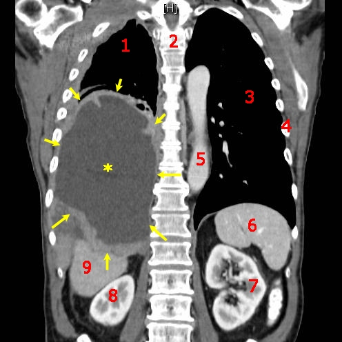
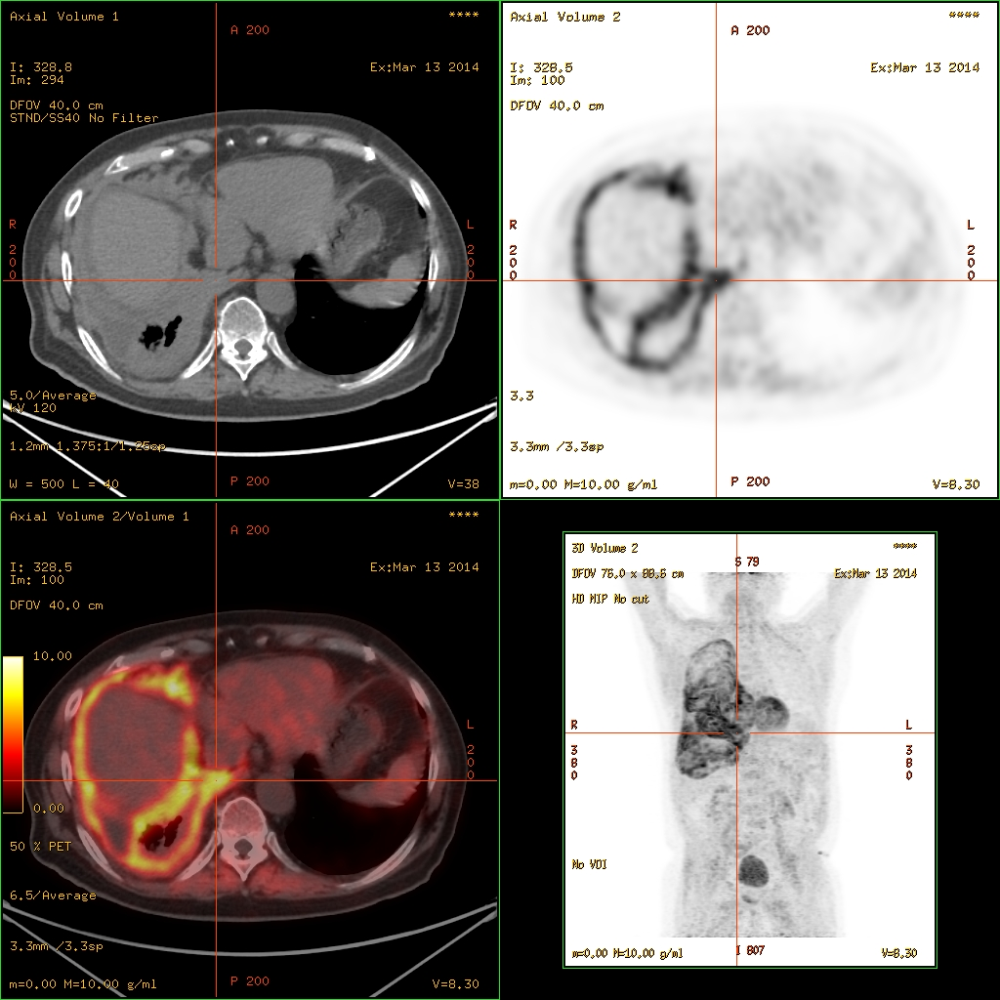

# 042 — Dày, vôi hóa & u màng phổi / Pleural thickening, plaques & Mesothelioma

**Tags:** `pattern:u-mang-phoi` `vung:mang-phoi`
**Mức chắc chắn (certainty):** tổng hợp y văn (literature synthesis) — nhóm tự biên từ y văn mở, chưa gắn ca nguyên văn đơn lẻ.

## 1. Tổng quan — màng phổi dày khi nào + con số

- Màng phổi bình thường < 2 mm, không thấy trên X-quang. Thấy được = bệnh: xơ sau viêm/mủ (fibrothorax), mảng amiăng (plaque), u trung biểu mô (mesothelioma), di căn.
- Ngưỡng: dày khu trú **> 10 mm** hoặc dày chu vi (rind) + co rút lồng ngực → nghĩ ác tính; mảng amiăng: dày khu trú 2–5 mm, **vôi hóa**, dọc thành ngực/cơ hoành, thường 2 bên, **chừa đỉnh + góc sườn hoành**.
- TẠI SAO mesothelioma co rút lồng ngực: u lan tỏa bao bó phổi (rind) + xơ → mất thể tích nửa ngực (khác dịch tự do đè trung thất sang đối diện).

## 2. Gamut dày màng phổi

- **Sau viêm/mủ/lao:** dày đều + vôi hóa + tiền sử mủ cũ, ổn định.
- **Mảng amiăng:** vôi hóa, 2 bên, phơi nhiễm, chừa đỉnh/góc — lành tính nhưng theo dõi mesothelioma.
- **Mesothelioma:** dày nốt chu vi + tràn dịch + co rút + phơi amiăng 20–40 năm.
- **Di căn màng phổi:** nốt đa ổ + K nguyên phát đã biết (phổi, vú, buồng trứng).

*Sơ đồ dạy học: khối màng phổi phải (sao vàng) + cấu trúc lân cận đánh số. Nguồn: Stevenfruitsmaak, CC BY-SA 4.0.*

## 3. Bảng so sánh

| Thực thể (entity) | Hình ảnh điển hình | Chốt vào (rule-in) | Chốt loại (rule-out) | Gợi ý xác nhận |
|---|---|---|---|---|
| Mesothelioma | **Dày nốt chu vi + dịch + co rút nửa ngực** + amiăng | **Rind + co rút + phơi amiăng 20–40 năm** | Mảng vôi 2 bên ổn định → amiăng lành | Sinh thiết màng phổi (VATS), PET |
| Mảng amiăng | Vôi hóa **2 bên, chừa đỉnh/góc**, không co rút | **Vôi hóa + phơi nhiễm + ổn định** | Dày nốt tiến triển → mesothelioma | Theo dõi định kỳ |
| Di căn màng phổi | Nốt đa ổ + K nguyên phát | **K đã biết + nốt màng phổi mới** | Đơn độc không tiền sử → nguyên phát | Dịch màng phổi tế bào học |
| Xơ sau mủ | Dày đều + vôi + tiền sử mủ/lao | **Tiền sử rõ + ổn định năm** | Tiến triển → u | So phim cũ |

*Bắt thuốc lan tỏa theo màng phổi. Nguồn: Hg6996, CC BY 3.0.*

## 4. Protocol

- **CT cản quang:** dày chu vi/nốt + ngấm thuốc + hạch + dịch; đo độ dày điểm lớn nhất (mm).
- **PET-CT:** lan tỏa bắt mạnh + tìm nguyên phát (di căn) + giai đoạn mesothelioma.
- **Sinh thiết VATS** là tiêu chuẩn vàng mesothelioma (tế bào học dịch âm tính giả cao).

## 5. Cạm bẫy

- **Mỡ ngoài màng phổi** giả dày 2 bên đối xứng — HU mỡ (−100) phân biệt.
- **Mảng amiăng chừa đỉnh/góc** — dày đỉnh nghĩ lao cũ, không phải amiăng.
- **Tế bào học dịch âm tính ≠ loại trừ mesothelioma** — sinh thiết mới chốt.

## 6. Tự lượng giá — Blind Quiz

**Ca 1 — Kể tên cấu trúc 1–9 và khối sao vàng là gì.**

<b>Bấm để hiện đáp án</b>

- Sao vàng = **khối u trung biểu mô màng phổi phải**; 1–9 là xương sườn/cột sống/gan/thận/lách (tự đối chiếu giải phẫu cắt ngang) — đọc CT phải định vị được tạng trước khi gọi tên u.
- Nguồn: Stevenfruitsmaak, CC BY-SA 4.0.

**Ca 2 — Thợ amiăng 30 năm, dày nốt chu vi + dịch + co rút nửa ngực phải:** chẩn đoán + bước tiếp?

<b>Bấm để hiện đáp án</b>

- **Mesothelioma:** rind + co rút + phơi nhiễm — sinh thiết VATS + PET giai đoạn (đối chiếu ảnh PET mục 3).

## Bài liên quan chéo
- [001 – Tổng quan hệ Ngực](../001-tong-quan-he-nguc/lesson.md)
- [040 – Tràn dịch màng phổi](../040-tran-dich-mang-phoi/lesson.md) (dịch + dày màng)
- [041 – Tràn khí màng phổi](../041-tran-khi-mang-phoi/lesson.md)

> Không dùng để chẩn đoán độc lập khi chưa có người hướng dẫn.
