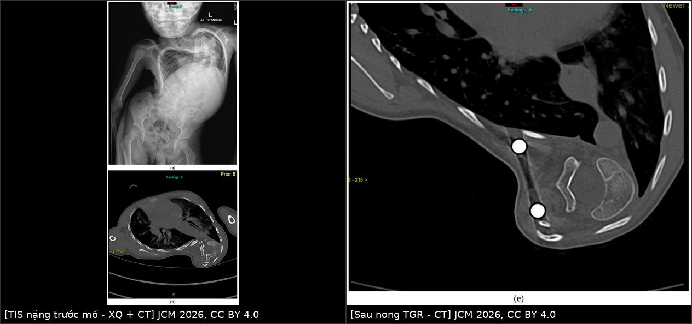
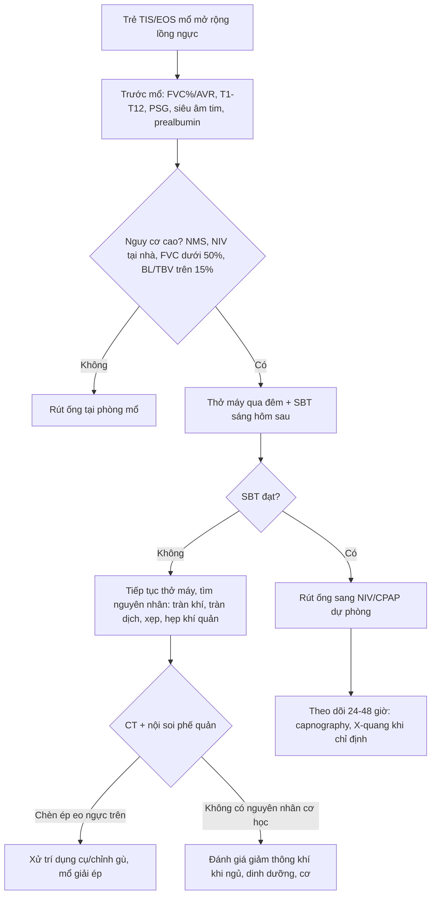
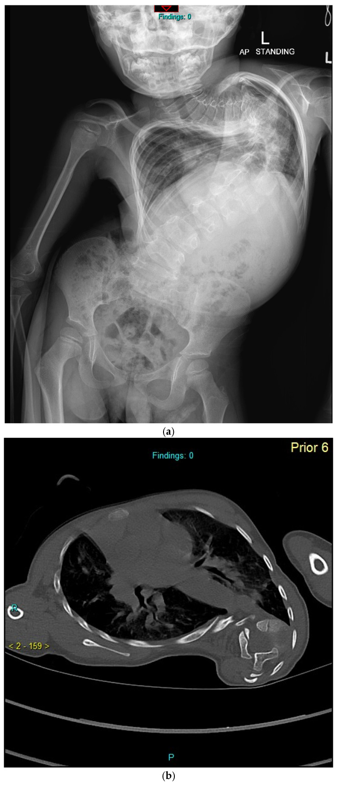
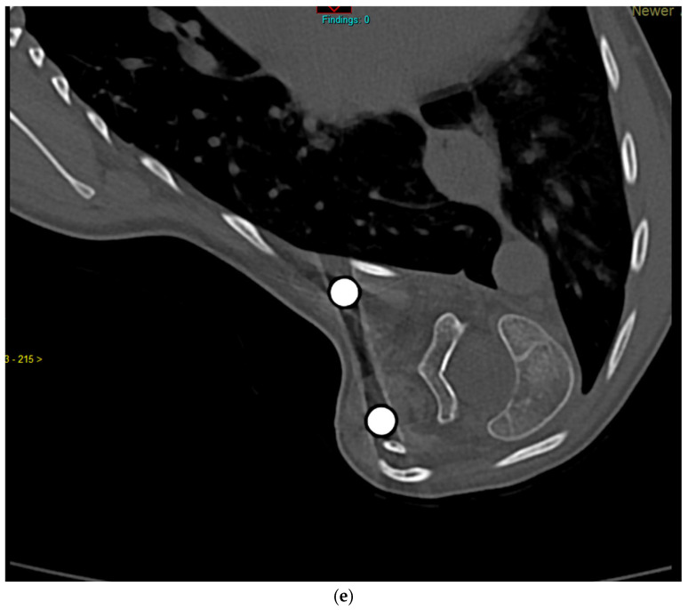

# 043 — Chăm sóc hô hấp quanh mổ & cai máy ở trẻ TIS/EOS sau mở rộng lồng ngực / Perioperative respiratory care and weaning in thoracic insufficiency syndrome and early-onset scoliosis

**Tags:** `pattern:han-che-thong-khi` `pattern:hep-long-nguc` `vung:long-nguc` `vung:duong-tho` `anatomy:long-nguc` `score:AVR` `score:C-EOS` `protocol:da-ky-giac-ngu` `protocol:hoi-suc-nhi` `incidentaloma:bien-dang-long-nguc`
**Mức chắc chắn (certainty):** tổng hợp y văn (literature synthesis) — số liệu từ **73 trẻ EOS** mổ dụng cụ "thân thiện tăng trưởng" (biến chứng hô hấp sau mổ 21,9%, OR theo yếu tố nguy cơ) của *Orthop Surg* 2022 (PMC9251275); **điểm luận chức năng hô hấp trong EOS** của *J Clin Med* 2026 (PMC12842268, CC BY 4.0); **84 trẻ vẹo cơ–thần kinh** được hội chẩn đa chuyên khoa, 48 ca mổ (biến chứng sớm 54,1%) của *BMJ Paediatr Open* 2025 (PMC11836852, CC BY-NC 4.0); **ngưỡng đa ký giấc ngủ để khởi trị NIV** của *J Clin Sleep Med* 2026 (PMC13379531); và **một ca nguyên văn** khó cai máy do hẹp eo ngực trên–chèn ép khí quản sau nong thanh (PMC13435391, CC BY 4.0).

> **Bài này là "phần chu phẫu" của [048](../048-hoi-chung-long-nguc-khong-du-tis-veptr/lesson.md).** 048 dạy **chẩn đoán TIS, SAL, chọn dụng cụ và nhịp nong**; bài 043 trả lời phần **trước mổ đo gì, trong mổ giữ gì, sau mổ cai máy thế nào, và vì sao trẻ vẫn có thể khó thở dù phim "đã chỉnh"**. Đọc kèm [001](../001-tong-quan-he-nguc/lesson.md) (học thuyết thể tích) và [047](../047-veo-cot-song-sau-mo-nguc/lesson.md) (biến dạng sau mở ngực).

## 1. Tổng quan bệnh học – cơ chế hình ảnh

- **Vì sao trẻ TIS/EOS là nhóm "khó cai máy" nhất trong phẫu thuật cột sống nhi:** ba bình diện cùng lúc —
  1. **Hạn chế (restrictive):** lồng ngực **không lớn theo phổi** → giảm **thể tích dự trữ**, giảm **dung tích cặn chức năng (FRC)**; khi nằm ngửa hoặc **nằm sấp** (tư thế mổ), tạng đẩy hoành lên → **đóng các đơn vị phổi đáy** → **shunt trong phổi tăng**, giảm oxy máu.
  2. **Tắc nghẽn (obstructive):** **33–76%** trẻ EOS có **khiếm khuyết tắc nghẽn** kèm theo, **không tương quan với FVC**; trong 49 trẻ được nong thanh, **ba phần tư** có tắc nghẽn dai dẳng và **hơn một nửa** nặng lên trong 5 năm (PMC12842268). Nghĩa là **thở ra cũng là vấn đề**, không chỉ "phổi nhỏ".
  3. **Giảm thông khí khi ngủ (sleep hypoventilation):** **đa số** trẻ TIS có **rối loạn hô hấp khi ngủ**, gồm **cơn ngừng thở và tụt bão hoà**, nặng nhất ở **giấc ngủ REM** vì trương lực cơ liên sườn–hoành thấp nhất (PMC12842268).
- **Con số "phải nhớ" về mức hạn chế (dùng để phân tầng trước mổ):**
  - Trẻ **chỉ khó thở khi FVC < 50% dự đoán** — **đánh giá lâm sàng rất kém nhạy**, không thể "nhìn trẻ chơi bình thường" mà kết luận phổi ổn (PMC12842268).
  - **Chiều cao cột sống ngực T1–T12 < 18 cm** là ngưỡng có ý nghĩa: **10/16** trẻ có **FVC/FEV1 < 50% dự đoán**, so với **2/8** ở nhóm **18–22 cm** và **0/4** ở nhóm **> 22 cm** (PMC12842268 dẫn Karol và cs). Đây là lý do mục tiêu phẫu thuật là **T1–T12 18–22 cm** — nhưng **không phải bảo đảm**: có trẻ ngực ngắn vẫn giữ PFT tốt, và ngược lại.
  - **FVC/FEV1 < 60% dự đoán trước tuổi trưởng thành** → **khó tránh biến chứng hô hấp** dù T1–T12 có vượt 18 cm (PMC12842268 dẫn Johnston và cs).
  - **Không kỳ vọng PFT tăng sau mổ:** với **thanh nong (TGR/MCGR)** và **VEPTR**, đa số nghiên cứu thấy **FVC%/FEV1% giữ nguyên hoặc giảm nhẹ**; mục tiêu thực tế là **duy trì tăng trưởng lồng ngực và ngăn suy giảm**, không phải "hồi phục phổi" (PMC12842268). Đây là câu trả lời chuẩn cho gia đình hỏi "mổ xong phổi có tốt hơn không".
- **Vì sao hình ảnh không được dùng thay PFT:** tương quan giữa **Cobb** và PFT chỉ **trung bình**; **tưới máu–thông khí phổi bất đối xứng** gặp ở **khoảng một nửa** trẻ EOS và **không theo bên lồi/lõm** (PMC12842268). Vì vậy **Cobb đẹp không đồng nghĩa phổi tốt**, và **phim ngực bình thường không loại trừ giảm thông khí khi ngủ**.
- **Biến chứng hô hấp sau mổ — bộ số của 73 trẻ EOS (định nghĩa thống nhất theo ESA-ESICM):**
  - **21,9% (16/73)** trẻ có **biến chứng hô hấp sau mổ (postoperative respiratory complications — PRC)**; tổng **54 lượt** biến chứng.
  - Thành phần: **tràn dịch màng phổi 25,9%**, **viêm phổi sau mổ 20,4%**, **giảm oxy máu 18,5%**, **xẹp phổi 14,8%**, **thở máy kéo dài > 48 giờ (PIMPPVS) 7,4%**, **co thắt phế quản 3,7%**, **đặt lại ống 3,7%**, **cai máy muộn 3,7%**, **tràn khí màng phổi 1,9%** (PMC9251275).
  - **Ngưỡng thời gian dùng trong bài (và trong hồ sơ):** **cai máy muộn/đặt lại ống/thở máy kéo dài** tính khi còn thở máy **> 24 giờ** sau mổ; **đặt lại ống** = cần đặt lại trong **24 giờ** sau rút; **PIMPPVS** = thở máy **> 48 giờ** (PMC9251275).
- **TẠI SAO — bốn yếu tố nguy cơ độc lập (OR) và cách dùng:**
  - **Mất máu/thể tích máu (BL/TBV) ≥ 15%: OR 29,19** (p = 0,010) — yếu tố **mạnh nhất**; mất máu nhiều → truyền dịch–máu → **phù phổi kẽ, giảm compliance, xẹp phổi**.
  - **Có bệnh phổi kèm theo: OR 19,22** (p = 0,012).
  - **Pre-transferrin < 200 mg/dL: OR 11,50** (p = 0,024) — dấu hiệu **suy dinh dưỡng**, làm yếu cơ hô hấp và chậm lành.
  - **Vẹo không vô căn (non-idiopathic): OR 7,63** (p = 0,046).
  - Phân tích đơn biến còn thấy **thời gian gây mê ≥ 300 phút** và **prealbumin < 3,5 g/dL** khác biệt có ý nghĩa (PMC9251275).
- **Nhóm vẹo cơ–thần kinh (neuromuscular scoliosis — NMS) — "bộ số" khác:** 48 trẻ được mổ, **54,1% có biến chứng sớm**, **không tử vong**; biến chứng hay gặp nhất là **thiếu máu sau mổ** và **nhiễm trùng hô hấp**. Ba yếu tố dự báo độc lập: **dùng NIV tại nhà**, **FVC < 70% dự đoán**, **ngồi xe lăn toàn thời gian**. Thời gian nằm **PICU tăng** thêm **1,8 ngày** (NIV), **1,5 ngày** (FVC < 70%), **2,1 ngày** (xe lăn), **2,1 ngày** (có mở khí quản) (PMC11836852).

## 2. Mẫu hình + chẩn đoán phân biệt theo cơ chế và theo thời điểm (gamut)

- **Gamut theo CƠ CHẾ (dùng khi trẻ "khó thở sau mổ" mà chưa rõ nguyên nhân):**
  - **Hạn chế thành ngực:** TIS/EOS nặng, dính sườn, dụng cụ thanh nong **kéo căng** → giảm FRC; **không có tổn thương nhu mô trên phim**.
  - **Xẹp phổi (atelectasis):** tư thế **nằm sấp kéo dài**, đau → thở nông, đờm ứ, **yếu cơ** (NMS) → xẹp **thùy dưới hai bên** hoặc **thùy giữa**.
  - **Tràn dịch màng phổi:** **mở màng phổi trong mổ** (VEPTR sườn–sườn, cắt sườn), **máu/dịch** → tràn dịch; **25,9%** các biến chứng.
  - **Tràn khí màng phổi:** rách màng phổi, **barotrauma** khi thông khí áp lực cao ở phổi hạn chế; **1,9%**.
  - **Viêm phổi:** **20,4%**; yếu tố: đặt nội khí quản lâu, xẹp phổi, **sặc** (NMS, bại não).
  - **Tắc nghẽn đường thở trên:** **mềm sụn–hẹp khí quản**, **chèn ép khí quản do gù/lordosis ngực trên** hoặc **hẹp eo ngực trên (thoracic inlet) sau nong** — ca nguyên văn PMC13435391.
  - **Giảm thông khí trung ương/do thuốc:** opioid, tồn dư giãn cơ, **hội chứng giảm thông khí khi ngủ** — **phim bình thường**.
  - **Phù phổi/TRALI:** truyền máu–dịch nhiều (gắn với **BL/TBV ≥ 15%**).
  - **Tràn dưỡng trấp (chylothorax):** hiếm, sau **mổ ngực/bóc tách trung thất**; dịch **vàng sữa**, tăng lymphocyte.
- **Gamut theo THỜI ĐIỂM (giúp chọn ảnh và thứ tự xử trí):**
  - **0–24 giờ:** **cai máy thất bại**, **tắc nghẽn đường thở trên**, **tràn khí**, **chảy máu**.
  - **24–72 giờ:** **xẹp phổi**, **tràn dịch**, **phù phổi**, **giảm oxy**.
  - **> 72 giờ:** **viêm phổi**, **tràn dưỡng trấp**, **biến chứng dụng cụ** (di trú thanh, hẹp eo ngực trên).
- **Ba câu hỏi trước khi gọi "biến chứng hô hấp":** **(1) Trẻ có thực sự hạn chế nặng trước mổ (FVC < 50–60%, T1–T12 < 18 cm)? (2) Có nguyên nhân "cơ học" sửa được (tràn khí, tràn dịch, tắc nghẽn, dụng cụ)? (3) Có yếu tố "không sửa được" (bệnh phổi nền, NMS, NIV tại nhà) khiến phải **kế hoạch hoá** cai máy chứ không "thử rút ống"?**

## 3. Bảng so sánh phân biệt (ma trận đối chiếu)

| Thực thể (entity) | Hình ảnh điển hình | Chốt vào (rule-in) | Chốt loại (rule-out) | Gợi ý xác nhận |
|---|---|---|---|---|
| **Xẹp phổi sau mổ** | Đám mờ **thùy dưới/thùy giữa**, **dịch chuyển rãnh liên thùy**, **giảm thể tích** nửa ngực; CT: phế quản hơi **tụ lại** | **Giảm thể tích + phế quản hơi tụ + không có mức dịch** | Có **mức khí–dịch** hoặc **mờ đáy thay đổi theo tư thế** → nghĩ tràn dịch | X-quang nghiêng/CT; đối chiếu trước–sau khi vỗ rung |
| **Tràn dịch màng phổi** | **Mờ đáy, mức cong (meniscus)**, **xoá góc sườn hoành**, nghiêng thay đổi; CT: dịch **0–20 HU** | **Mức cong + thay đổi theo tư thế + xoá góc sườn hoành** | Không mức cong, giảm thể tích, phế quản hơi tụ → xẹp | US tại giường (dịch ≥ 10 mm), CT |
| **Tràn khí màng phổi** | **Đường màng phổi**, **không thấy mạch máu ngoại vi**, phim **nằm**: **dấu rãnh sâu (deep sulcus)** | **Đường màng phổi rõ + mất vân phổi ngoại vi** | Chỉ **tăng sáng** do kỹ thuật, không có đường màng phổi → không phải | US (mất trượt màng phổi), CT nếu nghi |
| **Viêm phổi sau mổ** | Đám mờ **mới/xấu đi**, có thể **đông đặc**, **phế quản hơi**; hay gặp **thùy dưới** | **Đám mờ mới + sốt > 38°C + bạch cầu < 4.000 hoặc > 12.000 + đờm mủ/tăng hút** | Mờ **ổn định** nhiều ngày, không sốt, không tăng bạch cầu → nghĩ xẹp | X-quang lặp lại, cấy, PCT |
| **Hẹp eo ngực trên/chèn ép khí quản** | X-quang: **hẹp cột khí** ngang **eo ngực trên**; CT: **khí quản bị ép từ ngoài**, **lordosis ngực trên**; nội soi xác nhận | **Khó đặt ống/khó rút ống + hẹp cột khí trên phim/CT + nội soi thấy chèn ép** | Khí quản **bình thường** trên CT → tìm nguyên nhân khác | CT lát mỏng + nội soi phế quản mềm |
| **Giảm thông khí khi ngủ** | **Phim ngực bình thường**; **đa ký giấc ngủ** là chốt | **tcCO₂ > 50 mmHg ≥ 25% tổng thời gian ngủ** (AASM) hoặc **tăng ≥ 10 mmHg so với lúc thức ≥ 2% thời gian ngủ** (CHEST/ERS) | SpO₂ và CO₂ bình thường suốt đêm → loại trừ | PSG trước mổ; theo dõi capnography sau mổ |
| **Phù phổi/TRALI** | **Mờ hai đáy/quantum**, **dày vách**, **tràn dịch hai bên**, tim không to | **Truyền máu–dịch nhiều (BL/TBV ≥ 15%) + mờ mới hai bên + giảm oxy** | Mờ **một bên**, có mức dịch rõ → nghĩ tràn dịch/xẹp | X-quang/CT, đáp ứng lợi tiểu–thông khí |
| **Tràn dưỡng trấp** | **Tràn dịch lượng nhiều, tái phát nhanh**, có thể **một bên**; dịch **vàng sữa** | **Dịch tái phát nhanh sau mổ ngực + triglyceride dịch cao + tăng lymphocyte** | Dịch **máu/thanh mạc**, không tái phát → không phải | Chọc dò sinh hoá; CT sau khi ăn mỡ |

*Trái: **(a)** X-quang đứng và **(b)** CT ngang trước mổ — vẹo nặng, lồng ngực hẹp, cột sống xoay; **T1–T12 8,9 cm**, FEV1/FVC **25% dự đoán**. Phải: **(e)** CT sau nhiều lần nong thanh — **cột sống vẫn chui vào khoang ngực**, phần xoay **chưa được giải quyết**. Nguồn: *J Clin Med* 2026 (PMC12842268) Fig. 1a–b và 1e, CC BY 4.0; ghép bằng `tools/make_composite.py` (letterbox, không crop/kéo giãn).*

### Ba dấu hiệu quyết định trên phim
- **Thể tích phổi trước, bệnh nhu mô sau:** đếm **số cung sườn**, đo **chiều cao T1–T12**, tính **SAL** (bài 048); nếu **lồng ngực hẹp + phổi "sáng đều"** thì khó thở là do **thành ngực**, không phải viêm phổi.
- **Mức khí–dịch thay đổi theo tư thế** = dịch tự do; **cố định** = kén/áp-xe/đông đặc.
- **Cột khí bị hẹp ngang eo ngực trên** là dấu hiệu **phải nội soi** khi trẻ **khó rút ống** — ca nguyên văn: trẻ 6 tuổi, khó cai máy sau lần nong thanh đầu tiên, CT + nội soi cho thấy **khí quản bị chèn ép ở eo ngực trên do lordosis ngực trên**, xử trí bằng **cắt xương cột sau nhiều tầng + thanh cong theo gù**, **rút ống ngày hậu phẫu 2** (PMC13435391).

## 4. Protocol chụp, đánh giá và cai máy

- **Trước mổ — 4 việc bắt buộc:**
  1. **PFT (spirometry) khi trẻ hợp tác (≈ ≥ 5–6 tuổi):** lấy **FVC% và FEV1%**; **dưới tuổi đó** dùng **AVR (assisted ventilation rating)** — thang mức hỗ trợ thông khí ban ngày/ban đêm (bài 048). Ghi **cả FVC% và T1–T12** vì **Cobb không thay thế được PFT**.
  2. **Đa ký giấc ngủ (polysomnography — PSG)** khi có **ngáy, ngưng thở, tụt SpO₂ khi ngủ, đau đầu sáng, NMS, FVC < 50%**. **Ngưỡng khởi trị NIV** (dùng thống nhất, ghi rõ hệ):
     - **AASM cổ điển:** **AHI ≥ 5 sự kiện/giờ** (tắc nghẽn hoặc trung ương) và/hoặc **etCO₂/tcCO₂ > 50 mmHg trong > 25% tổng thời gian ngủ**.
     - **CHEST 2023 / ERS (khởi trị sớm hơn):** **tcCO₂ > 50 mmHg ≥ 2% tổng thời gian ngủ**; **tăng ≥ 10 mmHg so với lúc thức ≥ 2% thời gian ngủ**; **SpO₂ < 90% ≥ 2% thời gian ngủ hoặc ≥ 5 phút liên tục** (PMC13379531).
  3. **Siêu âm tim** tìm **tăng áp lực động mạch phổi** (hệ quả của thiếu giường mạch + thiếu oxy mạn) và **đánh giá chức năng thất phải** trước gây mê.
  4. **Dinh dưỡng:** đo **prealbumin** và **transferrin** — ngưỡng **prealbumin < 3,5 g/dL**, **transferrin < 200 mg/dL** gắn với **biến chứng hô hấp** (PMC9251275). Bổ sung dinh dưỡng **trước** mổ, không "mổ rồi tính".
- **Trong mổ — 3 mục tiêu giảm biến chứng:**
  - **Giữ mất máu < 15% thể tích máu (BL/TBV < 15%)** — đây là **yếu tố nguy cơ mạnh nhất** (OR 29,19); dùng **tranexamic acid**, mổ **theo thì**, chuẩn bị máu.
  - **Hạn chế thời gian gây mê ≥ 300 phút** nếu có thể (yếu tố đơn biến) — cân nhắc **mổ hai thì** ở trẻ nặng.
  - **Bảo vệ phổi trong mổ:** tránh **thông khí áp lực cao/thể tích lớn** trên phổi hạn chế, **huy động phổi** sau khi đóng vết mổ, **kiểm tra màng phổi** trước khi đóng.
- **Sau mổ — quyết định "rút ống hay để ống" theo NGƯỠNG, không theo cảm tính:**

| Nhóm | Chiến lược cai máy | Theo dõi tối thiểu |
|---|---|---|
| **Nguy cơ thấp** (vô căn, FVC > 70%, không bệnh phổi, mất máu ít) | **Rút ống tại phòng mổ** nếu đủ tiêu chuẩn (tỉnh, tự thở, TOF ≥ 0,9, không chảy máu) | Nhịp thở, SpO₂, đau, X-quang khi có chỉ định |
| **Nguy cơ trung bình** (FVC 50–70%, thời gian mổ dài, tràn dịch) | **Thở máy qua đêm → thử nghiệm tự thở (SBT) sáng hôm sau** | Capnography, khí máu nếu nghi giảm thông khí |
| **Nguy cơ cao** (NMS, **NIV tại nhà**, **FVC < 50%**, **T1–T12 < 18 cm**, BL/TBV ≥ 15%) | **Kế hoạch rút ống sang NIV/CPAP** (extubation to NIV), **không rút ống "thử"** | PICU, capnography, đa ký giấc ngủ sớm sau mổ |

- **Định nghĩa để ghi hồ sơ (và để so sánh):** **cai máy muộn** = còn thở máy **> 24 giờ**; **PIMPPVS** = **> 48 giờ**; **đặt lại ống** = trong **24 giờ** sau rút (PMC9251275). Ghi rõ các mốc này để không gọi nhầm "ổn" khi trẻ vẫn thở máy ngày 2.
- **Khi nào mở khí quản (tracheostomy):** không có ngưỡng tuyệt đối trong các nguồn đã đọc — **chưa rõ, cần tra**. Dùng hướng tiếp cận: **thất bại cai máy nhiều lần + hạn chế nặng không hồi phục + cần hỗ trợ thông khí dài hạn** (NMS, NIV tại nhà đã có) → hội chẩn **hô hấp–tai mũi họng–phẫu thuật cột sống**; đây là **quyết định của ê-kíp**, không dựa một phim.
- **Sau ra viện:** PFT **không tăng** là kỳ vọng bình thường với thanh nong/VEPTR (PMC12842268) — đừng đổi kế hoạch chỉ vì "PFT không cải thiện"; theo dõi **T1–T12, SAL, Cobb, AVR**, **PSG** nếu có NIV, và **phát triển thần kinh–dinh dưỡng**.
- **Sơ đồ quyết định cai máy (Mermaid):**

## 5. Biến thể bình thường và cạm bẫy

- **Biến thể bình thường 1 — "phổi sáng đều" ở trẻ TIS:** không có bệnh nhu mô; **giảm thể tích là do thành ngực**. Đừng báo "viêm phổi" chỉ vì đám mờ đáy **do xẹp**.
- **Biến thể bình thường 2 — mờ đáy sau mổ 24–48 giờ:** thường là **xẹp/xuất tiết nhẹ**; **hết sau vỗ rung–vận động**. Chỉ gọi viêm phổi khi có **sốt + bạch cầu + đờm mủ** theo định nghĩa.
- **Cạm bẫy 1 — phim ngực bình thường trong giảm thông khí khi ngủ:** **PFT/PSG là chốt**, không phải X-quang. Trẻ có thể **SpO₂ 98% lúc thức** và **tcCO₂ 55 mmHg khi ngủ REM**.
- **Cạm bẫy 2 — phim nằm tại giường:** tràn dịch **không có mức cong**, dễ đọc thành "mờ đáy không rõ nguyên nhân"; tràn khí **không có đường màng phổi đỉnh** mà chỉ **dấu rãnh sâu**. Nghi → **US tại giường** hoặc **CT**.
- **Cạm bẫy 3 — dụng cụ che phổi:** thanh nong/VEPTR tạo **bóng kim loại** và **dày màng phổi phản ứng**; đừng gọi "dày màng phổi" là bệnh lý nếu không có dịch/ngấm.
- **Cạm bẫy 4 — hẹp eo ngực trên sau nong:** trẻ **khó đặt ống, khó rút ống, thở rít** sau lần nong → **không chỉ tăng thuốc giãn phế quản**; chụp **CT lát mỏng** và **nội soi** để tìm **chèn ép khí quản từ ngoài** (ca PMC13435391).
- **Cạm bẫy 5 — "mổ xong Cobb đẹp là phổi tốt":** **Cobb–PFT tương quan trung bình**, và **PFT thường không tăng** sau thanh nong; đánh giá kết quả bằng **tăng trưởng T1–T12 + AVR + chất lượng sống**, không bằng Cobb.
- **Cạm bẫy 6 — bỏ sót sặc (aspiration):** trẻ NMS/bại não có **nuốt không an toàn**; đợt "viêm phổi sau mổ" có thể là **sặc** — đọc thêm [081](../081-sac-va-roi-loan-nuot/lesson.md), [082](../082-bai-nao-an-toan-nuot/lesson.md).
- **Cạm bẫy 7 — thoả mãn tìm kiếm:** thấy tràn dịch là dừng, bỏ **tràn khí kèm**, **xẹp thùy**, **hẹp khí quản**, **BL/TBV lớn** — bốn thứ đổi hoàn toàn kế hoạch cai máy.

## 6. Tự lượng giá — Blind Quiz (không cần app)

**Ca 1 — Trẻ 4 tuổi, vẹo vô căn khởi phát sớm nặng; trước mổ FEV1/FVC 25% dự đoán, đa ký giấc ngủ có rối loạn nhẹ.**

- Gợi ý: T1–T12 đo được **8,9 cm**; trẻ chưa từng thở máy.
- Câu hỏi: (1) Mô tả 2 bất thường chính trên X-quang và CT? (2) Vì sao **không** kết luận "phổi bình thường" dù trẻ chơi được? (3) Ba việc phải làm trước mổ?

<b>Bấm để hiện đáp án (findings + chẩn đoán)</b>

- **Dấu hiệu:** **(a)** vẹo ngực nặng, lồng ngực **hẹp–biến dạng**, cột sống xoay; **(b)** CT ngang: **cột sống xoay và chui vào khoang ngực**, khoang phổi **không đối xứng**.
- **Vì sao không "bình thường":** trẻ **chỉ khó thở khi FVC < 50% dự đoán**; FEV1/FVC **25%** = hạn chế rất nặng; **T1–T12 8,9 cm** (ngưỡng nguy cơ < 18 cm).
- **Ba việc trước mổ:** **PSG** (ngưỡng NIV: tcCO₂ > 50 mmHg ≥ 25% TST hoặc ≥ 2% theo CHEST), **siêu âm tim** tìm tăng áp phổi, **dinh dưỡng** (prealbumin/transferrin) + kế hoạch **halo-gravity traction**.
- **Nguồn ảnh:** *J Clin Med* 2026 (PMC12842268) Fig. 1a–b, CC BY 4.0.

**Ca 2 — Cùng trẻ sau 4 lần nong thanh; phụ huynh hỏi "mổ nhiều lần vậy phổi có tốt hơn không?".**

- Câu hỏi: (1) Ảnh cho thấy điều gì **chưa được giải quyết**? (2) Trả lời gia đình thế nào về PFT? (3) Nếu trẻ khó rút ống sau lần nong kế tiếp, cần nghĩ gì?

<b>Bấm để hiện đáp án</b>

- **Dấu hiệu:** **(e)** cột sống **vẫn xoay và chui sâu vào khoang ngực**, thanh nong **không sửa được phần xoay**; thể tích phổi **không đối xứng**.
- **Trả lời gia đình:** mục tiêu của thanh nong là **giữ tăng trưởng lồng ngực và kiểm soát biến dạng**, **không phải làm PFT tăng**; đa số nghiên cứu thấy **FVC%/FEV1% giữ nguyên hoặc giảm nhẹ** (PMC12842268). Đừng hứa "mổ xong phổi khoẻ".
- **Khó rút ống sau nong:** nghĩ **hẹp eo ngực trên/chèn ép khí quản** — **CT lát mỏng + nội soi phế quản**; ca tương tự xử trí bằng **cắt xương cột sau + thanh cong theo gù**, rút ống **ngày 2** (PMC13435391).
- **Nguồn ảnh:** *J Clin Med* 2026 (PMC12842268) Fig. 1e, CC BY 4.0.

**Ca 3 — Trẻ 9 tuổi vẹo cơ–thần kinh, đang NIV tại nhà, FVC 62% dự đoán; mổ 6 giờ, mất máu 18% thể tích máu.**

- Câu hỏi: (1) Ước lượng nguy cơ biến chứng hô hấp và nêu **hai yếu tố nguy cơ độc lập** ở ca này? (2) Nên **rút ống tại phòng mổ** hay **kế hoạch rút ống sang NIV**? (3) Ba ngưỡng cần ghi vào hồ sơ hậu phẫu?

<b>Bấm để hiện đáp án</b>

- **Nguy cơ:** nhóm **NMS** có **54,1%** biến chứng sớm; **NIV tại nhà** và **FVC < 70%** là **hai yếu tố dự báo độc lập**, mỗi yếu tố làm **tăng thời gian PICU** (1,8 và 1,5 ngày) (PMC11836852). **BL/TBV ≥ 15%** làm **OR 29,19** cho biến chứng hô hấp sau mổ (PMC9251275).
- **Chiến lược:** **không rút ống "thử"** — **thở máy qua đêm, SBT sáng hôm sau, rút ống sang NIV/CPAP** (extubation to NIV), theo dõi **capnography**.
- **Ba ngưỡng ghi hồ sơ:** **> 24 giờ** = cai máy muộn; **> 48 giờ** = PIMPPVS; **đặt lại ống trong 24 giờ** = thất bại cai máy (PMC9251275). Kèm **BL/TBV < 15%** làm mục tiêu trong mổ.
- **Nguồn số liệu:** PMC9251275, PMC11836852, PMC13379531.

## Bài liên quan chéo
- [048 – Hội chứng lồng ngực không đủ: SAL, VEPTR, nhịp nong](../048-hoi-chung-long-nguc-khong-du-tis-veptr/lesson.md)
- [001 – Tổng quan hệ Ngực: học thuyết thể tích](../001-tong-quan-he-nguc/lesson.md)
- [047 – Vẹo cột sống sau mở ngực](../047-veo-cot-song-sau-mo-nguc/lesson.md)
- [602 – Tracheobronchomalacia ở trẻ BPD](../602-tracheobronchomalacia-o-tre-bpd/lesson.md)
- [612 – Cấp cứu đường thở trên ở trẻ em](../612-cap-cuu-duong-tho-tren-tre-em/lesson.md)
- [084 – Viêm phổi thở máy (VAP) & dự phòng vi hít sặc](../084-viem-phoi-tho-may/lesson.md)
- [600 – Tổng quan Nhi khoa](../600-tong-quan-nhi-khoa/lesson.md)

> Không dùng để chẩn đoán độc lập khi chưa có người hướng dẫn.
