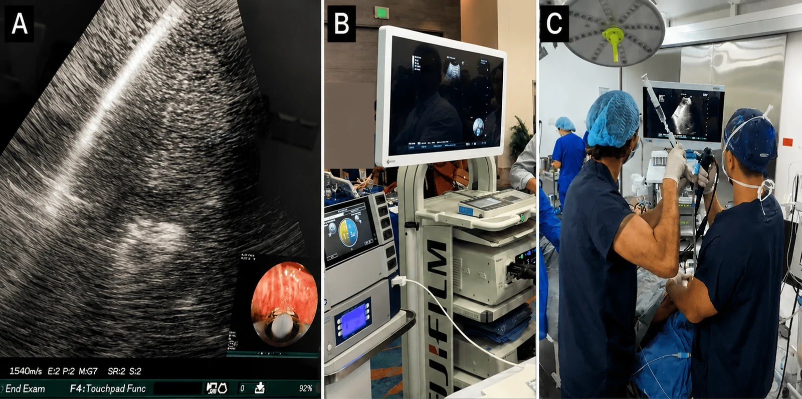
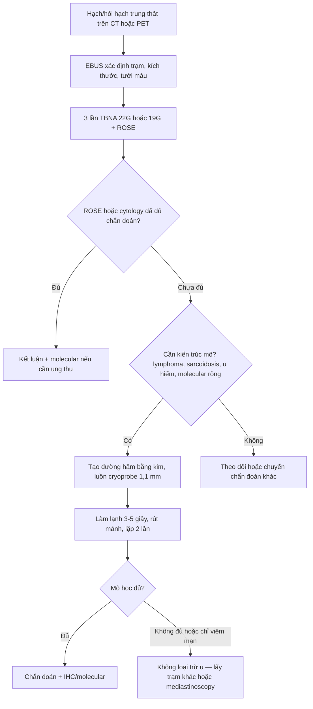
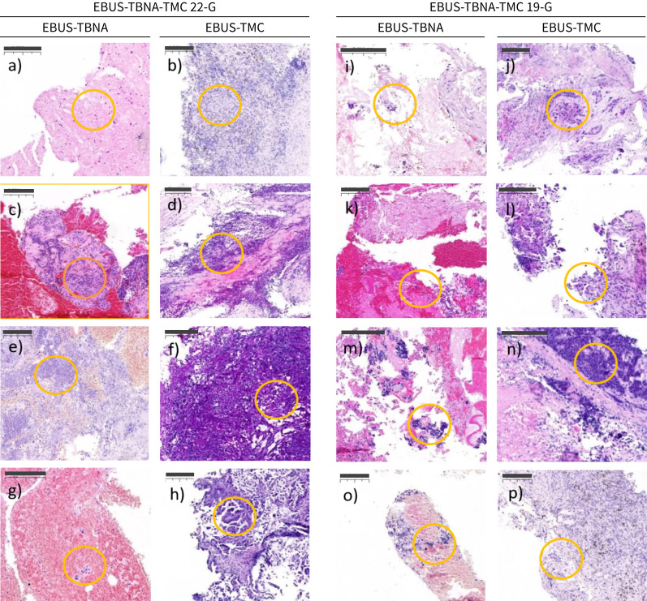

# 044 — Cryobiopsy trung thất qua EBUS: lấy mô lớn khi TBNA không đủ / EBUS-guided transbronchial mediastinal cryobiopsy (EBUS-TMC)

**Tags:** `pattern:hach-trung-that` `vung:trung-that` `protocol:EBUS-TBNA` `protocol:cryobiopsy` `protocol:ROSE` `score:EBUS-station-map`
**Mức chắc chắn (certainty):** tổng hợp y văn (literature synthesis) — tổng hợp từ y văn mở 2025–2026 (ERJ Open Res, Respirology, Endosc Ultrasound, Cureus) gồm **1 RCT ở sarcoidosis**, **2 nghiên cứu tiến cứu** và **1 loạt ca thực hành**; có gắn hình thái ca nguyên văn (ảnh thủ tục và ảnh mô học đối chiếu).

## 1. Tổng quan — vì sao kim 22–19 G vẫn "không đủ", và cryo sửa được gì

- **Vấn đề của EBUS-TBNA (kim chọc hút):** kim lấy **tế bào (cytology)**, mảnh mô nhỏ, **dập nát do cơ chế cắt–hút** và **mất kiến trúc mô (architecture)**. Hệ quả định lượng:
  - **U lympho (lymphoma):** TBNA đơn thuần **độ nhạy rất thấp** — trong một loạt 40 ca u lympho trung thất, **TBNA 15%**, **TBNA + flow cytometry 25%**, trong khi **cryobiopsy 95%**; ở ca tái phát **cryo 100% vs TBNA 14% / TBNA+flow 41%**.
  - **Sarcoidosis:** phát hiện **u hạt không hoại tử (non-necrotising granuloma)** — **cryo 89,8% vs TBNA 78,1%** (RCT 128 bệnh nhân, giai đoạn I/II).
  - **Hạch trung thất nói chung:** **cryo 91,1–93,3% vs TBNA 68,8–77,7%** (nghiên cứu tiến cứu 90 bệnh nhân, 2 cỡ kim).
- **TẠI SAO cryobiopsy lấy được mô tốt hơn (theo Argon — vật lý + mô học):**
  - Đầu dò cryo làm lạnh theo **hiệu ứng Joule–Thomson** (khí nén giãn nở trong đầu dò) → nhiệt độ đầu dò giảm sâu trong **vài giây**. Mô tiếp xúc **đông đặc nhanh**, **dính chặt vào đầu dò**, rồi được **kéo ra nguyên khối** khi rút probe.
  - Vì mô đông cứng trước khi bị kéo, **lực cắt dọc theo mặt phẳng ít hơn** kim hút → **ít dập nát (crush artefact)**, **giữ kiến trúc** (nang, u hạt, mô đệm, biểu mô tuyến) và **đủ mô cho hoá mô miễn dịch (IHC) + sinh học phân tử**.
  - Kích thước mẫu thực tế: **đường kính trục dài 3,5 ± 0,9 mm (kim 22 G) và 3,6 ± 1,1 mm (kim 19 G)** — lớn hơn nhiều mảnh cytoblock thông thường; nhưng **mẫu > 4 mm không cải thiện thêm chất lượng mô học hay tỷ lệ chẩn đoán**.
- **Kỹ thuật "đường hầm" (tunnel) — điểm khác biệt cốt lõi:** cryoprobe **1,1 mm** không tự xuyên qua thành phế quản. Trình tự: **chọc kim TBNA (22 G hoặc 19 G) vào hạch để tạo đường hầm** → **rút kim, giữ đường hầm** → **luồn cryoprobe qua đường hầm vào trong hạch dưới hướng dẫn EBUS** → làm lạnh **3–5 giây** → rút probe + mảnh mô. Vì vậy kỹ thuật này **bắt buộc làm ngay trong cùng một thì** với TBNA, không phải "chọc lại từ đầu".
- **Ngưỡng định lượng cần nhớ:**
  - Thời gian làm lạnh chuẩn trong nghiên cứu: **3–5 giây**; đường kính probe **1,1 mm**; kim tạo đường hầm **22 G** (linh hoạt, hợp tổn thương xa) hoặc **19 G** (hạch trung tâm, đường hầm rộng hơn).
  - **Số lần chọc TBNA trước đó: 3 lần** (chuẩn trong nghiên cứu tiến cứu).
  - **Thời gian thủ thuật: 25,1 ± 3,9 phút (22 G) vs 26,7 ± 5,3 phút (19 G)** — không khác biệt (p = 0,11).
  - **Tỷ lệ chẩn đoán mô học trong thực hành thật (118 ca): 92,4%**; **PD-L1 làm được ở 37,3%**.
  - **Biến chứng (118 ca): tràn khí trung thất 11,9%, co thắt phế quản 5,9%, tràn khí màng phổi 4,2%** — **không có tràn máu trung thất, không nhiễm trùng**. Ở nghiên cứu 90 ca: **chảy máu nhẹ < 10 mL 6/45 + 5/45, trung bình 10–40 mL 2/45 + 1/45, nặng > 40 mL 0**; **không tràn khí màng phổi, không tràn khí trung thất**.

## 2. Mẫu hình + chẩn đoán phân biệt theo bối cảnh (gamut)

- **Nguyên tắc chọn bệnh cảnh:** cryobiopsy **không thay thế** TBNA cho chẩn đoán–phân giai đoạn ung thư thông thường; nó **giải quyết nhóm cần KIẾN TRÚC MÔ**:
  1. **Nghi u lympho (lymphoproliferative disorder):** hạch lớn, nhiều hạch, triệu chứng B, tái phát sau điều trị — cần phân týp (WHO) và IHC.
  2. **Sarcoidosis / bệnh u hạt:** cần thấy **u hạt không hoại tử + tế bào khổng lồ**; TBNA chỉ thấy tế bào biểu mô rải rác.
  3. **U hiếm / u mô mềm trung thất:** schwannoma, u tuyến ức, sarcoma, u mạch — cần kiến trúc + IHC.
  4. **Ung thư phổi cần sinh học phân tử rộng:** PD-L1, EGFR/ALK/ROS1, NGS — mô nhiều hơn, ít dập nát hơn.
  5. **Nhiễm trùng khó (lao, nấm, IgG4):** cần mô + nhuộm đặc biệt (AFB, PAS/Grocott, IgG4/IgG ratio).
- **Gamut theo hình thái hạch trên EBUS:** **hạch đồng nhất giảm hồi âm** (di căn/lymphoma) — **hạch có vùng hoại tử/lỏng** (lao, áp-xe, di căn vảy) — **hạch tăng hồi âm rải rác** (anthracosis, bụi than — bẫy PET dương tính giả) — **hạch mềm, mất ranh giới** (xâm lấn trung thất).
- **Nhóm "TBNA âm mà vẫn nghi":** lymphoma, sarcoidosis, u thần kinh, bệnh mô liên kết, bụi than (anthracosis) — đây chính là **chỉ định cryobiopsy mạnh nhất**.

## 3. Bảng so sánh phân biệt (ma trận đối chiếu)

| Thực thể / kỹ thuật | Hình ảnh & mô học điển hình | Chốt vào (rule-in) | Chốt loại (rule-out) | Gợi ý xác nhận |
|---|---|---|---|---|
| **EBUS-TBNA (kim 22/19 G)** | **Cytoblock**: cụm tế bào, ít mô đệm, dập nát; đủ cho tế bào học + IHC giới hạn | **Có tế bào ác tính điển hình + IHC đủ** (adenocarcinoma, SCC) | **Chỉ có tế bào biểu mô rải rác / không thấy kiến trúc** → chưa loại sarcoidosis/lymphoma | ROSE tại chỗ; 3 lần chọc; flow cytometry nếu nghi lymphoma |
| **EBUS-TMC (cryobiopsy 1,1 mm)** | **Mảnh mô liền, kiến trúc nguyên vẹn**, mô hạt/u hạt, mô đệm; mẫu ~3,5 mm | **Thấy u hạt không hoại tử, kiến trúc u lympho, mô u nguyên vẹn + IHC dương** | **Chỉ viêm mạn, không thấy u** → **âm tính giả do lấy trượt** (không loại trừ u) | 2 lần cryo trở lên; IHC + molecular; đối chiếu PET/CT |
| **EBUS-TBNB (kẹp sinh thiết qua nội soi)** | Mảnh nhỏ bị nghiền, thường < 2 mm | Có mô nhưng ít | Không đủ kiến trúc → không kết luận lymphoma | Ít dùng khi đã có cryo |
| **Mediastinoscopy / VATS** | Mô lớn, kiến trúc đầy đủ, lấy được toàn bộ hạch | **Chẩn đoán mô học đầy đủ khi các cách trên thất bại** | — | Tiêu chuẩn vàng cho lymphoma; xâm lấn hơn, dính khi mổ lại |
| **Chẩn đoán khác trong hạch (anthracosis, IgG4, lao)** | Mô bụi than, xơ; IgG4+ tương bào; u hạt hoại tử | **Đặc điểm mô học đặc hiệu** | **PET dương tính mạnh không loại trừ lành tính** | Nhuộm AFB/PAS, IgG4/IgG > 40%, theo dõi |

*(A) EBUS: **đầu dò cryo nằm trong hạch đích** (ảnh nhỏ: hình nội soi khi làm lạnh); (B) hệ thống EBUS + máy cryo; (C) **hai người thao tác** — một giữ ống soi/định hướng, một luồn và rút probe. Nguồn: Echeverri-Hoyos J et al., *Cureus* 2026, PMC13626287 Fig. 1, **CC BY 4.0**.*

### Ba dấu hiệu "chốt" khi đọc kết quả
- **Kiến trúc mô còn nguyên (preserved architecture)** — thấy **nang, tuyến, mô hạt, lớp tế bào** thay vì chỉ cụm tế bào rời.
- **IHC dương tính rõ trên mảnh lớn** — đặc biệt **CD20/CD3, Ki-67, cytokeratin, PD-L1**; mảnh lớn cho phép **đếm tế bào trên diện rộng**.
- **Mẫu không dập nát ở bờ** — bờ mô sắc, ít "bùn" tế bào; đây là khác biệt vật lý của cryo so với kim hút.

## 4. Protocol + thuật toán quyết định

- **Chuẩn bị:** CT ngực/PET-CT gần nhất; **đông máu (INR, tiểu cầu)**; ngừng kháng đông theo quy ước; **đánh giá nguy cơ chảy máu & tăng áp phổi**; bệnh nhân **nhịn ăn**, đường truyền, monitor.
- **Thiết lập:** ống nội soi phế quản **EBUS đầu dò tuyến tính**, **gây mê vừa phải (midazolam + propofol)** hoặc gây mê toàn phần; ống nội khí quản **7,5 mm không bóng** để luồn ống soi; **hai người thao tác**.
- **Trình tự chuẩn (theo nghiên cứu tiến cứu):**
  1. **Xác định hạch/hối hạch trên EBUS** — ghi **trạm (station), kích thước, mức tưới máu**.
  2. **3 lần TBNA** (22 G hoặc 19 G) → cytology ± **ROSE**.
  3. **Tạo đường hầm** bằng chính kim đó → **luồn cryoprobe 1,1 mm** qua đường hầm vào hạch dưới EBUS.
  4. **Làm lạnh 3–5 giây** → rút probe + mảnh mô → **formalin** (mô học/IHC) và **mảnh riêng cho molecular** nếu cần.
  5. **Lặp 2 lần cryo trở lên** ở cùng hạch (nhiều lần → mẫu lớn hơn, nhưng **> 4 mm không thêm giá trị**).
  6. **Kiểm tra chảy máu** bằng nội soi trực tiếp; **X-quang ngực sau thủ** để loại tràn khí màng phổi/trung thất (theo quy trình nghiên cứu: X-quang + theo dõi 30 phút/lần, gọi điện 48 giờ, khám lại 2–4 tuần).
- **Chọn cỡ kim:** **22 G** cho **tổn thương xa/khó (trạm 11–12, thùy dưới)**, linh hoạt hơn; **19 G** cho **hạch trung tâm (trạm 4R, 7)**, đường hầm rộng hơn. Trong nghiên cứu, **2 ca phải đổi 19 G → 22 G** vì không luồn được, và **tổn thương trạm 12 làm tốt hơn với 22 G**.
- **Ngưỡng dừng / chuyển chiến lược:**
  - **Đã có chẩn đoán mô học đủ** (u hạt, lymphoma typ, IHC/molecular đủ) → **dừng**, tránh lấy thêm.
  - **Cryo chỉ viêm mạn mà vẫn nghi u** → **không kết luận âm**; cân nhắc **lấy trạm khác** hoặc **mediastinoscopy/VATS**.
  - **Không tạo được đường hầm** (hạch xa, dính, mạch máu giữa) → quay lại TBNA ± chọc xuyên phế quản khác, hoặc chuyển mổ.

## 5. Biến thể bình thường và cạm bẫy

- **Cạm bẫy số 1 — "âm tính giả do lấy trượt" (sampling error):** trong chính bài nguồn, một ca **schwannoma**: cytoblock gợi ý u tế bào hình thoi, nhưng **cryobiopsy chỉ thấy viêm mạn và KHÔNG lấy được mô u**. Bài học: **cryo không bảo đảm lấy trúng** — mảnh to vẫn có thể trượt u, nhất là u xơ/giàu mô đệm. **Không bao giờ dùng kết quả "viêm mạn" để loại trừ u khi hình ảnh còn nghi.**
- **Cạm bẫy số 2 — khí trung thất (pneumomediastinum) không phải biến chứng hiếm:** **11,9%** trong loạt 118 ca (cao hơn nhiều so với cảm nhận "thủ thuật an toàn"), dù **không có ca nào cần can thiệp**. Phải **khám cổ/ngực, nghe tim, X-quang sau thủ** và giải thích trước cho bệnh nhân.
- **Cạm bẫy số 3 — chảy máu "không nặng" nhưng có:** trung bình **10–40 mL** gặp ở 2/45 + 1/45; **không có ca > 40 mL** trong nghiên cứu, nhưng **không được chủ quan** với hạch tăng sinh mạch, hạch cạnh động mạch phổi/động mạch chủ.
- **Cạm bẫy số 4 — coi cryo là "thay thế" TBNA:** TBNA vẫn cần cho **phân giai đoạn nhiều trạm (nodal map)** và **ROSE**; cryo **bổ sung**, không thay thế. Làm cryo ở mọi trạm làm tăng thời gian/thủ thuật mà không tăng chẩn đoán.
- **Cạm bẫy số 5 — mẫu lớn hơn ≠ chẩn đoán tốt hơn:** **> 4 mm không cải thiện chất lượng mô học/tỷ lệ chẩn đoán**; đừng đánh đổi an toàn lấy kích thước.
- **Cạm bẫy số 6 — hạch bụi than (anthracosis):** mô học **bụi than + xơ**, có thể **FDG dương tính mạnh** giả u; đây là chẩn đoán lành tính hay gặp nhất trong loạt thực hành (**14,4%**). **Đừng "điều trị ung thư" chỉ vì PET sáng.**
- **Cạm bẫy số 7 — vị trí không tạo được đường hầm:** trạm **12 (thùy dưới)** và tổn thương ngoại vi xa dễ thất bại; chọn **22 G** hoặc **chuyển hướng tiếp cận**.

## 6. Tự lượng giá — Blind Quiz

**Ca 1 — Hạch trạm 7, 22 mm, nghi lymphoma. Ảnh EBUS trong lúc làm thủ thuật — mô tả trình tự bạn thấy.**

- Gợi ý lâm sàng (clinical context): nam 59 tuổi, hạch trung thất lớn, sụt cân, không có u phổi nguyên phát.
- Câu hỏi: **Bước nào phải làm TRƯỚC** khi luồn cryoprobe? Vì sao cryoprobe **không tự xuyên qua thành phế quản**? Hai người thao tác để làm gì?

<b>Bấm để hiện đáp án (findings + chẩn đoán)</b>

- Dấu hiệu (findings): (A) **đầu dò cryo nằm trong hạch** dưới hướng dẫn EBUS; (C) **hai người**: một giữ ống soi và định hướng EBUS, một luồn/rút probe.
- Trình tự: **chọc kim TBNA tạo đường hầm → rút kim → luồn cryoprobe 1,1 mm qua đường hầm → làm lạnh 3–5 giây → rút mảnh**.
- Vì sao: probe **1,1 mm không có mũi sắc**, cần **đường hầm** do kim 22/19 G tạo ra; làm lạnh gây dính mô và kéo ra nguyên khối, ít dập nát.
- Chẩn đoán (diagnosis): **EBUS-TMC** — chỉ định mạnh khi nghi **lymphoma** (độ nhạy cryo 95% vs TBNA 15%).
- Nguồn ảnh: Echeverri-Hoyos J et al., *Cureus* 2026, PMC13626287 Fig. 1, CC BY 4.0.

**Ca 2 — Cùng bệnh nhân, kết quả mô học: cột trái là TBNA, cột phải là cryobiopsy. Panel nào cho thấy lợi thế rõ nhất, panel nào là một THẤT BẠI?**

- Câu hỏi: Ở **(a) vs (b)**, vì sao TBNA chỉ thấy "tế bào biểu mô rời" còn cryo thấy **u hạt nguyên vẹn**? Ở **(c) vs (d)** có gì bất thường, và kết luận đúng phải là gì?

<b>Bấm để hiện đáp án (findings + chẩn đoán)</b>

- Dấu hiệu (findings): **(a)** cytoblock — **chỉ tế bào biểu mô rời rạc**; **(b)** cryobiopsy — **u hạt biểu mô không hoại tử, tạo thành nang rõ** → **sarcoidosis**. **(c)** cytoblock gợi ý **u tế bào hình thoi (schwannoma)**; **(d)** cryobiopsy **chỉ viêm mạn, KHÔNG thấy mô u**.
- Chẩn đoán (diagnosis): cryo **thắng ở kiến trúc** (u hạt, lymphoma, biểu mô tuyến), nhưng **(c)–(d) là âm tính giả do lấy trượt** — không được loại trừ u.
- Kết luận đúng: **không dùng "viêm mạn" để loại trừ u**; cần **lấy trạm khác hoặc mediastinoscopy**.
- Phản biện nguồn: đây là các cặp ảnh **chọn lọc để minh họa**, không phải tỷ lệ đại diện; tỷ lệ định lượng nằm ở phần (1).
- Nguồn ảnh: Oruqaj G et al., *ERJ Open Res* 2026, PMC13148967 Fig. 4, **CC BY-NC 4.0**.

**Ca 3 — Hạch trạm 4R, 30 mm, không có ROSE. Bạn chọc 3 lần TBNA: cytology chỉ nói "tế bào không điển hình". Làm gì tiếp trong CÙNG thì?**

- Câu hỏi: Ba lựa chọn (làm thêm TBNA trạm khác / cryobiopsy cùng hạch / hẹn mediastinoscopy) — chọn nào và vì sao? Ngưỡng nào khiến bạn **dừng** sau cryo?

<b>Bấm để hiện đáp án (findings + chẩn đoán)</b>

- Chọn: **cryobiopsy cùng hạch ngay trong thì đó** — đúng nguyên lý "đường hầm đã có", tránh thủ thuật lần hai; tỷ lệ chẩn đoán tăng từ **68,8–77,7% (TBNA) lên 91,1–93,3% (cryo)**.
- Nếu không có cryo: **lấy thêm trạm khác + flow cytometry**, hẹn mediastinoscopy nếu vẫn nghi lymphoma.
- Ngưỡng dừng: **có chẩn đoán mô học đủ + IHC/molecular đủ**; **2 lần cryo** là đủ trong đa số; **mẫu > 4 mm không thêm giá trị**.
- Cảnh báo: **tràn khí trung thất 11,9%**, **tràn khí màng phổi 4,2%** → X-quang sau thủ.

## Bài liên quan chéo
- [018 – EBUS-TBNA/EUS hạch trung thất](../018-EBUS-TBNA-EUS-hach-trung-that/lesson.md)
- [060 – Khối trung thất (ITMIG)](../060-khoi-trung-that-itmig/lesson.md)
- [022 – Khối phổi & TNM](../022-khoi-phoi-TNM/lesson.md)
- [012 – Hạch trung thất](../012-hach-trung-that/lesson.md)
- [013 – Hạch nội phổi & phân biệt hạch–nốt](../013-hach-noi-phoi/lesson.md)

## Ảnh
- `images/044_EBUS-TMC-technique_PMC13626287-Fig1-CCBY.jpg` — CC BY 4.0.
- `images/044_TBNA-vs-TMC-histology_PMC13148967-Fig4-CCBYNC.jpg` — CC BY-NC 4.0.
- Nguồn + giấy phép từng ảnh: `images/CREDITS.md`; link gốc: `sources.md`.

> Không dùng để chẩn đoán độc lập khi chưa có người hướng dẫn.
