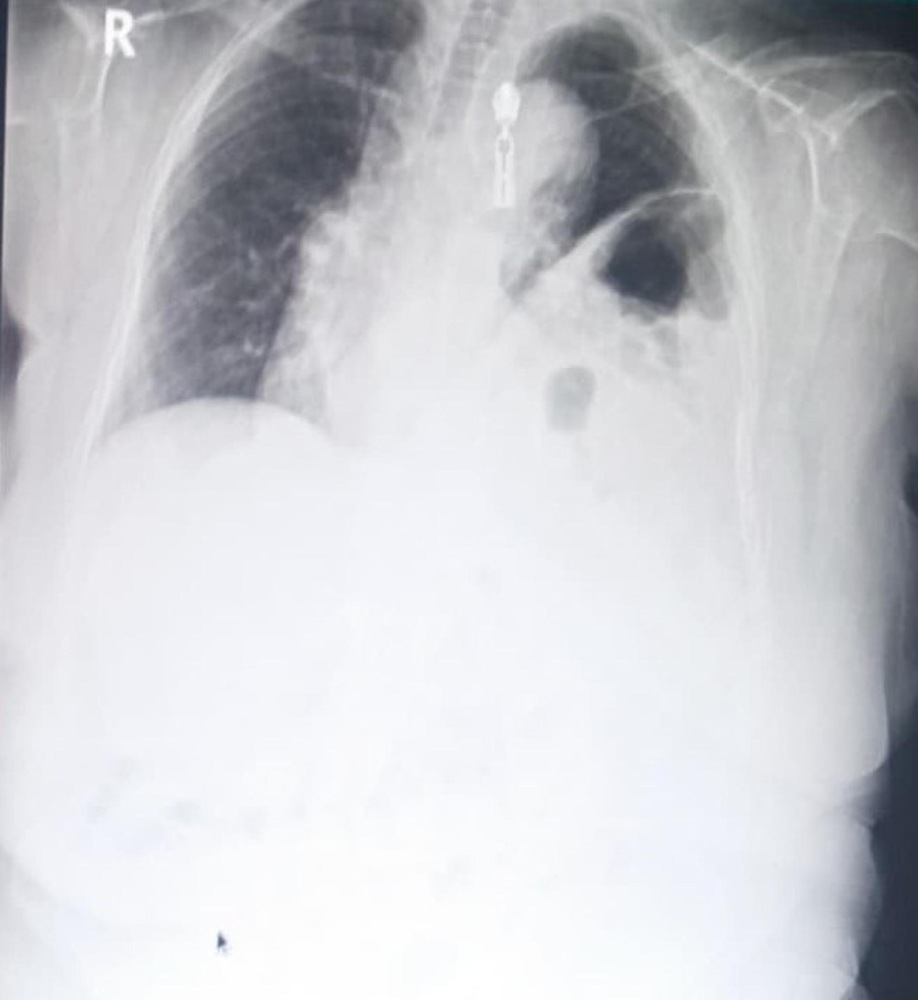
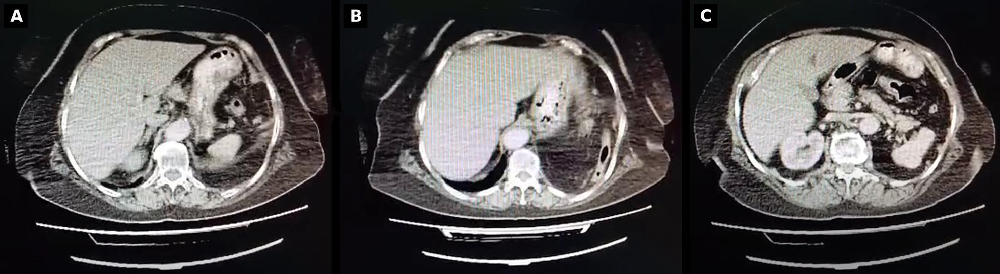

# 045 — Thành ngực (dấu ngoài màng phổi) & thoát vị hoành / Extrapleural sign & Diaphragmatic hernia

**Tags:** `pattern:ngoai-mang-phoi` `vung:thanh-nguc`
**Mức chắc chắn (certainty):** tổng hợp y văn (literature synthesis) — nhóm tự biên từ y văn mở, chưa gắn ca nguyên văn đơn lẻ.

## 1. Tổng quan — ngoài màng phổi vs trong phổi + Bochdalek người lớn

- **Dấu ngoài màng phổi (extrapleural sign):** tổn thương ngoài màng phổi đè vào phổi → bờ trong **lồi đều + góc tù** với thành ngực (u thành ngực, máu tụ ngoài màng, mủ ngoài màng).
- **Thoát vị Bochdalek người lớn:** lỗ sau-bên hoành bẩm sinh, 0,17% CT bụng, tuổi trung bình 60+; tạng (đại tràng ngang, mạc nối) lên ngực trái → khó thở gắng sức, dễ nhầm viêm/tràn dịch.
- TẠI SAO CT quyết định: thấy **khuyết hoành + tạng liên tục qua lỗ + xẹp ép đáy** cùng bên; X-quang chỉ gợi ý (mức khí-dịch + vòm hoành biến dạng).

## 2. Gamut khối thành ngực + mức khí-dịch đáy trái

- **Máu/mủ ngoài màng sau chấn thương:** lồi đều góc tù + gãy xương sườn kề — ổn định, theo dõi.
- **U thành ngực (xương/mô mềm):** hủy xương + phản ứng màng xương + mô mềm — sinh thiết.
- **Bochdalek:** mức khí-dịch + tạng liên tục qua hoành sau-bên trái + xẹp ép — mổ (kẹt/nghẹt nguy hiểm).
- **Thoát vị khe (hiatal):** qua khe thực quản, người già, ợ nóng — khác Bochdalek sau-bên.

## 3. Bảng so sánh

| Thực thể (entity) | Hình ảnh điển hình | Chốt vào (rule-in) | Chốt loại (rule-out) | Gợi ý xác nhận |
|---|---|---|---|---|
| Bochdalek người lớn | **Mức khí-dịch + tạng qua lỗ sau-bên + xẹp ép**, túi 15×7 cm | **Tạng liên tục qua khuyết hoành CT** | Không khuyết hoành → tràn dịch/viêm phổi | CT cản quang, mổ (nội soi/lồng ngực) |
| Máu ngoài màng | Lồi đều góc tù + gãy xương kề + chấn thương | **Góc tù + chấn thương + ổn định** | Góc nhọn + vượt rãnh → trong phổi | Theo dõi, dẫn lưu nếu ép |
| U thành ngực | Hủy xương + mô mềm + góc tù | **Hủy xương/màng xương** | Không hủy xương → máu/mủ cũ | Sinh thiết, MRI lan tỏa |
| Thoát vị khe | Qua khe thực quản + ợ nóng + người già | **Vị trí khe + triệu chứng trào ngược** | Sau-bên + tạng lớn → Bochdalek | Nội soi, điều trị trào ngược |

## 4. Protocol

- **CT cản quang ngực-bụng:** khuyết hoành + tạng + xẹp ép + thiếu máu tạng (kẹt).
- Bochdalek có triệu chứng/kẹt: mổ (nội soi ổ bụng/thoracoscopy tùy dính); không triệu chứng vẫn cân nhắc mổ dự phòng.
- X-quang: mức khí-dịch + vòm hoành biến dạng = gọi CT ngay, đừng chọc "tràn dịch".

## 5. Cạm bẫy

- **Chọc nhầm quai ruột trong ngực** tưởng tràn dịch — CT trước mọi chọc đáy trái bất thường.
- **Bóng dạ dày cao** giả thoát vị — uống cản quang xác nhận liên tục.
- **Xẹp ép đáy** giả viêm — tìm tạng qua hoành, đừng kháng sinh mù.

## 6. Tự lượng giá — Blind Quiz

**Ca 1 — Nữ 65 tuổi, khó thở gắng sức 2 tháng. Nhìn X-quang, gọi tên trước.**

- Hỏi: mức khí-dịch + vòm hoành trái biến dạng gợi gì? Bước tiếp theo (chọc hay CT)?

<b>Bấm để hiện đáp án</b>

- **Thoát vị Bochdalek trái:** mức khí-dịch + vòm hoành biến dạng — **CT cản quang ngay, cấm chọc mù**.
- Đối chiếu CT (nguyên bản, không cắt ghép do ND):

- Túi 15×7 cm + đại tràng ngang trong ngực + xẹp ép đáy trái → mổ (nội soi chuyển lồng ngực do dính kẹt).
- Nguồn: Aldakak et al., J Cardiothorac Surg 2026, CC BY-NC-ND 4.0 (giữ nguyên bản).

**Ca 2 — Chấn thương + khối lồi đều góc tù thành ngực + gãy xương kề:** trong hay ngoài phổi? Xử trí? *(Quy tắc mục 3.)*

<b>Bấm để hiện đáp án</b>

- **Ngoài màng phổi (máu tụ):** góc tù + chấn thương — theo dõi, dẫn lưu nếu ép hô hấp.

## Bài liên quan chéo
- [001 – Tổng quan hệ Ngực](../001-tong-quan-he-nguc/lesson.md)
- [040 – Tràn dịch màng phổi](../040-tran-dich-mang-phoi/lesson.md) (đừng chọc nhầm)
- [080 – Chấn thương ngực (dự kiến)](../080-chan-thuong-nguc/lesson.md) (vỡ hoành chấn thương)

> Không dùng để chẩn đoán độc lập khi chưa có người hướng dẫn.
