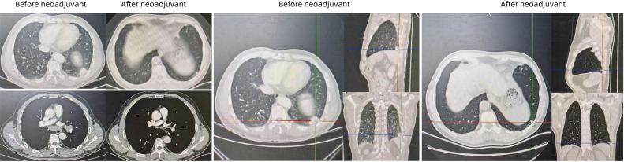
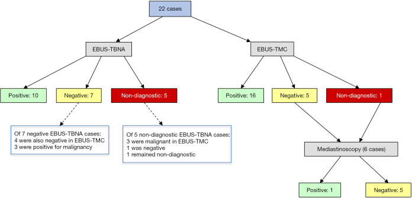
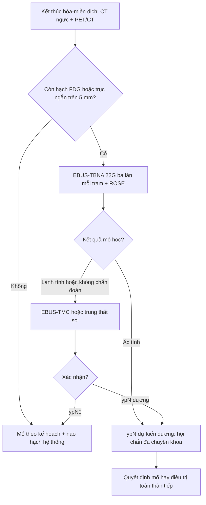
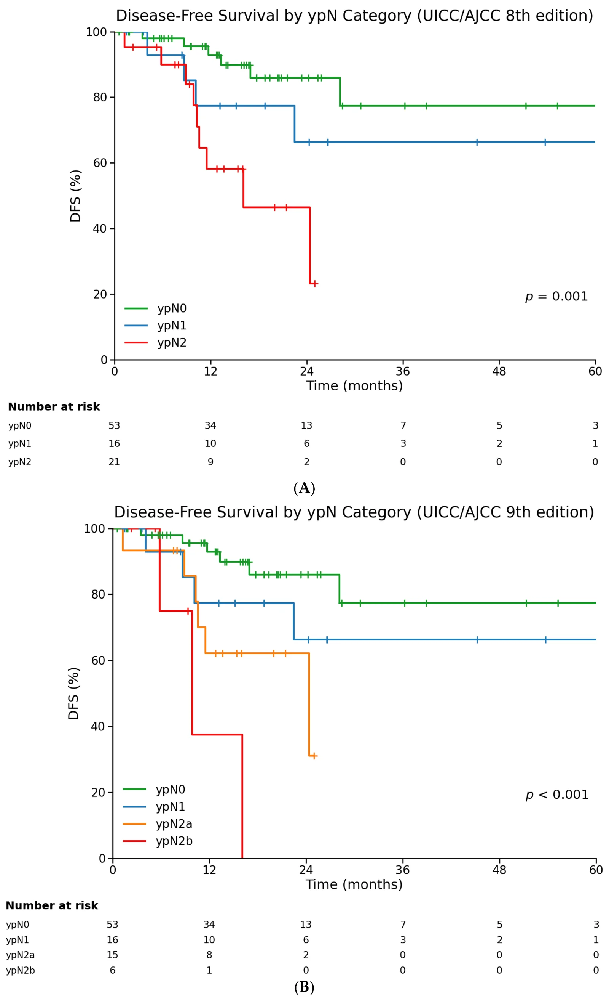
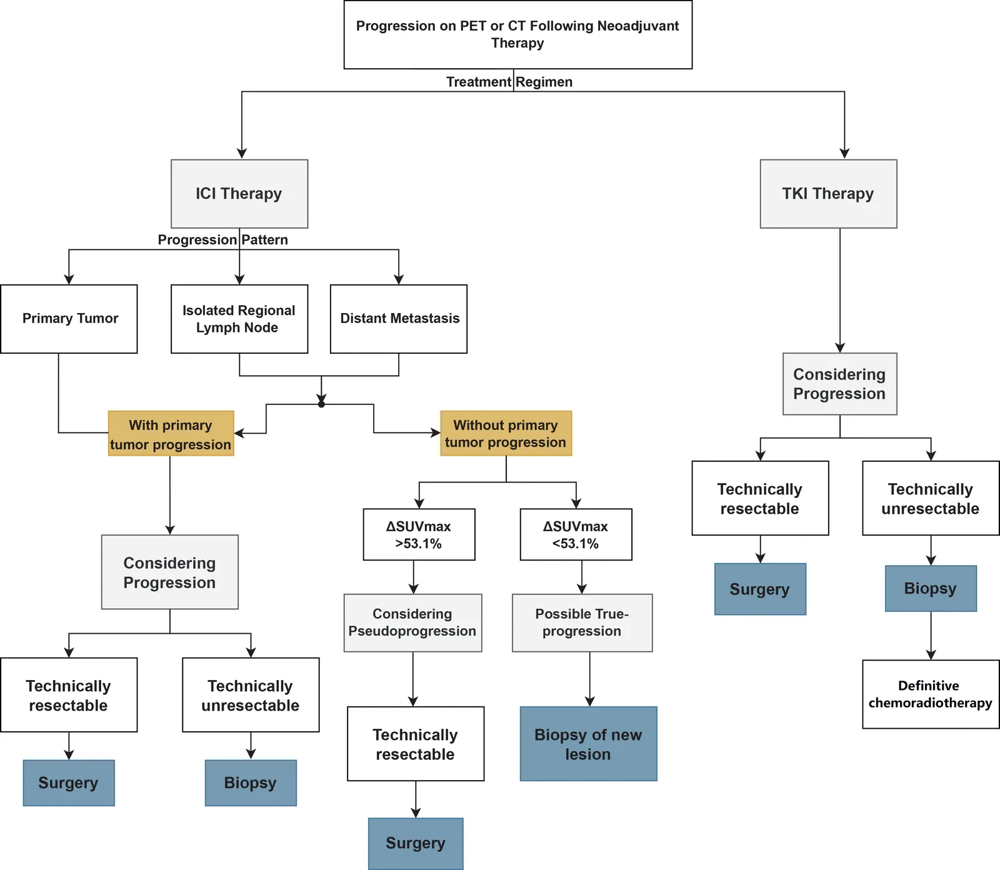
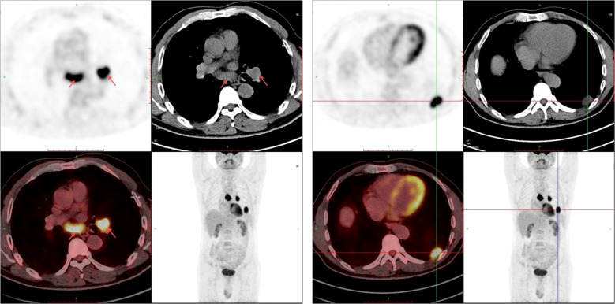
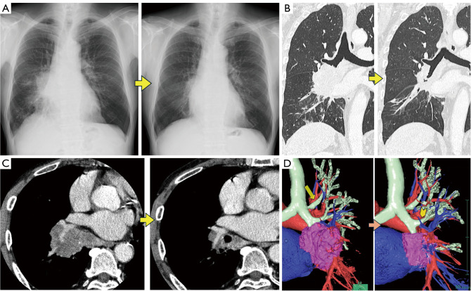

# 046 — Tái phân giai đoạn trung thất sau hóa–miễn dịch & bệnh hạch tồn dư (ypN) / Mediastinal restaging and residual nodal disease after neoadjuvant chemo-immunotherapy

**Tags:** `pattern:hach` `pattern:tai-phat` `vung:trung-that` `score:IASLC` `score:RECIST` `protocol:PET-CT` `protocol:EBUS-TBNA`
**Mức chắc chắn (certainty):** tổng hợp y văn (literature synthesis) — tổng hợp 4 nghiên cứu mở 2025–2026 (Europe PMC: Ariza-Prota et al. *Mediastinum* 2025, PMC12260948; Mosleh et al. *Cancers* 2026, PMC13564668; Pan et al. *ESMO Open* 2026, PMC13573743; Bader et al. *JTCVS Open* 2026, PMC13477020) + 2 ca nguyên văn dùng làm hình (PMC12893989, PMC13351936); số liệu giữ đúng nguồn, chỗ chưa kiểm chứng ghi "chưa rõ".

## 1. Tổng quan bệnh học – cơ chế hình ảnh

- **Vì sao phải tái phân giai đoạn trung thất (mediastinal restaging):** ở NSCLC giai đoạn III, **hạch trung thất còn sống sau điều trị tân bổ trợ** quyết định ba việc: (a) còn mổ triệt để được không, (b) có cần thêm điều trị toàn thân, (c) tiên lượng. Sau **hóa–miễn dịch tân bổ trợ (neoadjuvant chemo-immunotherapy)**, tỷ lệ đáp ứng mô bệnh rất cao nhưng **đáp ứng của u nguyên phát KHÔNG đồng nghĩa với xóa sạch hạch** — hai ổ này đáp ứng lệch nhau (Mosleh et al. 2026; Bader et al. 2026).
- **Định nghĩa mô bệnh chuẩn (IASLC), dùng để "đọc" kết quả sau mổ:**
  - **MPR (major pathologic response):** **≤ 10% tế bào u còn sống (residual viable tumor, RVT)** trong **u nguyên phát**.
  - **pCR (pathologic complete response):** **0% RVT** ở **cả u nguyên phát và hạch**.
  - Hệ quả thực hành: một u teo gần hết trên CT vẫn có thể kèm **hạch còn 20–30% u sống**; ngược lại u còn ổ đặc nhưng hạch đã sạch.
- **Vì sao tái phân giai đoạn sau hóa–miễn dịch KHÓ hơn trước điều trị (vật lý + mô bệnh):**
  - Điều trị gây **xơ hóa (fibrosis), hyalin hóa, hoại tử** → hạch **giảm mật độ tế bào**, tăng chất nền collagen. Collagen nghèo tế bào nên **kim chọc hút (cytology) chỉ lấy được chất xơ + máu**, không đủ tế bào để kết luận.
  - Trong 22 bệnh nhân được làm **cả hai kỹ thuật trên cùng một hạch** (Ariza-Prota et al. 2025): **EBUS-TBNA** độ nhạy **63,63%**, **không chẩn đoán được 22,7%** (5/22), mẫu đủ cho hóa mô miễn dịch/phân tử chỉ **29,41%**; **EBUS-TMC (cryobiopsy trung thất)** độ nhạy **95,45%**, không chẩn đoán **4,5%** (1/22), mẫu đủ **94,11%** (p = 0,03 cho độ nhạy). Cryobiopsy lấy **mảnh mô nguyên khối** nên nhìn được **kiến trúc** và vùng **xơ – u sống xen kẽ**.
  - **Vì sao FDG-PET không đủ một mình:** tế bào viêm/đại thực bào sau miễn dịch cũng bắt FDG mạnh (**dương tính giả**), còn **vi di căn** trong hạch nhỏ hoặc hạch đã xơ thì dưới ngưỡng phát hiện (**âm tính giả**). Trong 283 bệnh nhân của Pan et al. 2026, **25,1% (71/283)** đạt tiêu chuẩn **PMD (progressive metabolic disease)** theo EORTC nhưng **54,9% trong số đó vẫn đạt MPR** khi mổ.
- **Ngưỡng định lượng phải nhớ (cửa 1 của Argon):**
  - **Kích thước hạch chọn để chọc lại:** hạch **trục ngắn > 5 mm** và tới được bằng EBUS, hoặc **còn bắt FDG** sau điều trị (tiêu chuẩn chọn trong Ariza-Prota et al. 2025). Trong nghiên cứu này, trục ngắn trung bình giảm **21,31 ± 4,89 mm → 13,31 ± 4,93 mm**, **SUVmax 6,7 ± 2,47 → 3,99 ± 2,67**, với **ngưỡng SUV 2,5** phân biệt hạch lành/ác của đơn vị.
  - **Khoảng thời gian chuẩn:** PET/CT sau điều trị cách đợt cuối **34,77 ± 6,26 ngày**; EBUS cách PET **8,59 ± 1,7 ngày**; mổ cách kết thúc điều trị **trung vị 5,6 tuần (IQR 4,0–6,7)**.
  - **Tỷ lệ hạch tồn dư và tiên lượng (Mosleh et al. 2026, 90 bệnh nhân cN+):** **ypN0 58,9%**, **ypN1 17,8%**, **ypN2 23,3%**; theo ấn bản 9: **ypN2a (1 trạm) 16,7%** và **ypN2b (nhiều trạm) 6,7%**.
  - **DFS trung vị theo ypN:** ypN0 **chưa đạt**; ypN1 **64,8 tháng**; ypN2 **16,1 tháng** (log-rank p = 0,001). Tách ấn bản 9: **ypN2a 24,4 tháng vs ypN2b 9,9 tháng** (p < 0,001) — nhưng nhóm ypN2b chỉ 6 ca nên **mang tính thăm dò**.
  - **Phân tầng tích hợp (đáp ứng mô bệnh + hạch):** nhóm nguy cơ thấp (ypN0 + pCR/MPR) có DFS 1 năm **94,5%**, 2 năm **86,1%**; nhóm cao (ypN2, hoặc ypN1 không đáp ứng) 1 năm **68,0%**, 2 năm **54,6%**; mỗi bậc nguy cơ **HR 2,14 (95% CI 1,23–3,71)**.
  - **Yếu tố dự báo hạch trung thất còn u:** **cN2 lúc chẩn đoán** → **OR 4,90 (1,02–23,66)**; mỗi **10% PD-L1 tăng** → **OR 0,83 (0,71–0,98)** cho ypN2.
- **Giả tiến triển (pseudoprogression) — con số quyết định:** **26/283 (9,2%)** bệnh nhân đạt **RECIST 1.1 = PD** sau hóa–miễn dịch nhưng **65,4% (17/26) đạt MPR**, trong đó **53,8% (14/26) đạt pCR**, và **tất cả 26 ca vẫn mổ R0**. Ngưỡng phân biệt trên PET: **ΔSUVmax giảm ≥ 53,1%** cho **AUC 0,865**, tốt hơn nhiều so với **Δ đường kính u (AUC 0,727)**.

## 2. Mẫu hình + chẩn đoán phân biệt theo vị trí (gamut)

**Câu hỏi thực hành:** trên CT/PET sau hóa–miễn dịch, một hạch **còn to / còn bắt FDG** — đó là **u sống**, **xơ chết**, **viêm do miễn dịch**, hay **nhiễm trùng**? Gamut xếp theo **hình thái** và **vị trí trạm**:

- **Theo hình thái:**
  1. **Hạch to, đậm độ mềm, bắt thuốc đồng nhất, còn FDG** → nghĩ **di căn tồn dư (ypN+)** — nhất là khi **u nguyên phát cũng chưa sạch**.
  2. **Hạch nhỏ lại nhưng còn "nhân" đậm độ cao, vôi hóa, không bắt FDG** → nghĩ **xơ/hyalin hóa sau điều trị (hạch chết)** — chốt bằng mô học nếu còn nghi.
  3. **Hạch mới, đối xứng hai rốn phổi + trung thất, bắt FDG mạnh, không hoại tử** ở bệnh nhân đang/đã dùng **ức chế điểm kiểm soát miễn dịch** → nghĩ **phản ứng dạng sarcoid (sarcoid-like reaction)** — **không phải tiến triển**.
  4. **Hạch hoại tử trung tâm, bờ dày, ± khí** ở bệnh nhân suy giảm miễn dịch/điều trị corticoid → nghĩ **lao/nấm**.
  5. **Hạch rốn phổi một bên, rất đậm, không bắt thuốc, có vôi hóa** → nghĩ **hạch anthracotic/silicotic** (đã có ca mô phỏng ác tính trên FDG-PET/CT) — **bẫy chọc nhầm**.
- **Theo vị trí trạm (quyết định ngả lấy mô):**
  - **Trạm 4R, 4L, 7, 2R:** EBUS-TBNA với tới trực tiếp (trong nghiên cứu restaging: **4R 40,9%, 4L 18,2%, 7 22,7%, 2R 18,2%**).
  - **Trạm 5, 6, 8, 9:** **EBUS không tới** — phải **EUS-B** hoặc trung thất soi/ngực thuật; bỏ qua nhóm này là nguồn **âm tính giả hệ thống**.
  - **Trạm 10–14:** đánh giá cùng lúc khi mổ (nạo hạch hệ thống) — không thay thế bằng chọc trung thất.
- **Theo bối cảnh lâm sàng:** **sốt/ho đờm** → nhiễm trùng; **bệnh tự miễn/sarcoidosis trước đó** → u hạt; **u lympho** (hạch nhiều trạm, không hoại tử, đáp ứng kém) cần **cryobiopsy/mô lớn** — TBNA có độ nhạy thấp cho lymphoma (xem bài 018/044).

## 3. Bảng so sánh phân biệt (ma trận đối chiếu)

| Thực thể (entity) | Hình ảnh điển hình (CT/PET sau hóa–miễn dịch) | Chốt vào (rule-in) | Chốt loại (rule-out) | Gợi ý xác nhận |
|---|---|---|---|---|
| **Di căn hạch tồn dư (ypN+)** | Hạch còn **trục ngắn > 5 mm**, bắt thuốc, **FDG còn**; thường **không đối xứng**, cùng bên u | **FDG còn ở đúng trạm đã dương tính ban đầu + hạch không teo rõ** | Hạch **vôi hóa hoàn toàn, không bắt FDG** và **đã teo rõ** → ít nghĩ u sống | EBUS-TBNA 3 lần/trạm ± TMC; mô học + IHC |
| **Xơ – hyalin hóa sau điều trị (hạch chết)** | Hạch **teo, đậm độ cao, bờ rõ, có dải xơ**, **không/ít bắt FDG** | **Teo rõ + không bắt FDG + u nguyên phát đáp ứng tốt** | **Còn nhân mềm bắt thuốc trong hạch xơ** → không loại trừ u sống | Chọc lại nếu còn FDG; theo dõi CT 3–6 tháng |
| **Phản ứng dạng sarcoid do ICI** | Hạch **hai bên, đối xứng**, rốn phổi + trung thất, **bắt FDG mạnh**, không hoại tử; có thể kèm nốt phổi | **Đối xứng hai bên + bối cảnh ức chế miễn dịch + không có tổn thương ngoài lồng ngực mới** | **Một bên, hoại tử, xâm lấn** → không nghĩ sarcoid-like | Mô học: u hạt không hoại tử; **không tự ý đổi phác đồ** |
| **Giả tiến triển (pseudoprogression)** | **To lên hoặc tổn thương mới** trên CT nhưng **giảm chuyển hóa**; bệnh nhân vẫn khỏe | **ΔSUVmax giảm ≥ 53,1%** dù đường kính tăng | **Tăng cả kích thước và SUVmax, kèm tổn thương ngoài lồng ngực thật** | PET/CT định lượng; **không hủy mổ chỉ vì CT to lên** |
| **Tiến triển thật (true progression)** | **Tổn thương mới ngoài lồng ngực**, hạch **mới ở trạm xa**, **tràn dịch màng phổi mới**, **SUVmax tăng** | **Tổn thương mới ngoài trường chiếu + tăng cả kích thước và chuyển hóa** | Chỉ **một hạch to lên đơn độc** mà chuyển hóa giảm → nghĩ giả tiến triển | Sinh thiết tổn thương mới; hội chẩn đa chuyên khoa |
| **Nhiễm trùng cơ hội (lao/nấm)** | Hạch **hoại tử trung tâm**, bờ dày, ± khí; đông đặc quanh; sốt | **Sốt + hoại tử trung tâm + bạch cầu/CRP tăng** | Hạch **đặc, không hoại tử, không sốt** → ít nghĩ nhiễm | AFB/PCR, nấm; **tránh tăng ức chế miễn dịch** |
| **Hạch anthracotic/silicotic** | Hạch **rất đậm, vôi hóa, rốn phổi một bên**, **FDG dương tính giả** | **Đậm độ cao + vôi hóa + không lớn thêm** | **Bắt FDG mạnh, mềm, lớn nhanh** → không phải hạch lành | So phim cũ; mô học nếu vẫn nghi |

*Bốn lát cắt đối chiếu **trước** (Before neoadjuvant) và **sau** (After neoadjuvant) ở cùng bệnh nhân: khối mô mềm rốn phổi/đáy phổi trái giảm thể tích, nhưng **hạch trung thất vẫn còn thấy** — đúng lý do phải **đánh giá hạch riêng**, không suy ra từ u nguyên phát. Nguồn: Wang et al., Front Oncol 2026 (PMC12893989), **CC BY 4.0**, giữ nguyên bản.*

### Ba bẫy định lượng hay gặp khi "đọc" hạch sau điều trị

1. **Kích thước không phải sinh học:** hạch có thể **teo do xơ** dù còn đảo u sống, và có thể **to do viêm** dù đã sạch u. Ngưỡng **> 5 mm trục ngắn** chỉ dùng để **chọn hạch cần chọc**, không dùng để chẩn đoán.
2. **SUVmax là giá trị cực đại, không phải thể tích u sống:** một ổ viêm nhỏ có thể cho SUVmax cao hơn cả khối u. Vì vậy phải đọc **kèm hình thái, phân bố, đối xứng và ΔSUVmax**.
3. **Đáp ứng lệch giữa u và hạch:** trong cùng một bệnh nhân, **u nguyên phát đạt pCR vẫn có thể còn ypN2**; **43%** bệnh nhân có **đáp ứng hình ảnh khách quan (ORR)** vẫn **không đạt MPR** trên mô học (Bader et al. 2026).

## 4. Protocol chụp + hệ phân độ/điểm chuẩn hóa

**Protocol tái phân giai đoạn (theo 3 nghiên cứu đã đọc):**

- **CT ngực có cản quang** (lát ≤ 1,25 mm, dựng MPR) **± PET/CT toàn thân** sau đợt cuối **2–4 tuần** (trung vị 34,8 ngày trong nghiên cứu); đọc **cùng phim trước điều trị** trên cùng mặt cắt.
- **Chọn hạch để lấy mô:** (a) **mọi trạm đã dương tính ban đầu**, (b) **hạch còn FDG**, (c) **hạch trục ngắn > 5 mm** và tới được bằng EBUS.
- **EBUS-TBNA:** kim **22 G**, **3 lần/trạm**, **ROSE** nếu có; lấy thêm mẫu cho **PD-L1/EGFR/ALK** (sau miễn dịch mẫu cytology thường **không đủ**: chỉ **29,41%**).
- **Nếu TBNA âm/không chẩn đoán mà nghi cao:** **EBUS-TMC** (probe **1,1 mm**, làm lạnh **3–5 giây**, **3 mảnh**) ngay trong cùng thì, hoặc **trung thất soi**. Trong 22 ca, TMC phát hiện thêm **6 ca ác tính** mà TBNA bỏ sót.
- **Khi mổ:** nạo hạch hệ thống **≥ 3 trạm N2 + ≥ 1 trạm N1** (trung vị **11 hạch**, 7 N2); ghi **số hạch dương/tổng số** và **tỷ lệ hạch dương (LNR)** — LNR trung vị **0,17** (ypN1 0,13; ypN2 0,20).
- **Hệ phân độ dùng để báo cáo:**
  - **RECIST 1.1:** PR = giảm **≥ 30%** tổng đường kính; PD = tăng **≥ 20%** **và** tăng tuyệt đối **≥ 5 mm**, hoặc tổn thương mới.
  - **EORTC (PET):** PMR = **giảm ≥ 25%** SUV; PMD = **tăng ≥ 25%** SUV hoặc tổn thương mới; SMD = thay đổi **< 25% tăng / < 15% giảm**.
  - **UICC/AJCC ấn bản 9:** **ypN2a** (1 trạm) vs **ypN2b** (nhiều trạm) — dùng cho **báo cáo sau mổ** và phân tầng nguy cơ, **không** dùng để quyết định mổ trước mổ.
  - **MPR ≤ 10% RVT (u nguyên phát); pCR = 0% RVT (u + hạch).**

*22 bệnh nhân được làm **cả EBUS-TBNA và EBUS-TMC trên cùng hạch**: TBNA dương **10**, âm **7**, không chẩn đoán **5**; TMC dương **16**, âm **5**, không chẩn đoán **1**; 6 ca được trung thất soi xác nhận, TMC bỏ sót **1** ca (âm tính giả). Nguồn: Ariza-Prota et al., Mediastinum 2025 (PMC12260948), **CC BY-NC-ND 4.0**, giữ nguyên bản.*

**Đọc kết quả sau mổ — bảng phân tầng dùng ngay trong hội chẩn:**

| Nhóm sau mổ | Định nghĩa | DFS 1 năm | DFS 2 năm |
|---|---|---|---|
| Nguy cơ thấp | ypN0 + pCR hoặc MPR | 94,5% | 86,1% |
| Nguy cơ trung gian | ypN0 không đáp ứng, hoặc ypN1 + MPR | 78,8% | 78,8% |
| Nguy cơ cao | ypN2 bất kỳ, hoặc ypN1 không đáp ứng | 68,0% | 54,6% |

*Đường cong DFS theo **ypN**: (A) ấn bản 8 — ypN0 chưa đạt trung vị, ypN1 **64,8 tháng**, ypN2 **16,1 tháng**; (B) ấn bản 9 tách **ypN2a 24,4 tháng** vs **ypN2b 9,9 tháng**. Số ca ypN2b chỉ **6** → đọc thăm dò. Nguồn: Mosleh et al., Cancers 2026 (PMC13564668), **CC BY 4.0**.*

## 5. Biến thể bình thường và cạm bẫy

- **"Hạch còn thấy" không bằng "hạch còn u":** sau điều trị, **mô xơ thay thế hạch** vẫn tạo bóng mờ trên CT; đừng tự động nâng giai đoạn. Ngược lại, **hạch teo nhỏ < 5 mm** vẫn có thể chứa vi di căn — **không loại trừ**.
- **FDG dương tính giả sau miễn dịch:** viêm do **ức chế điểm kiểm soát**, **sarcoid-like reaction**, nhiễm trùng, xơ viêm phóng xạ; **SUVmax tăng đơn độc không đủ hủy mổ**.
- **FDG âm tính giả:** hạch **< 1 cm**, hoại tử/nhầy, **tăng đường huyết**, dùng corticoid, hoặc **sau xạ**; ngưỡng phân giải không gian của PET **chưa kiểm chứng đủ để loại trừ** vi di căn.
- **Bỏ sót trạm 5–6:** EBUS không tới; nếu chỉ chọc 4R/7 rồi kết luận "trung thất sạch" là **âm tính giả do chọn mẫu**.
- **Chỉ đọc u, bỏ đọc hạch (satisfaction of search):** u teo đẹp dễ làm người đọc bỏ qua hạch **còn FDG**; luôn đọc **theo trạm, so từng trạm với phim cũ**.
- **Cạm bẫy mặt cắt:** trên CT không cản quang, **hạch cạnh thực quản/khí quản dễ bị nhầm với thực quản co thắt hoặc tĩnh mạch giãn**; luôn dùng **cản quang + MPR**, đối chiếu PET và **theo dõi liên tục theo trục** để phân biệt.
- **Giả tiến triển:** **9,2%** bệnh nhân đạt RECIST PD nhưng **65,4% vẫn MPR** — hủy mổ chỉ vì "to lên" là sai lầm có thể bỏ mất cơ hội chữa khỏi.

*Nhánh quan trọng: tiến triển **không kèm u nguyên phát to lên** → dùng **ΔSUVmax**: giảm **≥ 53,1%** nghiêng **giả tiến triển** (tiếp tục mổ nếu mổ được); giảm **< 53,1%** nghiêng **tiến triển thật** → **sinh thiết tổn thương mới**. Với TKI, "tiến triển" mà còn mổ được thì vẫn mổ. Nguồn: Pan et al., ESMO Open 2026 (PMC13573743), **CC BY-NC-ND 4.0**, giữ nguyên bản.*

- **Phản biện nguồn:** các tỷ lệ trên đến từ **nghiên cứu đơn trung tâm, cỡ mẫu 22–283**, không phải thử nghiệm ngẫu nhiên; **ypN2b chỉ 6 ca** nên không dùng con số 9,9 tháng để tiên lượng cá nhân.

## 6. Tự lượng giá — Blind Quiz

**Ca 1 — Nam 64 tuổi, tình cờ thấy bóng mờ rốn phổi trái; PET/CT dưới đây trước điều trị. Hạch nào dương tính, và điều đó đổi giai đoạn thế nào?**

- Gợi ý lâm sàng: không hút thuốc, ECOG 0; EBUS-TBNA trạm 7 và 11L có tế bào ác tính; giải phẫu bệnh u: adenocarcinoma, PD-L1 40%.
- Câu hỏi: Mô tả phân bố FDG? Đây là N1, N2 hay N3? Vì sao phải chọc lại **trạm 7** sau điều trị dù u đã nhỏ?

<b>Bấm để hiện đáp án (findings + chẩn đoán)</b>

- Dấu hiệu: ổ bắt FDG mạnh ở **khối thùy dưới trái** + **hạch rốn phổi/trung thất** (mũi tên đỏ), tương ứng **trạm 7 và 11L** đã được EBUS xác nhận ác tính.
- Chẩn đoán: **adenocarcinoma phổi trái, cT2aN2M0 — giai đoạn IIIA** (ấn bản 8) → **N2 cùng bên** = chỉ định **hóa–miễn dịch tân bổ trợ** rồi đánh giá lại.
- Vì sao chọc lại trạm 7: **trạm 7 là trạm N2 đã dương tính**; u nguyên phát đáp ứng không chứng minh hạch sạch. Bệnh nhân này sau 3 chu kỳ **nivolumab + nab-paclitaxel + carboplatin** đạt **PR theo RECIST 1.1** và **pCR** khi mổ — nhưng đó là **kết quả sau mổ**, không suy ra được từ CT.
- Nguồn ảnh: Wang et al., *Front Oncol* 2026, PMC12893989, **CC BY 4.0**.

**Ca 2 — Nam 69 tuổi, khối 7,9 cm thùy dưới phải + hạch trạm 7; CT dưới đây là SAU hóa–miễn dịch. Có được mổ không?**

- Gợi ý lâm sàng: ho ra máu nhẹ, không di căn xa; sau điều trị bệnh nhân vẫn khỏe, không khó thở.
- Câu hỏi: Mô tả thay đổi so với trước điều trị? Hạch trạm 7 teo nhỏ có đủ để kết luận ypN0? Cần làm gì trước khi mổ?

<b>Bấm để hiện đáp án (findings + chẩn đoán)</b>

- Dấu hiệu: khối rốn phổi/thùy dưới phải **giảm rõ**; **hạch trạm 7 nhỏ hơn** nhưng vẫn còn mô mềm cạnh khí quản; phế quản chính thông thoáng, không xẹp phổi.
- Chẩn đoán: **đáp ứng hình ảnh một phần** sau hóa–miễn dịch — **đủ điều kiện xem xét mổ**, nhưng **teo hạch không đồng nghĩa ypN0**.
- Việc cần làm: **đánh giá lại trung thất bằng EBUS** ở trạm 7 (và trạm đã dương tính ban đầu) nếu hạch **> 5 mm hoặc còn FDG**; nếu âm mà nghi ngờ → **cryobiopsy/trung thất soi**; khi mổ phải **nạo hạch hệ thống ≥ 3 trạm N2**.
- Nguồn ảnh: Kanno et al., *Transl Lung Cancer Res* 2026, PMC13351936, **CC BY-NC-ND 4.0** (giữ nguyên bản).

**Ca 3 — Bệnh nhân N2 sau 3 chu kỳ hóa–miễn dịch, PET/CT còn một hạch 4R bắt FDG. Bạn chọc TBNA 3 lần: kết quả "không có tế bào ác tính, chỉ có xơ". Làm gì tiếp?**

- Câu hỏi: Ba lựa chọn (mổ luôn / chọc cryobiopsy cùng hạch / hủy mổ chuyển hóa–xạ) — chọn nào, dựa trên con số nào?

<b>Bấm để hiện đáp án (findings + chẩn đoán)</b>

- Chọn: **cryobiopsy trung thất (EBUS-TMC) cùng hạch ngay trong thì đó** — vì "không chẩn đoán" sau TBNA gặp tới **22,7%** và độ nhạy TBNA chỉ **63,63%** trong bối cảnh sau điều trị.
- Nếu không có cryo: **trung thất soi** — trong nghiên cứu, 6 ca được trung thất soi để xác nhận.
- Không hủy mổ chỉ vì PET còn dương: **25,1%** bệnh nhân đạt PMD theo EORTC nhưng **54,9%** trong số đó vẫn **MPR**; hủy mổ là mất cơ hội chữa khỏi.
- Ngưỡng dừng: có **mô học kết luận** (u sống hay xơ) + đủ mẫu cho **PD-L1/phân tử**; nếu vẫn không kết luận → **mediastinoscopy**.
- Nguồn số liệu: Ariza-Prota et al., *Mediastinum* 2025, PMC12260948; Pan et al., *ESMO Open* 2026, PMC13573743.

## Bài liên quan chéo
- [001 – Tổng quan hệ Ngực](../001-tong-quan-he-nguc/lesson.md)
- [018 – EBUS-TBNA & EUS-B hạch trung thất](../018-EBUS-TBNA-EUS-hach-trung-that/lesson.md)
- [044 – Cryobiopsy trung thất qua EBUS](../044-cryobiopsy-trung-that-EBUS/lesson.md)
- [022 – Khối phổi & TNM](../022-khoi-phoi-TNM/lesson.md)
- [012 – Hạch trung thất IASLC](../012-hach-trung-that/lesson.md)
- [016 – Nốt phổi ở bệnh nhân có tiền sử ung thư](../016-not-phoi-tien-su-ung-thu/lesson.md)
- [085 – Độc tính miễn dịch quanh mổ sau hóa–miễn dịch ung thư phổi](../085-doc-tinh-mien-dich-quanh-mo-ung-thu-phoi/lesson.md)

## Ảnh
- `images/046_PET-hach-truoc-dieu-tri_PETCT_PMC12893989.jpg` — CC BY 4.0.
- `images/046_CT-truoc-sau-NACT_CT_PMC12893989.jpg` — CC BY 4.0.
- `images/046_hach-7-sau-NACT_CT_PMC13351936.jpg` — CC BY-NC-ND 4.0, giữ nguyên bản.
- `images/046_luu-do-EBUS-TBNA-vs-TMC_CT_PMC12260948.jpg` — CC BY-NC-ND 4.0, giữ nguyên bản.
- `images/046_luu-do-gia-tien-trien_CT_PMC13573743.webp` — CC BY-NC-ND 4.0, giữ nguyên bản.
- `images/046_DFS-theo-ypN_CT_PMC13564668.webp` — CC BY 4.0.
- Nguồn + giấy phép từng ảnh: `images/CREDITS.md`; link gốc: `sources.md`.

> Không dùng để chẩn đoán độc lập khi chưa có người hướng dẫn.
