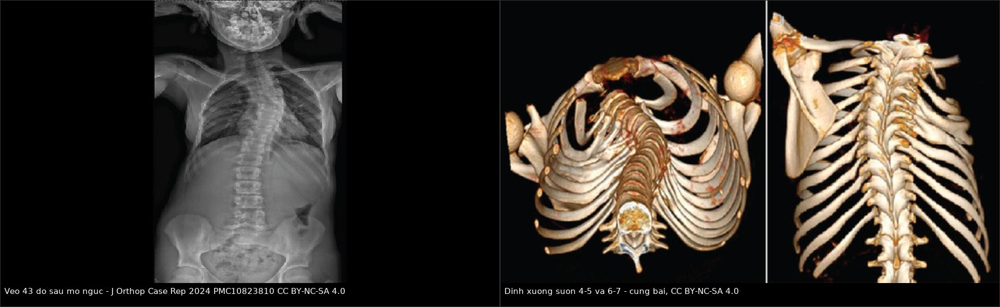
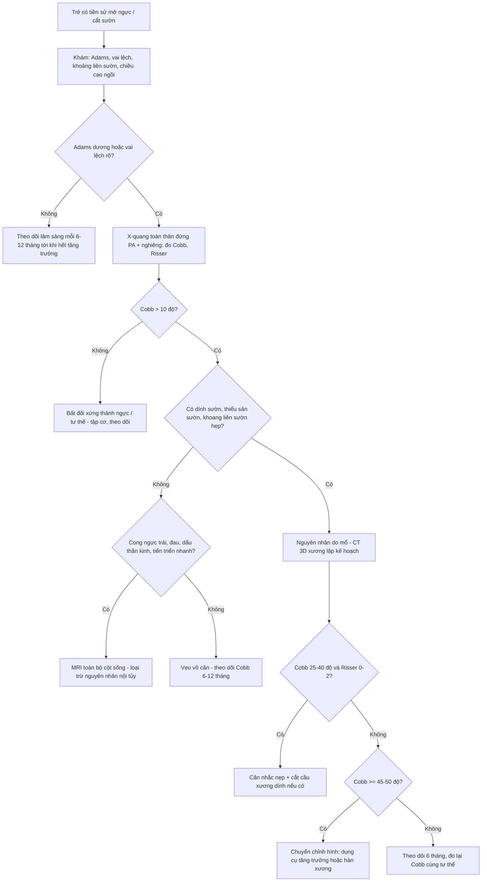
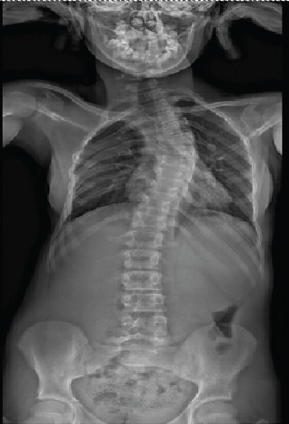
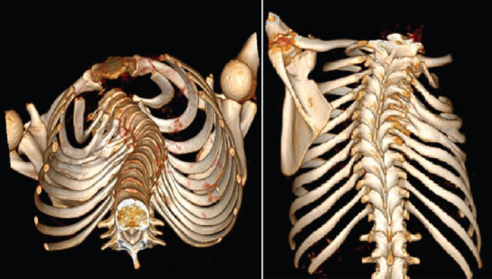
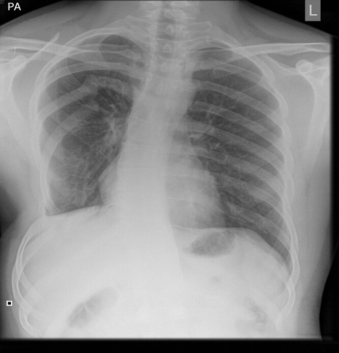

# 047 — Vẹo cột sống & biến dạng lồng ngực sau mở ngực ở trẻ: đo Cobb, theo dõi theo mốc tăng trưởng, ngưỡng can thiệp

**Tags:** `pattern:veo-cot-song` `vung:long-nguc` `anatomy:cot-song-nguc` `protocol:EOS-toan-than` `score:Cobb` `incidentaloma:bien-dang-long-nguc`
**Mức chắc chắn (certainty):** tổng hợp y văn (literature synthesis) — số liệu từ đoàn hệ quốc gia 322 trẻ hậu phẫu teo thực quản (PMID 28778692), đoàn hệ dân số 100 người lớn teo thực quản (PMID 19901003), nghiên cứu 61 bệnh nhân mở ngực thời thơ ấu (PMID 1948403), loạt 8 trẻ vẹo tiến triển sau mổ teo thực quản (PMID 6603750), khảo sát 159 trẻ sống sót thoát vị hoành (PMID 26766165), cơ sở dữ liệu vẹo khởi phát sớm (PMID 30192221), ca có ảnh dính sườn sau mổ (PMC10823810) và loạt theo dõi sau cắt thùy phổi bẩm sinh (PMC13572718, PMC3853854).

## 1. Tổng quan bệnh học – cơ chế hình ảnh

- **Bản chất:** **vẹo cột sống do mổ ngực (thoracogenic scoliosis)** là biến dạng **3 chiều** của cột sống – lồng ngực xuất hiện **sau can thiệp vào thành ngực thời thơ ấu** (mở ngực, cắt sườn, dính sườn do sẹo), **không có dị tật đốt sống bẩm sinh**. Đây là nhóm **thứ phát/do điều trị (iatrogenic)** nằm ngoài phân loại vẹo vô căn – bẩm sinh – thần kinh – hội chứng, và chính vì thế **dễ bị bỏ qua trong theo dõi**.
- **Cơ chế — vì sao cắt/dính sườn làm cong cột sống (vật lý tăng trưởng):**
  - Cột sống ngực **tăng trưởng nhờ sụn tiếp hợp đốt sống và sườn**; ở trẻ nhỏ, **chiều dài sườn** đóng góp lớn vào thể tích lồng ngực và vào **cân bằng lực hai bên cột sống**.
  - **Một bên sườn bị dính (synostosis), thiểu sản hoặc cắt bỏ** → bên đó **mất khả năng dài ra** → lực căng **bất đối xứng** lên cột sống đang lớn. Theo **định luật Hueter–Volkmann**, phía **chịu nén** tăng trưởng chậm hơn, phía **chịu kéo giãn** tăng trưởng nhanh hơn → **đường cong tiến triển theo thời gian**, không tự khỏi.
  - **Sẹo mổ, xơ cơ, cắt cơ răng trước, thiểu sản cơ ngực** làm **"dây neo" mềm** cố định tư thế; **dính sườn** là dây neo **cứng** — đây là lý do **cắt sườn bị dính** có thể cần thiết trước khi nắn chỉnh.
  - **Thời điểm mổ càng nhỏ, nguy cơ càng cao** vì còn nhiều **tiềm năng tăng trưởng** phía trước; đường cong thường **xuất hiện muộn, nhiều năm sau mổ**, và **tiến nhanh trong giai đoạn tăng trưởng dậy thì** (PMID 6603750).
- **Chiều cong — chi tiết dễ hỏi thi:** sau **mở ngực vì teo thực quản có dính sườn**, đường cong thường **lõm về phía mổ (concave toward the operated side)** (PMID 6603750); trong khi loạt 61 bệnh nhân mở ngực vì teo thực quản/bệnh tim/bệnh phổi, đa số **lồi về phía mổ (convex), trừ nhóm teo thực quản thì lõm về phía mổ** (PMID 1948403). Bài học: **không suy ra bên mổ từ chiều cong**, phải đọc phim và hỏi tiền sử.
- **Dịch tễ – những con số quyết định việc bạn có theo dõi hay không:**
  - **Nói chung sau mổ ngực–bụng thời thơ ấu: 8–50%** (PMID 30192221). Khoảng rộng này phản ánh khác biệt **đối tượng – thời gian theo dõi – cách định nghĩa** (Cobb > 10° hay > 20°), không phải mâu thuẫn.
  - **Teo thực quản – đoàn hệ quốc gia 322 trẻ:** **58,1%** có di chứng thành ngực trên X-quang, gồm **thiểu sản sườn 85 ca**, **bất thường sườn khác 47**, **bất thường khoang liên sườn 46**, **dính sườn 21**, **vẹo cột sống 12 ca (3,7%)**, **bán đốt sống 14**. Tỷ lệ di chứng **59,1% sau mở ngực kinh điển** so với **22,2% sau nội soi không chuyển mổ** (p = 0,04) (PMID 28778692).
  - **Teo thực quản – 100 người lớn:** **vẹo > 10° ở 56%**, **> 20° ở 11%**, **> 45° ở 1%**; nguy cơ vẹo > 10° **gấp 13 lần** và > 20° **gấp 38 lần** dân số chung; **dính sườn do mở ngực** là yếu tố dự báo mạnh nhất (OR 3,6) (PMID 19901003).
  - **Teo thực quản – 61 bệnh nhân mở ngực:** **20/61 (33%)** vẹo > 10° sau khi kết thúc tăng trưởng, **không ca nào > 25°**, không cần điều trị (PMID 1948403).
  - **Thoát vị hoành bẩm sinh (CDH) – 159 trẻ sống sót:** **vẹo 12,6%**, **ngực lõm 11,9%**, **lồng ngực bất đối xứng 7,5%**, tổng **27,7%** có bất thường cơ–xương; **khuyết hoành lớn** và **vá bằng mảnh ghép** là yếu tố dự báo vẹo (PMID 26766165). Loạt khác: **vẹo 11,4%** (PMID 34274078).
  - **Sau cắt thùy phổi bẩm sinh:** **vẹo 17,9%**, **pectus 14,3%** (PMC13572718); sau **mở ngực posterolateral**: **dính sườn 5,7%**, **sườn dồn 9,6%**, **thiểu sản cơ ngực 11,5%**, **vai cao bên mổ 5,7%**, **Cobb > 10° 1,9%** (PMC3853854) — nghĩa là **nhóm cắt thùy ít biến dạng hơn nhóm mở ngực vì bệnh nặng khác**, nhưng **vẫn phải theo dõi**.
  - **Thể nặng cần mổ:** trong cơ sở dữ liệu **vẹo khởi phát sớm**, **41 bệnh nhân (1,6%)** là vẹo do mổ ngực–bụng; **tuổi chẩn đoán trung bình 6,0 tuổi**, Cobb trước mổ trung bình **65°** ở nhóm phẫu thuật (PMID 30192221).
- **TẠI SAO trông như vậy trên hình (vật lý – kỹ thuật):**
  - **X-quang toàn thân tư thế đứng (EOS hoặc phim ghép):** thấy **đường cong ở mặt phẳng trục**, **xoay thân đốt** (pedicle không đối xứng, **bóng cuống sống lệch**), **vẹo kèm gù/ưỡn** trên phim nghiêng. **Đứng** mới phản ánh đường cong thật; **nằm** làm đường cong nhỏ đi → **không dùng phim nằm để theo dõi**.
  - **Bất đối xứng lồng ngực:** khoang liên sườn **hẹp lại**, sườn **dồn cụm**, **dính sườn** (một khối xương liên tục thay vì hai sườn riêng), **thiểu sản sườn**; đây là **dấu hiệu nguyên nhân**, không chỉ là "hệ quả".
  - **CT 3D xương:** dựng hình lồng ngực cho thấy **cầu xương dính sườn** và **vị trí – số khoang bị ảnh hưởng** — cần cho **quyết định cắt sườn dính** trước nắn chỉnh; không dùng để theo dõi định kỳ.
  - **MRI toàn bộ cột sống:** không phải xét nghiệm sàng lọc, nhưng **bắt buộc** khi đường cong **không điển hình** (cong ngực trái ở trẻ lớn, đoạn cong ngắn, đau, có dấu thần kinh, tiến triển nhanh bất thường) để loại **rỗng tủy (syrinx), dính tủy, u tủy, dị tật hố sau**.
- **Vì sao phải theo dõi tới tuổi trưởng thành:** đường cong có thể **xuất hiện nhiều năm sau mổ** và **tiến nhanh trong giai đoạn tăng trưởng** (PMID 6603750); ca nguyên văn 13 tuổi có **43°** sau **nhiều lần mở ngực vì teo thực quản** cho thấy **trẻ "đã mổ xong" vẫn cần lịch theo dõi** (PMC10823810).

## 2. Mẫu hình + chẩn đoán phân biệt theo vị trí (gamut)

- **Mẫu hình chốt:** *trẻ có tiền sử **mở ngực/cắt sườn** thời nhỏ, đường cong **ngực (thoracic)** hoặc **ngực–thắt lưng**, **đỉnh cong ngang mức mổ**, kèm **dính sườn/thiểu sản sườn/khoang liên sườn hẹp cùng bên**, **không có bán đốt sống hay dính đốt sống**, và đường cong **tăng dần qua các mốc tăng trưởng**.*
- **Gamut theo bối cảnh mổ (quyết định mức nguy cơ):**
  - **Teo thực quản – rò khí thực quản (EA/TEF):** nguy cơ cao nhất trong nhóm lành tính, đặc biệt khi **nhiều lần mở ngực**, **rò miệng nối – viêm trung thất – mủ màng phổi** (xơ hóa + dính sườn nặng) (PMID 6603750, PMC10823810).
  - **Thoát vị hoành bẩm sinh (CDH):** nguy cơ gắn với **khuyết lớn, vá mảnh ghép, thở máy kéo dài** (PMID 26766165, PMID 34274078).
  - **Cắt thùy phổi bẩm sinh (CPAM/CLH/bronchial atresia):** nguy cơ **trung bình**, tăng khi **mở ngực posterolateral** và mổ lúc **sơ sinh** (PMC13572718, PMC3853854; nối bài 049, 698, 699).
  - **Mổ tim:** **mở ngực bên** nguy cơ cao hơn **mở xương ức** trong cùng bệnh nền; bản thân bệnh tim bẩm sinh đã tăng nguy cơ vẹo **2–31%** (PMID 3270610).
  - **Cắt u thành ngực / cắt sườn:** nguy cơ **cao nhất** vì **mất đoạn sườn thật** — đây là nhóm cần theo dõi sát và có thể cần **tạo hình thành ngực** (PMC11110943).
  - **Mủ màng phổi – dày dính màng phổi phải bóc vỏ:** nguy cơ cao do **xơ hóa toàn bộ thành ngực** (PMC2847142).
  - **Xạ trị thành ngực ở trẻ:** nguy cơ **vẹo + chậm phát triển cột sống** (nhóm sống sót sau u); đường cong tiến triển **nhiều năm sau xạ** — cần phối hợp chương trình theo dõi sống sót ung thư nhi.
- **Gamut theo *loại đường cong* (đây là chỗ dễ chẩn đoán sai):**
  - **Bẩm sinh (congenital):** có **bán đốt sống, đốt sống hình nêm, dính đốt sống (block vertebra), dính sườn bẩm sinh** — tiến triển nhanh, thường **phát hiện sớm**; khác hẳn nhóm do mổ.
  - **Thần kinh – cơ:** liệt mềm/co cứng, **teo cơ tủy (SMA), loạn dưỡng cơ**, sau **u tủy/mở ống tủy** — đường cong dài, mất cân bằng chậu.
  - **Hội chứng:** **Marfan, Ehlers–Danlos, Noonan, Turner, VACTERL** (VACTERL đặc biệt hay gặp ở trẻ teo thực quản → **hai nguyên nhân cùng tồn tại**).
  - **Vô căn (idiopathic):** chẩn đoán **loại trừ**; **cong ngực trái ở trẻ lớn là "cờ đỏ"** — phải MRI tìm nguyên nhân nội tủy.
  - **Do tư thế/do đau (postural/antalgic):** cong **mềm, tự hết khi nằm/cúi**, không xoay thân đốt, không có dính sườn.
- **Gợi nhớ "THORACOTOMY":** **T**horax mổ lúc nhỏ – **H**ypoplasia sườn – **O**blique/ngắn đoạn cong – **R**ib fusion (dính sườn) – **A**symmetry khoang liên sườn – **C**oncave/convex không đoán được theo bên mổ – **O**nsets muộn nhiều năm sau – **T**ăng nhanh lúc dậy thì – **O**bserve tới trưởng thành – **M**RI khi không điển hình – **Y**êu cầu đo Cobb đúng chuẩn.

## 3. Bảng so sánh phân biệt (ma trận đối chiếu)

| Thực thể | Hình ảnh điển hình | Chốt vào (rule-in) | Chốt loại (rule-out) | Gợi ý xác nhận |
|---|---|---|---|---|
| **Vẹo do mổ ngực (thoracogenic)** | Cong **ngang mức mổ**, **dính sườn/thiểu sản sườn/khoang liên sườn hẹp cùng bên**, **không dị tật đốt sống** | **Tiền sử mở ngực/cắt sườn + dính sườn cùng bên + không bán đốt sống** | Có **bán đốt sống/dính đốt sống** → bẩm sinh; có **rỗng tủy** → thần kinh | X-quang đứng toàn thân (Cobb), **CT 3D xương** khi cần mổ; so phim cũ |
| **Vẹo bẩm sinh (congenital)** | **Bán đốt sống, đốt hình nêm, dính đốt**, đường cong **ngắn, góc nhọn**, tiến triển nhanh | **Dị tật đốt sống thấy trên X-quang/CT** ở trẻ nhỏ | Không dị tật đốt sống + có tiền sử mổ ngực → do mổ | CT cột sống dựng hình, MRI toàn bộ trục (tầm soát dị tật nội tủy, thận, tim) |
| **Vẹo vô căn (idiopathic)** | Cong **ngực phải** ở trẻ lớn, **xoay thân đốt rõ**, không dính sườn, không tiền sử mổ ngực | **Tuổi 10–18 + cong ngực phải + không nguyên nhân khác + Risser 0–2** | **Cong ngực trái, đau, dấu thần kinh, tiến triển > 1°/tháng** → không phải vô căn | MRI toàn bộ cột sống khi có cờ đỏ; theo dõi Cobb mỗi 6–12 tháng |
| **Vẹo thần kinh – cơ** | Đường cong **dài chữ C**, **khung chậu lệch**, teo cơ, biến dạng lồng ngực kiểu "thắt lưng" | **Bệnh thần kinh–cơ nền + cong dài + mất cân bằng chậu** | Cong ngắn, không lệch chậu, không bệnh nền → không phải nhóm này | MRI tủy, khám thần kinh, đo chức năng hô hấp |
| **Bất đối xứng lồng ngực không vẹo (pectus/asymmetry)** | **Ngực lõm/lồi, vai cao, sườn dồn** nhưng **cột sống thẳng trên phim đứng** | **Cobb < 10° + bất đối xứng thành ngực** | **Cobb > 10° + xoay thân đốt** → vẹo thật | Đo Cobb, khám Adams; CT thành ngực chỉ khi cân nhắc mổ tạo hình |
| **Vẹo sau xạ trị** | Cong **đoạn dài**, **chậm phát triển chiều cao**, da/thành ngực xơ xạ, nhiều năm sau điều trị | **Tiền sử xạ thành ngực/cột sống + chậm tăng trưởng + cong tiến triển** | Không tiền sử xạ → nhóm khác | So phim qua nhiều năm, MRI nếu có cờ đỏ; phối hợp ung thư nhi |

*Trái: **X-quang toàn thân tư thế đứng (EOS)** ở bé gái 13 tuổi sau nhiều lần mở ngực phải vì teo thực quản — **vẹo ngực trái 43°**, **không có dị tật đốt sống**. Phải: **CT 3D xương** cùng bệnh nhân — **cầu xương dính sườn 4–5 và 6–7 bên phải**. Nguồn: J Orthop Case Rep 2024 (PMC10823810) Fig. 1 và Fig. 2, CC BY-NC-SA 4.0. Ghép letterbox, không crop.*

### Ba dấu hiệu "nguyên nhân" phải tìm trên phim (đừng chỉ đo Cobb)
- **Dính sườn (rib synostosis):** hai sườn liền thành **một khối xương** — dấu hiệu mạnh nhất của **mổ ngực cũ**, và là **đích can thiệp** (cắt cầu xương) trước khi nắn chỉnh.
- **Thiểu sản/khuyết sườn:** sườn **ngắn, mảnh, mất đoạn** phía sau mổ → mất chỗ bám, lồng ngực **xẹp một bên**.
- **Hẹp khoang liên sườn:** khoảng cách hai sườn **nhỏ hơn bên đối diện** — dấu hiệu **sẹo xơ co kéo**, thường đi kèm **vai cao và xương bả vai nhô**.

## 4. Protocol chụp + hệ phân độ/điểm chuẩn hoá

- **Bước 1 — lâm sàng mỗi lần tái khám:** **nghiệm pháp Adams** (cúi người, nhìn gù một bên), đo **vai cao/thấp**, đếm **khoảng liên sườn**, tìm **xương bả vai nhô (scapular winging)**, **ngực lõm/lồi**, đo **chiều cao ngồi** (ngồi mới phản ánh thân mình), hỏi **đau lưng, dấu thần kinh**.
- **Bước 2 — X-quang toàn thân tư thế đứng (EOS ưu tiên vì liều thấp):** **thẳng (PA) + nghiêng**, gồm **cột sống cổ–ngực–thắt lưng và khung chậu**. Ghi **Cobb, Risser, góc sườn–đốt sống, cân bằng vai/chậu**. **So sánh cùng tư thế, cùng máy**; không dùng phim nằm.
- **Cách đo Cobb đúng (3 bước, sai ở đâu là sai ở đó):**
  1. Chọn **đốt sống đầu–cuối (end vertebrae)** = đốt **nghiêng nhiều nhất** ở hai đầu đường cong.
  2. Kẻ đường theo **mặt trên đốt trên** và **mặt dưới đốt dưới**; dựng **đường vuông góc** với hai đường đó.
  3. Đo **góc giữa hai đường vuông góc** = **góc Cobb**. **Cobb > 10° = vẹo** (Risser 0–5 = mức cốt hóa mào chậu, dùng để ước lượng tiềm năng tăng trưởng); **10–20° nhẹ**, **20–40° trung bình**, **> 40° nặng**.
  - **Bẫy kỹ thuật:** chọn sai đốt đầu–cuối, đo trên **phim xoay**, hoặc đo trên **phim nằm** đều làm sai số **vài độ** — đủ để kết luận "ổn định" hay "tiến triển" sai. Chỉ gọi là **tiến triển** khi tăng **≥ 5–6°** so với phim trước **trong cùng điều kiện chụp**, và **≥ 10°** mới chắc chắn.
- **Bước 3 — CT 3D xương (khi cân nhắc can thiệp):** lớp **≤ 1 mm**, cửa sổ xương, dựng hình lồng ngực — đếm **cầu dính sườn**, đo **đoạn sườn thiểu sản**, đánh giá **khung chậu** nếu cần; **không** dùng CT để theo dõi định kỳ (liều cao).
- **Bước 4 — MRI toàn bộ cột sống (chỉ định chọn lọc):** **cong ngực trái ở trẻ lớn**, **đoạn cong ngắn/góc nhọn**, **đau lưng về đêm**, **dấu thần kinh**, **tiến triển nhanh**, **trước phẫu thuật nắn chỉnh**, hoặc **dị tật đốt sống trên X-quang** (tầm soát rỗng tủy, dính tủy, u, dị tật Chiari).
- **Ngưỡng can thiệp (theo SRS, dùng để chuyển chỉnh hình — không tự quyết):**
  - **Cobb 10–25°:** **theo dõi** + **vật lý trị liệu** (tập cơ thân, bơi); không nẹp.
  - **Cobb 25–40° ở trẻ còn nhiều tiềm năng tăng trưởng (Risser 0–2, chưa có kinh hoặc mới có kinh < 1 năm):** **cân nhắc nẹp** (áo nẹp ngực–thắt lưng–cổ) — mục tiêu **ngăn tiến triển**, không nắn thẳng.
  - **Cobb ≥ 45–50°:** **cân nhắc phẫu thuật** (hàn xương / dụng cụ tăng trưởng tùy tuổi); với trẻ **< 10 tuổi** ưu tiên **phẫu thuật "thân thiện tăng trưởng"** (growing rods, VEPTR) thay vì hàn xương sớm.
  - **Dính sườn gây cong tiến triển:** **cắt cầu xương dính + dụng cụ tăng trưởng** (VEPTR) đã được báo cáo ở ca **43°** tuổi 13 (PMC10823810); **không** chỉ nẹp khi có **dây neo xương cứng**.
- **Lịch theo dõi đề xuất (suy luận của bài, y văn chưa có đồng thuận — ghi rõ):**
  - **< 5 tuổi hoặc đường cong > 20°:** khám + X-quang đứng **mỗi 6 tháng**.
  - **5–10 tuổi, đường cong < 20°:** **mỗi 12 tháng**.
  - **Dậy thì / tăng trưởng nhanh (Risser 0–2):** **mỗi 6 tháng** cho tới khi **Risser 4–5** hoặc **> 2 năm sau khi hết tăng trưởng**.
  - **Sau khi trưởng thành:** khám lâm sàng **1–2 năm/lần** nếu đường cong > 20°; **không** chụp lặp nếu không có triệu chứng mới.

## 5. Biến thể bình thường và cạm bẫy

- **Cạm bẫy 1 — "mổ xong, khỏi bệnh":** đường cong xuất hiện **nhiều năm sau mổ** và **tiến nhanh lúc dậy thì** (PMID 6603750). Trẻ 5 tuổi có phim bình thường **không** được xuất viện khỏi theo dõi; phải hẹn tới **hết tăng trưởng**.
- **Cạm bẫy 2 — đo Cobb trên phim nằm hoặc phim xoay:** làm đường cong **nhỏ đi hoặc sai lệch vài độ** → kết luận "không tiến triển" sai. Luôn **đứng, PA, cùng máy**, và **so cùng tư thế**.
- **Cạm bẫy 3 — nhầm bất đối xứng thành ngực với vẹo:** **vai cao, sườn dồn, xương bả vai nhô** sau mở ngực là **di chứng mô mềm/xương sườn**; nếu **cột sống thẳng (Cobb < 10°) và không xoay thân đốt** thì **không phải vẹo** — đừng nẹp, đừng mổ cột sống.
- **Cạm bẫy 4 — bỏ sót dị tật bẩm sinh đi kèm:** trẻ teo thực quản có thể có **VACTERL** (bán đốt sống, dị tật hậu môn, tim, thận); **14 bán đốt sống** trong đoàn hệ 322 trẻ (PMID 28778692). Thấy đường cong **ngắn, góc nhọn, tiến triển nhanh** → **CT/MRI tìm dị tật đốt sống**, đừng quy hết cho "do mổ".
- **Cạm bẫy 5 — "cong ngực trái ở trẻ lớn là bình thường":** đây là **cờ đỏ** kinh điển của **rỗng tủy/u tủy/dị tật nội tủy**; **MRI toàn bộ cột sống** trước khi kết luận vô căn.
- **Cạm bẫy 6 — nẹp cho mọi đường cong:** nẹp **không sửa được dây neo xương cứng** (dính sườn) và **không có chỉ định** khi trẻ đã **Risser 4–5** (hết tiềm năng tăng trưởng) hoặc Cobb < 25°.
- **Cạm bẫy 7 — liều bức xạ tích lũy:** trẻ cần chụp lặp nhiều năm; ưu tiên **EOS/khe quét liều thấp**, **che tuyến vú/tuyến giáp**, **không chụp toàn thân khi chỉ cần đo Cobb** ở trẻ nhỏ phối hợp.
- **Biến thể bình thường cần biết:** **đường cong < 10°** không gọi là vẹo; **bất đối xứng nhẹ khoang liên sườn** sau mổ ngực là **di chứng thường gặp, không tiến triển** (thiểu sản sườn 85/322 trẻ, PMID 28778692) — chỉ theo dõi, không can thiệp.

## 6. Tự lượng giá — Blind Quiz

**Ca 1 — Bé gái 13 tuổi, tiền sử nhiều lần mở ngực phải vì teo thực quản. Đau lưng nhẹ, vai phải cao hơn.**

- Câu hỏi: mô tả đường cong (bên, đỉnh, mức độ); có dị tật đốt sống không; ba nguyên nhân cần phân biệt và bước tiếp theo?

<b>Bấm để hiện đáp án (findings + chẩn đoán)</b>

- Findings: **vẹo ngực trái**, đỉnh khoảng **ngực giữa**, Cobb **43°**; **không thấy bán đốt sống, không dính đốt sống**; lồng ngực phải **hẹp hơn**, vai phải cao.
- Chẩn đoán: **vẹo cột sống do mổ ngực (thoracogenic) trên nền dính sườn** sau nhiều lần mở ngực phải — **không phải vẹo bẩm sinh** (không dị tật đốt sống) và **không phải vô căn** (cong ngực trái + tiền sử mổ).
- Phân biệt: **bẩm sinh** (cần thấy bán đốt sống/dính đốt), **thần kinh–cơ** (cong dài, lệch chậu, bệnh nền), **vô căn** (thường cong ngực phải, không dính sườn).
- Bước tiếp theo: **CT 3D xương** tìm cầu dính sườn (đã thấy **dính 4–5 và 6–7 bên phải**), đo Risser; Cobb 43° ở trẻ còn tăng trưởng → **chuyển chỉnh hình**, ca này được điều trị **cắt cầu xương dính + VEPTR** thay vì hàn xương sớm.
- Nguồn ảnh: *J Orthop Case Rep* 2024 (PMC10823810) Fig. 1, CC BY-NC-SA 4.0.

**Ca 2 — Cùng bệnh nhân, CT 3D xương lồng ngực.**

- Câu hỏi: mũi tên/khối xương bất thường nằm ở đâu, đó là gì, và vì sao phát hiện này **đổi kế hoạch mổ**?

<b>Bấm để hiện đáp án (findings + chẩn đoán)</b>

- Findings: **cầu xương liên tục giữa sườn 4–5 và 6–7 bên phải** (dính sườn/synostosis), kèm **biến dạng nhẹ khung sườn** cùng bên; cột sống cong về bên trái.
- Ý nghĩa: dính sườn là **dây neo xương cứng** — nẹp **không** nắn được; phải **cắt cầu xương** rồi mới dùng **dụng cụ tăng trưởng** (VEPTR/growing rods).
- Vì sao đổi kế hoạch: nếu chỉ hàn xương cột sống, **dính sườn còn lại** tiếp tục **kéo lệch** và làm mất thể tích lồng ngực; ở trẻ 13 tuổi, hàn xương sớm còn **hạn chế tăng trưởng ngực**.
- Nguồn ảnh: *J Orthop Case Rep* 2024 (PMC10823810) Fig. 2, CC BY-NC-SA 4.0.

**Ca 3 — Bệnh nhân trẻ, sau cắt u thành ngực có lấy đoạn sườn, chụp X-quang ngực PA.**

- Câu hỏi: mô tả bất thường thành ngực và cột sống; vì sao nhóm này nguy cơ vẹo **cao nhất**; cần theo dõi gì và bằng phương tiện nào?

<b>Bấm để hiện đáp án (findings + chẩn đoán)</b>

- Findings: **mất/thiếu đoạn sườn** và **bất đối xứng lồng ngực một bên sau mổ**, **đường cong cột sống ngực nhẹ**, thể tích phổi bên mổ giảm nhẹ.
- Vì sao nguy cơ cao nhất: **mất đoạn sườn thật** → mất hoàn toàn lực nâng đỡ và tăng trưởng một bên; nếu kèm **xạ trị** thì xơ hóa làm **cột sống tăng trưởng không đều** thêm.
- Theo dõi: **khám lâm sàng + X-quang toàn thân đứng mỗi 6 tháng** trong giai đoạn tăng trưởng; **CT 3D** khi lập kế hoạch **tạo hình thành ngực/dụng cụ tăng trưởng**; **MRI** nếu có cờ đỏ thần kinh hoặc trước nắn chỉnh.
- Phản biện: ảnh chụp ngực **không thay thế** phim toàn thân để đo Cobb — phải chụp **toàn bộ cột sống** mới đo đúng đốt đầu–cuối.
- Nguồn ảnh: *BJS Open* 2024 (PMC11110943) Fig. 15, CC BY 4.0.

## Bài liên quan chéo

- [049 – Theo dõi dài hạn sau cắt thùy phổi bẩm sinh](../049-theo-doi-sau-cat-thuy-phoi-bam-sinh/lesson.md) — vẹo 17,9%, pectus 14,3% trong loạt theo dõi
- [698 – Nang phổi bẩm sinh CPAM/CCAM](../698-nang-phoi-bam-sinh-cpam-ccam/lesson.md) — nhóm bệnh nền phải mổ ngực sớm
- [699 – Hẹp phế quản bẩm sinh & khí phế thũng thùy](../699-hep-phe-quan-bam-sinh-va-khi-phe-thung-thuy/lesson.md) — cùng nhóm mổ ngực ở trẻ
- [610 – Suy hô hấp sơ sinh & dị dạng phổi](../610-suy-ho-hap-so-sinh-va-di-dang-phoi/lesson.md) — bệnh nền hô hấp ảnh hưởng tăng trưởng lồng ngực
- [645 – Vỡ khung chậu ở trẻ](../645-vo-khung-chau-o-tre/lesson.md) — cùng nguyên lý "xương trẻ đang lớn, di chứng theo tăng trưởng"
- [310 – Giải phẫu xương khớp và biến thể](../310-giai-phau-xuong-khop-va-bien-the/lesson.md) — mốc cốt hóa, Risser, đọc phim trẻ

## Ảnh

- Tên file theo quy ước `NNN_slug_Modality_SourceID.jpg`; nguồn + giấy phép từng ảnh ở `images/CREDITS.md`.
- **CC BY-NC-SA 4.0** (PMC10823810): phim toàn thân và CT 3D — hiển thị/ghép **kèm attribution**, ảnh phái sinh theo **cùng giấy phép**.
- **CC BY 4.0** (PMC11110943): X-quang ngực sau cắt u thành ngực.

> Không dùng để chẩn đoán độc lập khi chưa có người hướng dẫn.
