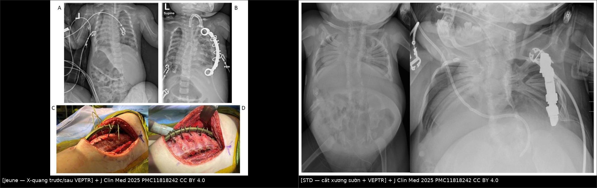
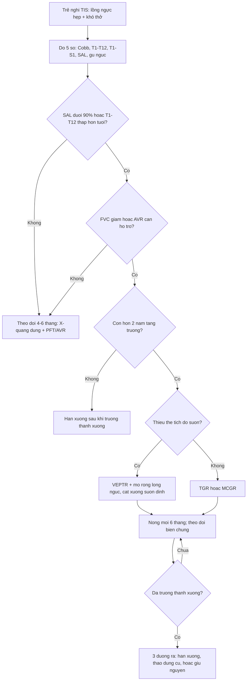
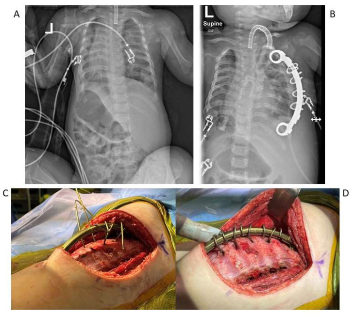
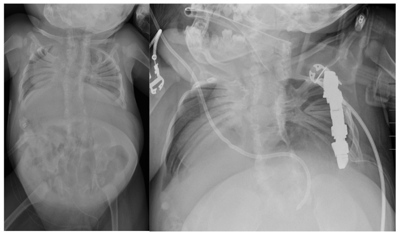
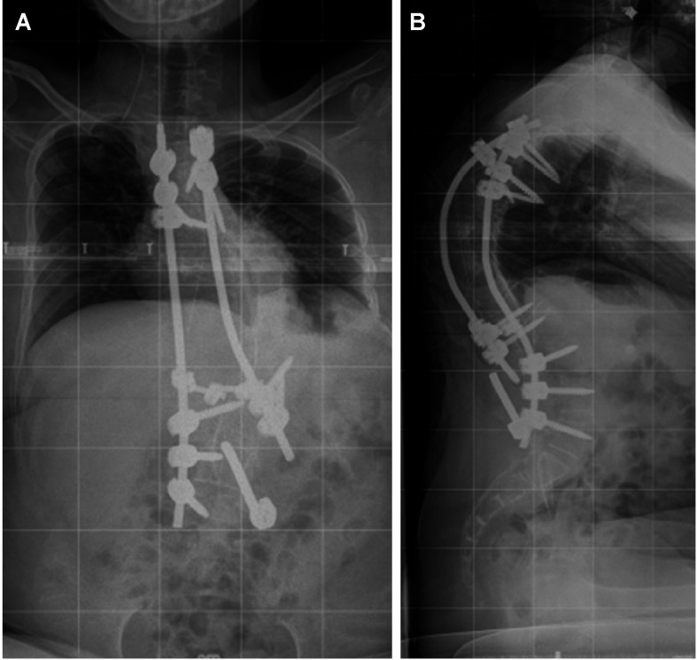

# 048 — Hội chứng lồng ngực không đủ: thiếu thể tích, SAL, VEPTR nong 6 tháng/lần & thời điểm ngừng

**Tags:** `pattern:long-nguc-khong-du` `pattern:hep-long-nguc` `pattern:dinh-suon` `vung:long-nguc` `vung:cot-song-nguc` `anatomy:long-nguc` `score:C-EOS` `score:SAL` `protocol:EOS-toan-than` `protocol:QdMRI` `incidentaloma:bien-dang-long-nguc`
**Mức chắc chắn (certainty):** tổng hợp y văn (literature synthesis) — số liệu từ bài điểm luận J Clin Med 2025 (PMC11818242), loạt 9 bệnh nhân VEPTR "tốt nghiệp" theo dõi 11,7 năm của World J Pediatr Surg 2025 (PMC12083380), nghiên cứu 21 trẻ đo độ giãn lồng ngực của J Child Orthop 2017 (PMC5382335) và khảo sát 58 ca tạo vạt che dụng cụ lộ của Plast Reconstr Surg Glob Open 2021 (PMC9555958). Không có ca nguyên văn riêng của nhóm.

## 1. Tổng quan bệnh học – cơ chế hình ảnh

- **Định nghĩa (Campbell):** **hội chứng lồng ngực không đủ (thoracic insufficiency syndrome — TIS)** = **lồng ngực không đủ khả năng duy trì hô hấp bình thường và/hoặc tăng trưởng phổi bình thường**. Đây là **chẩn đoán chức năng**, không phải chẩn đoán hình thái: **không có xét nghiệm vàng** (PMC11818242). Vì vậy "hẹp lồng ngực trên phim" chỉ là **điều kiện cần**, phải cộng thêm **hệ quả hô hấp** mới thành TIS.
- **Ba nhóm cơ chế (Campbell) — dùng làm gamut gốc:**
  1. **Thiếu thể tích (volume depletion):** mất/hợp nhất sườn, loạn sản sườn → **Jeune (asphyxiating thoracic dystrophy)**, **Jarcho–Levin/spondylothoracic dysostosis (STD)**, VACTERL, loạn sản sụn.
  2. **Thần kinh – cơ:** **SMA** ("collapsing parasol rib"), bại não, loạn dưỡng cơ, spina bifida.
  3. **Biến dạng cột sống:** **vẹo khởi phát sớm (early-onset scoliosis — EOS)** làm xoắn và mất chức năng lồng ngực.
  Đa số bệnh nhân **pha trộn cả ba** — nên hỏi "cơ chế nào đang chi phối" chứ không hỏi "thuộc nhóm nào".
- **EOS — ngưỡng định nghĩa:** vẹo **> 10°** chẩn đoán ở trẻ **< 10 tuổi**; **> 10° + còn > 2 năm tăng trưởng** = nhóm phải can thiệp "thân thiện tăng trưởng" nếu tiến triển (PMC11818242).
- **TẠI SAO lồng ngực hẹp lại làm phổi không lớn (sinh lý – vật lý):**
  - **Phổi lớn vì bị "kéo" chứ không vì tự bơm khí.** Trong bào thai và nhũ nhi, thể tích phổi tăng theo **thể tích khoang lồng ngực**; sườn ngắn/dính → khoang cứng, không nở → **giảm số đơn vị phế nang** (dysanapsis), giảm **diện tích trao đổi khí** và giảm **chiều dài đường dẫn khí** → hạn chế **hạn chế (restrictive)** với **FVC và TLC giảm** nhưng **FEV1/FVC bình thường hoặc tăng**.
  - **Cơ hô hấp mất đòn bẩy:** sườn ngắn + dính sườn → cơ liên sườn không tạo được mô-men nâng sườn; bệnh nhân chuyển sang **thở bằng cơ hoành** → khi nằm ngửa, hoành bị tạng đẩy lên → **giảm dung tích cặn chức năng (FRC)**, tăng shunt, **giảm SpO₂ khi ngủ**. Đây là lý do phải hỏi **"có cần hỗ trợ thông khí ban đêm không"** chứ không chỉ đo Cobb.
  - **Tăng áp phổi do thiếu giường mạch + thiếu oxy mạn** → thất phải giãn → tử vong sớm nếu không mở rộng lồng ngực (PMC11818242).
  - **Vật lý "vì sao phim đứng":** đường cong và **chiều cao T1–T12** đo trên phim **đứng (upright)** mới đúng; phim **nằm làm đường cong giảm 20–30% và xương chồng lên nhau** → **không dùng phim nằm để theo dõi EOS/TIS**.
- **Ngưỡng định lượng phải nhớ (mỗi con số đều có hệ quả xử trí):**
  - **SAL (space available for lung)** = tỉ lệ **bề ngang nửa lồng ngực bên lõm / bên lồi** tại đỉnh đường cong; bình thường **≈ 100%**; loạt VEPTR: **86% trước mổ → 90% ngay sau mổ → 97% ở lần theo dõi cuối** (PMC12083380). SAL **< 90%** = thiếu thể tích có ý nghĩa.
  - **T1–T12 (chiều cao cột sống ngực)** là **đại diện thể tích lồng ngực**: loạt trên **128 mm → 196 mm (+32%)** sau trung bình **7,4 năm** VEPTR; **T1–S1 252 mm → 333 mm (+32%)** (PMC12083380).
  - **Cobb:** **65° (36–94°) trước mổ → 50° ngay sau → 58° ở lần cuối** — tức **mất chỉnh 8–15°** theo thời gian; nghiên cứu khác: **68° → 45°** (p < 0,001) nhưng **mất 8,23°** ở lần theo dõi cuối (PMC12083380, PMC5382335).
  - **Gù ngực > 70°: tránh VEPTR** (nguy cơ gù nặng thêm và giảm SAL) (PMC12083380).
  - **Jeune:** **60–80% tử vong sớm** nếu không can thiệp; **VEPTR + mở rộng lồng ngực: sống ~70%** so với **70–80% tử vong** ở nhóm không mổ (PMC11818242 dẫn Campbell 2015).
  - **SMA "parasol rib":** **chỉ số Parasol ≤ 0,56** xác định biến dạng sườn dù; công thức = **(rộng nửa ngực bên lồi T6 / bên lõm T6) × (rộng T6 / rộng T12)** (PMC11818242).
  - **Độ giãn lồng ngực (thoracic dynamic compliance):** nhóm VEPTR **10,64 → 17,94 mL/mbar**, nhóm chứng **15,06 → 23,99 mL/mbar**; **tốc độ tăng theo cân nặng KHÔNG khác biệt** → VEPTR **không cải thiện độ giãn vượt tự nhiên**, chỉ **giữ cho lồng ngực lớn lên** (PMC5382335). Đây là câu trả lời chuẩn cho "VEPTR có làm phổi tốt hơn không": **chủ yếu là ngăn suy giảm, không phải đảo ngược**.

## 2. Mẫu hình + chẩn đoán phân biệt theo cơ chế (gamut)

- **Mẫu hình X-quang cốt lõi — "lồng ngực hẹp + cột sống cong":** đếm **số cung sườn nhìn thấy**, đo **chiều rộng lồng ngực lớn nhất / chiều rộng bụng**, đo **T1–T12**, tính **SAL**; sau đó tìm **dấu hiệu nguyên nhân**: **dính sườn (synostosis)**, **sườn thiểu sản**, **nửa đốt sống**, **hợp nhất đốt sống cổ**, **hình "càng cua" của STD**.
- **Gamut theo cơ chế:**
  - **Thiếu thể tích – loạn sản sườn:** Jeune (lồng ngực hình **"ba lá cỏ"**, sườn ngắn đều, xương đòn cao), **STD/Jarcho–Levin** (**hợp nhất toàn bộ khớp sườn–đốt sống hai bên**, hình **càng cua**, cột sống ngắn, **hợp nhất cột sống cổ**; gen **MESP2**), VACTERL (nửa đốt sống + bất sản trực tràng + tim bẩm sinh).
  - **Thiếu thể tích mắc phải:** sau **cắt sườn/u thành ngực**, **dính sườn sau mở ngực** (nối bài 047), **di chứng xạ trị**.
  - **Thần kinh – cơ:** **SMA type 1–2** (sườn dù), bại não, loạn dưỡng cơ Duchenne (vẹo + hạn chế), spina bifida.
  - **Biến dạng cột sống:** EOS **bẩm sinh** (nửa đốt sống, thanh dọc), **hội chứng** (Marfan, Ehlers–Danlos, Down), **vô căn**, **thần kinh–cơ**.
  - **Bắt chước TIS mà KHÔNG phải TIS:** **pectus excavatum** đơn thuần (lõm ức, không giảm T1–T12), **bệnh nhu mô phổi** (CPAM, BPD, PIBO), **bệnh tim bẩm sinh** gây tim to – giả hẹp lồng ngực, **loạn sản sụn không kèm hẹp ngực**.
- **Gợi nhớ 3 câu hỏi trước khi gọi là TIS:** **(1) lồng ngực có thật sự hẹp theo số đo? (2) phổi có bằng chứng hạn chế (FVC/AVR)? (3) nguyên nhân có thể sửa bằng mở rộng lồng ngực?**

## 3. Bảng so sánh phân biệt (ma trận đối chiếu)

| Thực thể (entity) | Hình ảnh điển hình (X-quang/CT/MRI) | Chốt vào (rule-in) | Chốt loại (rule-out) | Gợi ý xác nhận |
|---|---|---|---|---|
| **Jeune (loạn sản ngực ngạt thở)** | Lồng ngực **hẹp đều**, sườn **ngắn ngang**, đầu xương sườn loe, xương đòn cao; bụng to tương đối | **Hẹp đều + sườn ngắn đồng dạng + T1–T12 giảm nặng** | Sườn đủ dài, chỉ có vẹo → không phải Jeune | Gen **IFT80/DYNC2H1**; khám thận/gan (loạn sản đa cơ quan) |
| **STD / Jarcho–Levin** | **Hợp nhất sườn–đốt sống hai bên**, hình **càng cua**, cột sống ngắn, **hợp nhất cột sống cổ** | **Hợp nhất khớp sườn–đốt sống hai bên + cột sống ngắn** | Dính sườn **một bên** sau mổ → do can thiệp, không phải STD | **MESP2**; X-quang cổ cúi–ngửa vì nguy cơ chèn tủy |
| **EOS bẩm sinh có dính sườn (TIS thể thiếu thể tích)** | Vẹo **kèm dính sườn cùng bên**, nửa đốt sống, **SAL < 90%** | **Dính sườn + SAL giảm + Cobb > 10°** | Không dính sườn, không giảm SAL → EOS đơn thuần | **CT 3D xương** để vẽ bản đồ dính sườn trước khi cắt xương |
| **SMA "parasol rib"** | Sườn **cong xuống – xẹp vào**, lồng ngực hẹp dần theo tuổi, vẹo thần kinh–cơ | **Parasol score ≤ 0,56 + yếu cơ tiến triển** | Sườn cong đều, sức cơ bình thường → loạn sản | Đo trên X-quang đứng; **AVR** (mức hỗ trợ thông khí) |
| **EOS vô căn không TIS** | Vẹo đơn thuần, lồng ngực **không hẹp**, sườn đủ dài | **Cobb > 10° nhưng SAL ≈ 100% và FVC bình thường** | SAL < 90% hoặc FVC giảm → đã có TIS | PFT; theo dõi 4–6 tháng |
| **Pectus excavatum** | Lõm ức, **chỉ số Haller** (rộng ngực / khoảng ức–cột sống trên CT) **> 3,25** | **Lõm ức + Haller > 3,25 + tim bị đẩy trái** | Lồng ngực hẹp đều, T1–T12 giảm → loạn sản/TIS | CT ngực; không nhầm với TIS (thể tích phổi thường bình thường) |
| **Hạn chế phổi do nhu mô (BPD, CPAM, PIBO)** | Phổi tăng/giảm sáng khu trú, xẹp, ứ khí; **lồng ngực có thể căng** | **Bất thường nhu mô + lồng ngực không hẹp** | Lồng ngực hẹp + sườn ngắn → cơ chế thành ngực | HRCT thì thở ra, MRI thai |

*Trái: **Jeune** — lồng ngực hẹp đều, sườn ngắn; (A) trước mổ, (B) sau mở rộng lồng ngực + VEPTR sườn–sườn hai bên, (C–D) ảnh trong mổ. Phải: **STD** — (trái) hình "càng cua" do hợp nhất sườn–đốt sống hai bên; (phải) sau cắt xương sườn hình chêm + VEPTR bên phải. Nguồn: J Clin Med 2025 (PMC11818242) Fig. 1 và Fig. 2, CC BY 4.0; ghép bằng `tools/make_composite.py` (letterbox, không crop/kéo giãn).*

### Ba dấu hiệu quyết định trên phim
- **SAL (space available for lung):** đo tại **đỉnh đường cong**, bề ngang nửa ngực bên **lõm** chia bên **lồi**. **< 90%** = thiếu thể tích; đây là chỉ số **được cải thiện rõ nhất sau VEPTR** (86% → 97%) trong khi Cobb chỉ cải thiện khiêm tốn.
- **T1–T12 so với tuổi:** chiều cao cột sống ngực là **proxy thể tích lồng ngực**; tăng **~32%** sau 7,4 năm VEPTR — nếu **không tăng theo tuổi** thì dù Cobb ổn định vẫn là TIS tiến triển.
- **Dính sườn (rib synostosis):** cầu xương liên tục thay vì hai sườn riêng — **phải cắt trước khi nong**, nếu không VEPTR chỉ kéo trên một khối xương cứng và **gãy sườn/xuyên da**.

## 4. Protocol chụp + phân loại & lịch nong

- **X-quang toàn thân tư thế đứng (EOS slot-scanning hoặc phim ghép), PA + nghiêng, mỗi 4–6 tháng và trước mỗi lần nong:** đo **Cobb**, **T1–T12**, **T1–S1**, **SAL**, **gù ngực T1–T12**, **cân bằng vành (C7 plumb line)**. Đây là bộ **5 số** tối thiểu của mọi lần theo dõi.
- **CT xương lồng ngực liều thấp + dựng 3D:** **chỉ trước mổ** — vẽ bản đồ **dính sườn, sườn thiểu sản, nửa đốt sống**, chọn vị trí **cắt xương chêm (wedge osteotomy)** và neo dụng cụ. **Không** dùng CT để theo dõi định kỳ (tích lũy liều ở trẻ).
- **MRI toàn bộ cột sống trước mổ (bắt buộc):** tìm **rỗng tủy, tủy căng, Chiari, dị tật hố sau** — cột sống cong "không điển hình", đau, dấu thần kinh, hoặc trước khi đặt neo vào cột sống.
- **PFT (FVC, FEV1, TLC) khi trẻ hợp tác được (~≥ 5–6 tuổi)**; dưới tuổi đó dùng **AVR (assisted ventilation rating)** — thang đánh giá **mức hỗ trợ thông khí ban ngày/ban đêm**; cải thiện AVR **24%**, ổn định **64%**, **20%** bỏ được hỗ trợ sau VEPTR (PMC12083380).
- **QdMRI (quantitative dynamic MRI)**: MRI tự do thở, dựng **chu kỳ hô hấp 4D**, đo **thể tích khí lưu thông từng khoang** và **di động hoành hai bên** — cho thấy thể tích khí lưu thông **tăng sau đặt VEPTR**, trong khi **Cobb kém dự báo** thể tích này (PMC11818242). Chưa có dữ liệu chuẩn theo tuổi → **chưa dùng để quyết định một mình**.
- **Siêu âm tim** tầm soát tăng áp phổi; **đo SpO₂ ban đêm/đa ký giấc ngủ** khi nghi giảm thông khí.
- **Phân loại C-EOS (Williams và cs):** 3 trục — **nguyên nhân C/N/S/I** (Congenital / Neuromuscular / Syndromic / Idiopathic), **độ lớn đường cong 1 = 20–60°, 2 = 60–90°, 3 = > 90°**, **gù ngực K0/K1/K2** theo độ lớn; dùng để **so sánh kết cục giữa các trung tâm**, không thay thế đánh giá TIS.
- **Dụng cụ và nhịp nong:**

| Dụng cụ | Neo | Nong | Ưu điểm | Nhược điểm chính |
|---|---|---|---|---|
| **VEPTR** (titani) | **sườn–sườn, sườn–cột sống, sườn–chậu**, hybrid | **mổ mở mỗi 6 tháng** (loạt thực tế 6–12 tháng) | **Mở rộng lồng ngực trực tiếp** (expansion thoracoplasty) — chọn cho **thiếu thể tích do sườn** | Nhiều lần mổ; **nhiễm trùng, lộ dụng cụ, di trú neo, gãy sườn**; có thể **tăng cứng thành ngực** |
| **TGR (growing rod kinh điển)** | cột sống–cột sống | mổ mở **6 tháng** | Chỉnh gù/đường cong tốt hơn VEPTR ở gù ngực cao | **Biến chứng tới 58%**; tự hàn xương |
| **MCGR (rod từ tính)** | cột sống hoặc sườn | **3–4 tháng/lần, không mổ** (dùng remote) | Ít mổ, chi phí – biến chứng của mổ lặp | **Không nong được, gãy rod, metallosis, dụng cụ lộ**; **không mở rộng lồng ngực** như VEPTR |

- **Biến chứng — con số để tư vấn trước mổ:** **1,8 biến chứng/bệnh nhân**, **21% số thủ thuật là ngoài kế hoạch**, **14 thủ thuật/bệnh nhân** (10–20), **nhiễm trùng cần nạo 18%** (38/213), **thất bại neo gần 19–53%**, **tổn thương đám rối cánh tay** có thể gặp (PMC12083380, PMC9555958).
- **Khi dụng cụ lộ — "thang tái tạo":** **62,1%** ca lộ dụng cụ **giữ được dụng cụ** nhờ vạt cơ (latissimus hoặc paraspinal); **lộ dụng cụ thật** (so với **nguy cơ lộ**) làm **tăng nguy cơ tháo dụng cụ ngay (OR 7,0)**; **VEPTR sườn–sườn ít nhiễm trùng hơn (30,0% vs 60,7%)**; **vẹo thần kinh–cơ + không đi lại được** là yếu tố thất bại (PMC9555958) → **chuyển phẫu thuật tạo hình sớm, đừng chờ thủng da**.
- **Thời điểm ngừng — 3 đường ra hợp lệ:** (1) **hàn xương sau (final fusion)** khi gần trưởng thành xương; (2) **tháo dụng cụ, không hàn** nếu đường cong tĩnh; (3) **giữ nguyên dụng cụ** sau khi hết nong. Thực tế: hàn xương sau VEPTR **rất khó** — trung bình **6,4 năm** sau đặt, tuổi **13,3**, cần **13 thủ thuật chia thì** cho 5 bệnh nhân, **halo traction** ở 3 ca, và **chỉ chỉnh thêm 17%** (80° → 67°); **cốt hóa mô mềm quanh dụng cụ ở 100%** ca (PMC12083380). **Kết luận thực hành: đừng hứa "sau này mổ một lần là thẳng"**.

## 5. Biến thể bình thường và cạm bẫy

- **Biến thể bình thường dễ gọi nhầm là hẹp lồng ngực:**
  - **Lồng ngực nhũ nhi "hình chuông"** + **đầu xương sườn loe** sinh lý — luôn **so với chiều rộng bụng và với phim trước**, đừng đo một phim đơn độc.
  - **Sườn cổ 11–12 ngắn** hoặc **bất thường số sườn** không làm giảm SAL.
  - **Pectus excavatum nhẹ** (Haller < 3,25) không phải TIS.
- **Cạm bẫy (pitfall) hay gặp:**
  - **Đo Cobb trên phim nằm** → giảm 20–30%, "ổn định giả" → bỏ sót tiến triển.
  - **Nhìn Cobb mà quên SAL và T1–T12:** trong loạt VEPTR, Cobb chỉ cải thiện khiêm tốn nhưng **SAL và chiều cao ngực tăng 32%** — **thành công chức năng không nằm ở Cobb**.
  - **Gù ngực > 70°** mà vẫn đặt VEPTR → gù nặng thêm, giảm SAL; cân nhắc TGR.
  - **Bỏ qua MRI tủy trước mổ** → bỏ sót tủy căng/rỗng tủy, gây liệt sau nắn chỉnh.
  - **Tưởng "lộ dụng cụ = phải tháo"**: **62,1%** giữ được nhờ vạt cơ nếu can thiệp **trước khi thủng da**; ngược lại **lộ thật** làm tăng **OR 7,0** nguy cơ tháo ngay.
  - **Hứa hẹn quá mức:** VEPTR chủ yếu **duy trì/ngăn suy giảm** (độ giãn lồng ngực tăng cùng nhịp với trẻ bình thường, không vượt), và **hàn xương sau đó rất khó** — tư vấn đúng để gia đình không thất vọng.

## 6. Tự lượng giá — Blind Quiz

**Ca 1 — Nhũ nhi 14 tháng, lồng ngực rất hẹp, thở nhanh, nhiều đợt viêm phổi. Nhìn phim trước can thiệp và mô tả trước.**

- Gợi ý lâm sàng: trẻ nhỏ, lồng ngực hẹp từ nhỏ, suy hô hấp tái diễn, bụng to tương đối.
- Câu hỏi: (1) Bất thường chính là **thể tích lồng ngực** hay **nhu mô phổi**? (2) Ba chẩn đoán phân biệt? (3) Dấu hiệu nào trên ảnh chốt cơ chế?

<b>Bấm để hiện đáp án (findings + chẩn đoán)</b>

- Dấu hiệu (findings): **(A)** lồng ngực **hẹp đều theo trục dọc**, sườn **ngắn**, phổi bị ép, bụng chiếm tỉ lệ lớn; **(B)** sau **mở rộng lồng ngực từng thì + VEPTR sườn–sườn hai bên**, lồng ngực rộng ra rõ rệt, hai thanh titani cong theo thành ngực; **(C–D)** ảnh trong mổ: bộc lộ khoang sườn, đặt dụng cụ.
- Chẩn đoán (diagnosis): **Jeune (asphyxiating thoracic dystrophy)** gây **TIS thể thiếu thể tích** — sườn ngắn làm khoang ngực không nở, phổi không lớn theo → hạn chế + tăng áp phổi. Vì sao: **thể tích phổi phụ thuộc thể tích khoang ngực**, không phụ thuộc nhu mô.
- Phân biệt: **STD/Jarcho–Levin** (hợp nhất sườn–đốt sống hai bên, hình càng cua), **EOS bẩm sinh có dính sườn**, **SMA sườn dù**.
- Xử trí: **VEPTR + mở rộng lồng ngực**, nong **6 tháng/lần**; tư vấn **tử vong 60–80% nếu không mổ**, sống **~70%** sau can thiệp.
- Nguồn ảnh: J Clin Med 2025, PMC11818242 Fig. 1, CC BY 4.0.

**Ca 2 — Trẻ 3 tuổi, cột sống ngắn, sườn "dính thành chùm". Nhìn phim trái rồi đoán cơ chế trước khi mở đáp án.**

- Gợi ý lâm sàng: hội chứng cột sống–sườn bẩm sinh, cổ khó gập/ngửa, không có tiền sử mổ ngực.
- Câu hỏi: (1) Vì sao các sườn "dính" thành khối? (2) Khác gì dính sườn sau mở ngực? (3) Can thiệp nào được thực hiện ở ảnh phải?

<b>Bấm để hiện đáp án (findings + chẩn đoán)</b>

- Dấu hiệu: **(trái)** toàn bộ **khớp sườn–đốt sống hợp nhất hai bên**, sườn xòe như **càng cua**, cột sống ngắn, lồng ngực hẹp; **(phải)** sau **cắt xương sườn hình chêm bên phải + VEPTR**, lồng ngực bên phải được mở rộng, còn **đoạn dụng cụ phía dưới**.
- Chẩn đoán: **spondylothoracic dysostosis (STD/Jarcho–Levin)** — đột biến **MESP2**, hợp nhất sườn–đốt sống hai bên; hô hấp **phụ thuộc hoàn toàn cơ hoành**.
- Phân biệt: **dính sườn sau mở ngực** (một bên, có sẹo mổ, không hợp nhất khớp sườn–đốt sống hai bên); **Jeune** (sườn ngắn nhưng không hợp nhất).
- Vì sao phải cắt xương chêm: khối sườn hợp nhất là **dây neo xương cứng**; nong mà không cắt = gãy sườn/xuyên da.
- Nguồn ảnh: J Clin Med 2025, PMC11818242 Fig. 2, CC BY 4.0.

**Ca 3 — Bệnh nhân đã "tốt nghiệp" VEPTR. Nhìn phim và cho biết đã xảy ra những gì.**

- Gợi ý lâm sàng: đã trải qua nhiều lần nong, nay đau lưng và đường cong tăng lại.
- Câu hỏi: (1) Hai loại dụng cụ cùng hiện diện? (2) Vì sao hàn xương sau VEPTR khó? (3) Con số nào trong bài chứng minh điều đó?

<b>Bấm để hiện đáp án (findings + chẩn đoán)</b>

- Dấu hiệu: **(A)** cột sống được cố định bằng **dụng cụ cột sống (vít cuống + rod)** sau khi **tháo VEPTR**, còn **đoạn VEPTR phía dưới để lại tại chỗ**; **(B)** nghiêng: gù ngực còn, đường cong cứng.
- Chẩn đoán: **trạng thái sau hàn xương sau (final fusion) ở bệnh nhân VEPTR** — chỉnh thêm hạn chế vì **cốt hóa mô mềm quanh dụng cụ và tự hàn xương**.
- Con số: hàn xương sau trung bình **6,4 năm** sau đặt VEPTR, tuổi **13,3**, **13 thủ thuật chia thì** cho 5 bệnh nhân, **halo traction** 3 ca, chỉnh thêm **17%** (80° → 67°), cốt hóa **100%**.
- Nguồn ảnh: World J Pediatr Surg 2025, PMC12083380 Fig. 2, CC BY-NC 4.0.

## Bài liên quan chéo
- [001 – Tổng quan hệ Ngực](../001-tong-quan-he-nguc/lesson.md)
- [047 – Vẹo cột sống & biến dạng lồng ngực sau mở ngực ở trẻ](../047-veo-cot-song-sau-mo-nguc/lesson.md) (cơ chế mất cân bằng tăng trưởng — bài "trước" của 048)
- [049 – Theo dõi dài hạn sau cắt thùy phổi bẩm sinh](../049-theo-doi-sau-cat-thuy-phoi-bam-sinh/lesson.md)
- [698 – Nang phổi bẩm sinh CPAM/CCAM](../698-nang-phoi-bam-sinh-cpam-ccam/lesson.md) (hạn chế phổi do nhu mô — không phải TIS)
- [612 – Cấp cứu đường thở trên ở trẻ em](../612-cap-cuu-duong-tho-tren-tre-em/lesson.md)
- [645 – Vỡ khung chậu ở trẻ](../645-vo-khung-chau-o-tre/lesson.md) (tiếp cận chấn thương – dụng cụ ở trẻ)

## Ảnh
- `048_TIS-jeune_XR_VEPTR_JCM2025-f1.jpg`, `048_TIS-std_XR_VEPTR_JCM2025-f2.jpg`, `048_dung-cu-veptr_Anh_JCM2025-f3.jpg` — J Clin Med 2025, PMC11818242, **CC BY 4.0**.
- `048_veptr-tai-cho_XR_WJPS2025-f1.jpg`, `048_veptr-graduate_XR_WJPS2025-f2.jpg` — World J Pediatr Surg 2025, PMC12083380, **CC BY-NC 4.0** (phi thương mại).
- `composite_048_jeune-vs-std.jpg` — ảnh phái sinh từ Fig. 1 + Fig. 2 của PMC11818242 → **CC BY 4.0**.
- Chi tiết giấy phép từng ảnh: `images/CREDITS.md`.

> Không dùng để chẩn đoán độc lập khi chưa có người hướng dẫn.
