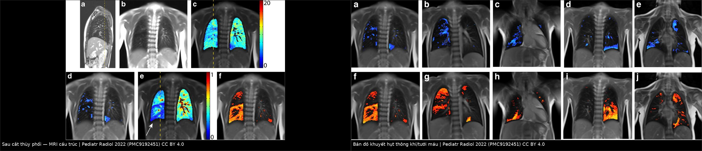
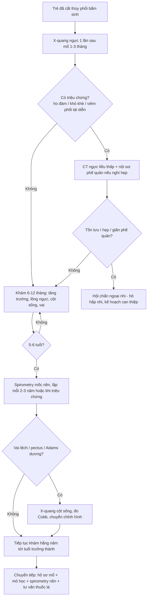
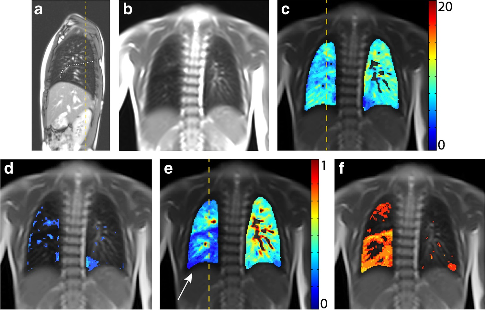
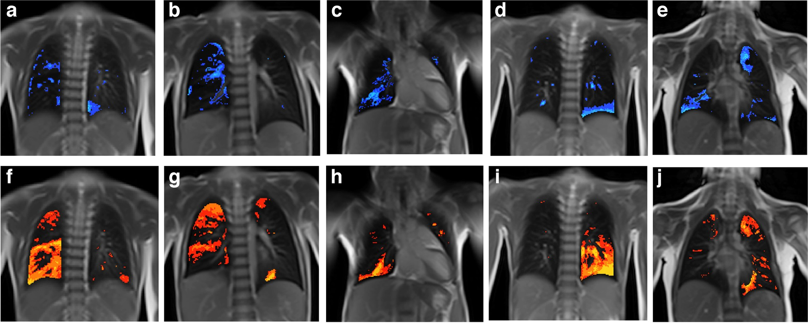

# 049 — Theo dõi dài hạn sau cắt thùy phổi bẩm sinh ở trẻ: phổi còn lại, vẹo cột sống & lịch chụp lại

**Tags:** `pattern:hau-mo` `pattern:qua-sang` `vung:phoi` `protocol:MRI-chuc-nang` `protocol:spirometry` `protocol:CT-lieu-thap` `anatomy:phoi-thuy`
**Mức chắc chắn (certainty):** tổng hợp y văn (literature synthesis) — số liệu từ loạt 56 trẻ hậu phẫu có theo dõi hô hấp (PMC13572718), so sánh cắt thùy vs cắt tiết kiệm nhu mô (PMC13314818), nghiên cứu MRI cấu trúc – chức năng ở tuổi học đường (PMC9192451) và khảo sát di chứng sau mở ngực ở trẻ (PMC3853854); **lịch theo dõi đề xuất ở mục 4 là suy luận của bài** (y văn chưa có đồng thuận), đã ghi rõ.

## 1. Tổng quan bệnh học – cơ chế hình ảnh

- **Bối cảnh:** trẻ đã **cắt thùy phổi** vì **dị dạng phổi bẩm sinh (congenital lung malformation — CLM)**: CPAM (bài 698), khí phế thũng thùy bẩm sinh/hẹp phế quản (bài 699), cách ly phổi (sequestration), nang phế quản. Câu hỏi của bài **không phải "mổ hay không"** mà là **"sau mổ thì theo dõi cái gì, bằng gì, bao lâu"**.
- **Sinh lý – vì sao phổi còn lại trông "khác thường" nhưng là bình thường:** sau cắt thùy, **thể tích lồng ngực bên mổ không giảm tương ứng** — phổi còn lại **giãn ra (expansion)** lấp khoảng trống, trung thất **dịch về bên mổ**, cơ hoành **cao lên**, các thùy còn lại **tăng thể tích**. Ở trẻ nhỏ, còn có **tăng sinh phế nang thật (compensatory growth)** trong vài năm đầu; ở trẻ lớn hơn, phần lớn là **giãn phế nang (distension)** hơn là tăng sinh (PMC9192451).
- **TẠI SAO MRI chức năng "bắt" được điều mà X-quang/CT không thấy:** vùng phổi giãn vào chỗ thùy đã cắt **thông khí và tưới máu tại chỗ giảm** — trên MRI, **bản đồ khuyết hụt thông khí (fractional ventilation defect)** và **khuyết hụt tưới máu (perfusion defect)** hiện vùng "nóng" đúng vị trí thùy đã cắt, trong khi phần phổi còn lại bình thường. Đây là **khiếm khuyết chức năng khu trú**, không phải tổn thương mới (PMC9192451).
- **Vì sao xét nghiệm chức năng hô hấp "bình thường" vẫn có thể có bất thường:** sau cắt thùy, **FVC và FEV₁ thường thấp hơn nhẹ** so với trẻ cùng tuổi nhưng vẫn trong **khoảng tham chiếu**; khi đo bằng **chỉ số thanh thải phổi (lung clearance index — LCI)** hoặc MRI chức năng, **bất thường đồng đều thông khí** vẫn lộ ra. Vì vậy đừng kết luận "ổn" chỉ dựa vào spirometry (PMC9192451).
- **Dịch tễ – những gì thực sự gặp khi theo dõi (số liệu để tư vấn phụ huynh):**
  - Loạt **56 trẻ** hậu phẫu CLM, theo dõi tới trung vị **54 tháng**: **vẹo cột sống 17,9%**, **biến dạng lồng ngực (pectus) 14,3%**; **chiều cao và cân nặng z-score bình thường** (−0,01 và −0,15); **spirometry gần bình thường** (FVC z = −0,77; FEV₁ z = −0,84) nhưng **chỉ 26,7% trẻ được đo** (PMC13572718).
  - Sau **mở ngực posterolateral** ở trẻ: **cánh tay xương bả vai nhô 5,7%**, **vai cao bên mổ 5,7%**, **sẹo dính vào khung xương 7,7%**, **thiểu sản cơ ngực 11,5%**, **dính sườn 5,7%**, **sườn dồn 9,6%**, **vẹo cột sống Cobb > 10° 1,9%** (PMC3853854).
  - **Cắt thùy vs cắt tiết kiệm nhu mô (lung-sparing)**: 31 trẻ, theo dõi trung vị **71 tháng** — **mổ lại 0% vs 33%** (p = 0,0207); **biến dạng thành ngực 22% vs 43%** (p = 0,36); biến chứng sớm 19% vs 44% (p = 0,20) (PMC13314818).
- **Nguy cơ dài hạn cần nhớ (lý do không được "mất theo dõi"):**
  - **Tồn lưu/tái phát tổn thương** khi cắt không trọn (đặc biệt cắt tiết kiệm nhu mô) → mổ lại (PMC13314818).
  - **Ác tính:** PPB (pleuropulmonary blastoma) có thể phát sinh trong **CPAM type 4** — type 4 thực chất là **PPB type I** (bài 698); **ung thư biểu mô nhầy (mucinous adenocarcinoma)** hiếm nhưng đã gặp trên nền CPAM type 1/2, có liên quan **KRAS** — trong loạt 56 trẻ có **2 ca CPAM + mucinous adenocarcinoma, 1 ca KRAS dương** (PMC13572718).
  - **Biến dạng cột sống – lồng ngực** tiến triển theo tăng trưởng, đặc biệt sau **mở ngực** và khi mổ lúc còn nhỏ (PMC3853854, PMC13572718).
  - **Bệnh phổi mạn/giãn phế quản quanh chỗ mổ**, tắc nghẽn phế quản do hẹp/mềm sụn, xẹp phổi tái diễn.

## 2. Mẫu hình + chẩn đoán phân biệt theo vị trí (gamut)

- **Mẫu hình "bình thường sau mổ":** *trung thất dịch về bên mổ, cơ hoành bên mổ cao, phổi còn lại tăng sáng và giãn vào khoang đã cắt, đường kẹp/staples thẳng, màng phổi dày mỏng đều, không có nang mới, không có nốt.*
- **Gamut theo hình ảnh "thùy/phổi tăng sáng sau mổ":**
  - **Giãn bù sinh lý** của phổi/thùy còn lại — **phổ biến nhất**, không can thiệp.
  - **Tồn lưu dị dạng** (CPAM còn phần nang, sequestration còn phần nhu mô bất thường) — có nang/nốt mới hoặc không giảm theo thời gian.
  - **Tắc nghẽn phế quản** (hẹp do sẹo, mềm sụn, dị vật, xoắn phổi) — tăng sáng + **mạch máu thưa, thể tích tăng**, có thể xẹp phổi từng đợt.
  - **Tràn khí màng phổi/bóng khí** sau mổ — màng phổi có khí, không có vách nang.
  - **Nhiễm trùng – áp-xe** quanh chỗ mổ — đông đặc, mức khí – dịch, sốt.
- **Gamut theo triệu chứng khi theo dõi:**
  - **Khò khè/hít vào kéo dài, một bên:** hẹp phế quản, mềm sụn, xoắn thùy còn lại.
  - **Ho đàm tái diễn:** giãn phế quản quanh chỗ mổ, tồn lưu dị dạng.
  - **Đau lưng – vai, vai cao, lệch vai:** biến dạng lồng ngực/vẹo cột sống.
  - **Không triệu chứng, chỉ "phổi tăng sáng" trên phim:** giãn bù — **không** chụp CT lặp tràn lan.
- **Mnemonic "GROW":** **G**iãn bù (bình thường) – **R**esidual (tồn lưu) – **O**bstruction (tắc nghẽn) – **W**all/spine (thành ngực, cột sống). Khi đọc phim sau mổ, luôn tự hỏi đủ 4 khả năng này trước khi kết luận.

## 3. Bảng so sánh phân biệt (ma trận đối chiếu)

| Tình huống | Hình ảnh | Chốt vào (rule-in) | Chốt loại (rule-out) | Gợi ý xác nhận |
|---|---|---|---|---|
| **Giãn bù sinh lý** | Phổi còn lại **tăng sáng, thể tích tăng**, trung thất dịch về bên mổ, cơ hoành cao; mạch máu **đều, mảnh**, không nang mới | **Đúng vị trí thùy đã cắt + không nang/nốt mới + trẻ không triệu chứng** | Có **nang mới, nốt, đông đặc** → tồn lưu/nhiễm trùng; thể tích **giảm** → xẹp | So phim cũ; **không cần CT** nếu không triệu chứng |
| **Tồn lưu dị dạng** | **Nang/nốt còn lại** trong thùy còn lại hoặc bờ cắt; kích thước **không giảm** theo thời gian | **Nang/nốt mới hoặc không thay đổi qua 2 lần chụp cách ≥ 6–12 tháng** | Phổi giãn bù thuần, không nang → không phải tồn lưu | **CT ngực liều thấp** khi có triệu chứng/nghi ngờ; đối chiếu mô học lần mổ |
| **Tắc nghẽn phế quản** | Tăng sáng **một thùy**, mạch máu **thưa**, thể tích **tăng**, có thể xẹp từng đợt; phim **thì thở ra** cho thấy khí bị giữ | **Tăng sáng + mạch thưa + khí giữ thì thở ra + khò khè một bên** | Mạch máu bình thường, không khí giữ → giãn bù | **CT thì hít – thở ra**, nội soi phế quản nếu nghi hẹp/dị vật |
| **Nhiễm trùng/áp-xe** | Đông đặc, **mức khí – dịch**, dày màng phổi khu trú, có thể rò phế quản – màng phổi | **Sốt + đông đặc/mức khí – dịch + bạch cầu tăng** | Không sốt, không đông đặc → giãn bù | X-quang/CT, cấy đàm, siêu âm màng phổi |
| **Biến dạng thành ngực – vẹo cột sống** | **Vai cao bên mổ, sườn dồn/dính sườn, pectus, Cobb > 10°** khi trẻ lớn | **Khám lâm sàng bất thường (Adams, vai lệch) ± Cobb > 10°** | Lồng ngực đối xứng, không lệch vai → theo dõi lâm sàng | Khám định kỳ; **X-quang cột sống** khi lâm sàng nghi; đo Cobb |
| **Ác tính (PPB/adenocarcinoma)** | **Nang nhiều vách tăng sinh, nốt đặc trong nang, khối mới**, tràn dịch | **Khối/nốt mới tăng dần + tiền sử CPAM type 4/1** | Nang ổn định, không thành phần đặc → lành | CT có cản quang, **chuyển ung thư nhi**; đối chiếu mô học |

*Trái: MRI cấu trúc — **thùy giữa giãn vào khoang thùy dưới phải đã cắt**, mạch máu trong vùng giãn thưa. Phải: **bản đồ khuyết hụt thông khí và tưới máu** — vùng "nóng" đúng vị trí thùy đã cắt, phần phổi còn lại bình thường. Nguồn: Willers C et al., Pediatric Radiology 2022 (PMC9192451) Fig. 1 và Fig. 6, CC BY 4.0. Ghép letterbox, không crop.*

## 4. Protocol chụp + hệ phân độ/điểm chuẩn hoá

- **Nguyên tắc:** theo dõi sau cắt thùy bẩm sinh là **theo dõi chức năng – tăng trưởng – thành ngực**, **không** phải chụp CT định kỳ. Y văn **chưa có lịch đồng thuận**; loạt lớn nhất chỉ đo được spirometry ở **26,7%** trẻ và kết luận cần **theo dõi hô hấp nhi có cấu trúc** (PMC13572718) — nên lịch dưới đây là **đề xuất thực hành (suy luận)**, cần cá thể hóa.
- **Đánh giá ngay sau mổ (trong 3 tháng):**
  - **X-quang ngực** 1 lần (hoặc khi có triệu chứng): kiểm tra **giãn bù, tràn khí, xẹp, mức dịch**; không chụp lặp nếu hồi phục bình thường.
  - **Siêu âm màng phổi** nếu còn dẫn lưu/nghi tụ dịch.
- **Theo dõi 1–5 tuổi:** khám lâm sàng **mỗi 6–12 tháng** — cân nặng, chiều cao, **ho/khò khè tái diễn, số đợt viêm phổi**, khám **lồng ngực – vai – cột sống** (tư thế, Adams). **Không chụp hình thường quy** nếu không triệu chứng.
- **Từ 5–6 tuổi (hợp tác được):** **spirometry** (FVC, FEV₁, FEV₁/FVC) làm **mốc nền**; lặp lại khi có triệu chứng hoặc mỗi 2–3 năm. Nhớ rằng **giá trị thấp nhẹ vẫn có thể bình thường** sau cắt thùy (FVC z −0,77; FEV₁ z −0,84) (PMC13572718).
- **Khi nào chụp CT ngực:** **có triệu chứng** (ho đàm kéo dài, khò khè một bên, viêm phổi tái diễn cùng bên), **nghi tồn lưu**, hoặc **bất thường mới trên X-quang** — dùng **CT liều thấp, không cản quang**, lớp 1 mm; **không** dùng CT làm xét nghiệm sàng lọc định kỳ.
- **Khi nào chụp MRI chức năng:** chỉ định **nghiên cứu/chuyên khoa** khi cần lượng hóa khiếm khuyết vùng (thông khí/tưới máu) hoặc giải thích triệu chứng không tương xứng; **không thay thế** spirometry trong thực hành thường (PMC9192451).
- **Cột sống – thành ngực:** khám lâm sàng mỗi lần tái khám; **X-quang cột sống** khi **vai lệch rõ, pectus tiến triển, hoặc Adams dương** — đo **Cobb**, so sánh các mốc tăng trưởng (PMC3853854, PMC13572718).
- **Chuyển tiếp (transition) sang người lớn:** bàn giao **hồ sơ mổ + mô học** (đặc biệt **CPAM type 1/4** vì nguy cơ ác tính), kết quả spirometry nền, và **khuyến cáo không hút thuốc** — nguy cơ adenocarcinoma trên nền CPAM là hiếm nhưng có thật (PMC13572718).

## 5. Biến thể bình thường và cạm bẫy

- **Cạm bẫy 1 — đọc "phổi tăng sáng" là tràn khí:** sau cắt thùy, phổi còn lại **giãn bù** trông rất sáng; phân biệt bằng **mạch máu còn đi vào vùng sáng** (giãn bù) với **màng phổi có khí, không mạch máu** (tràn khí).
- **Cạm bẫy 2 — tưởng trung thất bị đẩy sang bên lành:** sau cắt thùy, **trung thất dịch về bên mổ** là bình thường; chỉ lo khi **đẩy sang bên lành** (tràn dịch/khí nhiều, thoát vị).
- **Cạm bẫy 3 — đo Cobb trên phim xoay:** phim X-quang xoay làm Cobb sai lệch; chụp **thẳng, đứng, đúng tư thế**, đo trên phim **đứng** khi có chỉ định.
- **Cạm bẫy 4 — "spirometry bình thường = phổi bình thường":** FEV₁/FVC có thể bình thường nhưng **LCI tăng** và **MRI chức năng có khuyết hụt khu trú**; đừng bỏ theo dõi (PMC9192451).
- **Cạm bẫy 5 — quy mọi nốt mới là tái phát:** **hạt cùi/staples**, **dày màng phổi khu trú**, **xoẹp phổi** có thể giả nốt; cần **so phim cũ** và **CT mỏng** trước khi kết luận.
- **Cạm bẫy 6 — bỏ qua nguy cơ ác tính ở CPAM type 1/4:** tỉ lệ rất thấp nhưng **PPB type I = CPAM type 4**, và adenocarcinoma nhầy có thể xuất hiện muộn; khối/nốt **tăng dần** phải chuyển ung thư nhi (PMC13572718, bài 698).
- **Cạm bẫy 7 — chụp CT quá nhiều ở trẻ:** mỗi CT tích lũy liều; chỉ chụp khi **thay đổi xử trí**. Đây là lý do lịch theo dõi đặt **lâm sàng + spirometry** lên trước hình ảnh.
- **Biến thể bình thường cần biết:** **dày màng phổi mỏng, đều** vài mm sau mổ; **đường kẹp kim loại**; **cơ hoành cao nhẹ** bên mổ; **giảm nhẹ FVC** — tất cả có thể tồn tại suốt đời mà không cần can thiệp.

## 6. Tự lượng giá — Blind Quiz

**Ca 1 — Bé gái 7 tuổi, đã cắt thùy dưới phổi phải vì tổn thương hybrid (sequestration + CPAM type 1). MRI dưới đây.**

- Gợi ý lâm sàng: không triệu chứng, LCI 8,37 (tăng), spirometry trong giới hạn bình thường.
- Câu hỏi: mô tả vị trí thùy giãn (a, b)? Hai bản đồ chức năng (d, f) cho thấy gì và **vì sao spirometry vẫn bình thường**?

<b>Bấm để hiện đáp án (findings + chẩn đoán)</b>

- Dấu hiệu: (a, b) **thùy giữa giãn vào khoang thùy dưới phải đã cắt**, mạch máu trong vùng giãn thưa; (d) khuyết hụt thông khí **13,1% — trong giới hạn bình thường**; (f) khuyết hụt tưới máu **26,1% — tăng**, đúng vùng thùy giữa đã giãn vào (mũi tên trắng).
- Chẩn đoán: **giãn bù sau cắt thùy dưới phải**, khiếm khuyết **tưới máu khu trú** nhiều hơn thông khí.
- Vì sao spirometry bình thường: tổn thương **khu trú** ở vùng đã cắt, phần phổi còn lại bù được; **LCI tăng** phản ánh bất thường phân bố thông khí toàn bộ mà FEV₁ không bắt được.
- Ý nghĩa: **không can thiệp**; tiếp tục theo dõi lâm sàng – spirometry, không chụp CT định kỳ.
- Nguồn ảnh: Willers C et al., Pediatric Radiology 2022 (PMC9192451) Fig. 1, CC BY 4.0.

**Ca 2 — Năm trẻ sau cắt thùy phổi, bản đồ khuyết hụt thông khí (hàng trên) và tưới máu (hàng dưới).**

- Gợi ý lâm sàng: tất cả đều không triệu chứng ở tuổi học đường; một số có LCI tăng.
- Câu hỏi: vùng "nóng" trên bản đồ tương ứng với gì? Vì sao khuyết hụt **tưới máu** thường rõ hơn **thông khí**? Điều này nói gì về bản chất "giãn bù"?

<b>Bấm để hiện đáp án (findings + chẩn đoán)</b>

- Dấu hiệu: vùng **màu xanh (thông khí) và cam (tưới máu)** tập trung đúng **vùng thùy đã cắt** ở cả 5 trẻ; phần phổi còn lại gần như bình thường.
- Vì sao tưới máu rõ hơn: mô phổi giãn vào khoang trống **không có hệ mạch phát triển tương ứng** — giãn (distension) nhiều hơn tăng sinh thật; thông khí còn được bù nhờ đường thở bên.
- Bản chất "giãn bù": **thể tích lấp chỗ trống nhưng chức năng tại chỗ không hoàn hảo** — giải thích vì sao trẻ có thể gắng sức kém hơn dù spirometry bình thường.
- Ý nghĩa: dùng **MRI chức năng** khi cần giải thích triệu chứng; không thay spirometry trong theo dõi thường quy.
- Nguồn ảnh: Willers C et al., Pediatric Radiology 2022 (PMC9192451) Fig. 6, CC BY 4.0.

**Ca 3 — Trẻ 6 tuổi sau cắt thùy, khám định kỳ: vai phải cao hơn, lồng ngực hơi lép bên mổ. X-quang ngực bình thường, không triệu chứng hô hấp.**

- Gợi ý lâm sàng: bố mẹ lo "phổi bên mổ bị teo"; trẻ chơi thể thao bình thường.
- Câu hỏi: trả lời gia đình thế nào? Có cần CT ngực không? Cần làm gì tiếp theo để theo dõi cột sống?

<b>Bấm để hiện đáp án (findings + chẩn đoán)</b>

- Nhận định: **giãn bù sinh lý** — trung thất dịch nhẹ về bên mổ, cơ hoành cao, phổi còn lại giãn; **không** có nang/nốt mới, không đông đặc.
- Tư vấn: phổi **không teo** mà **giãn bù**; chức năng toàn bộ thường gần bình thường, nhưng **vùng đã cắt có khiếm khuyết tưới máu khu trú** (MRI chức năng) — không ảnh hưởng sinh hoạt.
- Có cần CT? **Không**, nếu không triệu chứng và X-quang ổn định; CT chỉ khi nghi tồn lưu/nhiễm trùng.
- Cột sống: **khám Adams + đo vai**, chụp **X-quang cột sống đứng** nếu lệch rõ; **vẹo cột sống gặp 17,9%** trong loạt theo dõi, phần lớn nhẹ (PMC13572718); tránh chụp lặp không cần thiết.
- Nguồn ảnh: Willers C et al., Pediatric Radiology 2022 (PMC9192451) Fig. 1 + Fig. 6, CC BY 4.0 (ảnh ghép).

## Bài liên quan chéo

- [698 – Nang phổi bẩm sinh CPAM/CCAM: Stocker, CVR & quyết định mổ](../698-nang-phoi-bam-sinh-cpam-ccam/lesson.md) — chỉ định mổ, type 4 = PPB type I
- [699 – Hẹp phế quản bẩm sinh & khí phế thũng thùy bẩm sinh](../699-hep-phe-quan-bam-sinh-va-khi-phe-thung-thuy/lesson.md) — nhóm bệnh lý cũng hay phải cắt thùy
- [601 – Tràn khí màng phổi tự phát ở trẻ lớn & VATS](../601-tran-khi-mang-phoi-tu-phat-tre-lon-vats/lesson.md) — biến chứng tràn khí, chỉ định mổ lại
- [079 – Tràn dịch dưỡng trấp (chylothorax)](../079-tran-dich-duong-trap-chylothorax/lesson.md) — biến chứng dẫn lưu kéo dài sau mổ ngực
- [617 – Hội chứng rò khí ở nhũ nhi](../617-hoi-chung-ro-khi-o-nhu-nhi/lesson.md) — biến chứng hô hấp kéo dài sau can thiệp ngực ở trẻ
- [610 – Suy hô hấp sơ sinh & dị dạng phổi](../610-suy-ho-hap-so-sinh-va-di-dang-phoi/lesson.md) — bối cảnh sơ sinh của nhóm bệnh lý phổi bẩm sinh

## Ảnh

- Tên file theo quy ước `NNN_slug_Modality_SourceID.jpg`; nguồn + giấy phép từng ảnh ở `images/CREDITS.md`.
- Cả hai ảnh gốc và ảnh ghép đều **CC BY 4.0** — **không crop**, giữ nguyên thang màu và nhãn của tác giả (thang màu là phần của dữ liệu, không được cắt bỏ).

> Không dùng để chẩn đoán độc lập khi chưa có người hướng dẫn.
