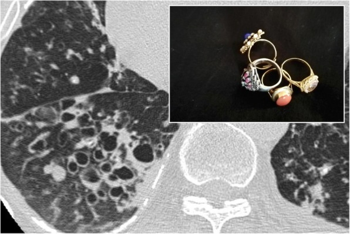
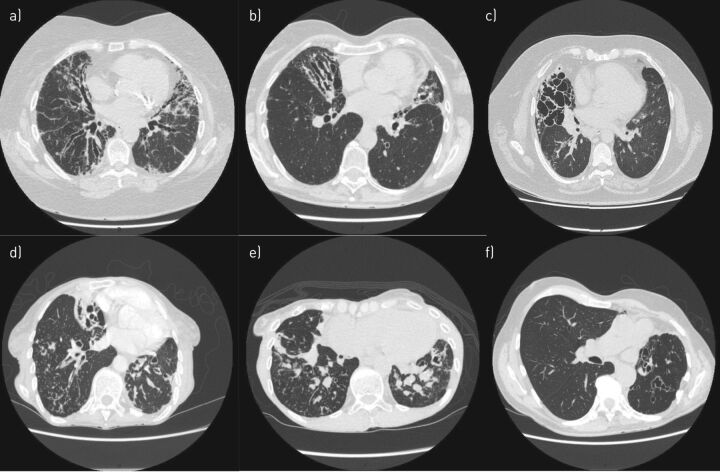
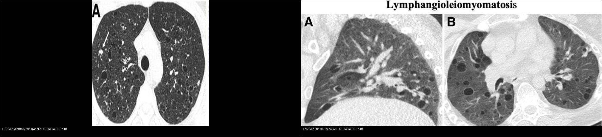
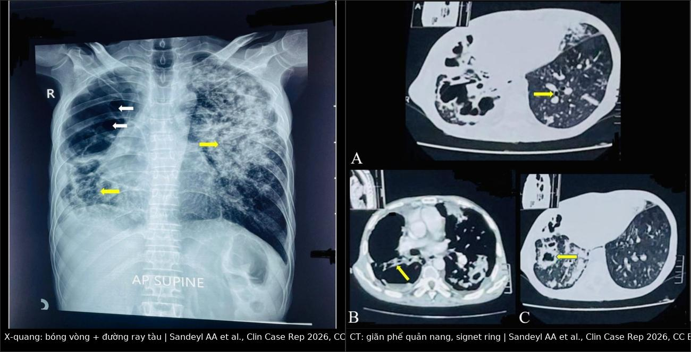
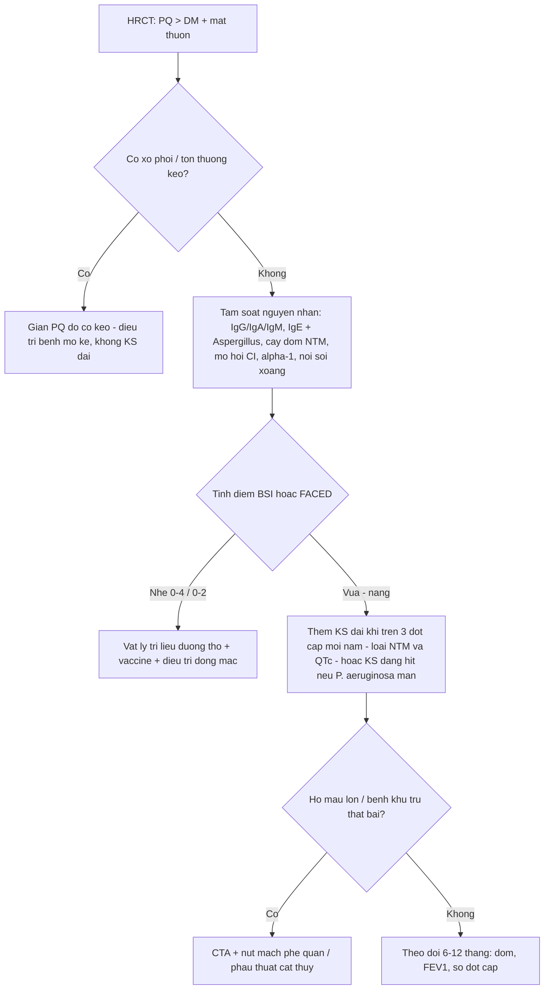
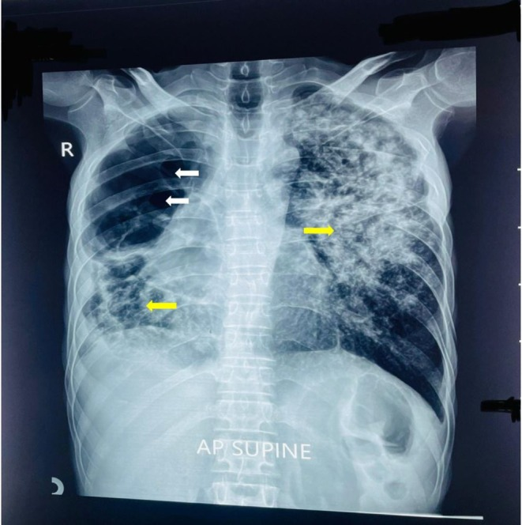
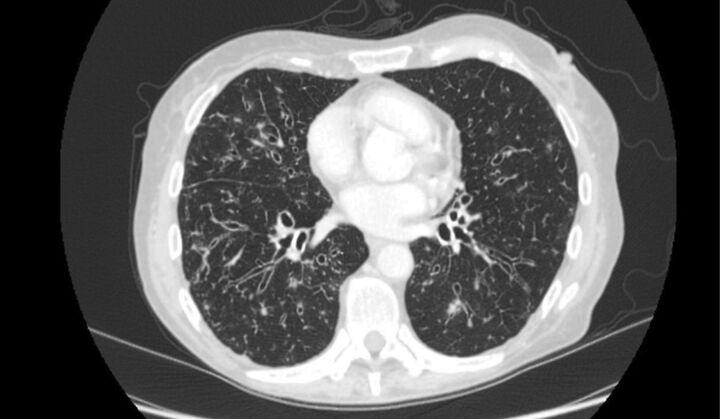

# 050 — Giãn phế quản người lớn: thể hình thái, nguyên nhân, phân độ nặng & kén khí / Bronchiectasis & Cystic lung

**Tags:** `pattern:gian-phe-quan` `pattern:ken-khi` `vung:duong-tho` `vung:phoi` `protocol:HRCT` `score:Reiff` `score:BSI` `score:FACED`
**Mức chắc chắn (certainty):** tổng hợp y văn (literature synthesis) — nhóm tự biên từ y văn mở (Eur Respir Rev 2018; Clin Case Rep 2026; Front Med 2026), chưa gắn ca nguyên văn đơn lẻ.

## 1. Tổng quan — PQ giãn khi nào, TẠI SAO giãn không hồi phục + ngưỡng nhẫn ngọc

- **Giãn phế quản (bronchiectasis):** giãn **không hồi phục** của phế quản (PQ) do phá hủy **sụn – cơ – sợi chun** thành PQ, kèm viêm mạn tính đường thở. Vòng xoáy bệnh sinh (Cole): **ứ nhầy → nhiễm khuẩn → bạch cầu trung tính + elastase/protease → phá thành → giãn thêm → ứ nhầy**.
- **TẠI SAO thấy nhẫn ngọc (signet-ring):** PQ và động mạch (ĐM) đi kèm bình thường **cùng cỡ và nhỏ dần ra ngoại vi**; khi sợi chun mất, PQ **không thuôn** nên mặt cắt ngang là **vòng lớn cạnh chấm ĐM nhỏ**. Nhẫn ngọc = **tỷ số phế quản–động mạch (broncho-arterial ratio) > 1,0** ở người lớn (trẻ em > 0,8; người già/vùng cao nguyên tới **1,5** vẫn có thể bình thường).
- Ba tiêu chuẩn HRCT (Naidich, dùng tới nay): **(1) PQ > ĐM kèm; (2) mất thuôn ra ngoại vi (lack of tapering); (3) thấy PQ cách màng phổi sườn < 1 cm**. Thêm **dày thành PQ > 0,5 mm** (hoặc > 1/3 đường kính lòng) là dấu viêm hoạt động.
- **TẠI SAO "đường ray tàu" (tram-track):** cắt **dọc** PQ giãn thành dày → hai đường song song; cắt **ngang** → nhẫn ngọc. Cùng một tổn thương, khác mặt cắt.
- **TẠI SAO thể nang:** phá hủy lan tới tiểu PQ + tụ mủ → các túi khí **chùm nho**, có thể có **mức khí–dịch**; thành mỏng nhưng không phải kén thật (kén thật ≤ 2 mm, bài này mục 2).
- **X-quang kém nhạy** (bóng vòng, đường ray tàu, dày thành) — **HRCT là chuẩn**; bình thường X-quang không loại trừ.

*PQ giãn thành dày cạnh ĐM cùng cỡ + hình nhẫn đối chiếu. Nguồn: Chiarenza et al., Insights into Imaging 2019 Fig. 30, CC BY 4.0.*

## 2. Mẫu hình + chẩn đoán phân biệt theo thể và theo vị trí (gamut)

### 2a. Theo hình thái — 3 thể của Reid (mức độ phá hủy tăng dần)

1. **Hình trụ (cylindrical/tubular):** PQ giãn đều, **thẳng, không thuôn**, đường ray tàu; mất thuôn là dấu sớm nhất.
2. **Dạng varicose (chuỗi hạt):** thành **phình từng đoạn rồi thắt** — "chuỗi ngọc/string of pearls"; đây là mốc **chuyển tiếp**, tiên lượng nặng hơn thể trụ.
3. **Dạng nang (cystic/saccular):** túi khí chùm nho, thành mỏng, thường có mức dịch; **thể nặng nhất**, hay kèm *P. aeruginosa*.

*Cùng một bài: a) thể trụ thùy dưới, b) varicose thùy dưới, c) thể nang thùy dưới phải, d) nang + tree-in-bud + nút nhầy, e) nút nhầy + tree-in-bud, f) varicose thùy trên và lưỡi. Nguồn: Contarini M, Finch S, Chalmers JD, Eur Respir Rev 2018 Fig. 5, CC BY-NC 4.0.*

### 2b. Theo phân bố → gợi ý nguyên nhân

- **Thùy trên ưu thế:** lao cũ (xơ đỉnh + co kéo), **xơ nang (CF)**, ABPA (nhưng **trung tâm**), bệnh phổi do thuốc/hít.
- **Thùy dưới ưu thế:** sau nhiễm (ho gà, sởi, virus), **vô căn (idiopathic)** hay gặp nhất ở đây, **viêm khớp dạng thấp**, bệnh ruột viêm, **hít sặc (phải dưới)**, suy giảm miễn dịch.
- **Trung tâm (quanh rốn phổi):** **ABPA** (nút nhầy "ngón tay trong găng"), **Mounier-Kuhn** (khí quản giãn > 30 mm ở nam / > 27 mm ở nữ).
- **Ngoại vi hai đáy, nền phổi xơ:** **giãn PQ do co kéo (traction)** — không phải giãn PQ nhiễm trùng; đừng gắn nhãn "bronchiectasis" rồi điều trị như bệnh đường thở.
- Sau khi tầm soát đủ (mục 4), **khoảng 1/4–1/3 ca vẫn vô căn** — ghi "vô căn" là chẩn đoán loại trừ, không phải bỏ qua tầm soát.

### 2c. Gamut kén khí (phần phân biệt với giãn PQ thể nang)

- **Kén tròn đều 2 phổi, nữ trẻ + tràn khí tái phát:** LAM (lan tỏa, không chừa vùng).
- **Kén kỳ dị + nốt, thùy trên, chừa đáy, hút thuốc:** LCH (nốt → kén theo thời gian, bỏ thuốc có thể lui).
- **Kén cạnh vách + tiền sử gia đình + u da/thận:** BHD (kén đáy, cạnh trung thất).
- **Vùng giảm đậm độ không thành + chấm ĐM trung tâm (central dot):** khí phế thũng trung tâm tiểu thùy, không phải kén.
- **Giãn PQ thùy giữa/lưỡi + hen + nút nhầy:** ABPA (finger-in-glove).

*Trái: LCH — kén hình thù kỳ dị ưu thế trên. Phải: LAM — kén tròn đều lan tỏa. Nguồn: Sousa et al., CC BY 4.0. Ảnh ghép letterbox (panel đã cắt có ghi rõ).*

## 3. Bảng so sánh phân biệt

| Thực thể (entity) | Hình ảnh điển hình (HRCT) | Chốt vào (rule-in) | Chốt loại (rule-out) | Gợi ý xác nhận |
|---|---|---|---|---|
| Giãn PQ thể trụ | **Nhẫn ngọc > 1,0**, mất thuôn, đường ray tàu, thành dày > 0,5 mm | **PQ > ĐM kèm + thấy PQ < 1 cm từ màng phổi** | PQ = ĐM và thuôn đều ra ngoại vi → bình thường | Đờm nuôi cấy, IgG/IgE, CT lặp sau 3–6 tháng |
| Giãn PQ dạng varicose | Thành **phình–thắt từng đoạn (chuỗi hạt)** | **Chuỗi hạt dọc PQ + nút nhầy** | PQ thẳng đều, không thắt → thể trụ | Như trên; tiên lượng nặng hơn thể trụ |
| Giãn PQ thể nang | **Chùm nang, thành mỏng, mức khí–dịch**, có khi mất thể tích thùy | **Chùm nang + mức dịch + *P. aeruginosa* mạn** | Nang ĐƠN ĐỘC thành mỏng không thông với cây PQ → kén thật | Cấy đờm (kể cả NTM), cân nhắc phẫu thuật nếu khu trú |
| Giãn PQ giả (pseudobronchiectasis) | PQ giãn **sau viêm phổi cấp**, thành dày, **hồi phục** | **Bệnh cảnh viêm phổi ≤ 3 tháng + không có bệnh sử ho khạc mạn** | Vẫn giãn sau 6 tháng → giãn thật | **CT lại sau 3–6 tháng** trước khi dán nhãn |
| Giãn PQ do co kéo (traction) | PQ giãn **trong vùng xơ**, bờ không đều, không nút nhầy | **Xơ + tổ ong + giãn PQ ngoại vi hai đáy** | Giãn PQ đơn thuần không xơ → nguyên phát | Đọc cùng mô kẽ (bài 035); điều trị bệnh xơ, không phải KS dài |
| ABPA | **Giãn PQ trung tâm** + nút nhầy ngón tay-găng, thùy trên | **IgE toàn phần ↑ + IgE/IgG *A. fumigatus* + hen** | Giãn PQ ngoại vi lan tỏa → không phải ABPA | IgE, RAST, thử corticoid |
| Mounier-Kuhn | **Khí quản > 30 mm (nam)/ > 27 mm (nữ)** + giãn PQ 2 đáy | **Khí quản giãn + túi thừa khí quản** | Khí quản bình thường < 27 mm | CT ngực không cản quang, đo đường kính |
| LCH | **Kén kỳ dị + nốt thùy trên, chừa đáy**, hút thuốc | **Nốt + kén trên + chừa đáy + hút thuốc** | Kén tròn đều lan tỏa nữ trẻ → LAM | Bỏ thuốc theo dõi lui; sinh thiết khi không điển hình |
| LAM | **Kén tròn đều mỏng lan tỏa 2 phổi**, nữ trẻ, tràn khí | **Nữ trẻ + kén đều + tràn khí tái phát** | Kén kỳ dị trên + hút thuốc → LCH | VEGF-D, sirolimus |
| Khí phế thũng TTT | **Vùng giảm đậm độ KHÔNG thành + chấm ĐM trung tâm**, trên | **Central dot + hút thuốc + không thành** | Có thành ≤ 2 mm → kén thật | Chức năng hô hấp, cai thuốc |
| Tổ ong (UIP) | Xếp tầng **dưới màng phổi đáy, chung vách dày** | **Tầng + đáy + vách dày** (nối bài 035) | Rải rác + thành mỏng → LAM/LCH | (nối bài 035) |

*Trái: X-quang — bóng vòng/đường ray tàu, mất thể tích trái, nhiều bóng khí. Phải: HRCT cùng ca — giãn PQ nang + bóng khí thùy trên trái, mũi tên vàng chỉ nhẫn ngọc. Nguồn: Sandeyl AA et al., Clin Case Rep 2026, CC BY 4.0. Ảnh ghép letterbox, không crop.*

## 4. Protocol chụp + phân độ nặng + điều trị

### 4a. Protocol HRCT đường thở

- **HRCT xoắn ốc lát mỏng 0,6–1,25 mm**, thì **hít vào tối đa**, cửa sổ phổi; **không cản quang** thường quy.
- Thêm **thì thở ra** khi nghi bệnh tiểu PQ (bẫy khí, mosaic) và **tư thế nằm sấp** khi nghi giãn PQ ở vùng phụ thuộc (phân biệt xẹp phụ thuộc).
- **CTA** chỉ khi: ho máu nhiều (tìm ĐM phế quản giãn/giả phình), nghi u, nghi thuyên tắc.
- Đo **broncho-arterial ratio** trên mặt cắt **ngang thật** của PQ (tránh cắt chéo); đếm **số thùy tổn thương** (6 thùy, lưỡi tính riêng).
- **Điểm Reiff (CT):** mỗi thùy 0 = không giãn, 1 = một PQ giãn, 2 = nhiều PQ giãn, 3 = thể nang → **tổng 0–18**; theo dõi tiến triển/đáp ứng.

### 4b. Phân độ nặng — chọn 1 thang, ghi rõ phiên bản

- **BSI (Bronchiectasis Severity Index, Chalmers 2014)** — 9 biến số: tuổi, BMI, FEV1 % dự đoán, số đợt cấp/năm, nhập viện trước đó, khó thở MRC, *P. aeruginosa* mạn, vi khuẩn khác, ≥ 3 thùy hoặc có nang. **0–4 nhẹ · 5–8 vừa · ≥ 9 nặng**.
- **FACED (Martínez-García 2014)** — 5 biến số, **0–7**: **F**EV1 (≥ 50% = 0; 30–49% = 1; < 30% = 2), **A**ge (< 70 = 0; ≥ 70 = 1), **C**olonization *P. aeruginosa* (1), **E**xtension ≥ 3 thùy **hoặc thể nang** (1), **D**yspnoea mMRC 0–2 = 0, 3–4 = 1. **0–2 nhẹ · 3–4 vừa · 5–7 nặng**.
- **Đợt cấp (exacerbation):** nặng lên **≥ 3 trong 6 triệu chứng** (ho, lượng đờm, mủ đờm, khó thở, khò khè, mệt) trong **≥ 48 giờ** và thầy thuốc quyết định dùng kháng sinh; **cấy đờm trước khi dùng KS**, điều trị **14 ngày** theo ERS 2017.

### 4c. Sơ đồ xử trí sau khi HRCT xác nhận

### 4d. Điều trị — ngưỡng cụ thể (ERS 2017 + cập nhật)

- **Vật lý trị liệu đường thở** 2 lần/ngày (kỹ thuật chu kỳ chủ động) — nền tảng ở **mọi** bệnh nhân có đờm.
- **Dung dịch ưu trương NaCl 7%** 4 mL × 2/ngày hoặc **mannitol** 400 mg hít khi đờm dai.
- **Kháng sinh dài hạn (macrolide):** cân nhắc khi **≥ 3 đợt cấp/năm** — azithromycin **250–500 mg × 3 ngày/tuần**; **loại trừ NTM trước**, kiểm tra **QTc** và thính lực.
- **Kháng sinh hít** (tobramycin, colistin) khi **P. aeruginosa mạn + ≥ 3 đợt cấp/năm**.
- **Ho máu lớn (> 300 mL/24 giờ hoặc > 100 mL/giờ):** CTA → **nút mạch phế quản** (nguồn ~90% từ ĐM phế quản giãn).
- **Phẫu thuật cắt thùy:** chỉ khi bệnh **khu trú một thùy**, thất bại điều trị nội khoa, hoặc ho máu tái diễn không nút được.
- Điều trị **nguyên nhân**: thay IgG, corticoid/kháng nấm trong ABPA, thuốc CFTR trong xơ nang; **vaccine cúm + phế cầu**.
- *Đang nổi:* **brensocatib** (ức chế DPP-1) — thử nghiệm ASPEN cho thấy giảm đợt cấp ở giãn PQ không do CF; **chưa thay thế** phác đồ chuẩn.

## 5. Biến thể bình thường và cạm bẫy

- **PQ cắt chéo** trông to giả — chỉ đo mặt cắt ngang thật, và **so với ĐM kèm** cùng lát.
- **Người già/vùng cao:** ratio tới **1,5** vẫn bình thường — đừng gọi giãn hàng loạt.
- **Thì thở ra / vùng phụ thuộc:** PQ và mô phổi xẹp phụ thuộc có thể giả giãn; chụp lại **hít vào + nằm sấp** trước khi kết luận.
- **Nhầy lấp PQ** giả nốt/khối — chụp lại sau vật lý trị liệu hoặc sau 4–6 tuần.
- **Giãn PQ sau viêm phổi (pseudobronchiectasis)** hồi phục trong **3–6 tháng** → luôn có mốc chụp lại trước khi gắn bệnh mạn tính.
- **Traction bronchiectasis bị gọi thành bronchiectasis:** không có nút nhầy, bờ ngoằn ngoèo, luôn kèm xơ — điều trị sai hướng nếu coi là bệnh nhiễm trùng đường thở.
- **Bỏ sót NTM** khi chỉ cấy 1 mẫu đờm — cần **2–3 mẫu** trước khi dùng macrolide dài hạn (nguy cơ kháng thuốc).

## 6. Tự lượng giá — Blind Quiz

**Ca 1 — Nam 60 tuổi, lao phổi điều trị không đầy đủ 6 năm, ho khạc đờm vàng hôi 3 tuần, khó thở tăng. Nhìn X-quang rồi CT, mô tả trước.**

- Hỏi: bóng vòng và đường ray tàu ở đâu? Mất thể tích bên nào? Cần chụp gì tiếp và tìm vi khuẩn nào?

<b>Bấm để hiện đáp án (findings + chẩn đoán)</b>

- **Findings:** mờ không đồng nhất + nhiều bóng khí/bóng vòng thùy trên trái, co kéo trung thất và mất thể tích trái; đường ray tàu hai đáy. HRCT cùng ca: **giãn PQ nang có nhẫn ngọc** (mũi tên vàng) + bóng khí lớn.
- **Chẩn đoán:** **giãn phế quản sau lao (post-TB structural lung disease) + đợt cấp nhiễm khuẩn**. Cấy đờm mọc ***P. aeruginosa*** + *S. pneumoniae*; điều trị KS theo kháng sinh đồ.
- **Vì sao:** lao phá hủy sụn–sợi chun thành PQ và gây xơ co kéo → giãn không hồi phục; đờm vàng hôi = nhiễm khuẩn hoạt động, không phải di chứng đơn thuần.
- Nguồn ảnh: Sandeyl AA et al., Clin Case Rep 2026, CC BY 4.0 (ca 60 tuổi, lao 6 năm).

**Ca 2 — HRCT: PQ giãn + nốt trung tâm tiểu thùy dạng cành cây. Phân loại thể và gợi ý nguyên nhân.**

- Hỏi: thể giãn PQ nào? Dấu "nụ trên cành" nói gì về hoạt tính bệnh?

<b>Bấm để hiện đáp án</b>

- **Thể trụ** (PQ thẳng, không thuôn, thành dày) + **tree-in-bud** hai đáy và thùy giữa.
- Tree-in-bud = **mủ/nhầy lấp tiểu PQ** → bệnh **đang hoạt động**, cần cấy đờm (lao, MAC, *H. influenzae*) và tăng vật lý trị liệu; không phải "sẹo cũ".
- Nguồn ảnh: Contarini M et al., Eur Respir Rev 2018 Fig. 4, CC BY-NC 4.0.

**Ca 3 — Cùng một bài có 6 panel HRCT. Hãy xếp mỗi panel vào thể trụ / varicose / nang trước khi mở đáp án.**

- Hỏi: panel nào là thể nang? Panel nào có nút nhầy? Thể nào tiên lượng nặng nhất?

<b>Bấm để hiện đáp án</b>

- a) thể trụ thùy dưới · b) **varicose** thùy dưới · c) **thể nang** thùy dưới phải · d) nang + tree-in-bud + nút nhầy (có hang thùy dưới phải) · e) nút nhầy + tree-in-bud · f) varicose thùy trên và lưỡi.
- **Thể nang tiên lượng nặng nhất**: phá hủy nhiều nhất, hay kèm *P. aeruginosa* mạn, Reiff cao hơn và đợt cấp nhiều hơn.
- Nguồn ảnh: Contarini M, Finch S, Chalmers JD, Eur Respir Rev 2018 Fig. 5, CC BY-NC 4.0.

## Bài liên quan chéo
- [001 – Tổng quan hệ Ngực](../001-tong-quan-he-nguc/lesson.md)
- [031 – Viêm phổi mẫu hình](../031-viem-phoi-mau-hinh/lesson.md) (tree-in-bud, lao)
- [035 – Xơ mô kẽ UIP vs NSIP](../035-xo-mo-ke-UIP-NSIP/lesson.md) (tổ ong vs kén, traction)
- [051 – Tiểu phế quản & khảm tưới máu](../051-tieu-phe-quan/lesson.md)
- [052 – Khí phế thũng vs đa kén khí](../052-khi-phe-thung-kem/lesson.md)
- [040 – Tràn dịch màng phổi](../040-tran-dich-mang-phoi/lesson.md) (biến chứng mủ màng phổi)

> Không dùng để chẩn đoán độc lập khi chưa có người hướng dẫn.
