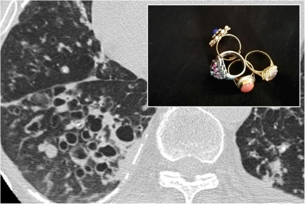
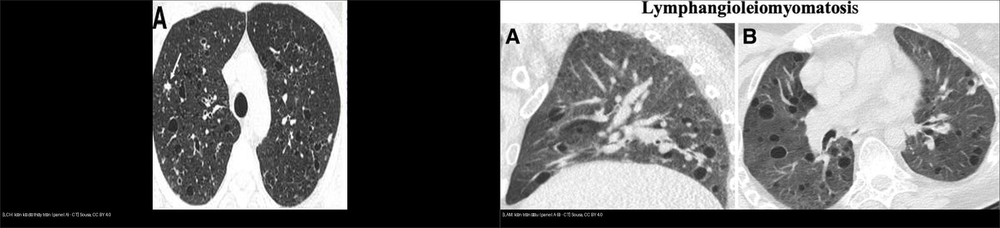
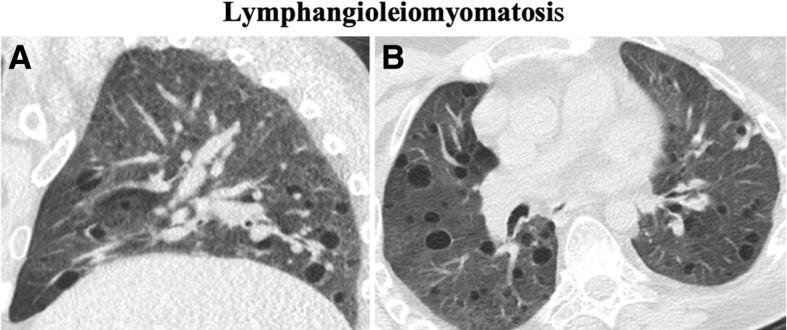

# 050 — Giãn phế quản, tree-in-bud & kén khí / Bronchiectasis, Tree-in-bud & Cystic lung

**Tags:** `pattern:gian-phe-quan` `pattern:ken-khi` `vung:duong-tho`
**Mức chắc chắn (certainty):** tổng hợp y văn (literature synthesis) — nhóm tự biên từ y văn mở, chưa gắn ca nguyên văn đơn lẻ.

## 1. Tổng quan — PQ giãn khi nào + ngưỡng nhẫn ngọc

- **Giãn phế quản (bronchiectasis):** thành PQ viêm/phá hủy → giãn không hồi phục. TẠI SAO thấy nhẫn ngọc (signet-ring): PQ và động mạch đi kèm bình thường **cùng cỡ**; PQ giãn → vòng lớn cạnh chấm nhỏ.
- Ngưỡng định lượng: tỷ số đường kính trong PQ / động mạch kèm (**broncho-arterial ratio**) **> 1,0** (người cao tuổi/vùng cao > 1,5 mới gọi); hoặc **mất thuôn nhỏ ra ngoại vi** (lack of tapering), hoặc thấy PQ cách màng phổi sườn **< 1 cm**.
- **Tree-in-bud (nụ trên cành):** nốt trung tâm tiểu thùy + nhánh nối — mủ/nhầy lấp tiểu PQ: lao, MAC, viêm tiểu PQ lan, hít.
- **Kén thật (true cyst):** khoang khí **có thành biểu mô mỏng ≤ 2 mm** — khác khí phế thũng (không thành) và tổ ong (chung vách dày, xếp tầng — bài 035).

*PQ giãn thành dày cạnh ĐM cùng cỡ + hình nhẫn đối chiếu. Nguồn: Chiarenza et al., Insights into Imaging 2019 Fig. 30, CC BY 4.0.*

## 2. Gamut kén khí theo hình + phân bố + đối tượng

- **Kén tròn đều 2 phổi, nữ trẻ + tràn khí tái phát:** LAM (chừa... lan tỏa, không chừa vùng).
- **Kén kỳ dị + nốt, thùy trên, chừa đáy, hút thuốc:** LCH (nốt → kén theo thời gian, bỏ thuốc có thể lui).
- **Kén cạnh vách + tiền sử gia đình + u da/thận:** BHD (kén đáy-cạnh trung thất).
- **Vùng giảm đậm độ không thành + chấm ĐM trung tâm (central dot):** khí phế thũng trung tâm tiểu thùy (hút thuốc), không phải kén.
- **Giãn PQ thùy giữa/lưỡi + hen + nhầy:** ABPA (ngón tay-găng finger-in-glove).

*Trái: LCH — kén hình thù kỳ dị ưu thế trên. Phải: LAM — kén tròn đều lan tỏa. Nguồn: Sousa et al., CC BY 4.0. Ảnh ghép letterbox (panel đã cắt có ghi rõ).*

## 3. Bảng so sánh phân biệt

| Thực thể (entity) | Hình ảnh điển hình (HRCT) | Chốt vào (rule-in) | Chốt loại (rule-out) | Gợi ý xác nhận |
|---|---|---|---|---|
| Giãn PQ (bronchiectasis) | **Nhẫn ngọc > 1,0** + mất thuôn + dày thành, tram-track | **PQ > ĐM kèm + PQ < 1 cm từ màng phổi** | PQ = ĐM + thuôn đều → bình thường | Nguyên nhân: ABPA/IgE, CF, lao cũ, suy giảm miễn dịch |
| LCH | **Kén kỳ dị + nốt thùy trên, chừa đáy**, hút thuốc | **Nốt + kén trên + chừa đáy + hút thuốc** | Kén tròn đều lan tỏa nữ trẻ → LAM | Bỏ thuốc theo dõi lui; sinh thiết khi không điển hình |
| LAM | **Kén tròn đều mỏng lan tỏa 2 phổi**, nữ trẻ, tràn khí | **Nữ trẻ + kén đều + tràn khí tái phát** | Kén kỳ dị trên + hút thuốc → LCH | VEGF-D, sirolimus |
| Khí phế thũng TTT | **Vùng giảm đậm độ KHÔNG thành + chấm ĐM trung tâm**, trên | **Central dot + hút thuốc + không thành** | Có thành ≤ 2 mm → kén thật | Chức năng hô hấp, cai thuốc |
| Tổ ong (UIP) | Xếp tầng **dưới màng phổi đáy, chung vách dày** | **Tầng + đáy + vách dày** (nối bài 035) | Rải rác + thành mỏng → LAM/LCH | (nối bài 035) |

## 4. Protocol HRCT đường thở

- Lát mỏng 1–1,5 mm + **thì thở ra** (bẫy khí: viêm tiểu PQ, HP) + coronal/sagittal (phân bố trên-dưới).
- Đo broncho-arterial ratio ở mặt cắt ngang PQ (tránh đo chéo gây giả to).
- Nghi ABPA: IgE toàn phần + precipitins; nghi CF: mồ hôi Cl−/gen.

## 5. Cạm bẫy

- **PQ cắt chéo** trông to giả — chỉ đo mặt cắt ngang thật.
- **Người già/vùng cao:** ratio tới 1,5 vẫn bình thường — đừng gọi giãn hàng loạt.
- **Nhầy lấp PQ** giả nốt/khối — chụp lại sau ho khạc/vật lý trị liệu.
- **Kén BHD cạnh trung thất** dễ bỏ sót — cuộn coronal toàn bộ.

## 6. Tự lượng giá — Blind Quiz

**Ca 1 — Ho khạc mạn, đợt cấp tái diễn. Nhìn HRCT, mô tả trước.**

- Hỏi: vòng lớn cạnh chấm nhỏ là gì? Ratio bao nhiêu? Chẩn đoán + tìm nguyên nhân gì?

<b>Bấm để hiện đáp án</b>

- **Giãn phế quản:** dấu nhẫn ngọc (PQ giãn + ĐM kèm), mất thuôn, dày thành — đo ratio > 1,0. Tìm ABPA (IgE), lao cũ, suy giảm miễn dịch.
- Nguồn: Chiarenza et al., Fig. 30, CC BY 4.0.

**Ca 2 — Nữ trẻ, tràn khí tái phát 2 lần:**

<b>Bấm để hiện đáp án</b>

- **LAM:** kén tròn đều mỏng lan tỏa 2 phổi ở nữ trẻ + tràn khí tái phát — khác LCH (kỳ dị, trên, hút thuốc).
- Nguồn: Sousa et al., Fig. 14 panel A–B (đã cắt bỏ phần BHD), CC BY 4.0.

## Bài liên quan chéo
- [001 – Tổng quan hệ Ngực](../001-tong-quan-he-nguc/lesson.md)
- [031 – Viêm phổi mẫu hình](../031-viem-phoi-mau-hinh/lesson.md) (tree-in-bud, lao)
- [035 – Xơ mô kẽ UIP vs NSIP](../035-xo-mo-ke-UIP-NSIP/lesson.md) (tổ ong vs kén)

> Không dùng để chẩn đoán độc lập khi chưa có người hướng dẫn.
