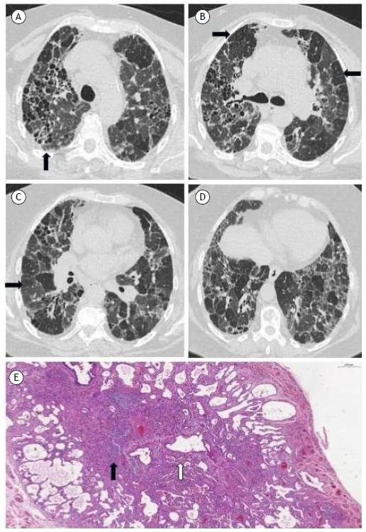
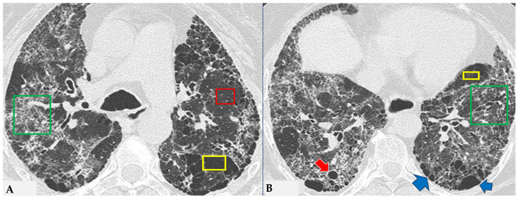
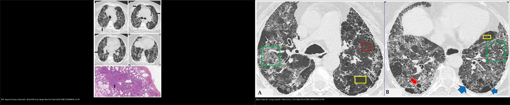

# 051 — Tiểu phế quản & khảm tưới máu / Small airways & Mosaic attenuation

**Tags:** `pattern:tieu-phe-quan` `vung:duong-tho` `protocol:HRCT-tho-ra`
**Mức chắc chắn (certainty):** tổng hợp y văn (literature synthesis) — nhóm tự biên từ y văn mở, chưa gắn ca nguyên văn đơn lẻ.

## 1. Tổng quan — bẫy khí thì thở ra là chốt + 3 màu khảm

- **Bẫy khí (air-trapping):** tiểu PQ tắc → khí vào không ra — chỉ hiện **thì thở ra** (vùng đen còn lại giữa phổi xẹp). Hít vào bình thường giả.
- **Khảm tưới máu (mosaic):** 3 đậm độ — đen (bẫy khí/kém tưới), xám (bình thường), trắng (kính mờ/tăng tưới bù). TẠI SAO mạch nhỏ lại ở vùng đen trong bẫy khí: thiếu oxy nang → **co mạch bù (hypoxic vasoconstriction)**.
- Ngưỡng: thì thở ra chuẩn (hết sức), lát mỏng 1–1,5 mm; so hít vào-thở ra cùng mặt cắt.

*Nốt mờ trung tâm tiểu thùy ở người hút thuốc (RB-ILD). Nguồn: Sousa et al., Insights into Imaging 2019 Fig. 15, CC BY 4.0.*

*HP xơ (FHP) trên HRCT. (A) giãn phế quản + biến dạng cấu trúc ưu thế quanh tiểu phế quản (mũi tên); (B) **vùng bẫy khí (bẫy khí — mũi tên đen)**; (C) vùng phổi bình thường xen giữa vùng bệnh và vùng bẫy khí; (D) **mẫu ba đậm độ (three-density pattern)**; (E) mô bệnh học (xơ vách và quanh tiểu phế quản). Nguồn: Bridi GDP et al., Respir Res Clin Pract 2026 (PMC13598884), Fig. 2, CC BY.*

## 2. Gamut khảm theo cơ chế

- **Đường thở (bẫy khí):** HP, viêm tiểu PQ, hen/COPD — đen không đổi + mạch nhỏ, thì thở ra.
- **Mạch máu (kém tưới):** thuyên tắc mạn (mạch to + khảm), tăng áp phổi.
- **Nhu mô (kính mờ):** NSIP/HP bán cấp, xuất huyết — trắng + mạch bình thường/to.
- **RB-ILD/DIP (hút thuốc):** nốt trung tâm + kính mờ trên, bỏ thuốc lui một phần.

*Mẫu ba đậm độ trong HP xơ. **Ô đỏ** = phổi đậm độ bình thường còn được chừa; **ô vàng** = vùng giảm đậm độ với **thưa mạch và phế quản (paucity of vessels)** = bẫy khí; **ô xanh** = vùng tăng đậm độ có lưới/xơ. Kèm nang phổi (mũi tên đỏ) và khí phế thũng cạnh vách/thể phá hủy tiến triển (ADE, mũi tên xanh). Nguồn: Rea G et al., J Clin Med 2024 (PMC10856167), Fig. 5, CC BY.*

*Trái: HP xơ — bẫy khí và mẫu ba đậm độ (B/D). Phải: mẫu ba đậm độ — vùng ít mạch xen kẽ vùng lưới/xơ. Chốt: **vùng giảm đậm độ + mạch nhỏ lại = bẫy khí**; đối chiếu thì hít vào-thở ra để xác nhận. Ảnh ghép letterbox giữ nguyên tỷ lệ. Nguồn: Bridi GDP et al. (PMC13598884) + Rea G et al. (PMC10856167), CC BY.*

## 3. Bảng đọc khảm

| Cơ chế | Vùng đen (thở ra) | Mạch trong vùng đen | Vùng trắng kèm | Ví dụ |
|---|---|---|---|---|
| Bẫy khí (đường thở) | Không đổi, ranh giới rõ | **Nhỏ lại** | Kính mờ bù vùng khác | HP, viêm tiểu PQ |
| Kém tưới (mạch) | Theo vùng mạch | **Mạch to/cụt** | Tăng tưới bù | PE mạn, tăng áp |
| Nhu mô (kính mờ) | — (trắng là bệnh) | Bình thường/to | Nốt trung tâm | NSIP, RB-ILD |

## 4. Protocol HRCT tiểu PQ

- **Hít vào + thở ra** cùng mặt cắt (so sánh trực tiếp); MIP mỏng (nốt trung tâm) + MinIP (bẫy khí).
- HP: hỏi kháng nguyên (chim, nấm, bể sục) + BAL lympho + tránh tiếp xúc (lui được).
- RB-ILD: cai thuốc là điều trị đầu tay.

## 5. Cạm bẫy

- **Thở ra không hết sức** giả bẫy khí lan tỏa — hướng dẫn BN + kiểm tra vòm hoành nâng lên.
- **Xẹp đáy** giả kính mờ vùng trắng — prone xác nhận.
- **HP mạn xơ** lẫn UIP — bẫy khí + chừa đáy gợi HP (nối bài 035).

## 6. Tự lượng giá — Blind Quiz

**Ca 1 — Hút thuốc + nốt mờ lan tỏa trên. Mô tả phân bố.**

- Hỏi: nốt trung tâm hay ngẫu nhiên? Có chạm màng không? Cai thuốc có lui?

<b>Bấm để hiện đáp án</b>

- **RB-ILD:** nốt trung tâm tiểu thùy + kính mờ trên ở người hút thuốc, chừa màng — cai thuốc lui một phần.
- Nguồn: Sousa et al., Fig. 15, CC BY 4.0.

**Ca 2 — Khảm ba màu trên HRCT. Đọc các ô màu và gọi tên cơ chế.**

- Gợi ý: bệnh nhân HP xơ; HRCT thì hít vào.
- Hỏi: ba ô (đỏ/vàng/xanh) tương ứng vùng nào? Vùng "ít mạch" nói lên điều gì? Diễn giải với thì thở ra?

<b>Bấm để hiện đáp án</b>

- Dấu hiệu (findings): **ô đỏ** = vùng đậm độ bình thường còn được chừa; **ô vàng** = vùng **giảm đậm độ, thưa mạch và phế quản** (bẫy khí); **ô xanh** = vùng **tăng đậm độ có lưới/xơ**.
- Chẩn đoán/lý giải: **mẫu ba đậm độ (three-density pattern)** của HP xơ. **Vùng giảm đậm độ + mạch nhỏ lại = bẫy khí (air trapping)** do tắc tiểu phế quản → đối chiếu **thì thở ra** thấy vùng này không đổi/đen hơn (các vùng khác xẹp lại).
- Nguồn ảnh: Rea G et al., J Clin Med 2024 (PMC10856167), Fig. 5, CC BY.

**Ca 3 — So sánh hai ca: bên nào nhấn bẫy khí, bên nào nhấn vùng ít mạch? Chốt phân biệt?**

- Gợi ý: cùng cơ chế tiểu phế quản tắc nhưng khác cách bộc lộ.
- Hỏi: Dấu hiệu nào chốt bẫy khí? Phân biệt với khảm tưới máu (mạch) thế nào?

<b>Bấm để hiện đáp án</b>

- Trái: HP xơ — vùng **bẫy khí** và mẫu ba đậm độ. Phải: **mẫu ba đậm độ** với vùng ít mạch xen vùng lưới.
- Chốt (clincher): **giảm đậm độ + mạch NHỎ lại = bẫy khí đường thở** (khác khảm tưới máu do mạch — mạch TO/cụt); xác nhận bằng **thì thở ra** (vùng đen không đổi).
- Nguồn ảnh: ghép Fig. 2 (PMC13598884) + Fig. 5 (PMC10856167), đều CC BY (ghép letterbox, giữ nguyên tỷ lệ).

## Bài liên quan chéo
- [001 – Tổng quan hệ Ngực](../001-tong-quan-he-nguc/lesson.md)
- [011 – Tiểu thùy thứ cấp](../011-tieu-thuy-phoi/lesson.md) (trung tâm tiểu thùy)
- [021 – Đa nốt phổi](../021-da-not-phoi/lesson.md) (nốt trung tâm)
- [050 – Giãn PQ & kén khí](../050-gian-phe-quan-ken-khi/lesson.md)

> Không dùng để chẩn đoán độc lập khi chưa có người hướng dẫn.
