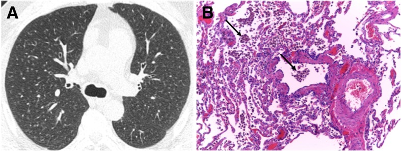

# 051 — Tiểu phế quản & khảm tưới máu / Small airways & Mosaic attenuation

**Tags:** `pattern:tieu-phe-quan` `vung:duong-tho` `protocol:HRCT-tho-ra`
**Mức chắc chắn (certainty):** tổng hợp y văn (literature synthesis) — nhóm tự biên từ y văn mở, chưa gắn ca nguyên văn đơn lẻ.

## 1. Tổng quan — bẫy khí thì thở ra là chốt + 3 màu khảm

- **Bẫy khí (air-trapping):** tiểu PQ tắc → khí vào không ra — chỉ hiện **thì thở ra** (vùng đen còn lại giữa phổi xẹp). Hít vào bình thường giả.
- **Khảm tưới máu (mosaic):** 3 đậm độ — đen (bẫy khí/kém tưới), xám (bình thường), trắng (kính mờ/tăng tưới bù). TẠI SAO mạch nhỏ lại ở vùng đen trong bẫy khí: thiếu oxy nang → **co mạch bù (hypoxic vasoconstriction)**.
- Ngưỡng: thì thở ra chuẩn (hết sức), lát mỏng 1–1,5 mm; so hít vào-thở ra cùng mặt cắt.

*Nốt mờ trung tâm tiểu thùy ở người hút thuốc (RB-ILD). Nguồn: Sousa et al., Insights into Imaging 2019 Fig. 15, CC BY 4.0.*

## 2. Gamut khảm theo cơ chế

- **Đường thở (bẫy khí):** HP, viêm tiểu PQ, hen/COPD — đen không đổi + mạch nhỏ, thì thở ra.
- **Mạch máu (kém tưới):** thuyên tắc mạn (mạch to + khảm), tăng áp phổi.
- **Nhu mô (kính mờ):** NSIP/HP bán cấp, xuất huyết — trắng + mạch bình thường/to.
- **RB-ILD/DIP (hút thuốc):** nốt trung tâm + kính mờ trên, bỏ thuốc lui một phần.

## 3. Bảng đọc khảm

| Cơ chế | Vùng đen (thở ra) | Mạch trong vùng đen | Vùng trắng kèm | Ví dụ |
|---|---|---|---|---|
| Bẫy khí (đường thở) | Không đổi, ranh giới rõ | **Nhỏ lại** | Kính mờ bù vùng khác | HP, viêm tiểu PQ |
| Kém tưới (mạch) | Theo vùng mạch | **Mạch to/cụt** | Tăng tưới bù | PE mạn, tăng áp |
| Nhu mô (kính mờ) | — (trắng là bệnh) | Bình thường/to | Nốt trung tâm | NSIP, RB-ILD |

## 4. Protocol HRCT tiểu PQ

- **Hít vào + thở ra** cùng mặt cắt (so sánh trực tiếp); MIP mỏng (nốt trung tâm) + MinIP (bẫy khí).
- HP: hỏi kháng nguyên (chim, nấm, bể sục) + BAL lympho + tránh tiếp xúc (lui được).
- RB-ILD: cai thuốc là điều trị đầu tay.

## 5. Cạm bẫy

- **Thở ra không hết sức** giả bẫy khí lan tỏa — hướng dẫn BN + kiểm tra vòm hoành nâng lên.
- **Xẹp đáy** giả kính mờ vùng trắng — prone xác nhận.
- **HP mạn xơ** lẫn UIP — bẫy khí + chừa đáy gợi HP (nối bài 035).

## 6. Tự lượng giá — Blind Quiz

**Ca 1 — Hút thuốc + nốt mờ lan tỏa trên. Mô tả phân bố.**

- Hỏi: nốt trung tâm hay ngẫu nhiên? Có chạm màng không? Cai thuốc có lui?

<b>Bấm để hiện đáp án</b>

- **RB-ILD:** nốt trung tâm tiểu thùy + kính mờ trên ở người hút thuốc, chừa màng — cai thuốc lui một phần.
- Nguồn: Sousa et al., Fig. 15, CC BY 4.0.

**Ca 2 — Khảm 3 màu + vùng đen không đổi thì thở ra + mạch nhỏ:** cơ chế nào? Bệnh gì? *(Bảng mục 3.)*

<b>Bấm để hiện đáp án</b>

- **Bẫy khí đường thở (HP/viêm tiểu PQ):** đen + mạch nhỏ + thở ra — hỏi kháng nguyên + BAL.

## Bài liên quan chéo
- [001 – Tổng quan hệ Ngực](../001-tong-quan-he-nguc/lesson.md)
- [011 – Tiểu thùy thứ cấp](../011-tieu-thuy-phoi/lesson.md) (trung tâm tiểu thùy)
- [021 – Đa nốt phổi](../021-da-not-phoi/lesson.md) (nốt trung tâm)
- [050 – Giãn PQ & kén khí](../050-gian-phe-quan-ken-khi/lesson.md)

> Không dùng để chẩn đoán độc lập khi chưa có người hướng dẫn.
