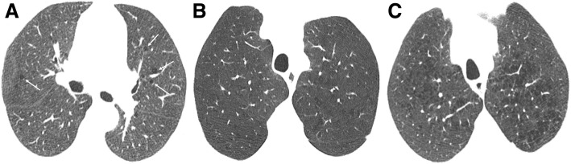
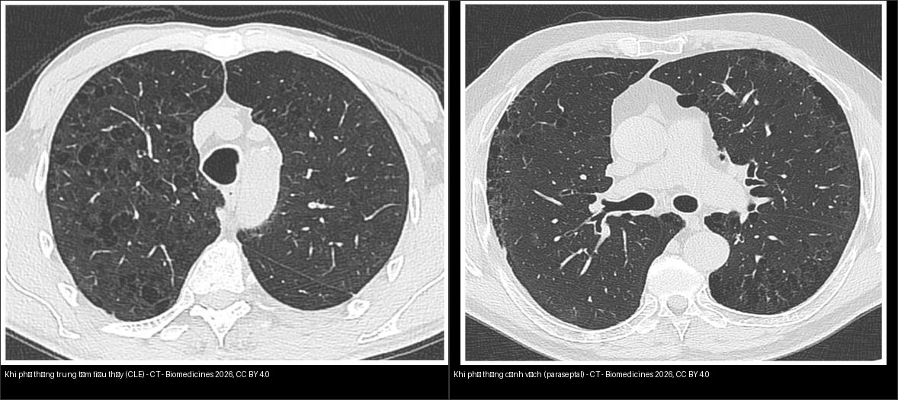
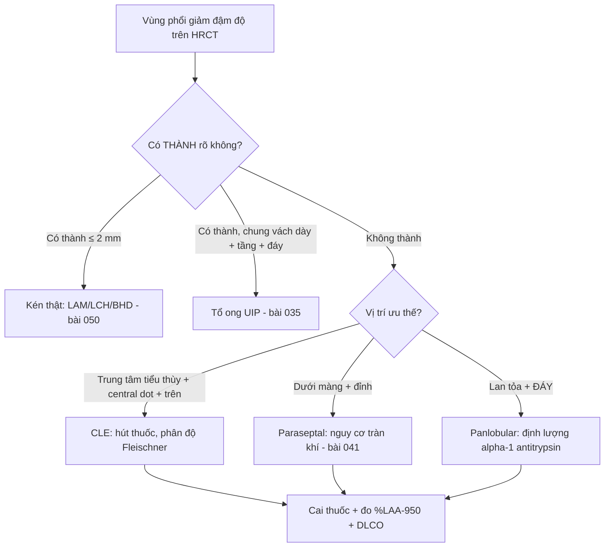
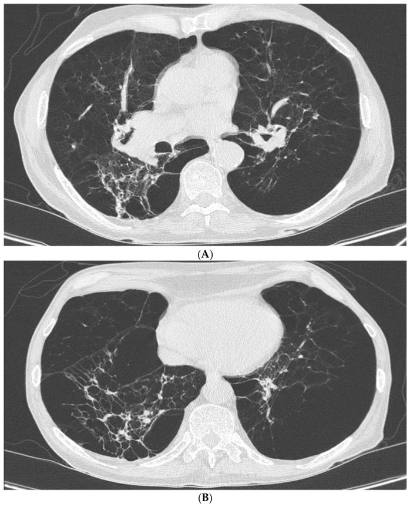

# 052 — Khí phế thũng vs đa kén khí / Emphysema vs Cystic lung diseases

**Tags:** `pattern:qua-sang` `vung:phoi` `protocol:HRCT-hit-tho-ra` `score:Fleischner-CLE`
**Mức chắc chắn (certainty):** tổng hợp y văn (literature synthesis) — nhóm tự biên từ y văn mở (Insights into Imaging, Biomedicines, Diagnostics), có ca minh họa giấy phép CC BY.

## 1. Tổng quan — không thành vs có thành + phân độ Fleischner CLE

- **Khí phế thũng (emphysema):** giãn bất thường khoang khí phía sau tiểu phế quản tận **do phá hủy vách phế nang** → vùng giảm đậm độ **KHÔNG có thành** thật. **Kén khí (cyst):** khoảng khí **CÓ thành** (biểu mô/xơ) rõ, thường **≤ 2 mm** (LAM/LCH/BHD — bài `050`). **Tổ ong (honeycombing):** kén **chung vách dày, xếp tầng ở đáy/dưới màng** = sẹo xơ cuối (UIP — bài `035`).
- **TẠI SAO phân biệt được (cơ chế):** khí phế thũng = **mất vách** nên bờ không có đường đậm; kén = **thành biểu mô/xơ** nên thấy viền mảnh; tổ ong = **xơ hóa chung vách** nên viền dày + xếp tầng. Đây là chốt hình học, không dựa vào kích thước.
- **Ba thể khí phế thũng (vị trí quyết định tên):**
  - **Trung tâm tiểu thùy (centrilobular — CLE):** vùng giảm đậm độ ở **trung tâm tiểu thùy**, quanh tiểu phế quản, **có chấm động mạch trung tâm (central dot)**; ưu thế **thùy trên**; người hút thuốc. TẠI SAO có central dot: tiểu động mạch đi kèm tiểu phế quản bị phá hủy quanh nó → thấy mạch nhỏ nổi giữa vùng đen.
  - **Cạnh vách (paraseptal):** hàng vùng đen **dưới màng phổi, ưu thế đỉnh**, vách mảnh; khi vỡ → **tràn khí màng phổi tự phát** ở người trẻ (bài `041`).
  - **Toàn tiểu thùy (panlobular):** **lan tỏa, ưu thế ĐÁY**, phá hủy đồng đều cả tiểu thùy; gặp ở **thiếu alpha-1 antitrypsin** (người trẻ, không hút thuốc).
- **Phân độ Fleischner CLE (2015):** trace (vài đốm) → mild (nhẹ) → moderate (trung bình) → confluent (hợp lưu) → advanced destructive (phá hủy tiến triển). Nhớ: **trace ở người hút thuốc gần như sinh lý theo tuổi**, đừng gọi bệnh ầm ĩ.
- **Ngưỡng định lượng:** định lượng thể tích bằng **% diện tích phổi có mật độ < −950 HU (%LAA-950)** trên HRCT hít sâu; khí phế thũng đáng kể thường khi **%LAA-950 > ~5–10%** (giá trị tùy máy/chỉnh năng lượng). Đo **không đổi giữa hít vào và thở ra** giúp loại bẫy khí giả.

*Khí phế thũng trung tâm tiểu thùy nhẹ (trace) — vùng giảm đậm độ không thành, có chấm động mạch trung tâm. Nguồn: Sousa et al., Insights into Imaging 2019 Fig. 4, CC BY 4.0.*

## 2. Gamut giảm đậm độ phổi

- **CLE (hút thuốc, thùy trên):** không thành + **central dot** — đừng nhầm kén.
- **Cạnh vách (paraseptal, đỉnh/dưới màng):** hàng đơn dưới màng, vỡ → tràn khí tự phát thanh niên (bài `041`).
- **Toàn tiểu thùy (panlobular, đáy, thiếu alpha-1):** lan tỏa đáy, trẻ không hút thuốc.
- **Kén LAM/LCH/BHD:** có thành ≤ 2 mm (bài `050`); **tổ ong UIP:** tầng + vách dày + đáy (bài `035`).
- **Khảm tưới máu (mosaic):** vùng đen do **bẫy khí** (mạch nhỏ lại, chỉ hiện thì thở ra) vs do **mạch** (mạch to/cụt — thuyên tắc mạn) — bài `051`.

## 3. Bảng so sánh phân biệt (ma trận đối chiếu)

| Thực thể (entity) | Hình ảnh điển hình | Chốt vào (rule-in) | Chốt loại (rule-out) | Gợi ý xác nhận |
|---|---|---|---|---|
| CLE (trung tâm tiểu thùy) | Vùng giảm đậm độ **trung tâm tiểu thùy, thùy trên, không thành**, có **central dot** | **Không thành + central dot + ưu thế trên + hút thuốc** | Có thành viền mảnh → kén thật (LAM/LCH) | HRCT; %LAA-950 định lượng; cai thuốc |
| Cạnh vách (paraseptal) | Vùng đen **dưới màng, ưu thế đỉnh**, vách mảnh hàng đơn | **Dưới màng + đỉnh + người trẻ** | Phân bố đáy lan tỏa → panlobular | HRCT; hỏi tiền sử tràn khí |
| Toàn tiểu thùy (panlobular) | **Lan tỏa, ưu thế ĐÁY**, phá hủy cả tiểu thùy | **Đáy + trẻ/không hút + tiền sử gia đình** | Ưu thế trên + central dot → CLE | **Định lượng alpha-1 antitrypsin** (SERPINA1) |
| Kén thật (LAM/LCH/BHD) | Khoảng khí **có thành ≤ 2 mm**, phân bố đặc trưng | **Có thành + hình dạng/phân bố** (LAM đều, LCH kỳ dị) | Không thành → khí phế thũng | CT; liên hệ bài `050` |
| Tổ ong (UIP) | Kén **chung vách dày, xếp tầng, đáy/dưới màng** | **Tầng + vách dày + đáy** | Ưu thế trên không tầng → khí phế thũng | CT; bài `035` |
| Bẫy khí (mosaic) | Vùng đen **chỉ hiện thì thở ra**, mạch nhỏ lại | **Khác biệt hít vào–thở ra + mạch nhỏ** | Không đổi theo thì thở → nhu mô/mạch | HRCT 2 thì; bài `051` |

*Trái: **CLE** — vùng giảm đậm độ rải rác ở thùy trên, không thành, quanh tiểu phế quản (central dot). Phải: **paraseptal** — vùng đen vách mảnh **dưới màng, ưu thế đỉnh**. Nguồn: Ari et al., Biomedicines 2026 Fig. 1 & 2, CC BY 4.0 (ảnh ghép letterbox).*

## 4. Protocol

- **HRCT lồng ngực:** hít sâu (lát mỏng 1–1,5 mm) + **thì thở ra** (bẫy khí) khi nghi bệnh đường thở nhỏ; MIP mỏng (nốt trung tâm) + MinIP (bẫy khí). Đo mật độ, **%LAA-950** khi cần định lượng.
- **Chức năng hô hấp:** tắc nghẽn **không hồi phục** (FEV1/FVC < 0,7 sau test giãn phế quản) + **DLCO giảm** (mất giường mao mạch).
- **Điều trị/khuyến nghị:** **cai thuốc** là can thiệp hiệu quả nhất; vắc-xin cúm/phế cầu; phục hồi chức năng.
- **Nghi thiếu alpha-1 antitrypsin:** tuổi trẻ + ưu thế **đáy** + không/ít hút thuốc → **định lượng enzyme + kiểu gen SERPINA1** (bài này).

## 5. Biến thể bình thường và cạm bẫy

- **CLE trace ở người hút thuốc** gần như bình thường theo tuổi — đừng thổi phồng thành bệnh; đối chiếu tuổi + số bao-năm.
- **Bẫy khí không làm hết sức** giả bẫy khí lan tỏa — hướng dẫn BN + kiểm tra vòm hoành nâng lên (bài `051`).
- **Kén cạnh vách đỉnh** vỡ gây tràn khí — hỏi tiền sử tràn khí tái phát (bài `041`).
- **CPFE (xơ + khí phế thũng kết hợp):** xơ ở **đáy** + khí phế thũng ở **trên** → **thể tích phổi "bình thường giả"**, nhưng **DLCO tụt sâu** và nguy cơ tăng áp phổi; đừng bỏ sót vì FEV1/FVC "không điển hình".
- **Xẹp đáy (dependent atelectasis)** giả kính mờ vùng trắng — chụp **prone** xác nhận.
- **Khí phế thũng do bẩm sinh (alpha-1)** dễ bị gọi "COPD tuổi già" ở người trẻ không hút — luôn cân nhắc định lượng enzyme.

## 6. Tự lượng giá — Blind Quiz

**Ca 1 — Người hút thuốc, vùng giảm đậm độ thùy trên, không thành, chấm trung tâm. Gọi tên + mức độ.**

- Hỏi: có thành không? Chấm trung tâm là gì? Trace có cần làm gì?

<b>Bấm để hiện đáp án</b>

- **CLE trace:** không thành + central dot ở người hút thuốc — ghi nhận + cai thuốc, không thổi phồng thành bệnh.
- Nguồn: Sousa et al., Fig. 4, CC BY 4.0.

**Ca 2 — Hai bệnh nhân, cùng vùng phổi giảm đậm độ. Bên nào CLE, bên nào cạnh vách (paraseptal)?**

- Hỏi: vị trí tổn thương (trung tâm tiểu thùy vs dưới màng/đỉnh)? Bệnh nào nguy cơ tràn khí màng phổi tự phát?

<b>Bấm để hiện đáp án (findings + chẩn đoán)</b>

- **Trái = CLE:** vùng giảm đậm độ rải rác thùy trên, không thành, quanh tiểu phế quản (**central dot**).
- **Phải = paraseptal:** vùng đen **vách mảnh, dưới màng, ưu thế đỉnh**.
- Chốt: **paraseptal** là thể dễ **vỡ → tràn khí màng phổi tự phát** ở người trẻ (bài `041`).
- Nguồn: Ari et al., Biomedicines 2026 Fig. 1 & 2, CC BY 4.0 (ảnh ghép letterbox).

**Ca 3 — Nữ trẻ không hút thuốc, khó thở, vùng phổi giảm đậm độ lan tỏa ưu thế ĐÁY. Đọc CT.**

- Hỏi: vì sao ưu thế đáy + tuổi trẻ lại quan trọng? Cần xét nghiệm gì?

<b>Bấm để hiện đáp án (findings + chẩn đoán)</b>

- Dấu hiệu (findings): **phá hủy lan tỏa cả tiểu thùy hai bên**, ưu thế đáy, vách phế nang còn lại mỏng, dày thành phế quản (A, B) — kiểu **toàn tiểu thùy (panlobular)**.
- Chẩn đoán (diagnosis): **khí phế thũng toàn tiểu thùy do thiếu alpha-1 antitrypsin** — vì người trẻ, không hút thuốc, ưu thế đáy; cần **định lượng alpha-1 antitrypsin + kiểu gen SERPINA1**.
- Nguồn ảnh: Ragnoli et al., Diagnostics 2026 Fig. 2, CC BY 4.0.

## Bài liên quan chéo
- [001 – Tổng quan hệ Ngực](../001-tong-quan-he-nguc/lesson.md)
- [035 – Xơ mô kẽ UIP vs NSIP](../035-xo-mo-ke-UIP-NSIP/lesson.md) (tổ ong)
- [041 – Tràn khí màng phổi](../041-tran-khi-mang-phoi/lesson.md) (vỡ kén cạnh vách)
- [050 – Giãn PQ & kén khí](../050-gian-phe-quan-ken-khi/lesson.md) (kén thật)
- [051 – Tiểu phế quản & khảm tưới máu](../051-tieu-phe-quan/lesson.md) (bẫy khí, mosaic)

> Không dùng để chẩn đoán độc lập khi chưa có người hướng dẫn.
