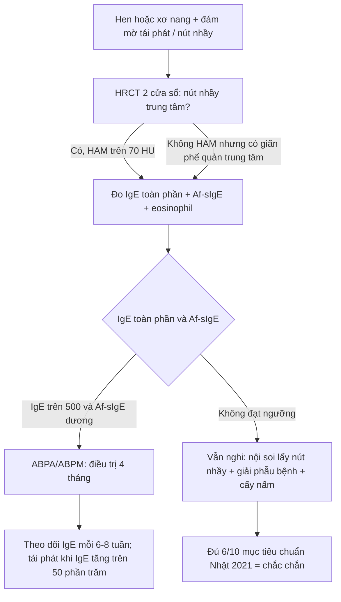
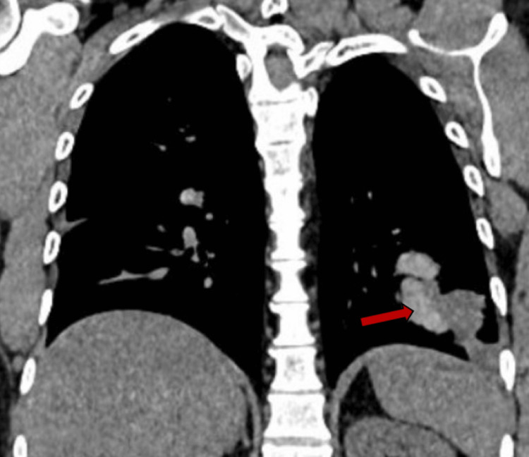
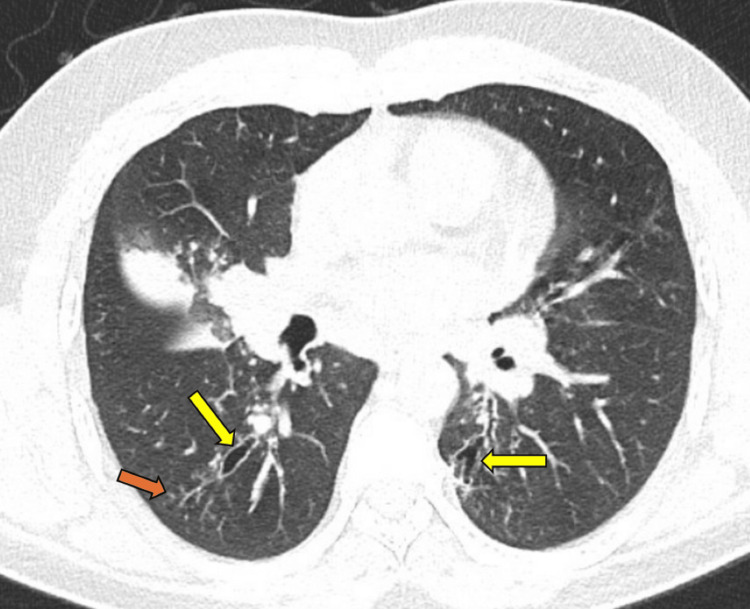
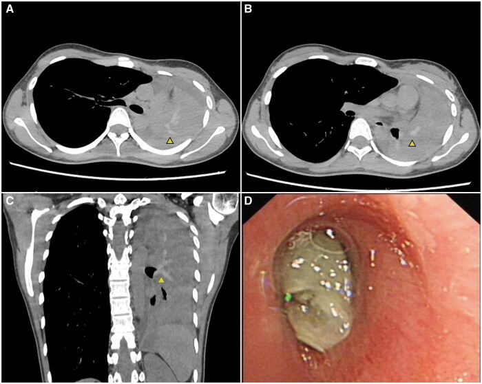
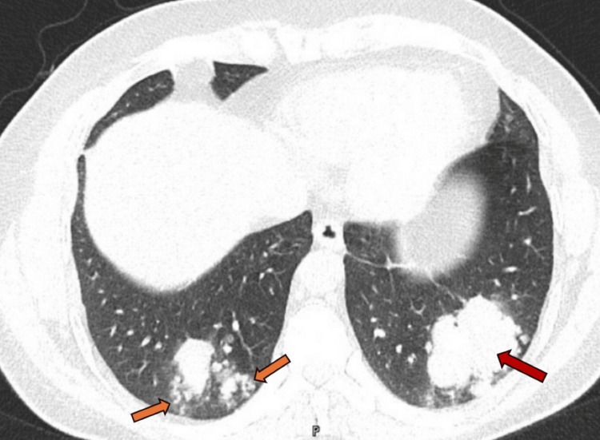

# 054 — ABPA (viêm phế quản phổi dị ứng do *Aspergillus*): nút nhầy "ngón tay trong găng", HAM > 70 HU, và giãn phế quản trung tâm

**Tags:** `pattern:nut-nhay-phe-quan` `pattern:gian-phe-quan-trung-tam` `pattern:ngon-tay-trong-gang` `pattern:dam-mo-lung` `pattern:xep-phoi` `vung:phoi` `vung:phe-quan` `score:ISHAM-ABPA` `protocol:HRCT-lat-mong` `protocol:CT-cua-so-trung-that`
**Mức chắc chắn (certainty):** tổng hợp y văn (literature synthesis) — ghép **tổng quan cập nhật 2026** về chẩn đoán – điều trị ABPA/ABPM (**PMC13655405**, CC BY-NC 4.0), **ca nguyên văn ABPA không hen** có **8 hình CT** mô tả toàn phổ hình ảnh (**PMC12716455**, CC BY 4.0), và **ca nguyên văn HAM 105 HU gây xẹp toàn bộ phổi trái** (**PMC12419793**, CC BY 4.0).

> **Câu chốt:** ABPA **không phải** "hen nặng" mà là **bệnh của nút nhầy**: bạch cầu ái toan chết theo kiểu **ETosis** giải phóng DNA/histone → nút nhầy **đặc, dính, giàu canxi–sắt–mangan** → **tăng đậm độ > 70 HU** (đậm hơn cơ), lấp phế quản trung tâm → **giãn phế quản trung tâm do nút nhầy đẩy thành ra** + **đám mờ phía sau do viêm phổi ái toan/xẹp**. Vì vậy **cửa sổ trung thất là bắt buộc**: chỉ đọc cửa sổ phổi sẽ **bỏ mất HAM** — dấu hiệu đặc hiệu nhất và từ **2024 được phép chẩn đoán ABPA một mình**.

> **Phân vai với bài khác:** [050](../050-gian-phe-quan-ken-khi/lesson.md) phủ **giãn phế quản nói chung** (ABPA chỉ là một hàng ma trận); [6126](../6126-plastic-bronchitis-ba-nhay-phe-quan-tre/lesson.md) phủ **viêm phế quản nhựa (plastic bronchitis)** — nút nhầy dạng khuôn nhưng **không tăng đậm độ** và không có phản ứng dị ứng *Aspergillus*; [025](../025-ton-thuong-phoi-tao-hang/lesson.md) phủ **hang – u nấm (aspergilloma)**. Bài này chỉ đi sâu **ABPA/ABPM**: hình ảnh nút nhầy + HAM, tiêu chuẩn chẩn đoán 2013/2021/2024, và theo dõi tái phát.

## 1. Tổng quan bệnh học – cơ chế hình ảnh (TẠI SAO nút nhầy lại > 70 HU, và TẠI SAO giãn phế quản là TRUNG TÂM)

### 1.1 Cơ chế: từ phản ứng dị ứng đến nút nhầy đặc

- **Hai phản ứng cùng lúc:** typ **I** (IgE) và typ **III** (phức hợp miễn dịch) với nấm sợi định cư trong lòng phế quản — chủ yếu ***Aspergillus fumigatus***, nhưng ở Nhật ***Schizophyllum commune*** chiếm **~40%** ca cấy dương ở đờm/dịch rửa phế quản (n = 216) và là tác nhân **thứ hai** sau *Aspergillus* (PMC13655405).
- **Điểm mấu chốt (PMC13655405):** bạch cầu ái toan hoạt hóa tiếp xúc nấm → **chết theo kiểu ETosis**, phóng thích **DNA + histone** thành **bẫy ngoại bào (extracellular traps)**. Các bẫy này tạo **nút nhầy nâu, ít nước, dai như bơ đậu phộng** — khác hẳn nút nhầy trắng/ướt do bạch cầu trung tính.
- **Vì sao nút nhầy > 70 HU:** nút nhầy giàu **canxi, sắt, mangan** và **ít nước** → đậm độ **vượt cơ ngực** (cơ ~ **40–60 HU**), đo được **> 70 HU**; ca PMC12419793 đo **~105 HU**. Trên ảnh, đây là **dấu hiệu "tăng đậm độ" (high-attenuation mucus, HAM)** — chỉ thấy trên **cửa sổ trung thất**, vì cửa sổ phổi đặt mức cửa sổ (window level) rất thấp nên **mọi mô mềm đều đen**.
- **HAM gặp ở đâu:** **> 20%** ca ABPA (PMC12419793); **dạng ống/phân nhánh từ rốn phổi ra ngoại vi** ("glove finger sign"), đôi khi **kèm xẹp phổi do tắc hoàn toàn** (ca PMC12419793: **xẹp toàn bộ phổi trái**, nút nhầy bít **phế quản gốc trái**).

### 1.2 TẠI SAO giãn phế quản lại ở TRUNG TÂM (và tại sao đám mờ ở ngoại vi)

- **Giãn phế quản trung tâm là HẬU QUẢ, không phải nguyên nhân:** nút nhầy **đặc, thể tích lớn** nằm trong phế quản trung tâm → **đẩy thành phế quản ra ngoài** theo thời gian (PMC13655405). Vì nấm chỉ định cư được ở **phế quản lớn (trung tâm)** — nơi có khí và niêm mạc rộng — tổn thương **bắt đầu và tập trung ở trung tâm**; ngoại vi ít bị.
- **Đám mờ ngoại vi là tổn thương PHÍA SAU chỗ tắc:** nút nhầy bít lòng → **viêm phổi ái toan** hoặc **xẹp phân thùy** ở hạ lưu (PMC13655405, PMC12716455). Vì vậy đám mờ **di chuyển (fleeting)** giữa các lần chụp và **hay tái phát cùng vị trí** nếu nút nhầy chưa lấy được.
- **Ngưỡng giãn phế quản trên HRCT (dùng chung với bài 050):** đường kính trong phế quản **> 1,5 lần động mạch phổi đi kèm** (dấu **signet ring**) và **mất dần thon dần (loss of tapering)** khi ra ngoại vi; ở ABPA, tổn thương **hai bên, đối xứng, thùy trên ưu thế** (PMC12716455 mô tả giãn **cả trung tâm và ngoại vi** ở ca không điển hình — nên **giãn ngoại vi không loại trừ ABPA**).

### 1.3 Dịch tễ và "cái bẫy" của tiêu chuẩn cũ

- **Tần suất:** một nguồn ghi **~13%** bệnh nhân ở **phòng khám hen** (PMC12716455 dẫn tài liệu 1) — con số này **dao động rộng** giữa các nơi và **không dùng để loại trừ**; điều đáng nhớ hơn: **~20%** ca ABPA/ABPM **không có hen và không có xơ nang**, và **gần 50%** **không đạt ngưỡng IgE ≥ 1.000 IU/mL** của tiêu chuẩn ISHAM 2013 (khảo sát toàn quốc Nhật, PMC13655405).
- **Vì vậy tiêu chuẩn đã thay đổi 2 lần:** ISHAM **2013** (IgE ≥ 1.000 + IgE đặc hiệu nấm + 2/3 tiêu chí phụ) → **ISHAM 2024** hạ ngưỡng IgE còn **500 IU/mL** và **cho phép chẩn đoán chỉ dựa vào HAM trong phế quản** → tiêu chuẩn **Nhật 2021** (10 mục, 3 nhóm; **≥ 6 mục = chắc chắn**, **5 mục = có thể**).

## 2. Mẫu hình + chẩn đoán phân biệt theo vị trí (gamut)

### 2.1 Mẫu hình theo vị trí — "trung tâm trước, ngoại vi sau"

| Vị trí | Mẫu hình | Ý nghĩa |
|---|---|---|
| **Phế quản trung tâm (rốn phổi)** | **Nút nhầy dạng ống/phân nhánh** lấp phế quản, ± **HAM > 70 HU**; giãn phế quản hình trụ/nang | **Chữ ký của ABPA** — nấm định cư + nút nhầy đẩy thành |
| **Thùy trên / thùy giữa–lưỡi** | Nút nhầy + xẹp phân thùy, đám mờ **di chuyển** | Hạ lưu của tắc; hay bị gọi "viêm phổi tái phát" |
| **Ngoại vi** | Nốt nhỏ, **tree-in-bud**, đám mờ quanh nút nhầy | Viêm phổi ái toan/viêm tiểu phế quản hạ lưu |
| **Toàn phổi** | **Xẹp toàn bộ một phổi** khi nút nhầy bít phế quản gốc | Cấp cứu đường thở (ca PMC12419793) |

### 2.2 Gamut "nút nhầy lấp phế quản" — 6 thực thể phải phân biệt

1. **ABPA/ABPM** — nút nhầy **trung tâm, tăng đậm độ**, kèm hen/CF, IgE cao, giãn phế quản trung tâm.
2. **Bệnh phổi do NTM (MAC/*M. abscessus*)** — nốt + **giãn phế quản thùy giữa/lưỡi**, **không HAM**, cấy đờm dương.
3. **Lao phế quản (endobronchial TB)** — hẹp phế quản, xẹp **một phân thùy**, **nốt vệ tinh + hang**, không IgE cao.
4. **Viêm phế quản nhựa (plastic bronchitis)** — **khuôn phế quản** (bronchial cast) tách ra khi ho, thường sau tim bẩm sinh/phẫu thuật Fontan; **không HAM**.
5. **Dị tật phế quản (bronchial atresia)** — **mucocele** hình ngón tay + **thùy phổi quá sáng (hyperlucent)** quanh, **không viêm**, ổn định nhiều năm.
6. **U nội phế quản (carcinoid, papilloma)** — nút nhầy **một bên, một phế quản**, kèm **khối trong lòng** thấy trên CT lát mỏng, không đáp ứng corticoid.

## 3. Bảng so sánh phân biệt (ma trận đối chiếu)

| Thực thể (entity) | Hình ảnh điển hình | Chốt vào (rule-in) | Chốt loại (rule-out) | Gợi ý xác nhận |
|---|---|---|---|---|
| **ABPA** | **Nút nhầy trung tâm dạng ngón tay-găng** ± **HAM > 70 HU**, giãn phế quản trung tâm hai bên, đám mờ di chuyển | **HAM > 70 HU + IgE đặc hiệu *A. fumigatus* + eosinophil > 500/µL** | Giãn phế quản **thuần ngoại vi**, không nút nhầy, không tăng IgE → không phải ABPA | IgE toàn phần, Af-sIgE/IgG, HRCT 2 cửa sổ |
| **Bệnh phổi do NTM** | Nốt + giãn phế quản **thùy giữa/lưỡi**, **không nút nhầy tăng đậm độ** | **Cấy đờm/BAL dương NTM + nốt–giãn phế quản** | **HAM + IgE rất cao** → nghiêng ABPA | Cấy NTM, AFB, HRCT |
| **Lao phế quản** | Hẹp phế quản, xẹp **một phân thùy**, **hang + nốt vệ tinh** | **AFB/PCR dương + hang thùy trên** | **Nút nhầy hai bên tăng đậm độ** → không phải lao | AFB, PCR, nội soi phế quản |
| **Viêm phế quản nhựa** | **Khuôn phế quản** hình cành cây, **đậm độ mô mềm thường**, tái phát | **Ho ra khuôn phế quản + bệnh tim bẩm sinh/Fontan** | **HAM > 70 HU** → không phải | Nội soi lấy khuôn, giải phẫu bệnh |
| **Dị tật phế quản (mucocele)** | Khối **hình ngón tay** một bên + **thùy quá sáng**, ổn định | **Ổn định nhiều năm, không viêm, không IgE cao** | **Tổn thương hai bên + di chuyển** → không phải | So phim cũ, CT lát mỏng |
| **U nội phế quản** | **Khối trong lòng** một phế quản + nút nhầy/xẹp hạ lưu | **Khối đặc trong lòng + không đáp ứng corticoid** | **Nút nhầy nhiều phế quản hai bên** → không phải | Nội soi sinh thiết |
| **Xẹp phổi do nút nhầy (biến chứng ABPA)** | **Xẹp toàn phổi**, trung thất lệch, **HAM trong phế quản gốc** | **HAM dạng ống từ rốn phổi + xẹp** | Xẹp không có nút nhầy → tìm nguyên nhân khác | Nội soi gắp nút (cryoprobe), CT sau điều trị |

## 4. Protocol chụp + tiêu chuẩn chẩn đoán (2013 → 2024) + theo dõi

### 4.1 Protocol hình ảnh

- **HRCT ngực lát mỏng ≤ 1 mm, thì hít vào, tái tạo cả hai cửa sổ** — **bắt buộc cửa sổ trung thất** để đo HAM; thêm **thì thở ra** nếu nghi tắc nghẽn tiểu phế quản.
- **Đo HAM:** đặt ROI trên nút nhầy và **so với cơ ngực cùng lát**; **> 70 HU** (hoặc **đậm hơn cơ**) = HAM; ghi **vị trí phế quản** và **lan tới đâu**.
- **Đo giãn phế quản:** tỷ lệ **đường kính phế quản / động mạch** (> 1,5), mất thon dần, **phân bố trung tâm vs ngoại vi**, thùy nào.
- **X-quang ngực:** đám mờ **di chuyển** so với phim cũ là dấu hiệu rẻ tiền nhưng giá trị — **luôn xin phim cũ**.
- **Không chọc hút/ sinh thiết khối "mass-like" trước khi loại ABPA:** ca PMC12716455 có **khối giả u ở thùy dưới trái** do nút nhầy; sinh thiết chỉ để loại u khi hình ảnh không điển hình.

### 4.2 Tiêu chuẩn — 3 phiên bản, dùng đúng ngưỡng

| Bộ tiêu chuẩn | Yêu cầu bắt buộc | Ngưỡng / mục phụ | Hiệu năng |
|---|---|---|---|
| **Rosenberg 1977 (cũ)** | Hen/CF + bệnh cảnh | 8 tiêu chí kinh điển | **Độ nhạy 25–49%** — không dùng một mình |
| **ISHAM 2013** | **IgE đặc hiệu nấm (+)** và **IgE toàn phần ≥ 1.000 IU/mL**, nền hen/CF | **≥ 2/3**: eosinophil > 500/µL, **IgG đặc hiệu nấm (+)**, hình ảnh điển hình | **Độ nhạy 77–83%**, độ đặc hiệu **87–91%** |
| **ISHAM 2024** | Nền bệnh **mở rộng** (kể cả không hen/CF) | **IgE hạ còn ≥ 500 IU/mL**; **HAM trong phế quản đủ để chẩn đoán** | Cập nhật mới nhất |
| **Nhật 2021 (ABPA/ABPM)** | 10 mục / 3 nhóm: **dị ứng – ái toan – nấm** | **≥ 6 mục = chắc chắn**, **5 mục = có thể** | **Độ nhạy 94–96%**, độ đặc hiệu **90–97%**; với nấm **không phải *Aspergillus***: nhạy **91%** (ISHAM 2013 chỉ 48%) |

*(số liệu PMC13655405)*

### 4.3 Điều trị và theo dõi (để đọc đúng phim sau điều trị)

- **Chuẩn:** **corticoid uống** hoặc **azole uống** (itraconazole/voriconazole) — đáp ứng **88–100%** ở 6–8 tuần (định nghĩa: cải thiện lâm sàng/hình ảnh + **IgE giảm ≥ 20%**); **thời gian 4 tháng, tối đa 6 tháng** (PMC13655405). Ca PMC12716455: **itraconazole 200 mg × 2/ngày + prednisolone 40 mg** giảm dần trong 4 tháng; IgE **10.817 → 1.681 → 1.425 kU/L**.
- **Tái phát (relapse):** triệu chứng/hình ảnh xấu đi + **IgE tăng ≥ 50%** sau khi loại trừ đợt cấp hen/giãn phế quản (PMC13655405).
- **Khó điều trị:** **49%** không đạt lui bệnh trong 6 tháng; **điểm difficult-to-treat ≥ 2** gặp ở **~60%**; 4 yếu tố: **khởi phát ≤ 50 tuổi, Af-sIgE ≥ 20 kU/L, cấy *Aspergillus* dương, có HAM** (PMC13655405).
- **Trên phim sau điều trị:** nút nhầy **biến mất trước**, giãn phế quản **có thể tồn tại vĩnh viễn** — **không** dùng "còn giãn phế quản" để kết luận thất bại; đánh giá đáp ứng bằng **nút nhầy + đám mờ + IgE**.

## 5. Biến thể bình thường và cạm bẫy

- **Chỉ đọc cửa sổ phổi:** mất **HAM** — dấu hiệu đặc hiệu nhất, và từ 2024 **đủ để chẩn đoán**. Ngược lại, chỉ đọc cửa sổ trung thất sẽ **bỏ nốt/tree-in-bud**.
- **Gọi "viêm phổi không đáp ứng kháng sinh" rồi sinh thiết khối:** nút nhầy tạo **khối giả u** (ca PMC12716455: khối thùy dưới trái, sinh thiết mới ra **viêm phế quản u hạt ái toan**); ở vùng dịch tễ lao, ca này còn bị **EBUS-TBNA** và **loại lao** trước. **Bệnh sử hen + IgE cao + HAM** phải được nghĩ **trước** thủ thuật xâm lấn.
- **"Giãn phế quản ngoại vi nên không phải ABPA":** sai — ca PMC12716455 có **giãn cả trung tâm và ngoại vi**; dấu chốt là **nút nhầy trung tâm ± HAM**, không phải mức lan của giãn.
- **ABPA không hen (ABPA sans asthma):** **~20%** ca không hen/CF (PMC13655405); nếu chỉ tìm ABPA ở người hen sẽ **bỏ sót 1/5**.
- **IgE dưới 1.000 IU/mL:** gần **50%** ca không đạt ngưỡng cũ; dùng ngưỡng **500** (ISHAM 2024) trước khi loại trừ.
- **Nút nhầy "đậm" do máu/vôi hóa khác:** máu tụ trong phế quản hay canxi hóa thành phế quản cũng tăng đậm độ — nhưng **không có bờ phế quản giãn đối xứng hai bên + không IgE cao**; bối cảnh quyết định.
- **Thỏa mãn tìm kiếm:** thấy nút nhầy rồi dừng → bỏ **xẹp phổi hạ lưu**, **giãn phế quản**, và **tràn khí** (ca ABPA có thể vỡ nang — hiếm).

## 6. Tự lượng giá — Blind Quiz

**Ca 1 — Nam 39 tuổi, ho khạc 2 tuần, "viêm phổi" 6 tháng trước đã khỏi, KHÔNG có tiền sử hen. Nhìn CT coronal cửa sổ trung thất trước.**

- Câu hỏi: (1) Cấu trúc dạng ống–phân nhánh này nằm ở đâu? (2) Nó đậm hơn cơ hay không, và điều đó nghĩa là gì? (3) Ba xét nghiệm cần làm tiếp?

<b>Bấm để hiện đáp án (findings + chẩn đoán)</b>

- **Dấu hiệu:** **nút nhầy dạng ống–phân nhánh** trong các phế quản **giãn** ở **thùy dưới trái**; một ổ **tăng đậm độ (HAM)** (mũi tên đỏ) — đậm hơn cơ ngực cùng lát.
- **Chẩn đoán:** **ABPA** — nút nhầy lấp phế quản giãn, phù hợp "ngón tay trong găng" thể không điển hình; HAM là dấu hiệu đặc hiệu.
- **Xét nghiệm:** **IgE toàn phần** (ca này **> 10.000 kU/L**), **Af-sIgE** (**17,6 kU/L**, class 4), **eosinophil máu** (**1,8 × 10³/µL**); cấy đờm/BAL tìm nấm.
- **Vì sao HAM > 70 HU:** nút nhầy ít nước + lắng đọng **canxi/sắt/mangan** từ sợi nấm và bẫy ngoại bào bạch cầu ái toan.
- **Nguồn ảnh:** *Cureus* 2025 — **PMC12716455** — CC BY 4.0 (Hình 3, nguyên bản).

**Ca 1 (tiếp) — cùng bệnh nhân, CT axial cửa sổ phổi:**

- Câu hỏi: Những mũi tên vàng chỉ gì? Mũi tên cam chỉ gì? Có giãn phế quản trung tâm không?

<b>Bấm để hiện đáp án</b>

- **Dấu hiệu:** **giãn phế quản hai bên** (mũi tên vàng) — phế quản lớn hơn động mạch đi kèm, mất thon dần; **nốt nhỏ + tree-in-bud** (mũi tên cam) = viêm tiểu phế quản hạ lưu.
- **Ý nghĩa:** tổn thương **không chỉ trung tâm** — giãn phế quản ngoại vi **không loại trừ** ABPA; dấu chốt vẫn là nút nhầy trung tâm ± HAM.
- **Nguồn ảnh:** *Cureus* 2025 — **PMC12716455** — CC BY 4.0 (Hình 5, nguyên bản).

**Ca 2 — Nữ 21 tuổi, hen mùa thu 3 năm, nhập cấp cứu khó thở, phổi trái mất thông khí. CT cửa sổ trung thất + nội soi.**

- Câu hỏi: (1) Vì sao cả phổi trái xẹp? (2) Đậm độ nút nhầy khoảng bao nhiêu HU và so với cơ? (3) Xử trí cấp?

<b>Bấm để hiện đáp án</b>

- **Dấu hiệu:** **xẹp toàn bộ phổi trái**, trung thất lệch trái, ít dịch màng phổi; **HAM dạng ống–phân nhánh** từ **rốn phổi trái ra ngoại vi** (mũi tên nhỏ), đậm độ **~105 HU**; nội soi (D) thấy **nút nhầy như thạch bít hoàn toàn phế quản gốc trái**.
- **Chẩn đoán:** **ABPA biến chứng tắc hoàn toàn phế quản gốc** — nút nhầy đặc (ETosis) không thể tống ra; xẹp là hậu quả cơ học, **không phải viêm phổi**.
- **Xử trí:** **gắp nút nhầy bằng cryoprobe** qua nội soi + **corticoid và voriconazole**; phổi nở lại hoàn toàn.
- **Nguồn ảnh:** *QJM* 2025 — **PMC12419793** — CC BY 4.0 (Hình 1, nguyên bản).

**Ca 3 — Bệnh nhân hen, "đám mờ đáy phổi" tái phát 3 lần trong 2 năm, khối dạng mass ở thùy dưới trái:**

- Câu hỏi: Đây là u phổi hay nút nhầy? Dấu hiệu nào giúp phân biệt, và vì sao không nên sinh thiết ngay?

<b>Bấm để hiện đáp án</b>

- **Dấu hiệu:** **đám mờ dạng khối (mass-like), bờ thùy múi, hai bên đáy phổi**, kèm **nốt nhỏ quanh tổn thương** (mũi tên cam) — phù hợp **viêm phổi ái toan quanh nút nhầy**, không phải u đặc.
- **Chốt:** tổn thương **thay đổi vị trí/hình dạng giữa các lần chụp**, kèm **nút nhầy trung tâm + IgE rất cao** → **không sinh thiết mù**; ca gốc vẫn phải sinh thiết vì không có tiền sử hen, kết quả là **viêm phế quản u hạt ái toan**.
- **Nguồn ảnh:** *Cureus* 2025 — **PMC12716455** — CC BY 4.0 (Hình 2, nguyên bản).

## Bài liên quan chéo
- [050 – Giãn phế quản kén khí](../050-gian-phe-quan-ken-khi/lesson.md) (ngưỡng phế quản/động mạch, phân loại hình thái)
- [6126 – Viêm phế quản nhựa và bã nhầy phế quản ở trẻ](../6126-plastic-bronchitis-ba-nhay-phe-quan-tre/lesson.md) (khuôn phế quản, phân biệt)
- [025 – Tổn thương phổi tạo hang](../025-ton-thuong-phoi-tao-hang/lesson.md) (aspergilloma, nấm xâm lấn — khác ABPA)
- [001 – Tổng quan hệ Ngực](../001-tong-quan-he-nguc/lesson.md)

## Ảnh
- 4 ảnh CT từ **PMC12716455** (CC BY 4.0) — toàn phổ hình ảnh ABPA (nút nhầy, HAM, giãn phế quản, tree-in-bud, khối giả u).
- 1 ảnh CT + nội soi từ **PMC12419793** (CC BY 4.0) — HAM 105 HU gây xẹp toàn phổi.
- Không dùng ảnh từ nguồn không rõ giấy phép; ảnh nội soi trong PMC12419793 là **một phần của hình gốc**, giữ nguyên bản.

> Không dùng để chẩn đoán độc lập khi chưa có người hướng dẫn.
