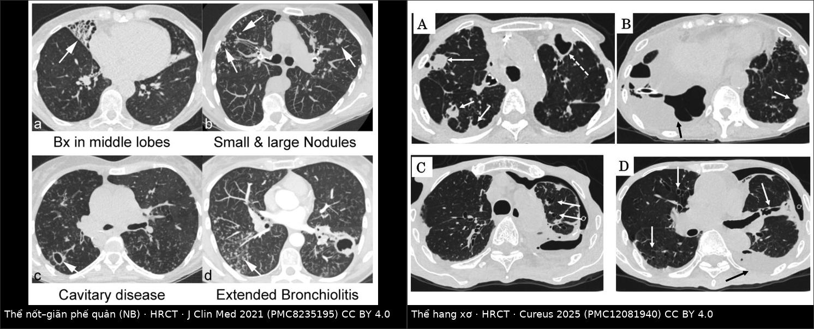
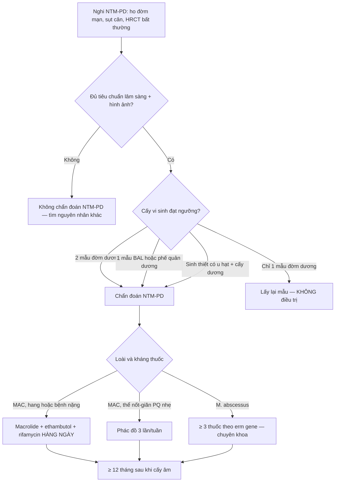
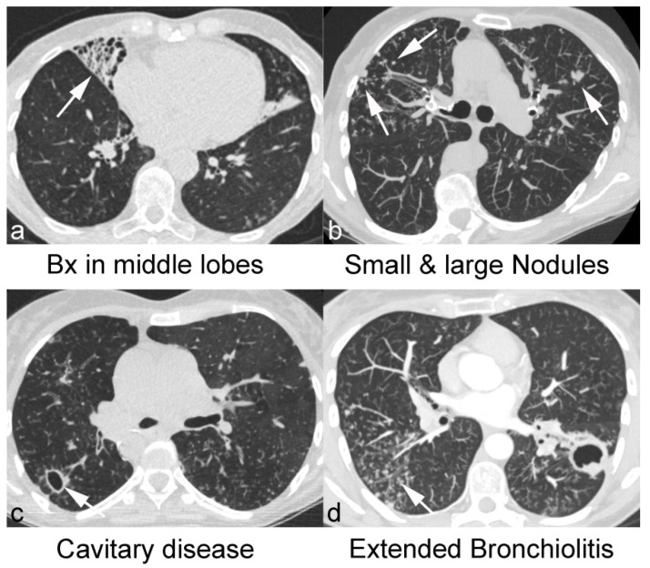
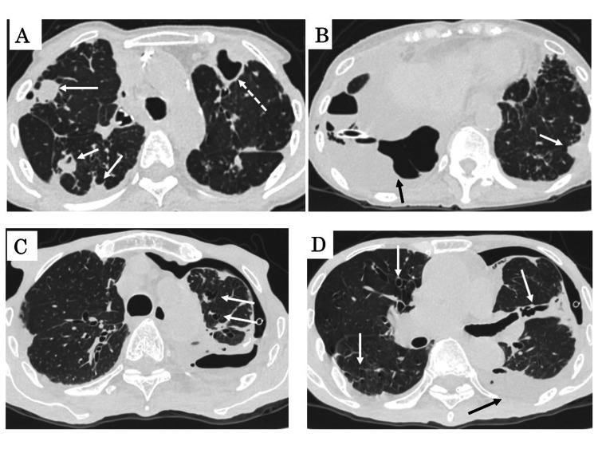
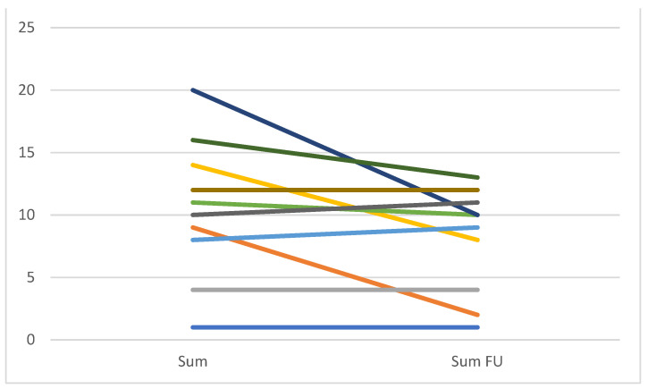

# 056 — Bệnh phổi do mycobacteria không lao (NTM-PD): thể nốt–giãn phế quản "Lady Windermere" vs thể hang xơ / Nontuberculous mycobacterial pulmonary disease

**Tags:** `pattern:gian-phe-quan` `pattern:tree-in-bud` `pattern:hang` `pattern:not-trung-tam-tieu-thuy` `vung:phoi` `vung:phe-quan` `protocol:HRCT-nguc` `score:NTM-CT` `incidentaloma:khong`
**Mức chắc chắn (certainty):** tổng hợp y văn (literature synthesis) — ghép **1 nghiên cứu CT 128 bệnh nhân giãn phế quản có/không NTM-PD** (*J Clin Med* 2021, PMC8235195, CC BY 4.0), **1 tổng quan đa chuyên khoa về NTM** (*Front Cell Infect Microbiol*-nhóm 2025, PMC12464587), **1 tổng quan điều trị MAC** (*Tuberc Respir Dis* 2025, PMC12277505), **1 phân tích gộp TB vs NTM-PD 11 nghiên cứu** (*Cureus* 2025, PMC12730445) và **1 đoàn hệ 204 ca NTM-PD** (*Infect Drug Resist* 2025, PMC12273711). Không có thử nghiệm ngẫu nhiên về ngưỡng hình ảnh.

> **Câu chốt:** NTM-PD **không phải "lao nhẹ"** mà là bệnh của **đường thở bị giãn + thanh thải niêm mạc hỏng**: vi khuẩn từ môi trường (nước, đất, aerosol) cư trú trong **phế quản giãn** → nốt trung tâm tiểu thùy và **tree-in-bud** quanh các phế quản đó. Vì vậy **vị trí quyết định**: **thùy giữa + lưỡi** (thể nốt–giãn phế quản) gợi NTM hơn lao, còn **hang đỉnh–thùy trên** một mình thì **không phân biệt được** — phải cấy.

## 1. Tổng quan bệnh học – cơ chế hình ảnh

### 1.1 Vi khuẩn, vật chủ và "ổ chứa" phế quản giãn

- **Tác nhân:** hơn **200 loài** NTM đã được mô tả; gây bệnh phổi chủ yếu là **MAC** (*M. avium*, *M. intracellulare*) và **phức hợp *M. abscessus***. Trong đoàn hệ 204 ca: **MAC 59,80%**, ***M. abscessus* 16,67%** (PMC12273711).
- **Vì sao phổi là cơ quan đích:** NTM là **saprophyte môi trường**, không lây người–người; bệnh xảy ra khi có **ổ phá hủy cấu trúc** (giãn phế quản, di chứng lao, COPD, xơ nang) hoặc **giảm thanh thải** (bệnh nhân gầy, ít vận động, lồng ngực biến dạng — "phenotype Lady Windermere"). NTM-PD gặp ở **1–6%** bệnh nhân giãn phế quản (PMC8235195).
- **Vì sao thùy giữa và lưỡi:** phế quản thùy giữa/lưỡi **dài, hẹp, góc thoát xiên**, dẫn lưu phụ thuộc và **thanh thải niêm mạc kém** → vi khuẩn cư trú, tạo vòng xoắn **viêm – giãn – ứ dịch – viêm**. Đây là **cơ chế giải phẫu** (không phải "tropism" của vi khuẩn) nên hình ảnh mới **đối xứng hai bên, đa thùy, nặng nhất ở giữa/lưỡi**.
- **Vì sao bệnh tiến triển chậm và dễ bị bỏ qua:** NTM sinh trưởng chậm — **1–3 tuần** trong môi trường lỏng, tới **2–8 tuần** tùy loài (PMC12464587); triệu chứng ho đờm mạn, sụt cân, mệt chỉ khác "viêm phế quản mạn" ở mức độ.

### 1.2 TẠI SAO hình ảnh trông như vậy (vật lý + mô bệnh)

| Dấu hiệu | Cơ chất mô học | Vì sao trên HRCT |
|---|---|---|
| **Giãn phế quản** (bronchiectasis) | Phá hủy cơ trơn + sụn thành phế quản, xơ hóa quanh phế quản | Lòng phế quản **> đường kính động mạch đi kèm** (ngưỡng **> 1,0**; phân độ Reiff **< 2× / 2–3× / > 3×** động mạch), không nhỏ dần về ngoại vi, thành dày |
| **Nốt trung tâm tiểu thùy** (centrilobular nodule) | Dịch – tế bào viêm lấp **tiểu phế quản hô hấp** | Nốt **2–5 mm**, **cách màng phổi ≥ 5 mm**, không chạm vách tiểu thùy → phân bố theo trục phế quản, không theo bạch mạch |
| **Tree-in-bud** | Viêm tiểu phế quản **sinh mủ, dạng caseous** lan theo chồi phế quản | Nốt trung tâm tiểu thùy **nối với nhau bằng nhánh tuyến tính** (chồi cây) → dấu hiệu **đặc hiệu nhất của lan theo đường thở** |
| **Hang** (fibrocavitary form) | Hoại tử nhu mô + xơ hóa quanh hang | Thành hang **mỏng (< 1 mm) tới 1–5 mm**, đường kính **< 3 cm → > 5 cm**, thường **thùy trên**, ít co kéo thể tích hơn lao |
| **Xẹp thùy** (atelectasis) | Nút nhầy bít phế quản thùy | Xẹp **thùy giữa/lưỡi** kèm giãn phế quản trong thùy xẹp — "middle lobe syndrome" |

### 1.3 Ngưỡng định lượng và dịch tễ

| Đại lượng | Số liệu | Nguồn |
|---|---|---|
| Tỉ lệ NTM-PD trong bệnh nhân giãn phế quản | **1–6%** | PMC8235195 |
| Xu hướng dịch tễ (Hàn Quốc, 2010→2021) | **11,4 → 56,7/100.000**; **≥ 65 tuổi: 41,9 → 163,1/100.000** (chiếm **47,6%** ca năm 2021) | PMC12277505 |
| Thành công điều trị MAC-PD | **~60%**; **> 30%** tái phát, phần lớn là **tái nhiễm** hơn là tái phát thật | PMC12277505 |
| Số mẫu tối thiểu để chẩn đoán | **≥ 2 mẫu đờm** dương tính **hoặc 1 mẫu BAL/phế quản** dương tính (2020 ATS/ERS/ESCMID/IDSA); khuyến cáo lấy **≥ 3 mẫu hô hấp** | PMC12464587 |
| Liệu trình | **≥ 12 tháng sau khi cấy âm** ("culture conversion"), 3 thuốc: **macrolide + ethambutol + rifamycin** | PMC12277505, PMC12464587 |
| Cấy âm sau phẫu thuật cắt tổn thương | **~93%** ở ca đủ điều kiện mổ | PMC12277505 |
| Tuân thủ guideline ngoài thực hành (Mỹ) | chỉ **~13%** bệnh nhân nhận đúng phác đồ | PMC12464587 |
| Phân bố tổn thương trong đoàn hệ 204 ca | **≥ 3 thùy 73,08%**; hang **54,81%**; giãn phế quản **51,92%**; dày màng phổi **63,46%** | PMC12273711 |

## 2. Mẫu hình + chẩn đoán phân biệt theo vị trí (gamut)

### 2.1 Hai thể kinh điển

- **Thể nốt – giãn phế quản (nodular-bronchiectatic, NB):** giãn phế quản **thùy giữa + lưỡi** hai bên, nốt trung tâm tiểu thùy **5–10 mm** rải rác, **tree-in-bud**, đôi khi xẹp thùy giữa tái diễn. Bệnh nhân điển hình: **nữ sau mãn kinh, gầy, không hút thuốc, không bệnh phổi trước đó** ("Lady Windermere"). Đây là thể **gặp nhiều nhất** trong thực hành và **dễ bị đọc là "giãn phế quản hậu nhiễm đơn thuần"**.
- **Thể hang xơ (fibrocavitary):** hang **thành mỏng ở thùy trên**, xơ hóa quanh hang, **ít co kéo thể tích** so với lao; thường **nam lớn tuổi, COPD/hút thuốc**, tiên lượng xấu hơn (sụt cân, AFB đờm dương, BMI thấp là yếu tố tiên lượng).
- **Thể "quá mẫn" (hot tub lung / HP-like):** lan tỏa dạng hạt mờ + tree-in-bud, bối cảnh **bồn nước nóng/bể sục**; có thể **khỏi khi ngừng phơi nhiễm** — nhưng sinh thiết vẫn có u hạt và cấy dương, nên **không được coi là HP vô căn**.

### 2.2 Gamut theo mẫu hình (mnemonic **NTM = "Nodules, Tree-in-bud, Middle lobe"**)

- **Nốt trung tâm tiểu thùy + tree-in-bud:** NTM-PD, **lao** (thường thùy trên/đỉnh), viêm tiểu phế quản nhiễm khuẩn (vi khuẩn thường, *S. aureus* ở CF), **bệnh phổi do Aspergillus**, u lan theo đường thở (adenocarcinoma lepidic — thường không có tree-in-bud rõ).
- **Giãn phế quản + xẹp thùy giữa:** NTM-PD, hội chứng thùy giữa do hạch/khối, dị vật, **giãn phế quản hậu nhiễm**, thiếu hụt miễn dịch (CVID, giảm IgG).
- **Hang thùy trên:** lao (hoạt tính/tái hoạt), **NTM thể hang xơ**, ung thư biểu mô vảy hoại tử (bài 025), **CPA** (aspergilloma/CPA trên nền hang cũ).

## 3. Bảng so sánh phân biệt (ma trận đối chiếu)

| Thực thể (entity) | Hình ảnh điển hình | Chốt vào (rule-in) | Chốt loại (rule-out) | Gợi ý xác nhận |
|---|---|---|---|---|
| **NTM-PD thể nốt–giãn PQ** | Giãn PQ **thùy giữa + lưỡi hai bên**, nốt **2–5 mm** + tree-in-bud, đa thùy | **Giãn PQ thùy giữa/lưỡi đối xứng + tree-in-bud**; giãn PQ thùy giữa **nhiều hơn hẳn** nhóm giãn PQ không NTM (p < 0,001) | Hang đơn độc thùy trên không kèm giãn PQ giữa/lưỡi → nghĩ lao/K | **≥ 2 mẫu đờm** hoặc **1 BAL** dương; BAL **nhạy hơn đờm** ở thể NB |
| **NTM-PD thể hang xơ** | Hang **thành mỏng** thùy trên, xơ quanh hang, **ít co kéo thể tích** | **Hang > giãn PQ** + nam lớn tuổi/COPD; hang **lớn hơn** và thành **dày–lan rộng hơn** so với giãn PQ đơn thuần (p = 0,038; 0,019; 0,016) | Hang + nốt vệ tinh + co kéo rõ → **lao** | Cấy + AFB; **không** chẩn đoán bằng hình thái |
| **Lao phổi** | Đám mờ **thùy trên/đỉnh–sau**, nốt vệ tinh, hang, co kéo thể tích, vôi hóa | **KHÔNG có giãn phế quản** (OR **0,19**; 95% CI 0,10–0,36; I² = 82% — thiếu giãn PQ nghiêng về lao); **IGRA dương (OR 17,34; 6,71–44,75)**; **ít tổn thương thùy giữa phải hơn** NTM | Giãn PQ giữa/lưỡi hai bên + tree-in-bud → nghiêng NTM | AFB, PCR Xpert MTB/RIF, IGRA |
| **Giãn phế quản không NTM (hậu nhiễm)** | Giãn PQ **một thùy/khu trú**, sẹo–xẹp, **không nốt mới**, không tree-in-bud hoạt tính | Bệnh cảnh **ổn định nhiều năm**, không nốt/tree-in-bud | **Nốt mới + tree-in-bud + đa thùy** → tìm NTM | So phim cũ; nếu bệnh tiến triển → cấy NTM **trước** macrolide |
| **CPA – aspergillosis mạn** | Hang có **khối nấm**, dày màng phổi, xơ phổi quanh hang; **liềm khí** | **Khối trong hang di động** / liềm khí; **IgG Aspergillus** dương | Tree-in-bud lan rộng hai bên + giãn PQ giữa/lưỡi → NTM | CT 2 tư thế (bài 025), IgG/kháng nguyên |

*Trái: giãn phế quản thùy giữa + nốt/tree-in-bud (thể NB). Phải: hang thùy trên nhiều ổ + xơ hóa (thể hang xơ). Nguồn: J Clin Med 2021 (PMC8235195, CC BY 4.0) và Cureus 2025 (PMC12081940, CC BY 4.0); ảnh ghép letterbox, không crop.*

### 3.1 Ba câu hỏi chốt khi đọc HRCT nghi NTM

1. **Giãn phế quản ở đâu?** Giữa + lưỡi hai bên → NTM; đỉnh–thùy trên + co kéo → lao.
2. **Có hoạt tính lan theo đường thở không?** Nốt trung tâm tiểu thùy + tree-in-bud = **đang hoạt động** (khác sẹo giãn PQ cũ).
3. **Có hang không, và hang "nằm trong" bệnh cảnh nào?** Hang **đơn độc** không phân biệt được nguyên nhân — **cấy là bắt buộc**; hang + giãn PQ giữa/lưỡi → NTM; hang + nốt vệ tinh + co kéo → lao.

## 4. Protocol chụp + tiêu chuẩn chẩn đoán 2020 + theo dõi

### 4.1 Protocol HRCT

- **HRCT ngực lớp mỏng ≤ 1 mm**, tái tạo **kernel sắc (sharp/bone)**, cửa sổ phổi + trung thất; **lát cắt thì hít vào tối đa**; thêm **lát thở ra** khi nghi bệnh đường thở nhỏ (air trapping).
- **Không cần cản quang** cho đánh giá nhu mô; cản quang khi cần phân biệt hang–u/hạch hoại tử.
- **Tư thế nằm sấp** khi tổn thương chỉ ở vùng phụ thuộc (phân biệt **xẹp đĩa do tư thế** với giãn PQ thật).
- Chụp lại **khi lâm sàng đổi** hoặc **sau 12 tháng điều trị**, không chụp theo lịch cứng: trong 12 ca cấy âm sau điều trị, **điểm CT giảm ≥ 3 điểm ở 5 ca**, nhưng chỉ **bronchiolitis** giảm có ý nghĩa (p = 0,043) (PMC8235195).

### 4.2 Thang điểm NTM-CT (Kim) — dùng để theo dõi, không để chẩn đoán

Mỗi đặc điểm chấm **0–3**, đọc trên **6 thùy**:

| Đặc điểm | Cách chấm |
|---|---|
| Giãn phế quản | **Mức độ**: 1 = < 2×, 2 = 2–3×, 3 = > 3× đường kính **động mạch đi kèm**. **Lan rộng**: 1 = 1–5 phân thùy, 2 = 6–9, 3 = > 9 |
| Nút nhầy (mucus plugging) | Theo số phân thùy như trên |
| Viêm tiểu phế quản tế bào | Mức độ + lan rộng như giãn phế quản |
| Hang | **Đường kính** 1 = < 3 cm, 2 = 3–5 cm, 3 = > 5 cm; **thành** 1 = < 1 mm, 2 = 1–5 mm, 3 = > 5 mm; **số hang** 1 = 1–3, 2 = 4–5, 3 = > 5 |
| Nốt | Theo số phân thùy: 1 = 1–5, 2 = 6–9, 3 = > 9 |
| Đông đặc | 1 = < 3 phân thùy, 2 = 3–5, 3 = > 5 |

(Nguồn cấu trúc điểm: PMC8235195 — mô tả nguyên văn theo Kim và cộng sự.)

### 4.3 Tiêu chuẩn chẩn đoán 2020 (ATS/ERS/ESCMID/IDSA) — đủ **cả 3** nhóm

- **Lâm sàng + hình ảnh:** triệu chứng hô hấp + **nốt/hang** trên X-quang **hoặc** HRCT có **giãn phế quản đa ổ + nhiều nốt nhỏ**.
- **Vi sinh:** **≥ 2 mẫu đờm** riêng biệt dương **hoặc 1 mẫu BAL/phế quản** dương **hoặc** sinh thiết phổi có u hạt + cấy dương.
- **Loại trừ** lao và bệnh khác. **Một mẫu đờm dương = chưa đủ chẩn đoán** — đây là lỗi hay gặp nhất (dẫn tới điều trị 12 tháng không cần thiết, hoặc ngược lại bỏ sót vì "chỉ là tạp nhiễm").
- **Trước khi dùng macrolide phải cấy + làm kháng sinh đồ clarithromycin/amikacin**: macrolide đơn thuần trên chủng kháng → chọn lọc kháng và mất lựa chọn duy nhất còn hiệu quả (PMC12277505, PMC12464587).

## 5. Biến thể bình thường và cạm bẫy

- **"Giãn phế quản tuổi già" không phải bệnh:** giãn nhẹ **rải rác đáy phổi**, thành mỏng, **không nốt/tree-in-bud**, bệnh nhân không triệu chứng → **không cấy, không điều trị**.
- **Xẹp đĩa phụ thuộc (dependent atelectasis)** giả giãn phế quản: chụp lại **tư thế nằm sấp** — tổn thương mất đi.
- **Một mẫu đờm dương tính ≠ bệnh:** NTM có trong nước máy, bồn sục, đất; **ô nhiễm mẫu** và **cư trú tạm thời** đều gặp → luôn **≥ 2 mẫu**.
- **Sai lầm "hang = lao"**: hang thành mỏng ở **nữ lớn tuổi, không đái tháo đường, không tiếp xúc lao** thường là NTM; AFB đờm có thể **dương** trong cả hai → cần **PCR/IGRA**.
- **Sai lầm "CT cải thiện = khỏi"**: sau 12 tháng, phần lớn đặc điểm CT **giảm nhưng không có ý nghĩa**; chỉ **bronchiolitis** giảm rõ (p = 0,043) → **quyết định ngừng thuốc dựa trên cấy, không dựa trên CT**.
- **Cạm bẫy mặt cắt:** nốt trung tâm tiểu thùy **cách màng phổi ≥ 5 mm**; nốt **chạm màng phổi/vách** là nốt quanh bạch mạch (sarcoid, di căn) — đừng gọi tree-in-bud.
- **Thuốc lá điện tử/ô nhiễm** gây hình ảnh giống nhưng cấy âm — hỏi kỹ phơi nhiễm **nước nóng, bể sục, vòi sen, đất làm vườn**.

## 6. Tự lượng giá — Blind Quiz

**Ca 1 — nữ 68 tuổi, ho đờm 2 năm, sụt 4 kg, không hút thuốc. Đọc 4 panel trước khi mở đáp án.**

- Gợi ý: bốn panel lần lượt là **(a) giãn phế quản thùy giữa**, **(b) nốt nhỏ và lớn**, **(c) hang**, **(d) viêm tiểu phế quản lan rộng**.
- Câu hỏi: Panel nào **chốt hướng NTM** mạnh nhất, và vì sao **không** chốt được chỉ bằng hình ảnh?

<b>Bấm để hiện đáp án (findings + chẩn đoán)</b>

- Dấu hiệu: giãn phế quản **thùy giữa/lưỡi** + **nốt trung tâm tiểu thùy** + tree-in-bud + hang thành mỏng. Trong nghiên cứu nguồn, nhóm NTM-PD có giãn phế quản thùy giữa **nhiều hơn** nhóm giãn phế quản không NTM (p < 0,001) và nhiều nốt nhỏ/lớn hơn (p < 0,001).
- Chẩn đoán: **NTM-PD thể nốt–giãn phế quản** — hướng này **không thay thế** vi sinh: cần **≥ 2 mẫu đờm** hoặc **1 BAL** dương.
- Nguồn ảnh: *J Clin Med* 2021;10(12):2736 (PMC8235195), CC BY 4.0.

**Ca 2 — nam 74 tuổi, COPD, ho ra máu, X-quang có mờ thùy trên. CT có 4 panel.**

- Câu hỏi: 3 chẩn đoán phân biệt cho **hang thành mỏng + dày màng phổi**? Dấu hiệu nào trên ảnh giúp phân biệt **mủ màng phổi** với **hang trong nhu mô**?

<b>Bấm để hiện đáp án</b>

- Findings: hang nhiều ổ thùy trên hai bên, xơ hóa–co kéo quanh hang, **dày màng phổi** và ổ dịch màng phổi khu trú (mũi tên). Bệnh cảnh là **NTM gây mủ màng phổi** trên nền phá hủy phổi.
- DDx: lao phổi hoạt tính, NTM thể hang xơ, **CPA/aspergilloma**, ung thư vảy hoại tử, áp-xe vi khuẩn.
- Chốt: ổ dịch **ngoài nhu mô** có **góc tù + split pleura** = mủ màng phổi; hang **trong nhu mô** góc nhọn, thành đều hơn, không tách lá màng phổi (bài 025, 040).
- Nguồn ảnh: *Cureus* 2025;17(4):e82337 (PMC12081940), CC BY 4.0.

**Ca 3 — cùng bệnh nhân ca 1 sau 12 tháng điều trị, cấy âm 3 lần.**

- Câu hỏi: Điểm CT giảm bao nhiêu thì được coi là "đáp ứng hình ảnh"? Có được **ngừng thuốc** vì CT đẹp hơn không?

<b>Bấm để hiện đáp án</b>

- Findings: mỗi đường là một bệnh nhân; tổng điểm NTM-CT **giảm ≥ 3 điểm ở 5/12 ca** sau khi cấy âm; phần lớn đặc điểm giảm **không có ý nghĩa thống kê**, chỉ **viêm tiểu phế quản** giảm rõ (p = 0,043).
- Kết luận: hình ảnh **theo dõi được**, nhưng **tiêu chuẩn ngừng thuốc là cấy âm ≥ 12 tháng**, không phải CT.
- Nguồn ảnh: PMC8235195, CC BY 4.0.

## Bài liên quan chéo

- [025 – Tổn thương phổi tạo hang: dấu liềm khí, Monod sign](../025-ton-thuong-phoi-tao-hang/lesson.md)
- [050 – Giãn phế quản kén khí](../050-gian-phe-quan-ken-khi/lesson.md)
- [040 – Tràn dịch màng phổi](../040-tran-dich-mang-phoi/lesson.md)
- [051 – Viêm tiểu phế quản](../051-tieu-phe-quan/lesson.md)
- [054 – ABPA](../054-abpa-viem-phe-quan-di-ung-aspergillus/lesson.md)

> Không dùng để chẩn đoán độc lập khi chưa có người hướng dẫn.
