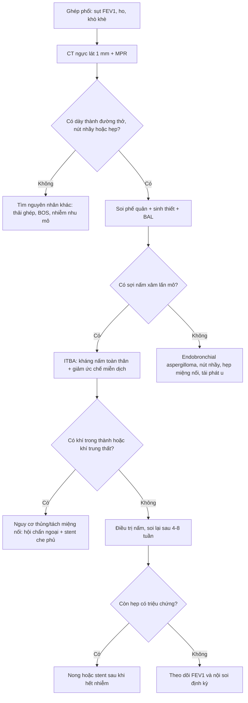
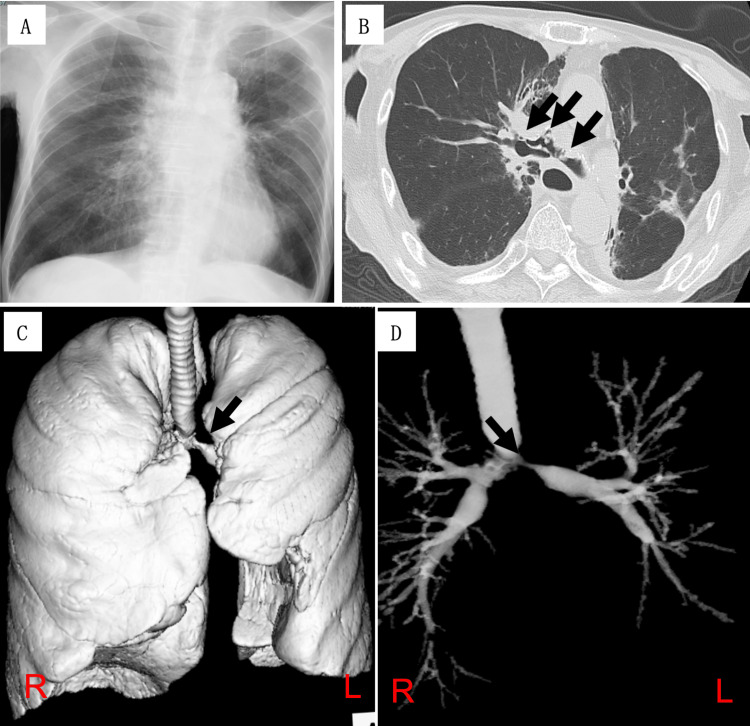
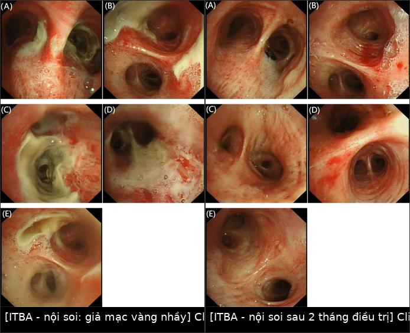
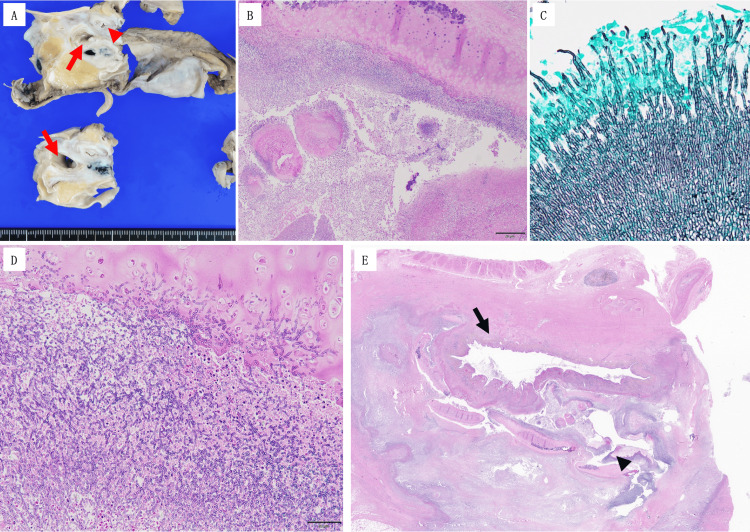

# 058 — Nhiễm nấm *Aspergillus* khí–phế quản xâm lấn (ITBA) sau ghép phổi: giả mạc, nút nhầy và đường thở "hẹp dần" / Invasive tracheobronchial aspergillosis

**Tags:** `pattern:day-thanh-duong-tho` `pattern:hep-duong-tho` `pattern:gia-mac` `pattern:nut-nhay` `pattern:xep-phoi` `vung:khi-quan` `vung:phe-quan` `vung:phoi` `vung:ghep-phoi` `protocol:CT-nguc-lat-mong` `protocol:noi-soi-phe-quan`

**Mức chắc chắn (certainty):** tổng hợp y văn (literature synthesis) — ghép **một ca tử vong có CT + đại thể + mô bệnh học** (Cureus 2024, **PMC11498964**, CC BY 4.0), **một ca giả mạc có nội soi trước–sau điều trị** (Clin Case Rep 2025, **PMC12376307**, CC BY 4.0), **tổng quan nhiễm nấm sau ghép phổi** (J Thorac Dis 2021, **PMC8662481**) và **tổng quan các thể Aspergillus đường thở** (ScientificWorldJournal 2011, **PMC3236535**). Nhóm **không có bệnh nhân của mình**; các tỷ lệ dưới đây là của các loạt đã công bố, không phải ước lượng.

> **Câu hỏi thực hành:** bệnh nhân **ghép phổi 3 tháng**, ho khan, khò khè, **FEV₁ tụt 20%** trong 2 tuần; CT ngực thấy **dày thành phế quản gốc hai bên** và **hẹp lòng từ carina xuống phế quản gốc trái**, kèm **khí ngoài khí quản**. Đội lâm sàng nghi **hẹp miệng nối (bài 023)** hoặc **tái phát bệnh nền**. Câu hỏi: **khi nào nghĩ nhiễm nấm đường thở xâm lấn, CT một mình đủ chưa, và cái gì quyết định sống còn?**
> Bài chốt ba điều: **(1) ITBA là bệnh của *niêm mạc đường thở*, không phải nhu mô — CT chỉ thấy dày thành/hẹp lòng/nút nhầy, chẩn đoán phải bằng nội soi + sinh thiết**; **(2) khí trong thành phế quản hoặc khí ngoài khí quản là dấu hiệu *xâm lấn sụn/phá thành* — đổi tiên lượng và cách xử trí**; **(3) sau ghép phổi, "hẹp miệng nối" và "nhiễm nấm đường thở" thường *cùng tồn tại*** — điều trị nấm trước, can thiệp hẹp sau.

## 1. Tổng quan bệnh học – cơ chế hình ảnh

### 1.1 Định nghĩa và vì sao người ghép phổi dễ mắc

- **Bào tử *Aspergillus* 2–3 µm**, đủ nhỏ để **vào tận phế quản nhỏ và phế nang** ở mọi người; người khỏe mạnh loại bỏ được nhờ **hàng rào niêm mạc, đại thực bào và bạch cầu trung tính** (ScientificWorldJournal 2011, **PMC3236535**).
- **ITBA (invasive tracheobronchial aspergillosis)** = nấm **xâm lấn *thành* khí quản–phế quản** (niêm mạc, dưới niêm, sụn), khác với **aspergilloma trong lòng** (không xâm lấn) và khác **viêm phổi do Aspergillus** (tổn thương nhu mô).
- **Tần suất:** ITBA chiếm **khoảng 10% các ca aspergillosis xâm lấn**; thể ITBA **đơn độc/chiếm ưu thế** chỉ gặp ở **6,9%** các ca aspergillosis trong lồng ngực (Cureus 2024, **PMC11498964**; ScientificWorldJournal 2011, **PMC3236535**). Ngược lại, **aspergillosis xâm lấn *lấy đường thở làm trung tâm* chiếm 14–34% các ca aspergillosis phổi xâm lấn** (PMC3236535).
- **Sau ghép phổi (lung transplant, LT):** **viêm khí–phế quản do nấm gặp ở 5–25%** người ghép; *Aspergillus* là tác nhân **hay nhất** (J Thorac Dis 2021, **PMC8662481**). Nhiễm nấm xâm lấn nói chung sau ghép phổi: **3–19% trong năm đầu**, *Aspergillus* **44%**, *Candida* **23%**; **tử vong 40–82%** (cùng bài).
- **Vì sao mảnh ghép phổi đặc biệt:** phổi ghép **mất phản xạ ho và dẫn lưu bạch mạch**, **thiếu máu nuôi hệ động mạch phế quản** (chỉ còn dòng ngược), **niêm mạc bị tổn thương do thiếu máu tái tưới máu** và **ức chế miễn dịch liên tục** — bốn lý do khiến đường thở ghép vừa **dễ nhiễm**, vừa **dễ hẹp/mềm sụn** sau nhiễm.

### 1.2 Ba thể lâm sàng – hình ảnh (theo phân loại Kramer, còn dùng)

| Thể | Tổn thương | Hình ảnh / nội soi | Hệ quả |
|---|---|---|---|
| **Giả mạc (pseudomembranous)** | Mảng **giả mạc vàng–trắng** gồm sợi nấm + mô hoại tử **phủ lên niêm mạc** | Nội soi: mảng dày, **dễ chảy máu khi chạm**; CT: **dày thành lan tỏa**, bề mặt không đều, có thể **hẹp lòng** | Thể **hay gặp nhất**, có thể lan sâu |
| **Tắc nghẽn (obstructive)** | **Nút nhầy chứa sợi nấm** bít lòng phế quản, viêm thành rất ít | CT: **nút nhầy trong lòng**, **xẹp phổi/ứ khí phía sau**, "ngón tay găng" nếu phế quản giãn | Xẹp phổi cấp, **suy hô hấp nhanh** |
| **Loét (ulcerative)** | **Loét/hoại tử niêm mạc**, có thể **xuyên sụn** | CT: dày thành + **khí trong thành**, **khí ngoài khí quản/trung thất**; nội soi: ổ loét, trợt, giả mạc lẫn máu | **Thủng, rò, chảy máu, hẹp muộn** |

- **Khoảng 20% ca ITBA không triệu chứng**, phát hiện tình cờ trên **nội soi phế quản giám sát** (Cureus 2024, **PMC11498964**; J Thorac Dis 2021, **PMC8662481**) — nghĩa là **"không có triệu chứng" không loại trừ ITBA ở người ghép phổi**.
- **Yếu tố nguy cơ định lượng:** **73%** ca ITBA có suy giảm miễn dịch; trong loạt đa trung tâm, **ghép tạng 44,2%**, **bệnh máu ác tính 21,2%**, **COPD 15,4%**; **corticoid kéo dài 71,8%**, **hóa trị 25,0%** (Cureus 2024 dẫn lại; **PMC11498964**).

### 1.3 TẠI SAO hình ảnh trông như vậy (vật lý + mô bệnh)

- **CT là "phim chụp mô mềm", không phải phim chụp niêm mạc.** Sợi nấm + mô hoại tử + fibrin có **đậm độ mô mềm (~30–60 HU)**, gần bằng cơ và sụn. Vì vậy:
  - **Giả mạc** hiện thành **dày thành phế quản không đều** — nhưng **không phân biệt được với nhầy đặc** nếu chỉ nhìn một lớp cắt;
  - **Nút nhầy** hiện **đậm độ dịch (0–30 HU)** trong lòng phế quản, thường **kèm xẹp phổi phía sau** do tắc hoàn toàn — dễ đọc nhầm là **u lòng phế quản**;
  - **Sợi nấm xâm lấn sụn** phá hủy sụn → **khí thoát ra ngoài lòng**, tạo **khí trong thành phế quản** và **khí ngoài khí quản/trung thất** — đây là **dấu hiệu định lượng được của xâm lấn sụn**, không phải "tràn khí tự phát".
- **Vì sao cần CT lát mỏng 1 mm:** thành phế quản gốc bình thường chỉ **mỏng khoảng 1–2 mm**; trên lát **3–5 mm** hiện tượng **hiệu ứng thể tích một phần** làm thành dày giả và **che mất mảng giả mạc mỏng**. Lát **≤ 1 mm** + **tái tạo đa bình diện (MPR)** là điều kiện tối thiểu để mô tả **chiều dài đoạn hẹp** và **vị trí so với miệng nối**. *(Ngưỡng "thành > 2 mm là bất thường" là quy ước thực hành cho phế quản lớn; chưa có nghiên cứu cắt ngang xác định cutoff riêng cho ITBA — ghi rõ để tránh overcall.)*
- **Vì sao CT không thay được nội soi:** tiêu chuẩn vàng của bệnh nấm **xâm lấn** là **bằng chứng xâm lấn mô của sợi nấm** trên **sinh thiết** (ScientificWorldJournal 2011, **PMC3236535**). CT chỉ đưa ra **bản đồ tổn thương** để nội soi lấy đúng chỗ.
- **Vì sao xét nghiệm máu có thể âm:** trong ca tử vong nêu trên, **β-D-glucan huyết thanh 12,3 pg/mL (bình thường)** dù mô bệnh học đầy sợi nấm (Cureus 2024, **PMC11498964**). Bệnh **khu trú ở đường thở** có thể không làm tăng đủ marker huyết thanh — **âm tính không loại trừ**.

### 1.4 Ngưỡng và con số cần nhớ

- **Loài:** *A. fumigatus* **50–60%** các ca aspergillosis nói chung; trong **121 ca tổn thương đường thở**, *A. fumigatus* **63%** (76/121), *A. flavus* 4,1%, *A. niger* 3,3% (ScientificWorldJournal 2011, **PMC3236535**).
- **Thời điểm sau ghép:** đa số nhiễm nấm xâm lấn xảy ra **trong năm đầu**; thể đường thở thường **3 tuần – 6 tháng** (trùng cửa sổ thiếu máu–tân mạch của miệng nối, xem bài 023).
- **Biến chứng cấu trúc** (J Thorac Dis 2021, **PMC8662481**): **mềm sụn phế quản (bronchomalacia)**, **hẹp phế quản**, **tách miệng nối (dehiscence)**, **chảy máu**, lan vào nhu mô/phát tán.
- **Điều trị:** **voriconazole là lựa chọn đầu tay** (Cureus 2024, **PMC11498964**); thay thế/ bổ sung: **isavuconazole, posaconazole, amphotericin B khí dung**; **giảm ức chế miễn dịch** khi có thể; **stent đường thở** khi tắc nghẽn trung tâm; **mổ cắt tổn thương** ở ca chọn lọc (J Thorac Dis 2021; Cureus 2024).
- **Tiên lượng:** trong ca tử vong, tổn thương **xuyên sụn, phá thành phế quản gốc trái** và **hẹp phế quản gốc phải**; tác giả kết luận **tiên lượng xấu khi tổn thương ăn sâu vào thành phế quản** (Cureus 2024). Ngược lại, **ITBA ở người ghép phổi có tiên lượng tốt hơn** nhóm suy giảm miễn dịch khác vì **được phát hiện sớm qua nội soi giám sát** (J Thorac Dis 2021).

## 2. Mẫu hình + chẩn đoán phân biệt theo vị trí (gamut)

- **Mẫu hình cốt lõi:** người **ghép phổi / suy giảm miễn dịch**, **ho, khò khè, khó thở tăng dần**, có khi **ho ra máu**; CT **dày thành khí quản–phế quản** (khu trú hoặc lan tỏa), **hẹp lòng**, **nút nhầy**, **xẹp phổi phía sau**, **khí trong thành/khí trung thất**.
- **Gamut theo vị trí (từ trên xuống):**
  1. **Khí quản:** ITBA thể giả mạc/loét; **u khí quản** (ung thư biểu mô tuyến giáp, squamous), **u nhú**, **bệnh sụn–xương khí quản (TPO)**, **amyloidosis**, **u hạt bệnh Wegener**.
  2. **Carina – phế quản gốc:** ITBA, **tái phát u tại miệng nối**, **hẹp miệng nối (023)**, **mềm sụn**, **nút nhầy đơn thuần**, **dị vật**.
  3. **Phế quản thùy/phân thùy:** **viêm khí–phế quản do vi khuẩn/CMV**, **hen**, **ABPA (bài 054)** với nút nhầy, **viêm phế quản do xạ**, **u lòng phế quản**.
  4. **Nhu mô phía sau:** **xẹp phổi do tắc** vs **viêm phổi** — phân biệt bằng **mất thể tích + phế quản hơi bị tắc** (xem bài 061 và 023).
- **Ba câu hỏi đọc CT:** **(1) tổn thương *thành* hay *lòng* đường thở? (2) có **khí trong thành / khí ngoài khí quản** (dấu xâm lấn sụn)? (3) **phía sau tắc** là xẹp hay viêm phổi?**
- **Cần nhớ:** trong cùng một bệnh nhân ghép phổi, **nhiễm nấm và hẹp miệng nối là một chuỗi** — nhiễm gây loét/hoại tử → sẹo xơ → hẹp. Điều trị nấm trước, **đánh giá lại hẹp sau khi hết nhiễm**.

## 3. Bảng so sánh phân biệt (ma trận đối chiếu)

| Thực thể (entity) | Hình ảnh điển hình | Chốt vào (rule-in) | Chốt loại (rule-out) | Gợi ý xác nhận |
|---|---|---|---|---|
| **ITBA (giả mạc/loét/tắc nghẽn)** | Dày thành khí quản–phế quản **lan tỏa hoặc từng đoạn**, bề mặt không đều; **nút nhầy**; **khí trong thành/khí trung thất**; xẹp phổi phía sau | **Người ghép phổi/suy giảm miễn dịch + dày thành đường thở + khí trong thành** | Thành mỏng, không nút nhầy, không khí ngoài lòng → ít nghĩ ITBA | **Nội soi + sinh thiết** (sợi nấm xâm lấn mô); cấy/BAL; GM dịch rửa |
| **Endobronchial aspergilloma** | Khối **trong lòng** phế quản, không xâm lấn thành; thành **không dày** | Khối lòng + **không xâm lấn** trên sinh thiết | Dày thành + khí trong thành → ITBA | Nội soi, sinh thiết |
| **Hẹp miệng nối (023)** | Hẹp **khu trú trong 2 cm quanh miệng nối**, thành xơ mỏng, **không giả mạc** | **Vị trí đúng miệng nối + bờ nhẵn + không tổn thương niêm mạc lan** | Tổn thương lan **xa miệng nối**, niêm mạc loét/giả mạc → nghĩ nhiễm | Nội soi; CT động thì thở ra |
| **Tái phát u tại miệng nối** | Khối **đặc, ngấm thuốc**, bờ không đều, có thể xâm lấn trung thất | Khối đặc ngấm thuốc + **tăng kích thước theo thời gian** | Tổn thương **dạng mảng phủ niêm mạc**, không khối → nghĩ nấm | PET/CT, sinh thiết |
| **Nút nhầy đơn thuần / hen** | Nút nhầy **đậm độ dịch**, thành phế quản **mỏng hoặc dày đều**, không khí trong thành | Không sốt, không tổn thương niêm mạc, **hết sau làm sạch** | Tái lập nhanh + giả mạc + khí trong thành → nghĩ nấm | Nội soi hút, điều trị thử |
| **Viêm khí–phế quản vi khuẩn/CMV** | Dày thành + **dịch lòng**; có thể loét | **Cấy/BAL dương tính vi khuẩn/virus**, đáp ứng kháng sinh | **Khí trong thành** nhiều + tổn thương sụn → nghĩ nấm xâm lấn | BAL, PCR CMV, cấy |
| **TPO / amyloidosis khí quản** | **Nốt sụn dưới niêm** (TPO) hoặc dày lan tỏa **có vôi hóa** (amyloid) | **Vôi hóa dạng nốt, không loét, không khí trong thành** | Bệnh cảnh cấp + giả mạc + sốt → không phải TPO/amyloid | CT xương, sinh thiết |

- **Ảnh ghép đối chiếu:** `images/composite_itba_noi-soi-truoc-sau.jpg` — nội soi trước và sau 2 tháng điều trị, thấy **giả mạc vàng nhầy** biến mất và niêm mạc hồi phục.

## 4. Protocol chụp + hệ phân độ + đường điều trị

### 4.1 Protocol CT ngực cho đường thở sau ghép phổi

- **Chỉ định:** mọi **sụt FEV₁ không giải thích**, ho/khò khè mới, ho ra máu, **nội soi giám sát bất thường**, hoặc trước can thiệp đường thở.
- **Kỹ thuật:** **lát ≤ 1 mm**, tái tạo **mặt phẳng trục + coronal + sagittal** dọc trục đường thở; **cửa sổ mô mềm, nhu mô và xương**; **thì hít vào** và **thì thở ra** (phát hiện mềm sụn); cản quang tĩnh mạch khi nghi xâm lấn trung thất/giả phình mạch (ho ra máu).
- **Cách đo:** đo **thành** vuông góc với trục phế quản, ở **cùng một vị trí giải phẫu hai bên**; đo **chiều dài đoạn hẹp**; ghi **khoảng cách tới miệng nối** (mm) — đây là thông tin quyết định **stent hay nong**.
- **Nội soi phế quản:** **lấy sinh thiết vùng niêm mạc bất thường + BAL**; nếu **giả mạc dày, dễ chảy máu** thì **không cố bóc** — nguy cơ chảy máu và thủng.

### 4.2 Phân độ và xử trí

- **Phân độ biến chứng đường thở sau ghép phổi: ISHLT 2018** (chi tiết ở bài 023) — dùng để mô tả **độ hẹp, mềm sụn, tách miệng nối**; **ITBA không nằm trong hệ này**, phải ghi **chẩn đoán nhiễm riêng**.
- **Điều trị ITBA:** kháng nấm toàn thân **voriconazole** (đầu tay), **isavuconazole/posaconazole** khi không dung nạp/tương tác; **amphotericin B khí dung** bổ trợ; **giảm ức chế miễn dịch**; **stent** khi tắc nghẽn trung tâm; **mổ** ở ca chọn lọc (J Thorac Dis 2021; Cureus 2024).
- **Thứ tự thực hành:** **(1) chẩn đoán nhiễm → (2) điều trị nấm → (3) đánh giá lại hẹp/mềm sụn sau khi niêm mạc lành → (4) can thiệp cơ học nếu còn hẹp có triệu chứng.** Can thiệp stent/nong khi đang nhiễm hoạt động làm tăng nhiễm stent và thủng.

## 5. Biến thể bình thường và cạm bẫy

- **Biến thể bình thường:**
  - **Thành phế quản dày nhẹ, đối xứng ở miệng nối** trong 4–6 tuần đầu sau ghép (phản ứng lành thương) — **không phải nhiễm** nếu niêm mạc lành và không có giả mạc.
  - **Nút nhầy nhỏ ở phế quản thùy dưới** ở bệnh nhân nằm lâu, giảm sau ho khạc — **không đặc hiệu**.
  - **Khí trong trung thất lượng nhỏ sau mổ/soi** có thể tồn tại vài ngày — cần đối chiếu **thời điểm** và **diễn tiến**.
- **Cạm bẫy:**
  1. **Đọc "hẹp miệng nối" cho mọi hẹp sau ghép** — bỏ sót nhiễm nấm lan **dưới miệng nối**.
  2. **Bỏ sót khí trong thành** vì cửa sổ nhu mô làm mờ mô mềm — luôn xem **cửa sổ trung thất**.
  3. **Kết luận "không nhiễm" khi marker huyết thanh âm** (β-D-glucan 12,3 pg/mL trong ca tử vong) — **bệnh đường thở có thể khu trú**.
  4. **Nong/stent ngay khi đang nhiễm hoạt động** — tăng nguy cơ nhiễm stent, thủng, tách miệng nối.
  5. **Sai vị trí sinh thiết:** chỉ lấy **nút nhầy** mà không lấy **niêm mạc dưới giả mạc** → mô bệnh học âm giả.
  6. **Nhầm xẹp phổi do tắc với viêm phổi** — xẹp có **mất thể tích**, **phế quản hơi bị tắc**, **dịch chuyển rãnh**, và **hồi phục sau hút** nếu chưa có đông đặc.

## 6. Tự lượng giá — Blind Quiz (bấm để hiện đáp án)

**Ca 1 — người ghép phổi, khó thở tăng dần**

- Gợi ý lâm sàng: nam 75 tuổi, tiền sử ung thư phổi đã xạ trị, **corticoid kéo dài**, khó thở 2 tuần, khò khè thì thở.
- Câu hỏi: (1) Dấu hiệu chính trên CT? (2) Ba chẩn đoán phân biệt? (3) Dấu hiệu nào gợi **xâm lấn sụn**?

<b>Bấm để hiện đáp án (findings + chẩn đoán)</b>

- **Dấu hiệu:** (A) X-quang ít thay đổi; (B) CT trục: **hẹp khẩu kính từ carina xuống hai phế quản gốc**, thành dày không đều, **khí ngoài khí quản (mũi tên)**; (C) dựng 3D: **hẹp phế quản gốc trái**; (D) "khuôn" đường thở: **phế quản gốc trái hẹp** so với bên phải.
- **Chẩn đoán:** **ITBA** (mô bệnh học sau tử vong: sợi nấm xâm lấn sụn, phá thành phế quản gốc trái) — Cureus 2024, **PMC11498964**, CC BY 4.0.
- **Vì sao:** khí ngoài lòng + phá sụn = **hủy sụn do nấm**, không phải hẹp xơ đơn thuần. **Phản biện:** ca này **không có β-D-glucan tăng** (12,3 pg/mL) — marker âm không loại trừ ITBA.
- Nguồn ảnh: Cureus 2024 (PMC11498964), Figure 2, CC BY 4.0.

**Ca 2 — giả mạc vàng–trắng trong khí quản**

- Gợi ý lâm sàng: bệnh nhân suy giảm miễn dịch, **sốt + ho ra máu**; nội soi thấy mảng vàng–trắng dễ chảy máu.
- Câu hỏi: (1) Mô tả tổn thương? (2) Thể ITBA nào? (3) Ảnh bên phải nói lên điều gì?

<b>Bấm để hiện đáp án (findings + chẩn đoán)</b>

- **Dấu hiệu:** nhiều **mảng giả mạc vàng–trắng** phủ niêm mạc khí quản–phế quản, **dễ chảy máu khi chạm**; hình phải: **niêm mạc hồi phục sau 2 tháng điều trị kháng nấm**.
- **Chẩn đoán:** **ITBA thể giả mạc** (pseudomembranous) — Clin Case Rep 2025, **PMC12376307**, CC BY 4.0.
- **Vì sao:** giả mạc = **sợi nấm + mô hoại tử + fibrin**; đáp ứng điều trị chứng minh tổn thương **còn hồi phục** nếu điều trị trước khi phá sụn.
- Nguồn ảnh: Clin Case Rep 2025 (PMC12376307), Figure 1 và Figure 4; ghép letterbox bằng `tools/make_composite.py`, CC BY 4.0.

**Ca 3 — mô bệnh học của "giả mạc"**

- Gợi ý lâm sàng: bệnh phẩm khí quản–phế quản sau tử vong ở ca 1.
- Câu hỏi: (1) Màu nhuộm đặc biệt nào dùng để thấy sợi nấm? (2) Hình thái sợi nấm? (3) Dấu hiệu nào chứng minh **xâm lấn**?

<b>Bấm để hiện đáp án (findings + chẩn đoán)</b>

- **Dấu hiệu:** (A) đại thể: khối xám trắng bít lòng; (B) H&E: khối nấm trong lòng, biểu mô mất; (C) **nhuộm Grocott (bạc)**: sợi nấm **có vách, phân nhánh góc nhọn**; (D) sợi nấm **xâm nhập sụn phế quản**; (E) phá thành và thủng phế quản gốc trái.
- **Chẩn đoán:** **ITBA xâm lấn sụn** — Cureus 2024, **PMC11498964**, CC BY 4.0.
- **Vì sao:** **xâm lấn sụn** là tiêu chuẩn mô học của thể loét/phá thành, giải thích **khí ngoài khí quản** trên CT và tiên lượng xấu.
- Nguồn ảnh: Cureus 2024 (PMC11498964), Figure 5, CC BY 4.0.

## Bài liên quan chéo
- [023 — Hẹp miệng nối phế quản sau ghép phổi](../023-hep-mieng-noi-phe-quan-sau-ghep-phoi/lesson.md) — cùng bệnh cảnh, khác cơ chế (thiếu máu vs nhiễm).
- [019 — Hẹp miệng nối động mạch phổi sau ghép phổi](../019-hep-mieng-noi-dong-mach-phoi-sau-ghep-phoi/lesson.md)
- [3108 — Vỡ mỏm phế quản sau cắt phổi](../3108-vo-mom-phe-quan-sau-cat-phoi/lesson.md) — biến chứng đường thở trung tâm khác.
- [054 — ABPA: viêm phế quản dị ứng Aspergillus](../054-abpa-viem-phe-quan-di-ung-aspergillus/lesson.md) — cùng tác nhân, cơ chế dị ứng.
- [061 — Tràn khí trung thất](../061-tran-khi-trung-that/lesson.md) — phân biệt khí trung thất tự phát vs do phá thành đường thở.
- [670 — BOS sau ghép tế bào gốc/ghép phổi](../670-bos-sau-ghep-te-bao-goc-ghep-phoi-o-tre/lesson.md) — nguyên nhân sụt FEV₁ không nhiễm.
- [947 — Viêm phổi RSV và cúm ở người ghép tạng](../947-viem-phoi-rsv-va-cum-o-nguoi-ghep-tang/lesson.md)

## Ảnh
- `images/058_itba_CT-hep-khi-quan_PMC11498964.jpg` — Cureus 2024, Figure 2 (**CC BY 4.0**).
- `images/058_itba_GP-nam-xam-lan-sun_PMC11498964.jpg` — Cureus 2024, Figure 5 (**CC BY 4.0**).
- `images/058_itba_NS-gia-mac_PMC12376307.jpg` — Clin Case Rep 2025, Figure 1 (**CC BY 4.0**).
- `images/058_itba_NS-sau-dieu-tri_PMC12376307.jpg` — Clin Case Rep 2025, Figure 4 (**CC BY 4.0**).
- `images/composite_itba_noi-soi-truoc-sau.jpg` — ảnh ghép letterbox từ 2 ảnh CC BY trên.

> Không dùng để chẩn đoán độc lập khi chưa có người hướng dẫn.
