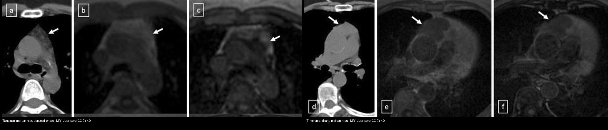
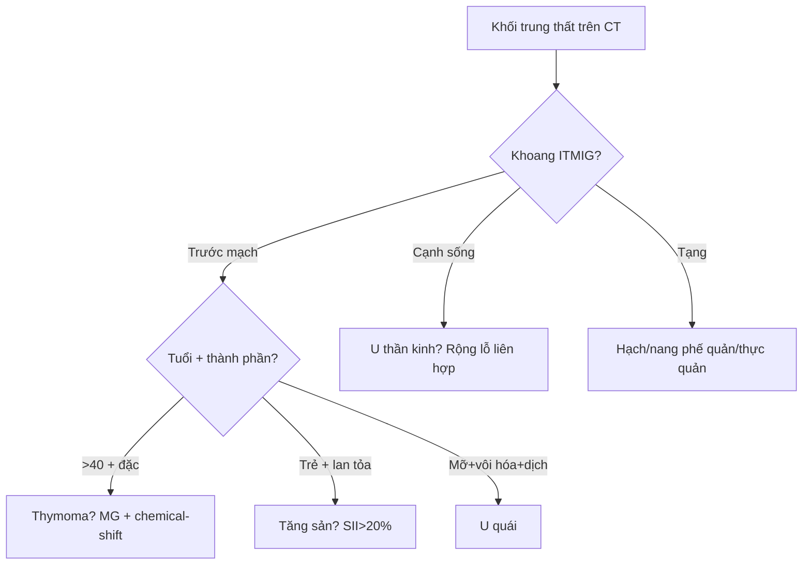
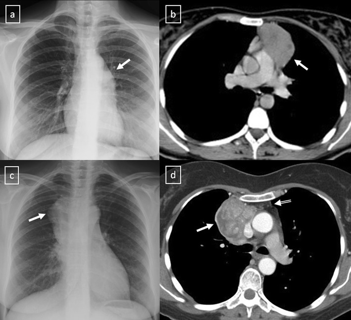

# 060 — Khối trung thất 3 khoang ITMIG / Mediastinal masses (ITMIG compartments)

**Tags:** `pattern:khoi` `vung:trung-that` `score:ITMIG`
**Mức chắc chắn (certainty):** tổng hợp y văn (literature synthesis) — nhóm tự biên từ y văn mở, chưa gắn ca nguyên văn đơn lẻ.

## 1. Tổng quan — 3 khoang ITMIG thay X-quang cổ điển

- ITMIG chia trung thất trên CT thành **trước mạch máu (prevascular)**, **tạng (visceral)**, **cạnh sống (paravertebral)** — thay phân loại X-quang trước/giữa/sau (sai số cao khi khối lớn tràn khoang).
- Quy tắc tuổi: **> 40 tuổi + khối trước mạch** nghĩ thymoma trước; **trẻ + khối trước mạch** nghĩ tăng sản/lymphoma/u mầm; **mọi tuổi + khoang cạnh sống** nghĩ u thần kinh trước.
- TẠI SAO chemical-shift phân biệt được tăng sản vs u: tuyến ức tăng sản còn **mỡ vi thể xen kẽ** → mất tín hiệu trên out-of-phase; u đặc không có mỡ vi thể → giữ nguyên tín hiệu. Ngưỡng: **SII (signal intensity index) > 20% hoặc CSR (chemical-shift ratio) < 0,7** = tăng sản.

## 2. Gamut theo khoang

- **Trước mạch (prevascular) — 4T:** Thymoma, Teratoma (u quái), Thyroid (tuyến giáp), Terrible lymphoma + tăng sản, nang tuyến ức/màng tim.
- **Tạng (visceral):** hạch lymphoma/lao, nang phế quản (bronchogenic cyst — cạnh carina 52%), thực quản (co thắt/túi thừa/thoát vị hoành).
- **Cạnh sống (paravertebral):** u thần kinh (schwannoma, u hạch — rộng lỗ liên hợp, hình quả tạ/dumbbell), áp-xe, tụ máu, tủy ngoài tủy.

## 3. Bảng so sánh 5 thực thể

| Thực thể (entity) | Hình ảnh điển hình | Chốt vào (rule-in) | Chốt loại (rule-out) | Gợi ý xác nhận |
|---|---|---|---|---|
| Thymoma | > 40 tuổi, khối đa cung trước mạch, nhược cơ (MG), hoại tử/vôi hóa trong u | **Tuổi + MG + khối đặc không mất tín hiệu chemical-shift** | Trẻ + mất tín hiệu out-of-phase → tăng sản | CT cản quang + Masaoka-Koga sau mổ |
| Tăng sản tuyến ức | Trẻ, tuyến to lan tỏa bờ nhẵn, sau stress/hóa trị (rebound > 50%) | **SII > 20% / CSR < 0,7 trên chemical-shift** | Khối khu trú + không mất tín hiệu → u | MRI chemical-shift, theo dõi teo dần |
| U quái (teratoma) | Trước mạch, **mỡ đại thể −40…−120 HU + vôi hóa/răng + dịch** trong cùng khối | **Mỡ + vôi hóa + dịch trong 1 khối** | Đặc thuần không mỡ/vôi → thymoma/lymphoma | AFP/β-hCG (u mầm ác) |
| Lymphoma | Trẻ, khối lớn bao bọc mạch (**vessel encasement**) mà **không tắc lòng** | **Bao mạch không tắc + hạch nhiều nhóm + tuổi trẻ** | Xâm lấn/tắc mạch → thymoma xâm lấn/K giáp | Sinh thiết hạch, PET đánh giá |
| U thần kinh | Cạnh sống, **rộng lỗ liên hợp**, dumbbell, vôi hóa mịn | **Khoang cạnh sống + rộng lỗ liên hợp** | Trước mạch → không phải u thần kinh | MRI tủy (xâm lấn ống sống?) |

*Trái: tăng sản — mất tín hiệu out-of-phase (panel c). Phải: thymoma B2 — giữ nguyên tín hiệu (panel f). Nguồn: Juanpere et al., CC BY 4.0. Ảnh ghép letterbox (panel đã cắt có ghi rõ).*

## 4. Protocol + flowchart khoang

- **CT cản quang ngực:** vẽ bản đồ mạch (encasement vs xâm lấn), HU mỡ/nước/vôi hóa, hạch.
- **MRI chemical-shift (in/out-of-phase):** mọi khối tuyến ức trẻ/không điển hình — SII/CSR như mục 1.
- DWI: ADC u ác thấp hơn lành (tham khảo, không chốt một mình).

## 5. Cạm bẫy

- **Rebound sau hóa trị/xạ trị/bỏng:** tuyến to > 50% sau stress — đừng đọc tái phát; chemical-shift + theo dõi teo dần.
- **Tuyến ức trẻ bình thường:** hình tam giác/bầu, bờ nhẵn — đừng gọi u.
- **Nang màng tim góc tâm hoành phải:** nang nước 0–20 HU, không ngấm thuốc — đừng gọi u đặc.
- **ĐMC quặt, thực quản giãn:** giả khối cạnh sống/tạng — uống cản quang/thuốc sủi khi nghi thực quản.

## 6. Tự lượng giá — Blind Quiz

**Ca 1 — Nữ 43 tuổi, khối trước mạch. So sánh 2 nửa dưới đây, kết luận trước.**

- Hỏi: nửa nào mất tín hiệu out-of-phase? Mỗi nửa là tăng sản hay u? Ngưỡng số?

<b>Bấm để hiện đáp án</b>

- Trái (a–c): mất tín hiệu out-of-phase → **tăng sản** (SII > 20%). Phải (d–f): giữ nguyên tín hiệu → **thymoma B2**.
- Nguồn: Juanpere et al., Fig. 17, CC BY 4.0.

**Ca 2 — Nữ 33 tuổi, nhược cơ, X-quang mờ rốn phổi trái:**

<b>Bấm để hiện đáp án</b>

- **Thymoma B1 giai đoạn II:** hilum overlay X-quang + khối trước mạch CT ở BN nhược cơ — bộ 3 tuổi + MG + vị trí.
- Nguồn: Juanpere et al., Fig. 18, CC BY 4.0.

## Bài liên quan chéo
- [001 – Tổng quan hệ Ngực](../001-tong-quan-he-nguc/lesson.md)
- [010 – Giải phẫu ngực cắt lớp](../010-giai-phau-nguc-cat-lop/lesson.md) (đường-dải trung thất)

> Không dùng để chẩn đoán độc lập khi chưa có người hướng dẫn.
