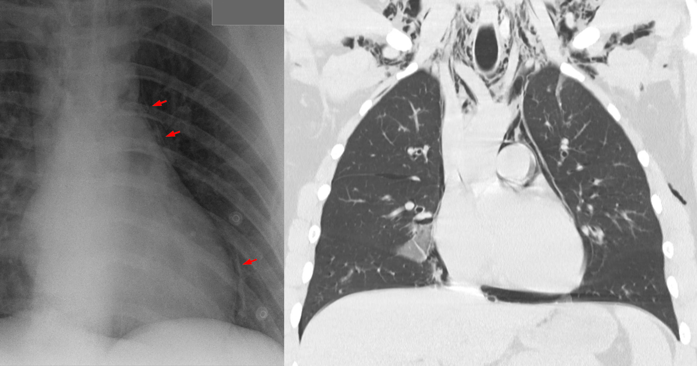
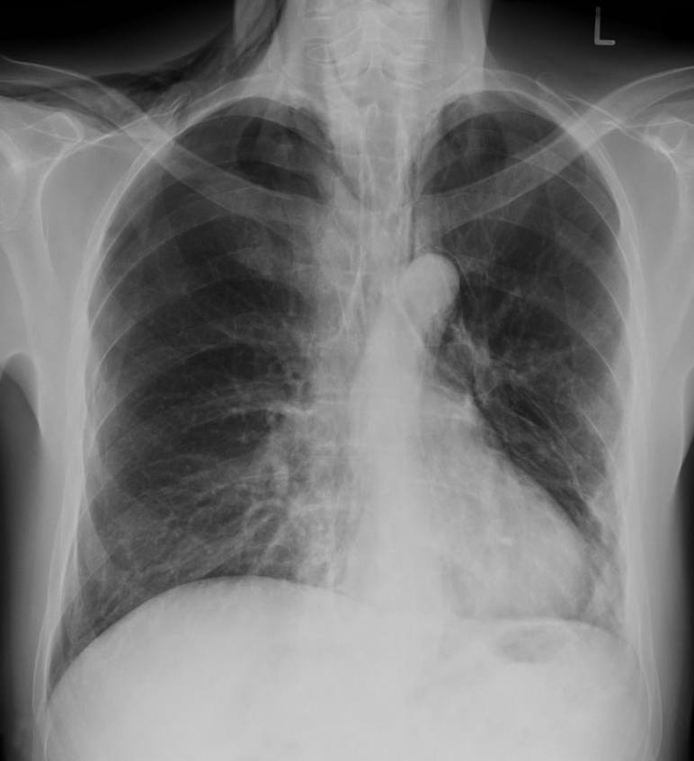
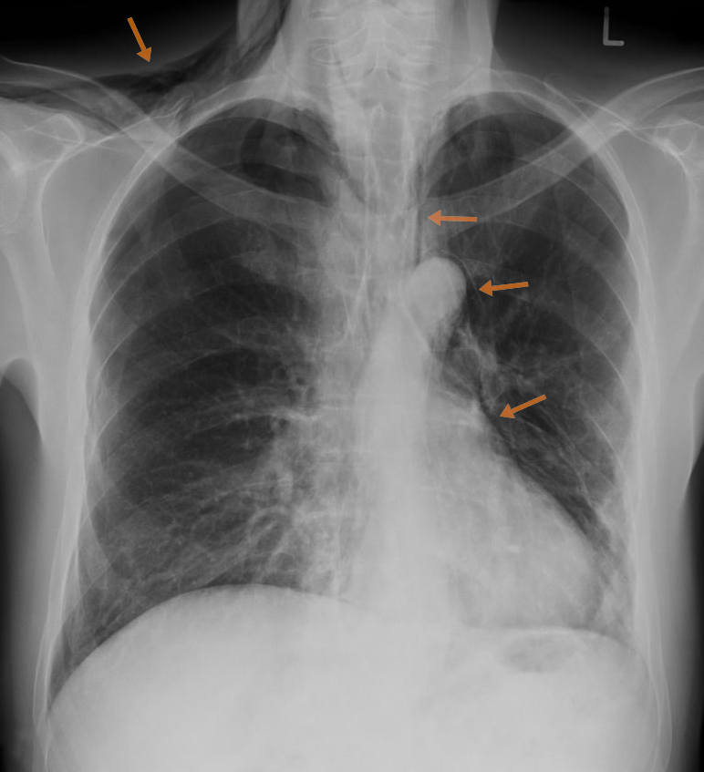

# 061 — Tràn khí trung thất / Pneumomediastinum

**Tags:** `pattern:khi-trung-that` `vung:trung-that`
**Mức chắc chắn (certainty):** tổng hợp y văn (literature synthesis) — nhóm tự biên từ y văn mở, chưa gắn ca nguyên văn đơn lẻ.

## 1. Tổng quan — khí ra trung thất theo 3 đường + Macklin

- Khí từ vỡ phế nang đi theo bao mạch-phế quản vào trung thất (**hiệu ứng Macklin**), từ thủng thực quản/khí quản, hoặc từ cổ/xương sườn chấn thương.
- Dấu X-quang: **đường sáng song song bờ trung thất**, liên tục với khí dưới da cổ; **dấu cánh buồm (spinnaker sail)** ở trẻ (tuyến ức nâng lên); CT: khí viền ĐMC/tim/thực quản + lan lên cổ.
- TẠI SAO phải tìm thủng thực quản mọi ca: viêm trung thất hoại tử tử vong > 20% nếu mổ muộn — khí trung thất + sốt + đau nuốt + khí dưới da = thủng đến khi chứng minh ngược lại.

## 2. Gamut theo bối cảnh

- **Tự phát (thanh niên, gắng sức/nôn):** lành tính, theo dõi — nhưng vẫn phải loại thủng (Boerhaave sau nôn ói dữ dội).
- **Chấn thương (gãy xương sườn, tai nạn):** kèm tràn khí/tràn máu, vỡ PQ (khí nhiều + xẹp không nở dù dẫn lưu).
- **Thủng thực quản (K, nội soi, Boerhaave):** khí + dịch trung thất + sốt — cấp cứu ngoại khoa.
- **Thở máy áp lực cao:** barotrauma ICU — giảm áp lực, dẫn lưu nếu kèm tràn khí áp lực.

*X-quang: đường sáng song song trung thất. CT coronal: khí tự do lên cổ + tràn khí khe nhỏ. Nguồn: Hellerhoff, CC BY-SA 3.0.*

## 3. Bảng so sánh

| Thực thể (entity) | Hình ảnh điển hình | Chốt vào (rule-in) | Chốt loại (rule-out) | Gợi ý xác nhận |
|---|---|---|---|---|
| Tự phát (spontaneous) | Khí trung thất + dưới da, không dịch, trẻ khỏe | **Trẻ + gắng sức + không sốt/dịch** | Sốt + dịch + đau nuốt → thủng | Theo dõi, Oxy, chụp lại |
| Vỡ PQ (tracheobronchial) | Khí nhiều + xẹp không nở + tràn khí áp lực | **Dẫn lưu không nở + khí liên tục** | Nở tốt sau dẫn lưu → không vỡ lớn | Soi PQ, phẫu thuật |
| Thủng thực quản | Khí + **dịch trung thất** + sốt + đau nuốt | **Dịch + sốt + bối cảnh K/nội soi/nôn** | Khí thuần không dịch + trẻ khỏe → tự phát | CT cản quang uống + nội soi, mổ sớm |
| Barotrauma ICU | Thở máy + khí trung thất/tràn khí mới | **Áp lực cao + mới xuất hiện** | Ngoài máy thở → nguyên nhân khác | Giảm áp, dẫn lưu khi cần |

## 4. Protocol

- **X-quang + CT cản quang (uống + tiêm):** uống tìm rò thực quản; tiêm đánh giá mạch/mô mềm.
- Nghi thủng: nhịn ăn + kháng sinh phổ rộng + hội chẩn ngoại lồng ngực sớm (vàng 24 giờ).
- Tự phát: nghỉ ngơi + tránh gắng sức/lặn bay 2–4 tuần.

## 5. Cạm bẫy

- **Khí trung thất lượng ít** lẫn với nếp da/mỡ — cuộn CT xác nhận, đừng bỏ sót thủng.
- **Tràn khí màng tim** (sau mổ tim): khí quanh tim không lên cổ — khác khí trung thất lan cổ.
- **Boerhaave sau nôn:** đau ngực sau nôn + khí trung thất = thủng đến khi chứng minh ngược lại (Mackler cổ điển: nôn + đau ngực + khí dưới da).

## 6. Tự lượng giá — Blind Quiz

**Ca 1 — K thực quản + đau nuốt + sốt. Tìm dải sáng quanh quai ĐMC.**

- Hỏi: dải sáng quanh quai ĐMC là gì? Bối cảnh này nguy hiểm nhất là gì?

<b>Bấm để hiện đáp án</b>

- **Thủng thực quản do K:** khí trung thất (dải sáng quanh quai ĐMC) + sốt + nuốt đau — mổ cấp cứu, không theo dõi như tự phát.
- Nguồn: Hellerhoff, CC BY-SA 4.0.

**Ca 2 — Thanh niên đau ngực sau tập gym, X-quang đường sáng trung thất, không sốt:** xử trí? *(Quy tắc mục 4.)*

<b>Bấm để hiện đáp án</b>

- **Tự phát:** loại thủng bằng hỏi nuốt/sốt + CT nếu nghi ngờ; còn lại nghỉ ngơi + Oxy + tránh gắng sức.

## Bài liên quan chéo
- [001 – Tổng quan hệ Ngực](../001-tong-quan-he-nguc/lesson.md)
- [041 – Tràn khí màng phổi](../041-tran-khi-mang-phoi/lesson.md) (khí màng phổi kèm)
- [060 – Khối trung thất ITMIG](../060-khoi-trung-that-itmig/lesson.md) (u thực quản)

> Không dùng để chẩn đoán độc lập khi chưa có người hướng dẫn.
