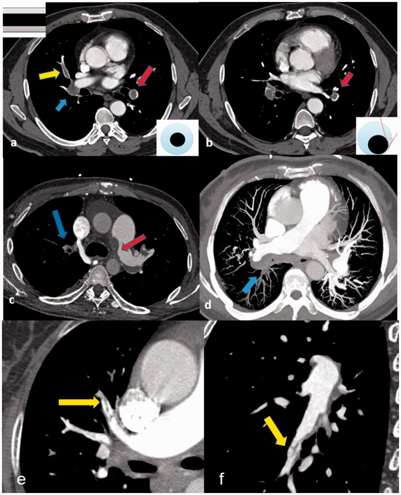
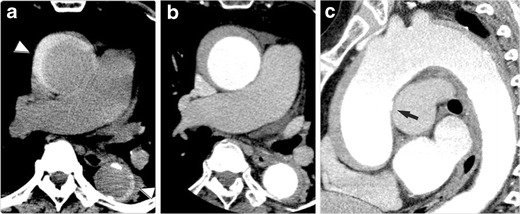
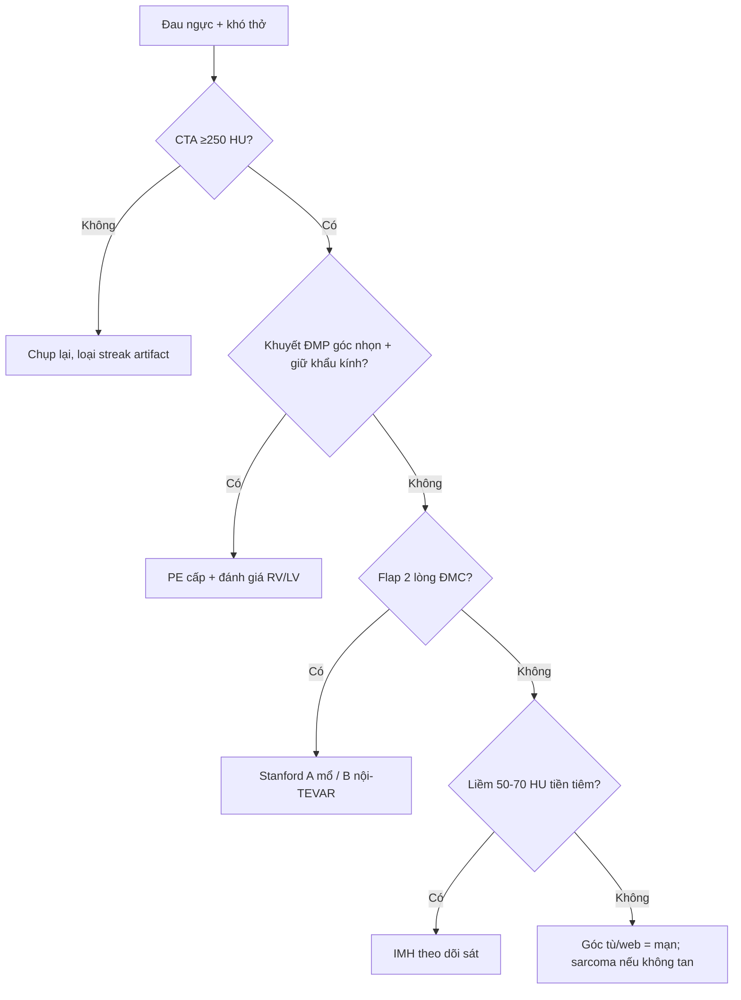

# 070 — Thuyên tắc phổi & hội chứng ĐMC cấp / PE & Acute aortic syndrome

**Tags:** `pattern:khuyet-thuoc` `vung:mach-nguc` `protocol:CTA-nguc`
**Mức chắc chắn (certainty):** tổng hợp y văn (literature synthesis) — nhóm tự biên từ y văn mở, chưa gắn ca nguyên văn đơn lẻ.

## 1. Tổng quan — CTA đọc gì + ngưỡng cản quang

- CTA ngực chẩn đoán PE khi thuốc cản quang động mạch phổi đạt **≥ 250 HU ở thân chung ĐMP** (dưới ngưỡng này giả khuyết thuốc do pha thuốc).
- **Khuyết thuốc cấp (acute):** giữ nguyên khẩu kính mạch, trung tâm (polo mint) hoặc dọc (railway track), **góc nhọn (acute angle)** với thành mạch.
- **Khuyết thuốc mạn (chronic):** khẩu kính hẹp/cụt, **góc tù (obtuse)**, web/band, pouch, vôi hóa nội mạc.
- TẠI SAO góc quyết định cấp/mạn: cục tươi nổi trong lòng → tiếp tuyến nhọn; xơ hóa dính thành lâu ngày → tù, kéo màng.

*a–b: cấp — polo mint, railway track, góc nhọn (có sơ đồ góc kèm). c–f: mạn — góc tù, pouch, web. Nguồn: Liu et al., Pulm Circ 2020 Fig. 1, CC BY-NC 4.0.*

## 2. Gamut khuyết thuốc ĐMP + đau ngực xé

- **PE cấp:** Wells cao, DVT, sau mổ/nằm lâu, ung thư (nguy cơ gấp 4–6 lần).
- **PE mạn/CTEPH:** tiền sử PE/DVT, tăng áp phổi, web/band.
- **Giả PE:** sarcoma ĐMP (không tan dù kháng đông + ngấm thuốc không đều + PET bắt mạnh), Takayasu (double-ring), Behçet (phình + huyết khối tại chỗ), streak artifact (mất ở thì muộn).
- **Hội chứng ĐMC cấp:** đau xé lan lưng, Stanford A (lên) mổ cấp cứu / B (xuống) nội khoa-TEVAR; bóc tách (flap), IMH (liềm 50–70 HU tiền tiêm), PAU (loét).

## 3. Bảng so sánh

| Thực thể (entity) | Hình ảnh điển hình (CTA) | Chốt vào (rule-in) | Chốt loại (rule-out) | Gợi ý xác nhận |
|---|---|---|---|---|
| PE cấp | Khuyết trung tâm/dọc, **góc nhọn**, giữ khẩu kính | **Góc nhọn + ≥ 250 HU thân ĐMP + Wells cao** | Góc tù/web/vôi hóa → mạn | Kháng đông, siêu âm DVT chi dưới |
| PE mạn/CTEPH | **Góc tù + web/band + pouch**, hẹp/cụt mạch | **Web + tiền sử PE + tăng áp phổi** | Góc nhọn + mới khởi phát → cấp | Thông tim phải, phẫu thuật bóc nội mạc |
| Sarcoma ĐMP | Khuyết lấp toàn thân ĐMP, **lobulated/tongue**, ngấm không đều | **Không tan dù kháng đông + PET bắt mạnh** | Tan sau kháng đông → huyết khối | Sinh thiết, hội chẩn ung bướu |
| Bóc tách ĐMC | **Vạt nội mạc (flap)**, lòng thật nhỏ-liên tục gốc, lòng giả lớn + **cobweb + beak** | **Flap + 2 lòng + Stanford A/B** | Liềm đặc không flap tiền tiêm → IMH | ECG-gated CTA, mổ/TEVAR theo Stanford |
| IMH | **Liềm tăng tỷ trọng 50–70 HU trên CT TRƯỚC TIÊM**, không flap | **Liềm tiền tiêm + đau xé + không flap** | Có flap rõ → bóc tách điển hình | Theo dõi sát (tiến triển thành bóc tách) |
| PAU | Loét lõm vào thành + máu tụ thành | **Ổ loét + xơ vữa nặng người già** | Flap dài → bóc tách | Stent-graft khi vỡ dọa |

*a: liềm tăng tỷ trọng tiền tiêm. b–c: CTA cùng BN. Nguồn: Ueda et al., Insights into Imaging 2012 Fig. 4, CC BY 4.0.*

## 4. Protocol CTA + quá tải thất phải

- Bolus-tracking thân ĐMP (ngưỡng ≥ 250 HU), lát mỏng, MIP/MPR dọc mạch (railway track chỉ hiện khi cắt dọc đúng).
- Dấu quá tải thất phải (tiên lượng nặng): **RV/LV > 1,0**, vách liên thất dẹt/đẩy sang trái, trào ngược thuốc vào tĩnh mạch chủ dưới.
- Nghi ĐMC: ECG-gated (khử giả flap do chuyển động gốc), thêm **thì trước tiêm** (IMH liềm 50–70 HU chỉ hiện tiền tiêm).

## 5. Cạm bẫy

- **Streak artifact:** khuyết thì sớm, mất thì muộn (dual-phase) — đừng gọi PE.
- **Hạch/van giả khuyết:** cuộn MPR dọc xác nhận, đừng đọc 1 lát.
- **IMH bỏ sót:** quên thì trước tiêm là mất liềm 50–70 HU — protocol phải có non-contrast.
- **Sarcoma gọi nhầm PE mạn:** không tan sau kháng đông đầy đủ → PET + sinh thiết, đừng tăng liều vô ích.

## 6. Tự lượng giá — Blind Quiz

**Ca 1 — Nhìn panel a–b, gọi tên dấu + phân biệt cấp/mạn.**

- Hỏi: polo mint ở đâu? railway track ở đâu? Góc nhọn hay tù? Sơ đồ góc kèm nói gì?

<b>Bấm để hiện đáp án</b>

- a: polo mint ĐMP thùy dưới trái + railway track ĐM thùy giữa phải + tắc ĐM thùy dưới phải; b: khuyết lệch tâm **góc nhọn** → **PE cấp**. Sơ đồ góc: nhọn = cấp, tù = mạn (panel c–f).
- Nguồn: Liu et al., Fig. 1, CC BY-NC 4.0.

**Ca 2 — Đau ngực xé, CT tiền tiêm thấy liềm đặc thành ĐMC, CTA không flap:**

<b>Bấm để hiện đáp án</b>

- **IMH:** liềm 50–70 HU tiền tiêm + không flap (đối chiếu ảnh mục 3) — theo dõi sát vì có thể tiến triển thành bóc tách/ vỡ.
- Nguồn: Ueda et al., Fig. 4, CC BY 4.0.

## Bài liên quan chéo
- [001 – Tổng quan hệ Ngực](../001-tong-quan-he-nguc/lesson.md)
- [031 – Viêm phổi mẫu hình](../031-viem-phoi-mau-hinh/lesson.md) (nhồi máu phổi)
- [040 – Tràn dịch màng phổi](../040-tran-dich-mang-phoi/lesson.md) (tràn máu màng phổi do vỡ)

> Không dùng để chẩn đoán độc lập khi chưa có người hướng dẫn.
