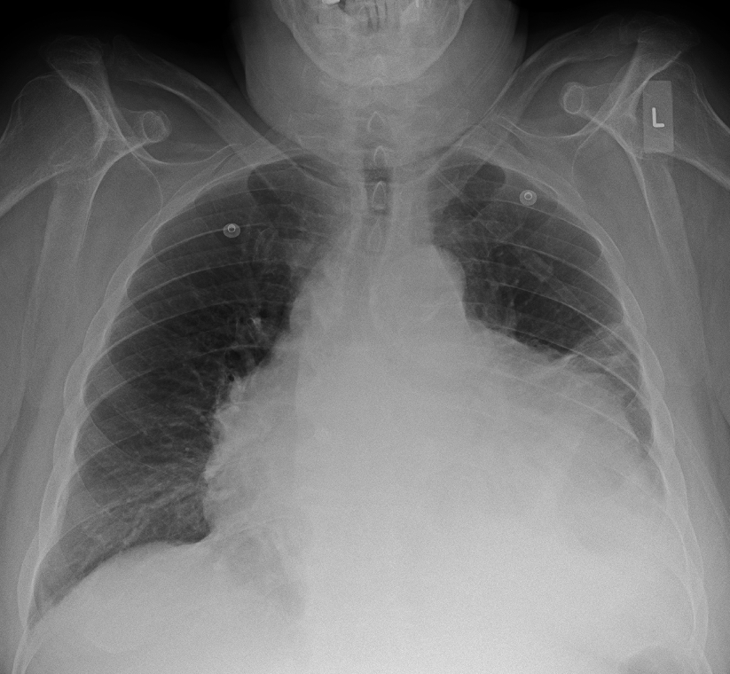
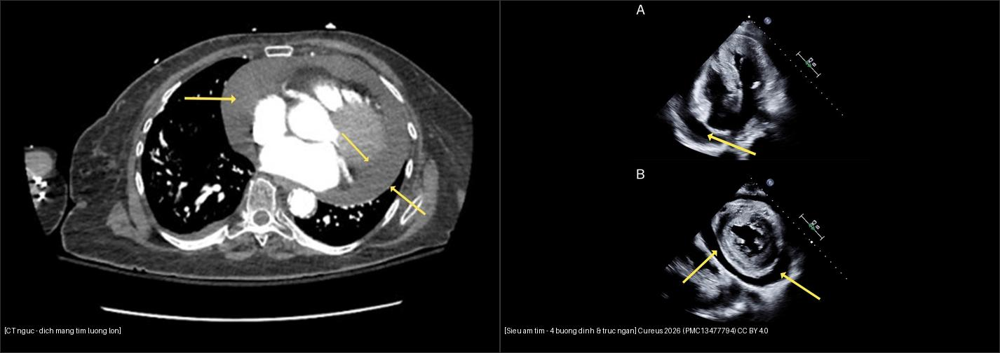
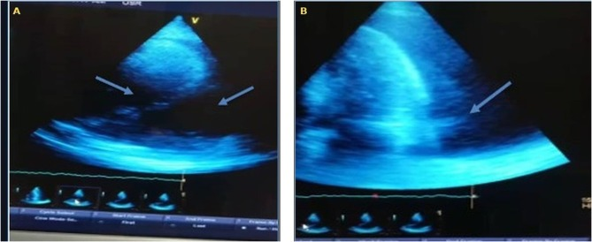

# 075 — Tràn dịch màng tim & chèn ép tim / Pericardial effusion & Tamponade

**Tags:** `pattern:tran-dich-mang-tim` `vung:mang-tim`
**Mức chắc chắn (certainty):** tổng hợp y văn (literature synthesis) — nhóm tự biên từ y văn mở, chưa gắn ca nguyên văn đơn lẻ.

## 1. Tổng quan — dịch bao tim + khi nào thành chèn ép

- Màng tim bình thường < 2 mm, < 50 mL dịch. Dịch tăng dần: lao, ure máu, ung thư (phổi/vú/lymphoma), sau NMCT/mổ tim (Dressler), suy giáp.
- **Chèn ép (tamponade) là sinh lý, không phải số mL:** dịch tăng nhanh (chấn thương/vỡ) chỉ 150–200 mL đã ép tim; mạn tính cả lít vẫn dung nạp. TẠI SAO: màng tim kém giãn cấp → áp lực trong bao vượt áp đổ đầy thất phải → cung lượng rơi.
- X-quang: **bóng tim hình chai nước (water-bottle)** + bờ tim sắc; > 250 mL mới thấy to ra. Siêu âm mới là chốt (không phải X-quang).

*Tràn dịch màng tim lượng lớn: bóng tim bè 2 bên hình chai nước. Nguồn: Doc James, CC BY-SA 4.0.*

*Trái: CT ngực trục — dịch màng tim lượng lớn bao quanh tim (mũi tên vàng), đậm độ dịch thấp. Phải: siêu âm tim qua thành ngực — (A) mặt cắt 4 buồng đỉnh, (B) mặt cắt trục ngắn, dịch màng tim bao quanh (mũi tên vàng). Nguồn: Cureus 2026 (PMC13477794), CC BY 4.0; ghép letterbox bằng `tools/make_composite.py`.*

*Siêu âm tim ở bệnh nhân suy giáp nặng: (A) mặt cắt 4 buồng đỉnh — dịch màng tim **chu vi lượng lớn** (mũi tên); **khoảng cách sau tối đa 3,2 cm**; (B) sau dẫn lưu/diễn tiến. Nguồn: *Int Med Case Rep J* 2026 (PMC13209143), CC BY-NC-ND 4.0 (nguyên bản, không ghép).*

## 2. Gamut bóng tim to

- **Dịch màng tim:** chai nước + bờ sắc + phổi trong (không phù) — siêu âm phân biệt với tim to.
- **Suy tim giãn:** tim to + phù phổi + Kerley (bài 033) — có dấu suy.
- **U màng tim:** khối khu trú + không đều, PET bắt (hiếm).
- **Mỡ màng tim:** đối xứng + HU mỡ (bài 042) — lành tính.

## 3. Bảng dấu chèn ép (siêu âm + lâm sàng)

| Dấu hiệu | Ngưỡng/số | Ý nghĩa |
|---|---|---|
| Xẹp nhĩ phải (RA collapse) | Cuối tâm trương, kéo dài > 1/3 chu kỳ | Nhạy nhất, xuất hiện sớm |
| Xẹp thất phải (RV collapse) | Đầu tâm trương | Đặc hiệu hơn, muộn hơn |
| Tĩnh mạch chủ dưới giãn | > 21 mm + xẹp < 50% khi hít vào | Áp nhĩ phải cao |
| Beck tam chứng (lâm sàng) | HA tụt + tĩnh mạch cổ nổi + tim mờ | Cấp cứu chọc hút |
| Mạch nghịch (pulsus paradoxus) | HA tâm thu giảm > 10 mmHg khi hít vào | Chèn ép có ý nghĩa huyết động |

## 4. Protocol

- **Siêu âm tim tại giường:** mọi nghi ngờ — đo dịch (mm), RA/RV collapse, IVC, Doppler (biến thiên qua hô hấp).
- **CT:** dịch + dày màng tim (> 4 mm nghĩ viêm co thắt kèm), nguyên nhân (u, lao).
- **Chọc hút cấp cứu** khi tamponade: dưới hướng dẫn siêu âm, đường dưới mũi ức; gửi sinh hóa/vi sinh/tế bào.

## 5. Cạm bẫy

- **X-quang bình thường không loại trừ tamponade cấp** (150 mL chưa to bóng) — siêu âm mới quyết định.
- **Mỡ màng tim** giả dịch trên X-quang — CT HU mỡ phân biệt.
- **Viêm màng tim co thắt** sau dịch mạn: dày + vôi hóa màng tim — khác chèn ép cấp (dịch nhiều, màng mỏng).

## 6. Tự lượng giá — Blind Quiz

**Ca 1 — Nhìn X-quang, gọi tên hình + bước tiếp theo.**

- Hỏi: bóng tim hình gì? Phổi có phù không? Bước tiếp theo là gì (X-quang hay siêu âm)?

<b>Bấm để hiện đáp án</b>

- **Chai nước + phổi trong** → tràn dịch màng tim lượng lớn; bước tiếp là **siêu âm tim ngay** tìm RA/RV collapse (X-quang không chẩn đoán tamponade).
- Nguồn: Doc James, CC BY-SA 4.0.

**Ca 2 — Bệnh nhân khó thở, tĩnh mạch cổ nổi; xem CT và siêu âm tim. Đọc ảnh trước.**

- Gợi ý lâm sàng (clinical context): mệt, khó thở tăng dần, huyết áp thấp, tĩnh mạch cổ nổi.
- Câu hỏi: Xác định dịch ở đâu? Tìm dấu hiệu chèn ép (RA/RV collapse) trên siêu âm? X-quang có thể bình thường không?

<b>Bấm để hiện đáp án (findings + chẩn đoán)</b>

- Dấu hiệu (findings): CT — **dịch bao quanh tim, đậm độ thấp, lượng lớn** (mũi tên); siêu âm — **dịch màng tim chu vi** ở mặt cắt 4 buồng đỉnh và trục ngắn.
- Chẩn đoán (diagnosis): **tràn dịch màng tim lượng lớn**; nếu kèm **xẹp nhĩ phải > 1/3 chu kỳ** hoặc **xẹp thất phải** → **chèn ép tim (tamponade)**. **X-quang có thể bình thường** khi dịch tăng nhanh (150–200 mL), nên **siêu âm mới quyết định**.
- Nguồn ảnh: Cureus 2026 (PMC13477794), CC BY 4.0 (ảnh ghép letterbox).

**Ca 3 — HA 85/60 + tĩnh mạch cổ nổi + tim mờ sau chấn thương ngực:** chẩn đoán + xử trí? *(Tam chứng Beck — mục 3.)*

<b>Bấm để hiện đáp án</b>

- **Tamponade cấp do máu màng tim:** chọc hút cấp cứu dưới siêu âm + mổ cầm máu (không chờ CT đủ liều).
- Nguồn số liệu: dấu chèn ép lấy từ y văn (mục 3); xem thêm ảnh siêu âm ở Ca 2.

## Bài liên quan chéo
- [001 – Tổng quan hệ Ngực](../001-tong-quan-he-nguc/lesson.md)
- [033 – Phù phổi & ARDS](../033-phu-phoi-ards/lesson.md) (tim to + phù vs chai nước + phổi trong)
- [080 – Chấn thương ngực (đã có)](../080-chan-thuong-nguc/lesson.md) (máu màng tim)

> Không dùng để chẩn đoán độc lập khi chưa có người hướng dẫn.
