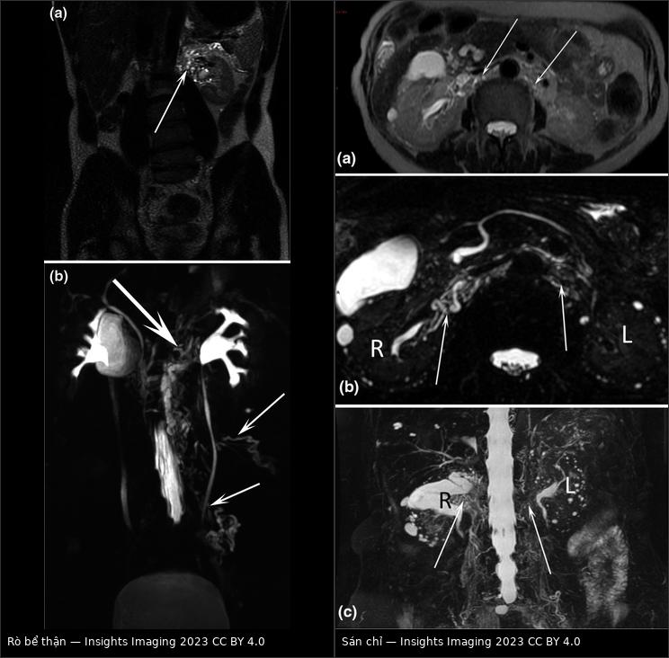
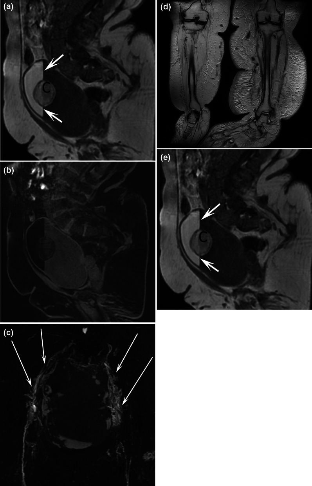
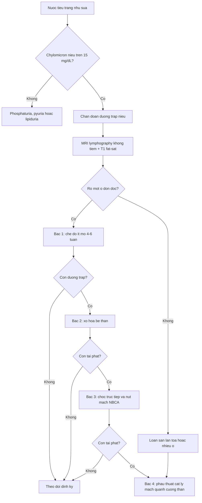
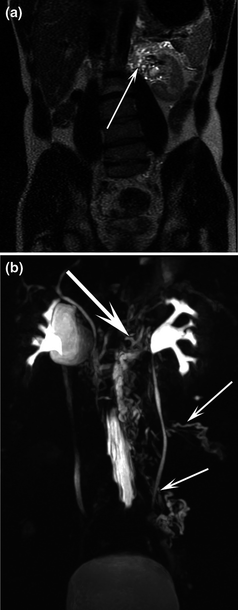
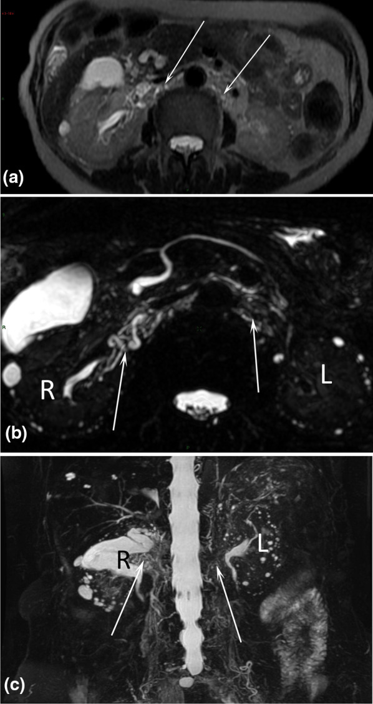
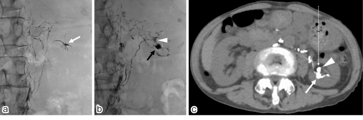

# 076 — Dưỡng trấp niệu & rò bạch huyết đường niệu: nước tiểu trắng như sữa, MRI lymphography, xơ hóa/nút mạch và khi nào mổ

**Tags:** `pattern:duong-trap-nieu` `pattern:ro-bach-huyet` `pattern:nuoc-tieu-trang` `vung:tiet-nieu` `vung:sau-phuc-mac` `anatomy:ong-nguc` `protocol:MRI-lymphography` `protocol:lymphangiography` `protocol:nut-mach`
**Mức chắc chắn (certainty):** tổng hợp y văn (literature synthesis) — số liệu từ bài tổng quan có ảnh Insights into Imaging 2023 (PMC10322811), ca TD stent + nút mạch của CVIR Endovascular 2023 (PMC10406733), ca chọc trực tiếp + NBCA của Interventional Radiology 2026 (PMC13044549) và loạt 6 ca phẫu thuật nội soi sau phúc mạc tại Việt Nam của Int J Surg Case Rep 2026 (PMC13652389). Không có ca nguyên văn riêng của nhóm.

## 1. Tổng quan bệnh học – cơ chế hình ảnh

- **Bản chất:** **dưỡng trấp niệu (chyluria)** = nước tiểu **trắng như sữa** do **dưỡng trấp (chyle)** — dịch bạch huyết ruột non — đi vào đường niệu qua một **rò bạch huyết–niệu (uro-lymphatic fistula)**. Dưỡng trấp **2–4 L/ngày**, giàu **chylomicron, albumin và tế bào lympho** (PMC10322811).
- **Vì sao nguy hiểm hơn "nước tiểu đục" thông thường:** mất **protein và mỡ** qua nước tiểu → **giả hội chứng thận nhiễm mỡ (pseudo-nephrotic syndrome)**: **giảm albumin, phù, sụt cân**, nhưng **KHÔNG tăng cholesterol** — ngược với hội chứng thận nhiễm mỡ thật (tăng cholesterol, có **thể mỡ tròn** trong cặn lắng). Ca điển hình: **albumin 2,4 g/dL, protein toàn phần 4,4 g/dL, protein niệu 0,854 g/ngày** (PMC13044549).
- **Ngưỡng chẩn đoán (quan trọng nhất bài):**
  - **Chylomicron niệu > 15 mg/dL**, lấy **4 giờ sau bữa ăn giàu mỡ** — **xét nghiệm đặc hiệu và nhạy nhất** (PMC10322811).
  - **Nghiệm pháp ether (ether test):** lắc nước tiểu với ether — **mất đục** = lipid (dưỡng trấp); **không mất** = mủ/phosphat. Đây là test giường bệnh kinh điển, **không thay thế** định lượng chylomicron.
  - **Phân biệt với mủ (pyuria):** ly tâm — **dưỡng trấp vẫn đục ở phần nước trong**, mủ lắng cặn và **có bạch cầu trung tính thoái hóa** (PMC10322811).
- **Cơ chế — hai học thuyết, ứng với hai nhóm nguyên nhân:**
  - **Tắc nghẽn (obstructive):** **sán chỉ (Wuchereria bancrofti)** làm tắc mạch bạch huyết → **tăng áp lực trong ống ngực** → mở rò vào **xoang thận/đài thận**, ít gặp hơn ở **niệu quản/bàng quang**.
  - **Trào ngược (regurgitation):** **loạn sản mạch bạch huyết thể ống (channel-type lymphatic malformation)** → thành mạch tăng thấm, giãn thành **varices quanh đường niệu** → rò.
- **Dịch tễ — vì sao vẫn phải nghĩ tới ở Việt Nam:**
  - **Sán chỉ chiếm ~95% nguyên nhân ký sinh trùng**, ước tính **tới 120 triệu người nhiễm trên toàn cầu**, lưu hành ở **Đông Á (đặc biệt vành đai sông Hằng – Ấn Độ) và châu Phi hạ Sahara**; tuổi điển hình **20–40**, nam = nữ (PMC10322811).
  - **Nhóm không do sán ngày càng tăng** khi chương trình diệt sán hiệu quả: **loạn sản mạch bạch huyết**, **chấn thương**, **sau mổ (cắt thận bán phần, mổ sau phúc mạc)**, **u**, **lao**, **thai kỳ** (PMC10322811, PMC13652389). Loạt Việt Nam 6 ca **đều không do sán**, tuổi trung bình **68,8** (41–87), **thận trái 4/6** (PMC13652389) — tức **đừng loại trừ chyluria chỉ vì bệnh nhân lớn tuổi, không vùng dịch tễ**.
- **TẠI SAO nhìn thấy rò trên MRI (vật lý chuỗi xung):**
  - **Dưỡng trấp là dịch đứng yên, giàu protein** → trên **chuỗi xung nặng T2 (heavily T2-weighted 3D fast spin-echo)** cho **tín hiệu rất cao**, gần nước tiểu nhưng **thấp hơn một chút** do nồng độ protein cao (PMC10322811).
  - **Mạch bạch huyết có "nhịp" đặc trưng:** hẹp – giãn xen kẽ tại **van bạch huyết**; đây là dấu hiệu **phân biệt mạch bạch huyết với niệu quản/bể thận** (niệu quản đều, bể thận hình loa).
  - **Dịch ruột cũng sáng trên T2** → cho uống **nước ép dứa/dung dịch thuận từ** để xóa tín hiệu ruột trước khi chụp.
  - **CT/MRI thấy "mức mỡ–dịch trong bàng quang" (fat–fluid level)** là dấu hiệu **gần như đặc hiệu** của dưỡng trấp niệu: mỡ nhẹ hơn nước nổi lên trên, đậm độ **âm (mỡ)** trên CT, **tăng tín hiệu T1 và mất tín hiệu khi fat-sat** (PMC10322811, Fig. 6).

## 2. Mẫu hình + chẩn đoán phân biệt theo vị trí rò (gamut)

- **Mẫu hình cốt lõi:** **nước tiểu trắng + chylomicron niệu tăng + hình ảnh mạch bạch huyết giãn tiếp giáp đường niệu**. Ba câu hỏi: **(1) rò ở đâu? (2) một ổ hay nhiều ổ? (3) có loạn sản bạch huyết lan tỏa kèm theo?** — câu (3) quyết định **nút mạch hay mổ**.
- **Gamut theo vị trí rò (phân loại của bài tổng quan):**
  - **Rò vào nhu mô thận (renal communication):** mạch bạch huyết giãn **tiếp giáp vỏ thận**, thường kèm **phù chi dưới/loạn sản lan tỏa**.
  - **Rò vào bể thận (renal pelvis):** hay gặp nhất, hình **chùm mạch quanh cuống thận**, thấy rõ trên MRL thì vành.
  - **Rò vào niệu quản (ureteral):** mạch giãn **dọc niệu quản**; dễ bỏ sót nếu chỉ nhìn cuống thận.
  - **Rò vào bàng quang (bladder):** **mức mỡ–dịch trong lòng bàng quang**, có thể có **cục dưỡng trấp (chylous clot)** gây bí tiểu.
- **Gamut theo nguyên nhân:** sán chỉ; loạn sản mạch bạch huyết (kênh/nang, có thể kèm **Gorham–Stout, GLA**); sau mổ/chấn thương; u sau phúc mạc; lao; thai kỳ.
- **Bắt chước "nước tiểu trắng" mà KHÔNG phải dưỡng trấp:**

| Nước tiểu trắng/đục | Cơ chế | Dấu hiệu phân biệt |
|---|---|---|
| **Dưỡng trấp niệu** | Rò bạch huyết–niệu | **Chylomicron > 15 mg/dL**, ether test dương, mức mỡ–dịch bàng quang |
| **Phosphaturia** | Kết tinh phosphat trong nước tiểu **kiềm** | Đục khi để lạnh, **trong lại khi thêm acid**; không có chylomicron |
| **Pyuria** | Mủ do nhiễm trùng | Ly tâm: cặn mủ, **bạch cầu trung tính**; cấy dương |
| **Lipiduria (thận nhiễm mỡ)** | Thể mỡ tròn qua màng lọc | **Protein niệu lớn + tăng cholesterol**, **thể mỡ tròn/"Maltese cross"**, không có chylomicron |
| **Sỏi/urate** | Tinh thể | Cặn lắng, đau quặn, CT không cản quang thấy sỏi |

## 3. Bảng so sánh phân biệt (ma trận đối chiếu)

| Thực thể (entity) | Hình ảnh điển hình (MRI/CT/X-quang) | Chốt vào (rule-in) | Chốt loại (rule-out) | Gợi ý xác nhận |
|---|---|---|---|---|
| **Dưỡng trấp niệu do sán chỉ** | **Giãn mạch bạch huyết lan tỏa**, **không có mạch loạn sản**, kèm **phù chi dưới**; rò hay ở **bể thận** | **Chylomicron niệu > 15 mg/dL + tiền sử/ổ dịch tễ + MRL giãn lan tỏa** | Mạch **loạn sản/hình nang** nhiều ổ → nghĩ loạn sản bẩm sinh | Huyết thanh học/kháng nguyên sán; **DEC** |
| **Loạn sản mạch bạch huyết thể ống** | **Giãn + mạch loạn sản**, nhiều tầng (sau phúc mạc, lồng ngực, xương, mô mềm) | **Nhiều bất thường bạch huyết ngoài đường niệu + mạch loạn sản** | Chỉ một ổ rò, mạch còn lại bình thường → do tắc/mổ | MRL toàn ổ bụng; **gen/đánh giá đa cơ quan** (GLA, Gorham–Stout) |
| **Rò sau mổ/chấn thương** | Rò **khu trú** đúng vị trí mổ (cắt thận bán phần, mổ sau phúc mạc), mạch xung quanh **bình thường** | **Tiền sử mổ/chấn thương + một ổ rò đơn độc** | Loạn sản lan tỏa hai bên → không phải do mổ | **MRL + lymphangiography**; thường **tự khỏi** với chế độ ít mỡ |
| **Rò vào bàng quang** | **Mức mỡ–dịch trong bàng quang**, cục dưỡng trấp; MRL thấy mạch tiếp giáp **hai mặt bàng quang** | **Mức mỡ–dịch + chylomicron niệu** | Không có mức mỡ, chỉ đục đều → pyuria/phosphaturia | MRI T1 + fat-sat; soi bàng quang thấy **dịch dưỡng trấp chảy từ lỗ niệu quản** |
| **Rò dưỡng trấp ổ bụng/màng phổi (078/079)** | **Báng dưỡng trấp** hoặc **tràn dịch màng phổi dưỡng trấp**; cùng đường bạch huyết | **Dịch màng phổi/báng: TG cao + chylomicron** | Dịch **giả dưỡng trấp** (cholesterol cao, tinh thể) | Xét nghiệm dịch; MRL; nối bài 078/079 |
| **Phosphaturia** | **Không có bất thường hình ảnh** | **Nước tiểu trong lại sau thêm acid** | **Chylomicron âm** | Xét nghiệm nước tiểu, không cần chụp |

*Trái: **rò bể thận trái không do sán** — (a) T2 thì vành: chùm mạch bạch huyết giãn tiếp giáp bể thận trái (mũi tên); (b) MRL MIP: thấy rõ **mạch giãn dọc niệu quản** và **rò vào bể thận**. Phải: **dưỡng trấp niệu do sán chỉ** — (a) T2 trục: mạch giãn hai bên; (b) MRL trục và (c) MRL vành MIP: mạng bạch huyết giãn lan tỏa quanh **hai thận**. Nguồn: Insights into Imaging 2023 (PMC10322811) Fig. 3 và Fig. 4, CC BY 4.0; ghép bằng `tools/make_composite.py` (letterbox, không crop/kéo giãn).*

### Ba dấu hiệu quyết định
- **"Nhịp van" trên MRL:** mạch bạch huyết **hẹp–giãn xen kẽ**; mất nhịp này mà thấy cấu trúc đều → có thể là **niệu quản** (đừng đọc nhầm rò).
- **Vị trí rò so với đài thận dưới:** đa số rò **quanh đài thận dưới/cuống thận** — nơi mạch bạch huyết quanh thận hội tụ; đây là **đích chọc kim** khi nút mạch.
- **Số ổ rò:** MRL có thể thấy **nhiều vị trí "tiềm năng"** nhưng **không xác định được ổ nào đang hoạt động** (PMC10322811) → phải **đối chiếu lâm sàng + lymphangiography động**.

*Dưỡng trấp niệu ở nữ 44 tuổi. **(a)** T2 thì trục và **(b)** T1 fat-sat: **mức mỡ–dịch trong lòng bàng quang** (mũi tên) — mỡ nổi trên, tín hiệu **mất khi fat-sat**; kèm **cục dưỡng trấp (C)**. **(c)** MRL MIP: mạch bạch huyết loạn sản tiếp giáp **hai mặt bàng quang**. **(d–e)** Hình chi dưới cho thấy **phù bạch mạch hai chân** và biến dạng cổ–bàn chân bẩm sinh — dấu hiệu loạn sản bạch huyết lan tỏa, không chỉ một ổ rò. Nguồn: Insights into Imaging 2023 (PMC10322811) Fig. 6, CC BY 4.0.*

## 4. Protocol chụp + bậc thang điều trị

- **Bước 1 — xác nhận dưỡng trấp:** chylomicron niệu (> 15 mg/dL, sau ăn mỡ 4 giờ), ether test, albumin/protein toàn phần, lipid máu (để thấy **không tăng cholesterol**).
- **Bước 2 — tìm rò, không xâm lấn:**
  - **MRI/MRL không tiêm (non-enhanced MR lymphography):** 1,5 T, **3D heavily T2 FRFSE**, **TR 3500–4000 ms, TE 700–884 ms**, lát **0,8–1,4 mm**, **FOV 400 × 400 mm**, **124–316 lát**, thở tự do có cổng hô hấp, **3–5 phút**, dựng **MIP** thì vành + trục (PMC10322811). Kèm **T2 thì vành** và **T1 fat-sat** để tìm mức mỡ–dịch bàng quang.
  - **MR urography / CT urography** thì bài tiết: thấy **trào ngược dưỡng trấp** và loại trừ sỏi/u.
  - **Siêu âm:** nước tiểu **tăng âm**, bàng quang có cặn; có thể thấy **mạch giãn sau phúc mạc**.
- **Bước 3 — chụp bạch huyết xâm lấn (khi chuẩn bị can thiệp):**
  - **Lymphangiography qua hạch bẹn (intranodal):** chọc **1 hạch mỗi bên**, bơm **5 mL Lipiodol**, chụp thì; **CT sau 2 giờ** thấy **Lipiodol tụ tại ổ rò** (PMC13044549). Đôi khi **bản thân lymphangiography làm hết dưỡng trấp**.
  - **Chụp ống ngực qua chọc bể dưỡng trấp (TD lymphangiography):** xác định **tắc đoạn cuối ống ngực** — nguyên nhân gây tăng áp lực và rò.
  - **Chụp bể thận ngược dòng (retrograde pyelogram):** thấy **thuốc trào quanh đài thận dưới vào mạch bạch huyết** — dấu hiệu kinh điển (PMC13044549, Fig. 1).
- **Bậc thang điều trị (đúng thứ tự, đừng nhảy bậc):**

| Bậc | Biện pháp | Hiệu quả / số liệu | Lưu ý |
|---|---|---|---|
| **1** | **Chế độ ít mỡ + uống nhiều nước** (đôi khi + **MCT**), nghỉ ngơi | **Thành công > 70%** (PMC10322811) | Thử **4–6 tuần** trước khi can thiệp; vẫn duy trì sau thủ thuật |
| **1b** | **Thuốc diệt sán** nếu nghi nhiễm: **DEC**, ivermectin, albendazole | Giảm tải ký sinh, giảm tái phát | **DEC 6 mg/kg/ngày × 12 ngày** là phác đồ cổ điển; phối hợp chế độ ăn |
| **2** | **Xơ hóa bể thận (renal pelvic instillation sclerotherapy):** **silver nitrate 0,5%** hoặc **povidone-iodine** | Rẻ, ít xâm lấn; **tái phát cao**, thường **nhiều lần** | Đau thắt lưng, sốt, **tiểu máu**, **hẹp niệu quản** (PMC13044549) |
| **3** | **Can thiệp nội mạch qua da:** chọc trực tiếp ổ rò **kim 21 G** ("bull's-eye"), bơm **NBCA:Lipiodol 1:1 (50%) 1,5 mL**; hoặc nút mạch qua đường ống ngực; **balloon-assisted** để chống trào keo | Ca chọc trực tiếp: **hết ngay**, albumin **2,4 → 3,9 g/dL**, protein niệu **0,854 → 0,003 g/ngày**, **> 2 năm không tái phát** (PMC13044549) | Có thể cần **nhiều lần**; nguy cơ **tắc ống ngực do keo** → dùng glucose 5% bảo vệ |
| **3b** | **Stent ống ngực** khi tắc đoạn cuối | Hết dưỡng trấp ngay, nhưng **stent tắc sau 4 tháng → tái phát**; phải nút ổ rò thì mới bền (PMC10406733) | Theo dõi bằng chụp ống ngực khi tái phát |
| **4** | **Phẫu thuật cắt ly mạch quanh cuống thận (reno-lymphatic disconnection)** — mở hoặc **nội soi sau phúc mạc/robot** | Loạt 6 ca: **122,9 phút**, mất máu **116,7 mL**, nằm viện **9,2 ngày**, **24 tháng không tái phát**; **2 ca rách tĩnh mạch thận** (khâu lại), **1 ca mổ lại vì còn dưỡng trấp**, **1 áp-xe quanh thận** (PMC13652389) | Chỉ định khi **thất bại bậc 1–3** hoặc **rò nhiều ổ/loạn sản lan tỏa**; cần **đặt JJ trước mổ** |

- **Theo dõi sau điều trị:** **xét nghiệm dưỡng trấp niệu âm**, **albumin/protein toàn phần** về bình thường, **cân nặng**; chụp lại **khi tái phát** (không chụp định kỳ). Tái phát có thể **sau nhiều tháng–năm** (ca stent: **4 tháng**; ca nút mạch: theo dõi **12 tháng** và **> 2 năm**).

## 5. Biến thể bình thường và cạm bẫy

- **"Bình thường" dễ đọc nhầm:**
  - **Bể dưỡng trấp (cisterna chyli)** là cấu trúc **bình thường** ở khoang sau trụ hoành, ngang **L1–L2**, bên phải động mạch chủ; có thể **rất to ("giant cisterna chyli")** — **không phải u/nang**. Nhiều tác giả gọi mô tả là **"hợp lưu các thân bạch huyết bụng"** (PMC10322811).
  - **Giãn nhẹ mạch bạch huyết quanh thận** ở người già, sau mổ — phải đối chiếu **chylomicron niệu** mới gọi là rò.
  - **Trào thuốc quanh đài thận** khi chụp bể thận ngược dòng có thể do **áp lực bơm cao**; chỉ gọi rò khi **thấy rõ mạch bạch huyết** và **có dưỡng trấp trong nước tiểu**.
- **Cạm bẫy (pitfall):**
  - **Chỉ nhìn một ổ rò trên MRL tĩnh:** MRL có thể hiện **nhiều ổ tiềm năng nhưng không nói ổ nào đang chảy** → **nút mạch sai ổ = tái phát ngay**; cần **lymphangiography động** hoặc **chụp bể thận** để xác định.
  - **Bỏ sót rò ở niệu quản/bàng quang** khi chỉ tập trung cuống thận → **mức mỡ–dịch bàng quang** là chìa khóa.
  - **Đọc "nước tiểu trắng" là nhiễm trùng** rồi dùng kháng sinh dài ngày → mất albumin, suy kiệt; **luôn hỏi chylomicron**.
  - **Tưởng mức mỡ trong bàng quang là khí** trên CT: khí có **HU ≈ −1000**, mỡ **−100 đến −50 HU**; đo HU để phân biệt.
  - **Bơm keo không bảo vệ ống ngực** → **tắc ống ngực, dưỡng trấp ngực/bụng**; luôn dùng **glucose 5% dòng song song** hoặc **bóng chặn**.
  - **Không điều trị sán nền** → rò tái phát dù nút mạch thành công.

## 6. Tự lượng giá — Blind Quiz

**Ca 1 — Nam 37 tuổi, tiểu trắng 3 tháng, không sốt, không đau. Nhìn ảnh MRI rồi mô tả trước.**

- Gợi ý lâm sàng: nước tiểu trắng từng đợt, albumin giảm nhẹ, không có tiền sử mổ.
- Câu hỏi: (1) Cấu trúc tăng tín hiệu tiếp giáp bể thận là gì? (2) Dấu hiệu nào giúp phân biệt mạch bạch huyết với niệu quản? (3) Xét nghiệm nào xác nhận chẩn đoán?

<b>Bấm để hiện đáp án (findings + chẩn đoán)</b>

- Dấu hiệu: **(a)** T2 thì vành: **chùm mạch tăng tín hiệu mạnh tiếp giáp bể thận trái**, có nhánh chạy **dọc niệu quản**; **(b)** MRL MIP: mạch bạch huyết **giãn, có nhịp van hẹp–giãn**, đổ vào **bể thận trái**; không thấy mạch loạn sản lan tỏa hai bên.
- Chẩn đoán: **rò bạch huyết–bể thận trái (chyluria)** — cơ chế trào ngược/tắc khu trú; **chylomicron niệu > 15 mg/dL** sau ăn mỡ là xét nghiệm chốt.
- Phân biệt: **loạn sản mạch bạch huyết lan tỏa** (mạch loạn sản nhiều tầng, phù chi), **rò sau mổ** (khu trú đúng vị trí mổ).
- Nguồn ảnh: Insights into Imaging 2023, PMC10322811 Fig. 3, CC BY 4.0.

**Ca 2 — Nữ 83 tuổi, tiểu trắng nhiều năm, sống vùng từng lưu hành sán chỉ. Nhìn ảnh và cho biết vì sao mạch giãn LAN TỎA lại quan trọng.**

- Gợi ý lâm sàng: tiểu trắng từng đợt nhiều năm, phù chân nhẹ, không mổ.
- Câu hỏi: (1) Mô tả mạch bạch huyết hai bên? (2) Vì sao hình ảnh này đổi chiến lược điều trị? (3) Ba bậc điều trị tiếp theo?

<b>Bấm để hiện đáp án (findings + chẩn đoán)</b>

- Dấu hiệu: **(a)** T2 trục: **mạch bạch huyết giãn, tăng tín hiệu cả hai bên** quanh hai thận; **(b)** MRL trục và **(c)** MRL vành MIP: **mạng lưới giãn lan tỏa**, nhiều nhánh tiếp giáp **cả hai thận** — không có một ổ rò đơn độc.
- Chẩn đoán: **dưỡng trấp niệu do sán chỉ (Wuchereria bancrofti)** — tắc nghẽn lan tỏa làm tăng áp lực ống ngực, giãn mạch bù và rò vào đường niệu.
- Vì sao quan trọng: **nhiều ổ/loạn sản lan tỏa → nút mạch một ổ dễ tái phát**, cân nhắc **phẫu thuật cắt ly mạch** hoặc **điều trị sán nền + chế độ ăn** trước.
- Bậc tiếp theo: **(1)** chế độ ít mỡ + **DEC**; **(2)** xơ hóa bể thận; **(3)** nút mạch qua da; **(4)** phẫu thuật nội soi sau phúc mạc.
- Nguồn ảnh: Insights into Imaging 2023, PMC10322811 Fig. 4, CC BY 4.0.

**Ca 3 — Bệnh nhân đã thất bại chế độ ăn; ảnh dưới là lúc can thiệp. Chuyện gì đang xảy ra?**

- Gợi ý lâm sàng: albumin 2,4 g/dL, sụt cân; chụp bể thận ngược dòng thấy thuốc trào quanh đài thận dưới trái.
- Câu hỏi: (1) Kỹ thuật trong ảnh? (2) Chất bơm và tỉ lệ? (3) Tiêu chí thành công và theo dõi?

<b>Bấm để hiện đáp án (findings + chẩn đoán)</b>

- Dấu hiệu: **(a)** lymphangiography qua hạch bẹn: **mạch bạch huyết tới ổ rò** (mũi tên); **(b)** **chọc trực tiếp ổ rò bằng kim 21 G** theo hình "bull's-eye" rồi bơm **NBCA:Lipiodol 1:1 (50%) 1,5 mL** — keo hiện trong mạch và **đài thận** (đầu mũi tên); **(c)** CT trục xác nhận **keo trong mạch bạch huyết và đài thận**, đường chọc được vẽ nét đứt.
- Chẩn đoán: **dưỡng trấp niệu do rò bạch huyết–đài thận dưới trái**, điều trị **nút mạch qua da trực tiếp**.
- Thành công: dưỡng trấp **hết ngay**, ăn lại bình thường ngày hôm sau; **3 tháng: protein toàn phần 6,5 g/dL, albumin 3,9 g/dL, protein niệu 0,003 g/ngày**; **> 2 năm không tái phát**.
- Nguồn ảnh: Interventional Radiology 2026, PMC13044549 Fig. 3, CC BY-NC 4.0.

## Bài liên quan chéo
- [001 – Tổng quan hệ Ngực](../001-tong-quan-he-nguc/lesson.md)
- [078 – Dưỡng trấp ổ bụng (chylous ascites)](../078-duong-trap-o-bung/lesson.md) (cùng đường bạch huyết, khác khoang)
- [079 – Tràn dịch dưỡng trấp (chylothorax)](../079-tran-dich-duong-trap-chylothorax/lesson.md)
- [159 – Bàng quang: VI-RADS & u đường niệu trên](../159-bang-quang-virads-u-duong-nieu-tren/lesson.md)
- [910 – Dẫn lưu áp-xe, PTBD & thận qua da](../910-abscess-biliary-nephrostomy/lesson.md)
- [920 – Nút mạch cầm máu: thoát hoạt tính vs giả phình](../920-vascular-embolization-gi-bleed/lesson.md)
- [930 – Gan can thiệp: TACE, đốt & LR-TR](../930-hepatic-oncology-tace-rfa/lesson.md) (nguyên lý keo/NBCA và đánh giá đáp ứng sau can thiệp)

## Ảnh
- `076_giai-phau-bach-huyet_SoDo_InsightsImaging2023-f1.jpg`, `076_ro-bach-huyet-be-than-trai_MRI_InsightsImaging2023-f3.jpg`, `076_san-chi_MRI_InsightsImaging2023-f4.jpg`, `076_muc-mo-dich-bang-quang_MRI_InsightsImaging2023-f6.jpg` — Insights into Imaging 2023, PMC10322811, **CC BY 4.0**.
- `076_ro-bach-huyet_MRI-XQ_CVIR2023-f1.jpg`, `076_keo-nbca_DSA_CVIR2023-f4.jpg` — CVIR Endovascular 2023, PMC10406733, **CC BY 4.0**.
- `076_choc-truc-tiep-keo_DSA_IR2026-f3.jpg` — Interventional Radiology 2026, PMC13044549, **CC BY-NC 4.0** (phi thương mại).
- `composite_076_loandsan-vs-losan.jpg` — ảnh phái sinh từ Fig. 3 + Fig. 4 của PMC10322811 → **CC BY 4.0**.
- Ảnh phẫu thuật nội soi của PMC13652389 (**CC BY-NC-ND 4.0**) **không tải/không ghép** — chỉ dẫn link trong `sources.md`.
- Chi tiết giấy phép từng ảnh: `images/CREDITS.md`.

> Không dùng để chẩn đoán độc lập khi chưa có người hướng dẫn.
