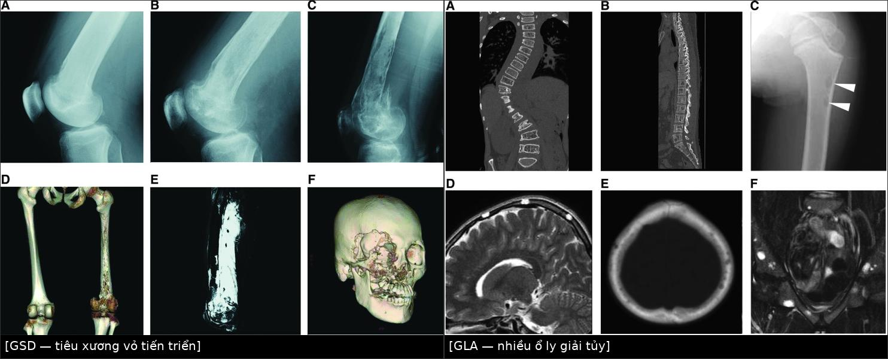
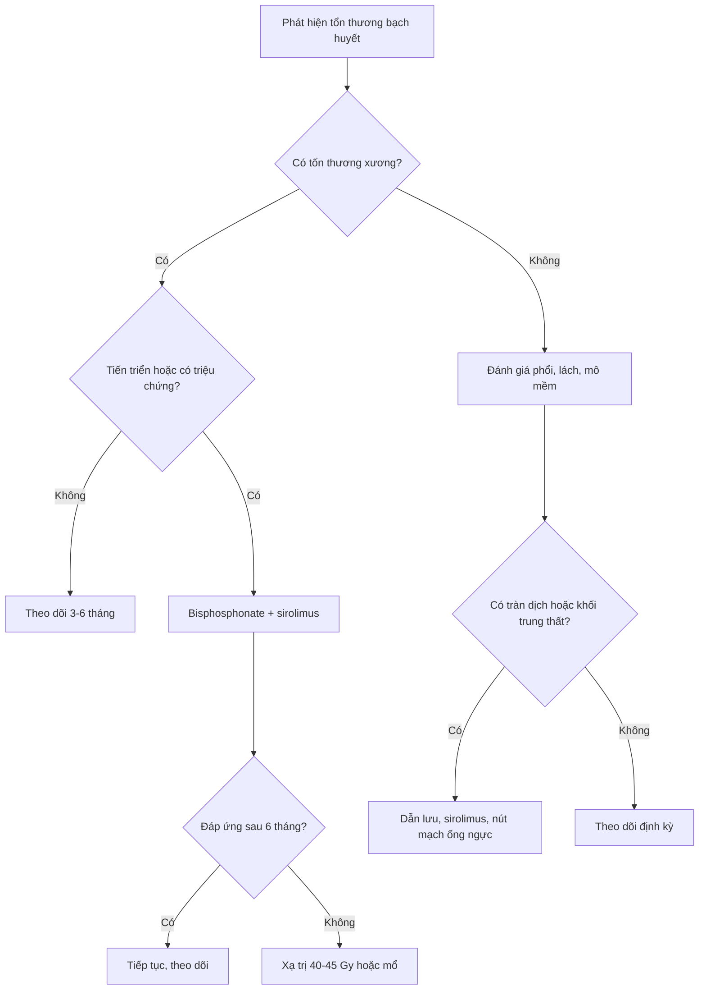
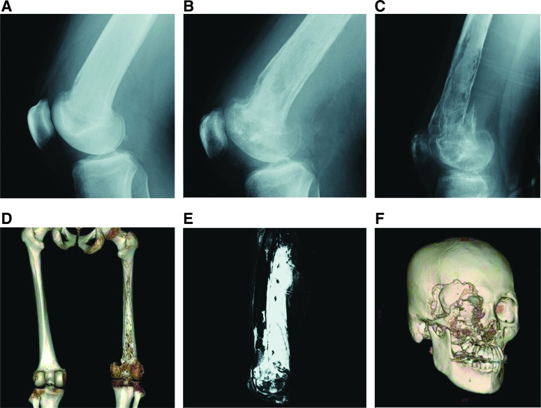
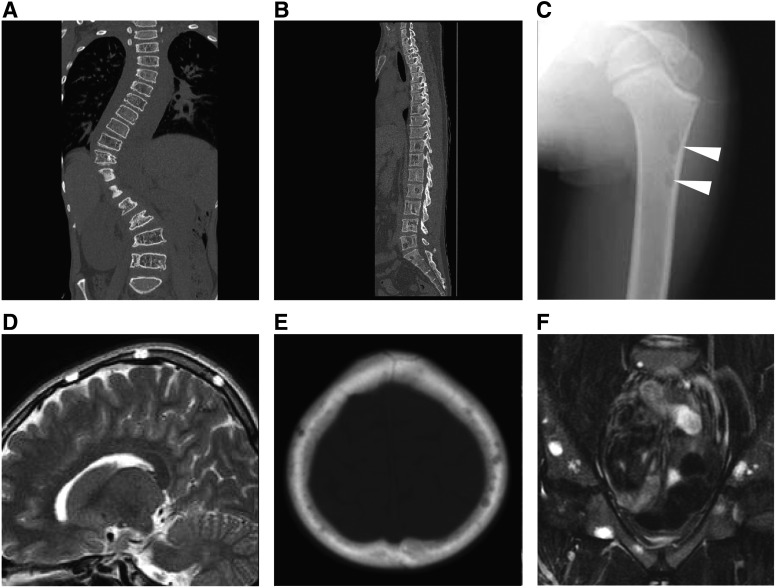
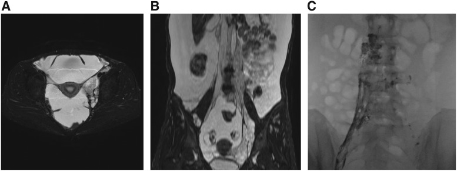
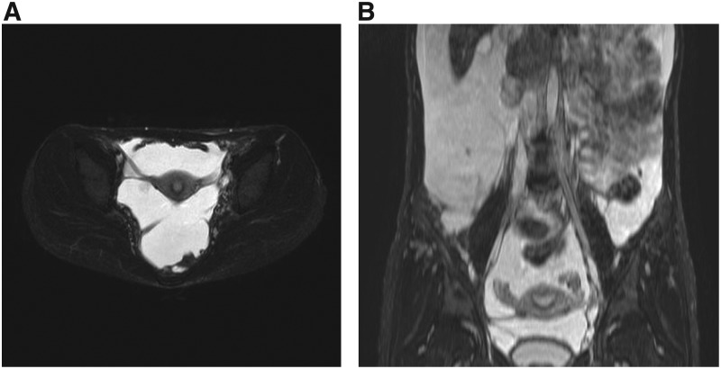

# 077 — Loạn sản mạch bạch huyết lan tỏa (GLA) & bệnh Gorham–Stout: xương "biến mất", tràn dưỡng trấp và sirolimus

**Tags:** `pattern:loansan-bach-huyet` `pattern:tieu-xuong` `pattern:tran-dich-duong-trap` `vung:da-he` `vung:phoi` `vung:xuong` `anatomy:ong-nguc` `protocol:MRI-toan-than` `protocol:lymphangiography`
**Mức chắc chắn (certainty):** tổng hợp y văn (literature synthesis) — bài tổng hợp từ review mở có số liệu định lượng và ca minh họa, chưa gắn một ca nguyên văn duy nhất của nhóm.

## 1. Tổng quan — vì sao mạch bạch huyết sai chỗ lại "ăn" xương và gây tràn dịch

- **GLA (generalized lymphatic anomaly)** là dị dạng mạch bạch huyết lan tỏa nhiều cơ quan: phổi, trung thất, lách, xương và mô mềm. **GSD (Gorham–Stout disease)** là dị dạng bạch huyết **trong xương** gây tiêu xương tiến triển, còn gọi "bệnh xương biến mất" (vanishing bone disease). Cả hai nằm trong nhóm **dị dạng bạch huyết phức tạp (complex lymphatic anomalies)** cùng với **KLA (kaposiform lymphangiomatosis)** và **CCLA (central conducting lymphatic anomaly)**.
- **TẠI SAO hình ảnh giống "nang dịch":** mô bạch huyết sai chỗ là các kênh chứa dịch giàu protein, không phải mô đặc. Dịch này **đồng đậm độ với nước trên CT (khoảng 0–20 HU)**, **giảm tín hiệu trên T1W**, **tăng tín hiệu rất mạnh trên T2W/T2 fat-sat** (nước tự do), **không hạn chế khuếch tán** (ADC cao, khác áp-xe/u đặc), và **không ngấm thuốc** trừ vách/bao. Đó là lý do một "khối" T2 sáng, không ngấm, nhiều thùy trong trung thất hay sau phúc mạc phải nghĩ mạch bạch huyết trước khi nghĩ u.
- **TẠI SAO xương bị tiêu ở GSD:** kênh bạch huyết xâm nhập tủy xương, tăng sinh và kích hoạt **hủy cốt bào (osteoclast)** qua trục VEGF-C/VEGFR-3, IL-6 và **RANKL/OPG**; tủy bị thay thế, vỏ xương bị ăn mòn từ trong ra. Trên phim, tổn thương **ly giải vỏ xương tiến triển, bờ không rõ, có thể vượt qua khớp** — khác nhiều ổ ly giải nhỏ trong tủy của GLA/KLA.
- **Định lượng nằm lòng:**
  - Tỉ lệ tử vong: **GLA 28,6% (10/35)**, **KLA 55,6% (5/9)**, khác biệt có ý nghĩa (p = 0,0268); tử vong gắn với bệnh phổi tiến triển và rối loạn đông máu.
  - **KLA** có tiểu cầu **50.000–100.000/µL**, tràn dịch màng phổi/màng tim **xuất huyết**, khối trung thất; đây là các dấu hiệu phân biệt với GLA.
  - Sirolimus: đáp ứng một phần lúc **6 tháng** ở **100% (7/7) GLA**, **100% (3/3) GSD**, **71% (5/7) KLA** (thử nghiệm tiến cứu của Adams, trích trong review). Nồng độ đáy mục tiêu **5–15 ng/mL** ở **76% (19/25)** nghiên cứu.
  - Xạ trị GSD: ổn định bệnh ở **~80%** ca; liều chia nhỏ **40–45 Gy** (Dunbar), dải **36–45 Gy** có hiệu quả tin cậy; liều thấp **16–20 Gy** có thể giảm triệu chứng lồng ngực (tràn dưỡng trấp, tràn dịch màng tim).
- **Dịch dưỡng trấp (chylothorax):** dịch màng phổi do rò bạch huyết, **triglyceride > 110 mg/dL** và có **chylomicron**; nhưng trong GLA/GSD, tràn dịch có thể là dưỡng trấp hoặc dịch thấm do tắc dẫn lưu — cần lymphangiography/DCMRL để tìm ổ rò trước khi can thiệp.

## 2. Mẫu hình + chẩn đoán phân biệt theo vị trí (gamut)

**Mẫu hình chính:** (a) nhiều ổ ly giải xương nhỏ trong tủy, hoặc tiêu xương vỏ tiến triển; (b) tràn dịch màng phổi/màng tim, khối trung thất; (c) dịch ổ bụng, nang lách, khối sau phúc mạc; (d) phù bạch mạch/lymphorrhea mô mềm.

**Gamut theo vị trí:**

- **Xương:** GSD (tiêu xương vỏ tiến triển), GLA/KLA (nhiều ổ ly giải tủy, không tiến triển), dị dạng bạch huyết xương đơn độc, và các "bệnh giống Gorham": tiêu xương đa ổ vô căn, tiêu xương đa ổ di truyền, tiêu xương do thần kinh, **LCH**, di căn, myeloma, viêm xương tủy, u nâu cường cận giáp, CRMO.
- **Trung thất/phổi:** GLA, KLA, CCLA, dị dạng bạch huyết dạng nang đơn độc, lymphangiectasia phổi, lymphoma, lao, tràn dưỡng trấp vô căn/sau mổ.
- **Lách:** GLA (nhiều nang lách), LAM, lymphoma, di căn, áp-xe, nang biểu mô, nang sán.
- **Mô mềm/da:** GLA, KLA, dị dạng bạch huyết mô mềm, dị dạng tĩnh mạch–bạch huyết, lipoma, sarcoma.

**Mẹo nhớ nhanh:** *trẻ/thanh niên + nhiều "nang" T2 sáng không ngấm ở nhiều cơ quan + xương ly giải + nang lách* → nghĩ **GLA**; *xương vỏ bị ăn mòn tiến triển từng tháng, có thể qua khớp* → nghĩ **GSD**; *tràn dịch xuất huyết + tiểu cầu thấp + khối trung thất* → nghĩ **KLA**; *chỉ có giãn ống bạch huyết trung tâm, không tổn thương nhu mô* → nghĩ **CCLA**.

## 3. Bảng so sánh phân biệt (ma trận đối chiếu)

| Thực thể (entity) | Hình ảnh điển hình | Chốt vào (rule-in) | Chốt loại (rule-out) | Gợi ý xác nhận |
|---|---|---|---|---|
| **GSD (Gorham–Stout)** | Tiêu xương vỏ **tiến triển**, bờ không rõ, có thể vượt khớp; xương chi, sườn, sọ, xương đòn, cột sống cổ; gãy bệnh lý; mô mềm quanh xương T2 sáng | **Tiêu xương vỏ tiến triển theo thời gian + tổn thương mô mềm bạch huyết lân cận + loại trừ nguyên nhân khác** | Nhiều ổ ly giải nhỏ trong tủy, không tiến triển, không mất vỏ xương → GLA/KLA | X-quang/CT nhiều thời điểm; MRI T2 fat-sat; sinh thiết có D2-40; ¹⁸F-NaF PET/CT |
| **GLA** | Nhiều ổ ly giải **trong tủy**, cột sống (thắt lưng hay gặp) và sọ; **nang lách**; tràn dịch màng phổi/màng tim; khối trung thất; ascites | **Tổn thương bạch huyết nhiều cơ quan + nang lách + nhiều ổ ly giải tủy** | Tiêu xương vỏ tiến triển, xương chi, gãy bệnh lý → GSD; tràn dịch xuất huyết + tiểu cầu thấp → KLA | WB-MRI T2 fat-sat; CT/MRI sọ–cột sống; DCMRL |
| **KLA** | Khối trung thất, **tràn dịch màng phổi/màng tim xuất huyết**, dày bó mạch–phế quản và vách liên tiểu thùy; tổn thương lách; tiểu cầu thấp | **Tràn dịch xuất huyết + tiểu cầu 50.000–100.000/µL + khối trung thất** | Không có tràn dịch xuất huyết, tiểu cầu bình thường → GLA | Sinh thiết: tế bào hình thoi D2-40+; Ang-2 cao; theo dõi đông máu |
| **CCLA** | Giãn/dyskinesia ống bạch huyết trung tâm; tràn dưỡng trấp, ascites, phù; không tổn thương nhu mô | **DCMRL thấy giãn hoặc rối loạn dòng ống bạch huyết trung tâm** | Có tổn thương nang ở phổi/lách/xương → GLA | DCMRL; lymphangiography qua hạch bẹn; EPHB4 nếu gia đình |
| **Dị dạng bạch huyết đơn độc** | Một khối nang đơn độc, vách mỏng, T2 rất sáng, thường ở cổ/trung thất/sau phúc mạc | **Một khối nang, không tổn thương cơ quan khác** | Nhiều cơ quan, xương, lách → GLA | US/CT/MRI; không cần sinh thiết nếu điển hình |
| **Di căn/myeloma/LCH** | Nhiều ổ ly giải, bờ rộng, có khối mô mềm, ngấm thuốc; tuổi lớn hơn; LCH có bờ vát | **Tiền sử ung thư, tổn thương ngấm thuốc, tăng canxi/máu, tuổi > 40** | Bệnh nhân trẻ, nhiều nang bạch huyết, nang lách, không ngấm | CT xương, MRI, sinh thiết; điện di/LCH markers |
| **Tràn dưỡng trấp vô căn** | Chỉ tràn dịch màng phổi dưỡng trấp, không tổn thương xương/lách/trung thất | **Ổ rò đơn độc, không tổn thương cơ quan khác** | Có nang lách, ly giải xương, khối trung thất → GLA/GSD/KLA | Lymphangiography/DCMRL; loại trừ ung thư, lao, chấn thương |

*Trái: **GSD** — X-quang 6 tháng cho thấy tiêu xương vỏ tiến triển rồi gãy bệnh lý; 3D-CT xương gần như "biến mất"; MRI T2 fat-sat có tín hiệu cao mô mềm quanh xương. Phải: **GLA** — nhiều ổ ly giải nhỏ trong tủy (cột sống, sọ, chỏm xương đùi), không tiến triển, nhiều nang T2 ở khung chậu. Nguồn: Adv Wound Care 2019, PMC6589502, Fig. 5 và Fig. 6, CC BY 4.0; ảnh ghép letterbox bằng `tools/make_composite.py`.*

## 4. Protocol chụp + hệ phân độ/điểm chuẩn hóa

- **MRI toàn thân (WB-MRI)** là khảo sát nền: **T2 fat-sat/STIR** (chuỗi chốt để thấy dịch bạch huyết), T1W, và **T1 sau tiêm gadolinium** để đánh giá vách/thành và phân biệt nang đơn thuần. Khảo sát tối thiểu: ngực, bụng, khung chậu, cột sống và xương chi theo triệu chứng.
- **DCMRL (dynamic contrast-enhanced MR lymphangiography):** tiêm gadolinium qua hạch bẹn, chụp động nhiều pha — xác định giãn/rối loạn dẫn lưu ống bạch huyết trung tâm và ổ rò trước khi can thiệp. **Lymphangiography qua hạch (lipiodol)** bổ sung chi tiết ổ rò; **lymphoscintigraphy** ít xâm lấn hơn nhưng độ phân giải thấp.
- **CT xương lát mỏng + dựng MPR** khi nghi GSD; **¹⁸F-NaF PET/CT** hữu ích để đánh giá hoạt tính tiêu xương và theo dõi.
- **Xét nghiệm:** công thức máu, tiểu cầu, fibrinogen, D-dimer (rối loạn đông nội mạch khu trú mạn — LIC), albumin/protein/Ig, **BAP, CTX-1, IL-6, OPG/free RANKL** (GSD), **angiopoietin-2** (GLA/KLA), và **nồng độ đáy sirolimus** khi điều trị.
- **Không có RADS cho bệnh này.** Theo dõi đáp ứng bằng định nghĩa thực hành: **bệnh ổn định = không có tổn thương mới trong 3 tháng** hoặc chỉ bất thường hình ảnh mà không triệu chứng; đáp ứng sirolimus đánh giá lúc **6 tháng** bằng hình ảnh + điểm chức năng + chất lượng sống.

- **Điều trị theo cơ chế:** **sirolimus** ức chế mTOR, giảm tăng sinh và rò bạch huyết — thuốc nền cho GLA/GSD/KLA; **bisphosphonate** (zoledronate) cho tiêu xương; **interferon, bevacizumab, propranolol, corticoid** có vai trò hạn chế; **xạ trị** khi không mổ được hoặc thất bại nội khoa; **phẫu thuật/nút mạch ống ngực** cho tràn dưỡng trấp khó trị.
- **An toàn sirolimus:** theo dõi nồng độ đáy, **dự phòng Pneumocystis** (đặc biệt nhũ nhi), nhiễm trùng, tương tác thuốc; không tự ngừng thuốc.

## 5. Biến thể bình thường và cạm bẫy

- **Ống ngực và hạch bạch huyết bình thường** có thể thấy rõ trên T2/lymphangiography — đừng gọi là "khối". Chỉ bất thường khi giãn không tương xứng, rò thuốc ra ngoài lòng, hoặc kèm tổn thương cơ quan.
- **GLA xương thường không đau, không tiến triển** — rất dễ bị đọc thành di căn ở bệnh nhân trẻ. Ngược lại, **GSD tiến triển nhanh** có thể bị nhầm viêm xương tủy/viêm khớp nhiễm khuẩn; sinh thiết xương dễ lấy mẫu vụn và không chẩn đoán được.
- **Không sinh thiết xương sườn** khi nghi GSD/GLA: nguy cơ gây **tràn dịch màng phổi khó trị** do rò bạch huyết; ưu tiên tổn thương mô mềm nông nếu buộc phải lấy mô.
- **KLA ≠ GLA:** tràn dịch xuất huyết + tiểu cầu thấp + khối trung thất là cờ đỏ; bỏ sót KLA dẫn tới điều trị thiếu tích cực và tiên lượng xấu.
- **Sau can thiệp màng phổi/ sinh thiết** có thể xuất hiện tràn dưỡng trấp mới — theo dõi sát, không rút dẫn lưu quá sớm.
- **LAM** (nang phổi lan tỏa ở nữ tuổi sinh sản, VEGF-D cao) khác GLA: LAM không có tổn thương xương/lách đa ổ kiểu GLA; đừng gộp hai bệnh.
- **Xạ trị ở trẻ:** nguy cơ rối loạn phát triển xương và ung thư thứ hai; chỉ dùng khi các lựa chọn khác thất bại.

## 6. Tự lượng giá — Blind Quiz

**Ca 1 — Nam 19 tuổi, đau gối phải 6 tháng, không sốt, không chấn thương. Nhìn chuỗi ảnh, mô tả trước khi mở đáp án.**

- Hỏi: tổn thương ở đâu, thay đổi theo thời gian ra sao? Chẩn đoán phân biệt 3 bệnh? Bước tiếp theo?

<b>Bấm để hiện đáp án</b>

- **Dấu hiệu:** A → B → C là chuỗi X-quang trong 6 tháng: ổ ly giải ở cổ xương đùi lan rộng, mất vỏ xương, rồi gãy bệnh lý; D là 3D-CT cho thấy gần như toàn bộ xương đùi bị tiêu; E là MRI T2 fat-sat có tín hiệu cao lan tỏa trong mô mềm quanh xương; F là 3D-CT sọ với tiêu xương hàm mặt ở một ca GSD khác.
- **Chẩn đoán:** **GSD** — tiêu xương vỏ tiến triển, có thể vượt khớp, kèm tổn thương bạch huyết mô mềm.
- **Phân biệt:** GLA/KLA (nhiều ổ ly giải tủy, không tiến triển), viêm xương tủy (sốt, phù, ngấm thuốc), di căn/u xương (tuổi, bờ rộng, ngấm thuốc).
- **Bước tiếp:** MRI T2 fat-sat toàn bộ vùng tổn thương, CT xương, đánh giá phổi/lách; cân nhắc bisphosphonate + sirolimus; tránh sinh thiết xương sườn.
- Nguồn ảnh: Adv Wound Care 2019, PMC6589502, Fig. 5, CC BY 4.0.

**Ca 2 — Ba bệnh nhân trẻ có nhiều ổ ly giải xương: bé trai 12 tuổi đau nhiều (A), nam 31 tuổi hoàn toàn không triệu chứng (B), bé trai 8 tuổi cũng không triệu chứng (C–F).**

- Hỏi: vì sao không nghĩ di căn? Panel nào gợi ý GLA, panel nào gợi ý KLA? Cần tìm thêm tổn thương ở đâu?

<b>Bấm để hiện đáp án</b>

- **Dấu hiệu:** A là CT dựng vành cột sống ngực–thắt lưng ở bé trai 12 tuổi **KLA**, nhiều ổ ly giải trong tủy, không phá vỏ; B là CT cột sống của nam 31 tuổi **GLA**, cũng nhiều ổ ly giải nhỏ nhưng không triệu chứng; C là X-quang chỏm xương đùi bé trai 8 tuổi **KLA** với ổ ly giải nhỏ (mũi tên); D–E là MRI T2 và CT sọ cùng bé, ổ ly giải nhỏ; F là MRI T2 fat-sat khung chậu cùng bé, nhiều nang T2 sáng.
- **Chẩn đoán:** **GLA** (B) và **KLA** (A, C–F) — điểm chung là nhiều ổ ly giải tủy **không tiến triển**, khác GSD (tiêu xương vỏ tiến triển).
- **Vì sao không phải di căn:** bệnh nhân trẻ, tổn thương nhỏ trong tủy, không phá vỏ, không có u nguyên phát, kèm nang bạch huyết đa ổ.
- **Cần tìm:** nang lách, tràn dịch màng phổi/màng tim, khối trung thất, tổn thương mô mềm; với KLA phải kiểm tra **tiểu cầu và đông máu** (nguy cơ tràn dịch xuất huyết).
- Nguồn ảnh: Adv Wound Care 2019, PMC6589502, Fig. 6, CC BY 4.0.

**Ca 3 — Nữ 32 tuổi, GLA có báng bụng nhiều và khối vùng chậu trái; được điều trị sirolimus.**

- Hỏi: khối T2 sáng là gì? Vì sao không ngấm thuốc? Đáp ứng điều trị kỳ vọng và cách theo dõi?

<b>Bấm để hiện đáp án</b>

- **Dấu hiệu:** A là T2 trục: tổn thương nhiều thùy, tăng tín hiệu mạnh cạnh tử cung; B là T2 vành: khối mô mềm không đồng nhất lan từ sau phúc mạc tới bàng quang; C là lymphangiography qua hạch bẹn: dòng bạch huyết trái kém, thuốc thoát vào ổ bụng từ tổn thương mạch bạch huyết.
- **Chẩn đoán:** dị dạng mạch bạch huyết (lymphatic malformation) của GLA — dịch trong kênh bạch huyết nên T2 rất sáng, không ngấm thuốc trừ vách.
- **Đáp ứng:** sirolimus giảm khối và báng sau **6 tháng**; đáp ứng một phần ở **100% (7/7)** ca GLA trong thử nghiệm Adams.

- **Theo dõi:** nồng độ đáy **5–15 ng/mL**, công thức máu, chức năng gan/thận, dự phòng Pneumocystis; MRI lặp lại theo triệu chứng.
- Nguồn ảnh: Adv Wound Care 2019, PMC6589502, Fig. 9, CC BY 4.0.

## Bài liên quan chéo
- [001 – Tổng quan hệ Ngực](../001-tong-quan-he-nguc/lesson.md)
- [076 – Dưỡng trấp niệu & rò bạch huyết đường niệu](../076-duong-trap-nieu-chyluria/lesson.md)
- [078 – Dưỡng trấp ổ bụng](../078-duong-trap-o-bung/lesson.md)
- [079 – Tràn dịch dưỡng trấp (chylothorax)](../079-tran-dich-duong-trap-chylothorax/lesson.md)
- [696 – LAM: nang phổi lan tỏa, VEGF-D & sirolimus](../696-lam-nang-phoi-lan-toa/lesson.md)
- [380 – Bệnh xơ cứng củ ở trẻ (TSC)](../380-benh-xo-cung-cu-o-tre/lesson.md)
- [377 – U bao dây thần kinh dạng đám rối & MPNST ở NF1](../377-u-than-kinh-dang-dam-roi-va-mpnst-nf1/lesson.md)

## Ảnh
- Tên file theo quy ước `077_slug_Modality_SourceID.jpg`; nguồn và giấy phép từng ảnh ở `images/CREDITS.md`.
- Ảnh ghép `images/composite_077_GSD-vs-GLA.jpg` tạo bằng `tools/make_composite.py` (letterbox nền đen, giữ tỷ lệ, không crop/kéo giãn).

> Không dùng để chẩn đoán độc lập khi chưa có người hướng dẫn.
