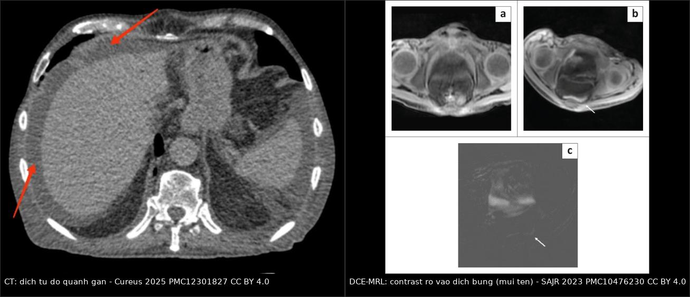
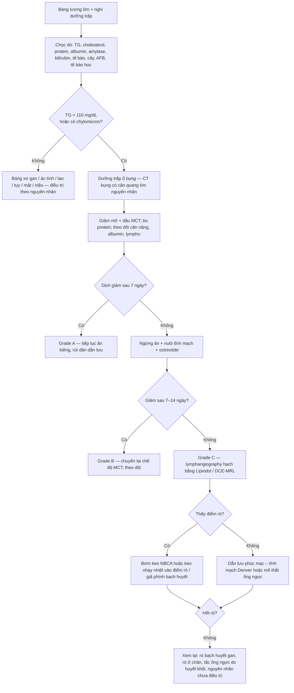
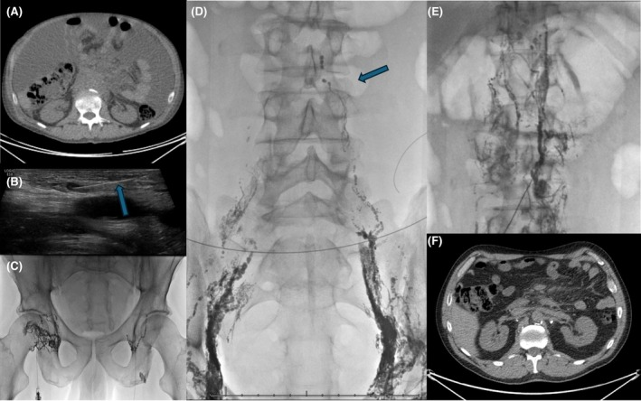
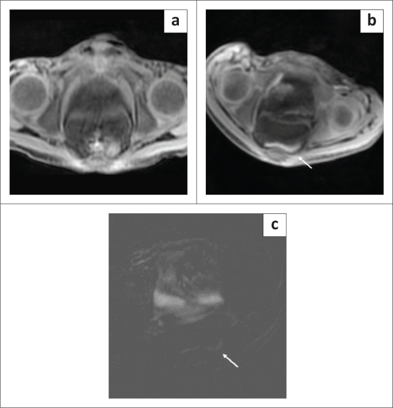
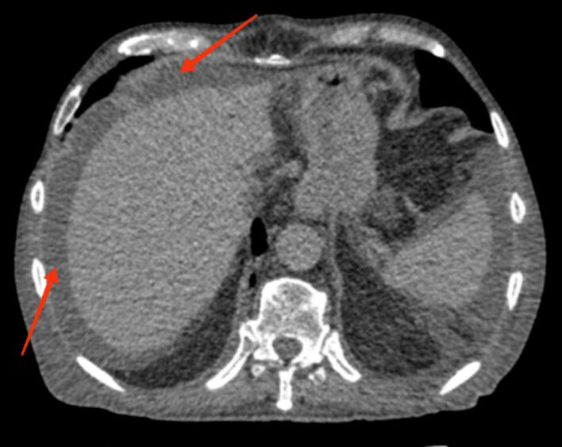

# 078 — Dưỡng trấp ổ bụng (chylous ascites): dịch sữa, định vị chỗ rò & bậc thang điều trị

**Tags:** `pattern:dich-bang` `vung:bung` `anatomy:ong-nguc` `protocol:lymphangiography` `score:TG-110` `incidentaloma:dich-bang`
**Mức chắc chắn (certainty):** tổng hợp y văn (literature synthesis) — số liệu lấy từ tổng quan can thiệp nội mạch cho dưỡng trấp ổ bụng sau mổ (PMC12078024), tổng quan hệ thống về chế độ ăn so với octreotide sau ghép gan (PMC12679238), loạt 143 ca nạo hạch cạnh động mạch chủ qua nội soi (PMC11889067), loạt can thiệp 44 ca dùng keo nhạy nhiệt (PMC13548310), hai ca có ảnh MR lymphangiography (PMC10476230) và ca lymphoma có ảnh chuỗi can thiệp (PMC12512073). **Không** gán một ca nguyên văn duy nhất cho toàn bài.

## 1. Tổng quan bệnh học – cơ chế hình ảnh

- **Bản chất:** **dưỡng trấp (chyle)** là dịch bạch huyết hấp thu ở ruột non, giàu **triglyceride dạng chylomicron**, protein, immunoglobulin và **tế bào lympho T**. Dòng chảy: mao mạch bạch huyết ruột → **thân ruột (intestinal trunk)** → **bể ngực (cisterna chyli)** ngang **L1–L2** (sau động mạch chủ, trước cột sống) → **ống ngực (thoracic duct)** → góc tĩnh mạch trái. Rò ở bất kỳ nhánh nào trong ổ bụng → dưỡng trấp tích trong phúc mạc = **dưỡng trấp ổ bụng (chylous ascites)**. Ba nhánh cần nhớ: **thân ruột** (sau nạo hạch cạnh ĐMC, cắt tụy), **thân thắt lưng** (sau nạo hạch chậu/bẹn), **bạch huyết gan (hepatic lymphatics)** (sau cắt gan, ghép gan) — ba vị trí rò cho ba kiểu can thiệp khác nhau.
- **Vì sao dịch đục như sữa:** **chylomicron** (đường kính ~75–1.200 nm) **tán xạ ánh sáng** (hiệu ứng Tyndall) — đây là hiện tượng **quang học**, không phải mủ. Hệ quả kép: (1) dịch đục **không** đồng nghĩa nhiễm trùng; (2) bệnh nhân **đang đói / nuôi tĩnh mạch hoàn toàn** có thể ra **dịch trong** → **âm tính giả**.
- **Vì sao lượng dịch lớn và tái lập nhanh:** lưu lượng ống ngực **1–2 L/ngày**, **tăng mạnh sau bữa ăn có mỡ** và **giảm khi đói**. Vì vậy dẫn lưu ra **hàng trăm đến hàng nghìn mL/ngày** không tương xứng với tổn thương mô, và **nghiệm pháp ăn nhạt mỡ** vừa là bằng chứng chẩn đoán vừa là điều trị.
- **Vì sao nguy hiểm:** mất liên tục dịch giàu **protein – immunoglobulin – lympho bào** → **suy dinh dưỡng, hạ albumin, giảm CD4 và suy giảm miễn dịch**, mất dịch – điện giải → **giảm thể tích, hạ natri**. Tổng quan can thiệp ghi **tử vong tới 50%** với rò bạch huyết sau mổ lưu lượng cao không được điều trị (PMC12078024); tổng quan nhi ghi **40–70%** với dưỡng trấp ổ bụng không nhận diện kịp (PMC12999782) — đây là lý do phải chẩn đoán sớm, không phải để hù dọa.
- **Dịch tễ – bối cảnh (con số quyết định việc bạn có nghĩ tới hay không):**
  - **Sau nạo hạch cạnh động mạch chủ (PALN) qua nội soi/robot ở ung thư đại tràng trái:** **18,8%** (27/143) trong một loạt liên tiếp; trong đó **63,0% Grade A, 22,2% Grade B, 14,8% Grade C**, **96,3%** khỏi bằng điều trị bảo tồn, khởi phát trung bình **5,0 ± 3,2 ngày** sau mổ, thời gian khỏi **8,0 ± 8,8 ngày** (PMC11889067).
  - **Nạo hạch D3 kinh điển ở ung thư đại tràng:** **1–6,6%** (PMC11889067).
  - **Sau nạo hạch sau phúc mạc vì ung thư:** tới **11%** (PMC12078024).
  - **Sau ghép gan:** **0,6–4,7%**, chẩn đoán trung vị **10 ngày** sau ghép (PMC12679238).
  - **Trẻ em:** hiếm, ước **1/20.000 – 1/187.000** lượt nhập viện; dưỡng trấp chiếm **6%** tràn dịch thai (PMC12999782). Ở nhũ nhi **nguyên nhân bẩm sinh** chiếm ưu thế; ở trẻ lớn thiên về **lao, nhiễm trùng, sau mổ, lymphoma**.
- **TẠI SAO trông như vậy trên hình (vật lý):**
  - **X-quang bụng:** chỉ thấy **mờ lan tỏa, mất bóng cơ thắt lưng, các quai ruột bị đẩy vào giữa** — không đặc hiệu, không phân biệt được bản chất dịch.
  - **Siêu âm:** dịch **trống âm, có vách mảnh hoặc không vách**, ruột **trôi tự do**; dùng để **định hướng chọc dò** và phát hiện **dịch khu trú/kén bạch huyết (lymphocele)**.
  - **CT (thì tĩnh mạch cửa):** dịch **0–15 HU, không ngấm thuốc, không vôi hóa**, phân bố theo trọng lực (cùng đồ, rãnh gan, túi cùng Douglas); CT trả lời ba câu hỏi mà xét nghiệm dịch không trả lời được: **nguyên nhân (khối, hạch, xơ gan, tắc mạch cửa), vị trí rò nghi ngờ (dọc chuỗi bạch huyết cạnh ĐMC), biến chứng (xoắn ruột, thoát vị nội, tắc ruột)**. **Dịch dưỡng trấp không có dấu hiệu CT đặc trưng** — cái "đặc trưng" là **bối cảnh + xét nghiệm dịch**.
  - **MR lymphangiography không cản quang (T2 nặng, MIP):** thấy **bể ngực và ống ngực** như cấu trúc **T2 tăng tín hiệu**; tỷ lệ hiện hình bể ngực **96%**, ống ngực **94%** ở người không rò (PMC12078024 dẫn Okuda, Erden) — nhưng **chỉ cho giải phẫu**, không cho dòng chảy.
  - **MR lymphangiography động (DCE-MRL) sau tiêm gadolinium vào hạch bẹn:** cho **dòng chảy theo thời gian** và **điểm rò** — thấy thuốc thoát vào **dịch tự do trong tiểu khung** (PMC10476230). Đây là kỹ thuật **dùng ngoài chỉ định ghi nhãn** của gadolinium tĩnh mạch, cần thống nhất với khoa chẩn đoán hình ảnh.
  - **Lymphangiography hạch (nodal, Lipiodol):** tiêm **Lipiodol** vào hạch bẹn hai bên dưới siêu âm → thấy **chuỗi thắt lưng, bể ngực, ống ngực, giả phình bạch huyết (lymphopseudoaneurysm), điểm rò**; Lipiodol đặc có thể **bịt rò nhỏ tại chỗ** — vừa chẩn đoán vừa điều trị (PMC12512073, PMC12078024).
  - **Lymphoscintigraphy ⁹⁹ᵐTc:** nhạy với **rò và tắc**, nhưng **độ phân giải thấp**, khó chỉ đúng điểm rò (PMC12078024).

## 2. Mẫu hình + chẩn đoán phân biệt theo vị trí (gamut)

- **Mẫu hình chốt:** *báng lượng lớn, tái lập nhanh, dịch **đục như sữa** (rõ nhất sau bữa ăn mỡ), **triglyceride dịch rất cao**, tế bào lympho chiếm ưu thế, cấy vô khuẩn* — kèm **bối cảnh** mổ sau phúc mạc / khối hạch / lao / xơ gan.
- **Gamut theo bối cảnh (quan trọng hơn gamut theo hình):**
  - **Sau mổ (hay gặp nhất ở người lớn):** nạo hạch PALN, cắt tụy – tá tràng (Whipple), nạo hạch sau phúc mạc vì ung thư phụ khoa/tinh hoàn, **cắt gan/ghép gan** (rò bạch huyết gan), mổ động mạch chủ, cắt u sau phúc mạc, lấy mảnh ghép tĩnh mạch (PMC12078024, PMC11889067, PMC12679238).
  - **Khối ác tính:** **lymphoma** là nguyên nhân ác tính hay gặp nhất ở người lớn (thường **không mổ** mà điều trị bệnh nền); di căn phúc mạc, u carcinoid — và **dưỡng trấp có thể là dấu hiệu đầu tiên** của lymphoma (PMC12512073).
  - **Xơ gan – tăng áp lực cửa:** áp lực tĩnh mạch cửa cao làm tăng sản xuất bạch huyết gan vượt khả năng dẫn lưu → **dưỡng trấp "thứ phát"**, thường **lẫn với báng xơ gan** (SAAG cao), điều trị theo xơ gan chứ không phải theo ống ngực.
  - **Nhiễm trùng:** **lao phúc mạc/hạch mạc treo** (vùng dịch tễ Việt Nam, trẻ em và người trẻ), **giun chỉ (filariasis)**, CMV ở nhũ nhi — nguyên nhân **có thể chữa khỏi** nên bắt buộc tầm soát (PMC12999782, PMC10476230).
  - **Bẩm sinh/dị dạng bạch huyết:** trẻ sơ sinh báng dưỡng trấp đơn độc hoặc trong **dị dạng bạch huyết phức tạp**, hội chứng **Noonan**, **Turner**, **phù thai**; người lớn có **LAM** (bài 696), hội chứng **vàng móng (yellow nail syndrome)**.
  - **Tim mạch:** **suy tim phải, hẹp màng tim, tuần hoàn Fontan** → tăng áp lực bạch huyết trung tâm, có thể biểu hiện **báng dưỡng trấp ± tràn dịch dưỡng trấp màng phổi**.
- **Gamut theo *loại dịch* (đây là chỗ quyết định điều trị, không phải hình ảnh):** dưỡng trấp thật — **báng xơ gan** — **báng ác tính** — **lao phúc mạc** — **báng do tụy (pancreatic ascites)** — **báng mật** — **báng niệu (urinary ascites)** — **dịch thẩm phân (PD effluent)**. Bảy thể sau **không** cần can thiệp bạch huyết, nên **chọc dò – xét nghiệm dịch là bước không thể bỏ**.
- **Gợi nhớ "CHYLE":** **C**reamy (đục như sữa, tăng sau ăn mỡ) – **H**igh TG (> 110 mg/dL, thường > 200) – **Y**ellow nails/lymphoma/TB (tìm nguyên nhân) – **L**ow SAAG (< 1,1 g/dL) + lympho ưu thế – **E**nteric loss (suy dinh dưỡng, giảm CD4).

## 3. Bảng so sánh phân biệt (ma trận đối chiếu)

| Thực thể | Dịch báng | Chốt vào (rule-in) | Chốt loại (rule-out) | Gợi ý xác nhận |
|---|---|---|---|---|
| **Dưỡng trấp ổ bụng** | **Đục như sữa** sau ăn mỡ; **TG > 200 mg/dL** (hỗ trợ mạnh), **> 110 mg/dL (1,24 mmol/L)** là ngưỡng dùng trong nghiên cứu; **TG < 50 mg/dL loại trừ**; lympho ưu thế, cấy vô khuẩn | **Dịch sữa + TG > 200 mg/dL + lympho ưu thế** ở bối cảnh mổ sau phúc mạc/khối hạch/lao | Dịch **trong, TG thấp, SAAG ≥ 1,1 g/dL** → báng xơ gan; **mủ, pH < 7,2, cấy (+)** → nhiễm trùng; **amylase rất cao** → báng tụy | Xét nghiệm dịch đầy đủ; **nodal lymphangiography / DCE-MRL** để định vị rò |
| **Báng xơ gan** | Trong, vàng chanh, **SAAG ≥ 1,1 g/dL**, protein thấp, **TG thấp** | **SAAG ≥ 1,1 + bệnh gan nền + dấu xơ gan trên CT** (gan teo, nốt, tuần hoàn bàng hệ) | **TG cao + dịch sữa** → dưỡng trấp (có thể **đồng thời** trên nền xơ gan) | Siêu âm/CT gan, elastography, nội soi tầm soát giãn tĩnh mạch |
| **Báng ác tính (di căn phúc mạc)** | Vàng hoặc máu, **SAAG thấp (< 1,1)**, protein cao | **Tế bào học (+), nốt phúc mạc/mạc nối "bánh xe", hạch, u buồng trứng** | Dịch sữa + TG rất cao + cấy vô khuẩn → dưỡng trấp; **lymphoma gây rò** vẫn có thể đồng thời | CT bụng–khung chậu có cản quang, tế bào học dịch, sinh thiết |
| **Lao phúc mạc** | Vàng, **SAAG thấp**, **lympho ưu thế**, protein cao, **ADA > 40 U/L** | **ADA cao + lympho ưu thế + hạch mạc treo hoại tử trung tâm + IGRA/PCR (+)** ở vùng dịch tễ | Dịch sữa + TG cao → dưỡng trấp (lao **có thể là nguyên nhân** của dưỡng trấp) | PCR lao trong dịch, nội soi ổ bụng sinh thiết; **không chờ** kết quả mới điều trị nếu lâm sàng nặng |
| **Báng do tụy** | Trong hoặc nâu, **amylase dịch rất cao (thường > 1.000 U/L)**, protein cao | **Amylase dịch cao gấp nhiều lần huyết thanh + viêm tụy/nang giả tụy/vỡ ống tụy** | TG cao + dịch sữa → dưỡng trấp | CT tụy, MRCP; điều trị bằng **nhịn ăn – octreotide – stent ống tụy** |
| **Báng mật (bile ascites)** | Vàng sậm/ xanh, **bilirubin dịch cao hơn huyết thanh**, không có mật trong ruột | **Bilirubin dịch rất cao + vết mổ gan–mật + dò đường mật** | Dịch sữa → dưỡng trấp | HIDA/MRCP, ERCP; dẫn lưu đường mật |
| **Báng niệu (urinary ascites)** | Trong, **creatinine dịch cao hơn hẳn creatinine huyết thanh (tỷ lệ > 1)**, thường ở sơ sinh | **Creatinine dịch cao + bàng quang nhỏ + hội chứng "phù thai"** | Dịch sữa → dưỡng trấp | Siêu âm thận–bàng quang, cystography; dẫn lưu bàng quang |

*Trái: **CT thì tĩnh mạch cửa** — lượng lớn dịch tự do quanh gan (mũi tên đỏ), **không** phân biệt được bản chất dịch. Phải: **DCE-MRL** sau tiêm gadolinium vào hạch bẹn — (a) trước tiêm, (b) sau tiêm 12 phút có **thoát thuốc vào dịch tự do tiểu khung** (mũi tên), (c) ảnh trừ làm nổi **điểm rò**. Nguồn: Cureus 2025 (PMC12301827) Fig. 1, CC BY 4.0; SA J Radiol 2023 (PMC10476230) Fig. 5, CC BY 4.0. Ghép letterbox, không crop.*

### Ba dấu hiệu định vị rò trên hình (đọc theo giải phẫu, không đoán)
- **Rò từ thân ruột/bể ngực:** dịch tụ nhiều ở **rễ mạc treo, quanh tụy, sau phúc mạc**; trên lymphangiography thấy **thuốc tụ thành đám bất thường ở ngang L1–L2**.
- **Rò từ chuỗi thắt lưng/chậu:** dịch nhiều ở **hố chậu cùng bên**, kèm **lymphocele** dọc mạch chậu; thường sau nạo hạch chậu/bẹn hoặc lấy mảnh ghép tĩnh mạch đùi.
- **Rò bạch huyết gan:** dịch nhiều ở **khoang dưới gan/quanh rốn**, sau **cắt gan/ghép gan**; lymphangiography qua **chọc gan** hoặc thấy rò từ **dây chằng gan–tá tràng** (PMC12078024).

## 4. Protocol chụp + hệ phân độ/điểm chuẩn hoá

- **Bước 1 — CT bụng–khung chậu có cản quang (thì tĩnh mạch cửa):** xác nhận lượng dịch, phân bố, **tìm nguyên nhân** (khối, hạch, nang giả tụy, xơ gan, thoát vị nội, xoắn ruột) và **biến chứng**. Đo **HU dịch** để loại máu/mỡ đại thể; ghi rõ **không có dấu CT đặc hiệu cho dưỡng trấp**.
- **Bước 2 — chọc dò chẩn đoán (bắt buộc, 20–50 mL):** **triglyceride, cholesterol, protein, albumin (kèm albumin máu để tính SAAG), LDH, amylase, bilirubin, glucose, tế bào – công thức, cấy, nhuộm Gram, AFB/PCR lao, tế bào học**. Nếu nghi dưỡng trấp mà TG thấp → **lặp sau bữa ăn có mỡ**, tìm **chylomicron**, đừng kết luận vội.
- **Bước 3 — định vị rò (khi cần can thiệp hoặc chẩn đoán chưa rõ):**
  - **Nodal lymphangiography bằng Lipiodol** (kim 25 G vào hạch bẹn hai bên, dưới siêu âm): thấy chuỗi thắt lưng – bể ngực – ống ngực, **giả phình bạch huyết**, điểm rò; có thể **bịt rò bằng keo (NBCA) hoặc keo nhạy nhiệt** ngay trong cùng buổi (PMC12512073, PMC13548310).
  - **DCE-MRL** (gadolinium qua hạch bẹn, MIP nhiều thì): không tia X, thấy **dòng chảy và điểm rò**, phù hợp trẻ em và theo dõi lặp (PMC10476230).
  - **Lymphoscintigraphy ⁹⁹ᵐTc-dextran:** độ phân giải thấp — dùng khi không có hai kỹ thuật trên.
- **Phân độ theo thời gian khỏi (dùng để quyết định bậc điều trị, PMC11889067):** **Grade A < 7 ngày**, **Grade B 7–14 ngày**, **Grade C > 14 ngày hoặc phải can thiệp/mổ**. Grade B/C = "khỏi chậm", gắn với **nạo hạch nhiều (> 25 hạch)** và **dùng ICG huỳnh quang** trong mổ (OR 5,41 và 2,92).
- **Hiệu quả điều trị (để tư vấn, không hứa hẹn):** bảo tồn khỏi **96,3%** trong loạt PALN (PMC11889067); sau ghép gan, **chế độ ăn giảm mỡ + MCT** khỏi **62,5–100%**, **octreotide** khỏi **83,3–100%**, **phối hợp khỏi 97,8% so với 78,9%** khi chỉ ăn (p = 0,02) và **thời gian khỏi trung vị 7 ngày so với 14 ngày** (p = 0,03) (PMC12679238). Can thiệp: **tiêm keo nhạy nhiệt** đạt hiệu quả lâm sàng **84,6%** so với **55,6%** khi chỉ chụp lymphangiography (PMC13548310).

## 5. Biến thể bình thường và cạm bẫy

- **Cạm bẫy 1 — "dịch đục = mủ":** dịch sữa **không sốt, không tăng bạch cầu hạt, cấy vô khuẩn**. Đặt kháng sinh rồi **bỏ qua mất dưỡng trấp** là sai lầm hay gặp nhất; ngược lại, **đừng bỏ sót nhiễm trùng thật** khi bệnh nhân có dẫn lưu lâu ngày.
- **Cạm bẫy 2 — bệnh nhân đang đói/nuôi tĩnh mạch:** TG dịch có thể **< 110 mg/dL**, dịch **trong** → **âm tính giả**. Xử lý: lặp xét nghiệm **sau bữa ăn có mỡ**, tìm chylomicron, hoặc dựa vào bối cảnh (dẫn lưu nhiều ngày 3–5 sau nạo hạch).
- **Cạm bẫy 3 — "báng ở bệnh nhân ung thư = di căn phúc mạc":** lymphoma **gây rò ống ngực** chứ không nhất thiết di căn phúc mạc; điều trị khác hẳn (điều trị lymphoma ± can thiệp bạch huyết). Luôn xét nghiệm dịch trước khi kết luận.
- **Cạm bẫy 4 — xơ gan nền:** **SAAG ≥ 1,1 g/dL** vẫn có thể đi kèm **TG dịch cao**; dưỡng trấp "trên nền xơ gan" điều trị theo **tăng áp lực cửa**, can thiệp ống ngực ít hiệu quả.
- **Cạm bẫy 5 — dịch báng vs dịch màng phổi trên CT ngang (bắt buộc phân biệt):** **dấu crus lệch (displaced crus sign)** — dịch màng phổi đẩy **crus** ra sau/ra trong; **dấu bare area** — dịch báng **ôm mặt sau gan** nơi gan tiếp xúc trực tiếp cơ hoành; **dấu "meniscus"** của màng phổi so với **bờ ôm gan/lách** của báng. Cùng đậm độ dịch, **vị trí tương đối với cơ hoành/crus** mới quyết định tên gọi (bài 040).
- **Cạm bẫy 6 — bỏ sót biến chứng cấp trong ổ bụng:** ca chyloperitoneum kèm **xoắn ruột non** cho thấy dấu **"whirlpool sign"** và **thâm nhiễm mỡ mạc treo** có thể là dấu hiệu **nguyên nhân cơ học**, không phải chỉ "dịch báng" (PMC11122546) — đọc CT phải tìm **xoắn, thoát vị nội, tắc ruột** trước khi quy mọi thứ cho rò bạch huyết.
- **Cạm bẫy 7 — trẻ sơ sinh:** báng ở sơ sinh **không** mặc định là dưỡng trấp; phân biệt **báng niệu (creatinine dịch cao), báng mật, viêm phúc mạc phân su, báng do thoát dịch não tủy (VP shunt)**. Chọc dò + creatinine/bilirubin dịch là bước rẻ và quyết định.
- **Biến thể bình thường:** một lượng **dịch tự do rất ít** (vài chục mL) sau mổ bụng lớn hoặc ở phụ nữ trong chu kỳ là **sinh lý**; chỉ xét nghiệm khi **lượng tăng nhanh, dịch đổi màu sau ăn, hoặc bệnh nhân suy dinh dưỡng**.

## 6. Tự lượng giá — Blind Quiz

**Ca 1 — Nam 56 tuổi, lymphoma nang, báng lượng lớn tái lập sau 3 lần chọc hút.**

- Gợi ý lâm sàng: đã dùng hóa trị; dịch báng **đục như sữa**, cấy vô khuẩn, triglyceride dịch rất cao.
- Câu hỏi: (A) mô tả dịch báng trên CT; (B) mũi tên xanh trong (B) và (C) chỉ gì; (D)–(E) cho thấy gì; (F) chứng minh điều trị thành công ở điểm nào?

<b>Bấm để hiện đáp án (findings + chẩn đoán)</b>

- (A) **Báng lượng lớn** (dịch tỷ trọng thấp quanh gan, lách, ruột), không thấy khối đặc — hình ảnh **không đặc hiệu**, chẩn đoán dựa vào xét nghiệm dịch.
- (B) **Siêu âm**: kim trong **hạch bẹn** (mũi tên xanh) — đường vào chuẩn để tiêm Lipiodol. (C) Fluoroscopy: kim đúng vị trí hạch.
- (D)–(E) **Nodal lymphangiography**: Lipiodol đi lên **chuỗi bạch huyết thắt lưng**, **vùng thoát thuốc nghi rò** được đánh dấu (mũi tên xanh ở D) rồi **bơm keo NBCA** trực tiếp vào điểm rò (E).
- (F) CT sau can thiệp: **hết báng** — chứng minh thành công về hình ảnh, khớp với lâm sàng.
- Chẩn đoán: **dưỡng trấp ổ bụng do lymphoma**, điều trị bằng **nút keo điểm rò qua da** + điều trị bệnh nền.
- Phản biện: không phải mọi báng ở bệnh nhân lymphoma đều do rò bạch huyết — ở ca này **TG dịch cao + hình ảnh rò** mới chốt.
- Nguồn ảnh: *British Journal of Haematology* 2025 (PMC12512073) Fig. 2, CC BY-NC 4.0 (hiển thị nguyên bản).

**Ca 2 — Bé trai 8 tuổi, sốt kéo dài, hạch bẹn và hạch ổ bụng, báng mới xuất hiện.**

- Gợi ý lâm sàng: sinh thiết hạch mạc treo xác định **lao hạch**; dịch báng có triglyceride cao.
- Câu hỏi: (a) → (b) khác nhau ở đâu, mũi tên chỉ gì, và (c) ảnh trừ thêm được gì? Vì sao DCE-MRL hữu ích hơn CT ở trẻ?

<b>Bấm để hiện đáp án (findings + chẩn đoán)</b>

- (a) **T1W trước tiêm**: dịch tự do tiểu khung tín hiệu thấp. (b) **12 phút sau tiêm gadolinium qua hạch bẹn**: **thuốc thoát vào dịch tự do** (mũi tên) = **điểm rò**. (c) **Ảnh trừ** làm nổi đường rò, dễ đo và so sánh giữa các thì.
- Vì sao hơn CT: CT chỉ thấy "có dịch"; **DCE-MRL thấy dòng chảy và vị trí rò**, không tia X, lặp lại được ở trẻ.
- Chẩn đoán: **dưỡng trấp ổ bụng do lao hạch mạc treo** — điều trị **lao** là gốc; dinh dưỡng MCT hỗ trợ.
- Phản biện: ở trẻ, **nguyên nhân nhiễm trùng có thể chữa khỏi** — đừng can thiệp bạch huyết trước khi loại trừ lao/CMV.
- Nguồn ảnh: *SA Journal of Radiology* 2023 (PMC10476230) Fig. 5, CC BY 4.0.

**Ca 3 — Bệnh nhân 45 tuổi, báng lượng lớn, CT dưới đây.** *(Tình huống dựng trên ảnh minh họa — không phải nguyên văn ca của bài gốc.)*

- Gợi ý lâm sàng: không sốt, không vàng da, albumin máu bình thường, chưa mổ gì; dịch khi chọc có màu **trắng đục**.
- Câu hỏi: mô tả dịch trên CT; ba xét nghiệm dịch **bắt buộc** để phân biệt dưỡng trấp với báng xơ gan; nếu TG dịch **70 mg/dL** thì làm gì tiếp?

<b>Bấm để hiện đáp án (findings + chẩn đoán)</b>

- Findings: **dịch tự do lượng lớn** ôm gan, lách và các quai ruột (mũi tên đỏ), **không khối, không hạch lớn, không dấu xơ gan** trên lát này; CT **không** cho biết bản chất dịch.
- Ba xét nghiệm bắt buộc: **triglyceride**, **albumin dịch + albumin máu (SAAG)**, **tế bào – công thức (lympho ưu thế)**; thêm **amylase, bilirubin, cấy, tế bào học, AFB/PCR lao** tùy bối cảnh.
- TG **70 mg/dL** (< 110): **chưa loại trừ** — bệnh nhân có thể đang đói; **lặp sau bữa ăn có mỡ**, tìm **chylomicron**, đo lại TG; nếu vẫn thấp và SAAG < 1,1 → tìm nguyên nhân khác (lao, ác tính, tụy).
- Chẩn đoán ở ca này: **dưỡng trấp ổ bụng** (dịch sữa, TG cao khi lặp) — bước tiếp theo là **CT có cản quang tìm nguyên nhân** và cân nhắc **lymphangiography** nếu tái lập.
- Nguồn ảnh: *Cureus* 2025 (PMC12301827) Fig. 1, CC BY 4.0.

## Bài liên quan chéo

- [079 – Tràn dịch dưỡng trấp màng phổi](../079-tran-dich-duong-trap-chylothorax/lesson.md) — cùng hệ bạch huyết, khác khoang; đọc cặp bài này cùng nhau
- [040 – Tràn dịch màng phổi](../040-tran-dich-mang-phoi/lesson.md) — tiêu chuẩn Light, dấu crus/bare area phân biệt dịch báng – dịch màng phổi
- [141 – Phúc mạc](../141-phuc-mac/lesson.md) — gamut dịch báng và nốt phúc mạc nói chung
- [160 – Bụng cấp tiêu hóa](../160-bung-cap-GI/lesson.md) — xoắn ruột, thoát vị nội: biến chứng phải loại trừ khi đọc CT báng
- [126 – Thể tích gan trong PLD](../126-the-tich-gan-dieu-tri-noi-khoa-PLD/lesson.md) — bệnh nang gan–thận, có thể kèm rò bạch huyết
- [696 – LAM: nang phổi lan toả, VEGF-D & sirolimus](../696-lam-nang-phoi-lan-toa/lesson.md) — dưỡng trấp màng phổi/ổ bụng, ức chế mTOR
- [741 – Dị dạng mạch máu đầu–cổ (ISSVA)](../741-di-dang-mach-mau-dau-co-o-tre/lesson.md) — dị dạng bạch huyết ở trẻ, nguyên nhân bẩm sinh của dưỡng trấp

## Ảnh

- Tên file theo quy ước `NNN_slug_Modality_SourceID.jpg`; nguồn + giấy phép từng ảnh ở `images/CREDITS.md`.
- **CC BY 4.0:** CT báng (PMC12301827), DCE-MRL (PMC10476230) và ảnh ghép — giữ nguyên mũi tên/nhãn của tác giả, không crop.
- **CC BY-NC 4.0:** chuỗi can thiệp lymphoma (PMC12512073) — hiển thị **nguyên bản**, không chỉnh sửa.

> Không dùng để chẩn đoán độc lập khi chưa có người hướng dẫn.
