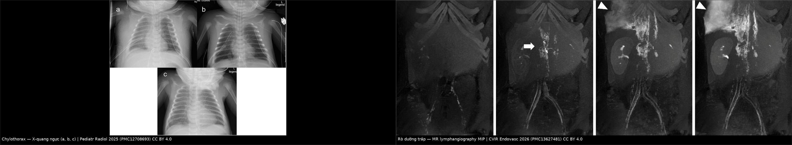
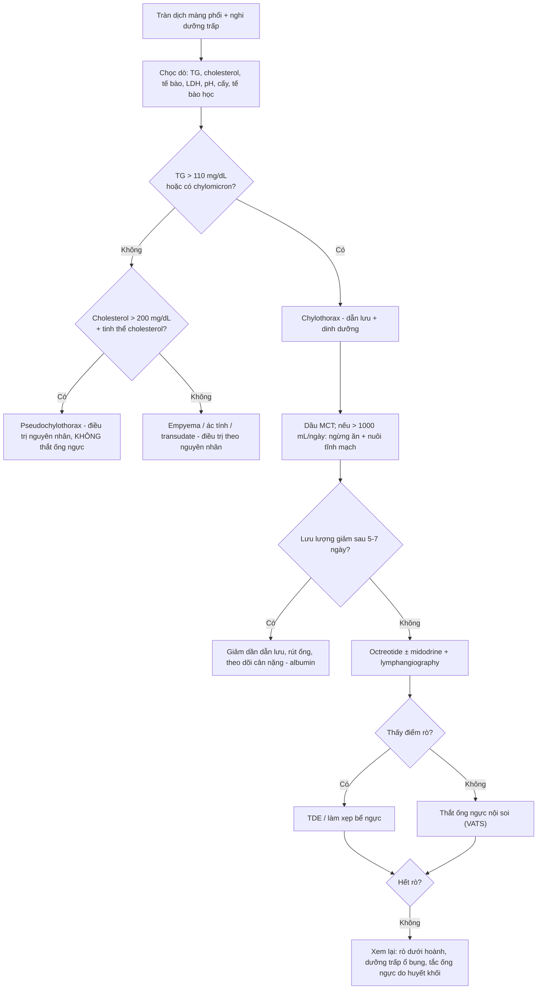
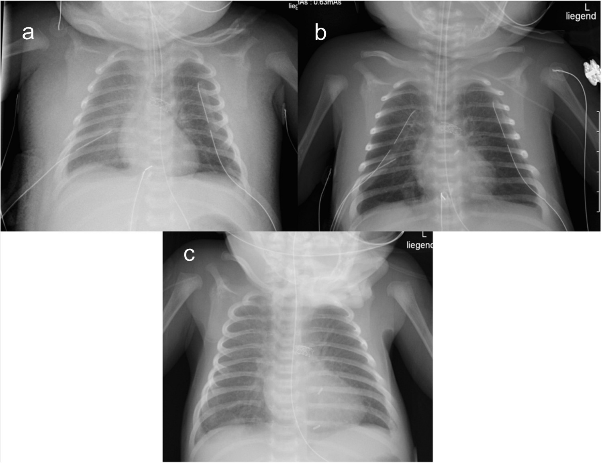
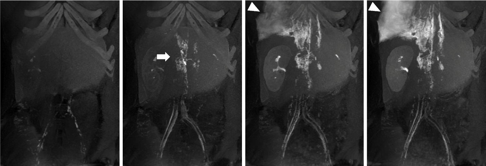
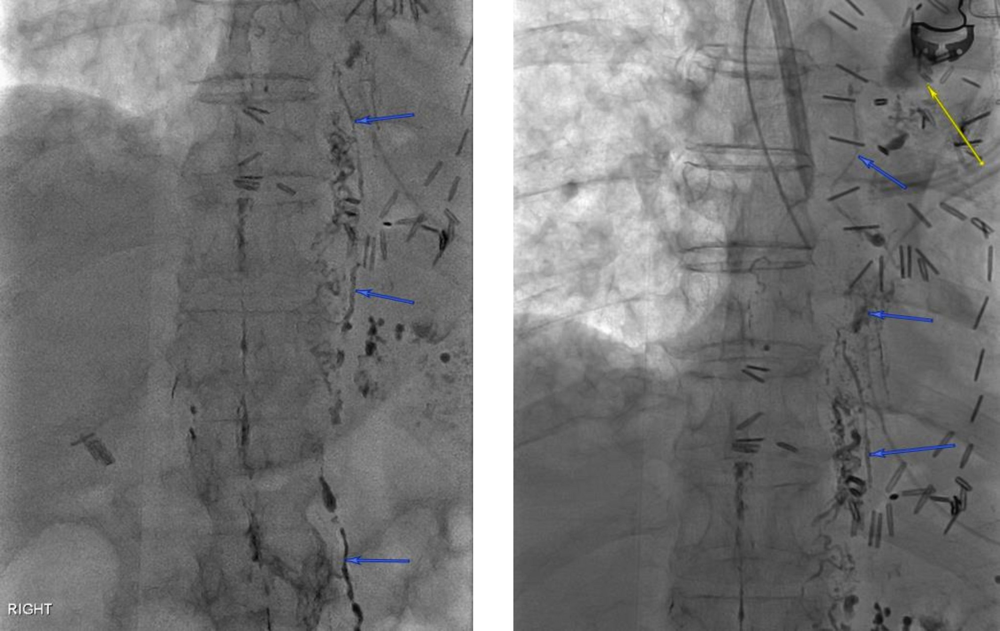

# 079 — Tràn dịch dưỡng trấp (chylothorax): nhận diện dịch, định vị chỗ rò & bậc thang điều trị

**Tags:** `pattern:tran-dich` `vung:mong-phoi` `anatomy:ong-nguc` `protocol:lymphangiography` `score:TG-110` `incidentaloma:tran-dich`
**Mức chắc chắn (certainty):** tổng hợp y văn (literature synthesis) — số liệu lấy từ phân tích gộp 2026 về chylothorax sau cắt phổi (PMC13619438), loạt 69 ca hậu phẫu của Moffitt (PMC13231676), tổng quan congenital chylothorax (PMC13277377), loạt can thiệp 150 ca (PMC11706833) và các ca nguyên văn có ảnh (PMC12708693, PMC13627481); **không** gán một ca nguyên văn duy nhất cho toàn bài.

## 1. Tổng quan bệnh học – cơ chế hình ảnh

- **Bản chất:** **dưỡng trấp (chyle)** là dịch bạch huyết từ ruột, giàu **triglyceride dạng chylomicron**, tế bào lympho, protein và immunoglobulin. Dưỡng trấp đi qua **bể ngực (cisterna chyli)** ở ngang **L1–L2**, lên **ống ngực (thoracic duct)** sau thực quản – giữa động mạch chủ và tĩnh mạch azygos, **vắt sang trái ở ngang T4–T5** rồi đổ vào **góc tĩnh mạch trái**. Rò ống ngực hoặc nhánh bên → dưỡng trấp tràn vào khoang màng phổi = **chylothorax**; tràn vào màng ngoài tim = **chylopericardium**; vào phúc mạc = **chylous ascites**.
- **Vì sao dịch đục như sữa (milk appearance):** các **chylomicron** có kích thước lớn **tán xạ ánh sáng** — đây là hiện tượng quang học, không phải mủ. Hệ quả lâm sàng: **dịch đục không đồng nghĩa với nhiễm trùng**, và ngược lại **dịch trong cũng không loại trừ chylothorax** (xem mục 5).
- **Vì sao thể tích lớn và nhanh:** lưu lượng ống ngực **tăng mạnh sau bữa ăn có mỡ** (có thể tới vài lít/ngày), **giảm khi đói**. Do đó một **dẫn lưu ra nhiều, không tương xứng với tổn thương phổi** sau mổ là dấu hiệu gợi ý sớm, và **nghiệm pháp ăn nhạt mỡ** vừa là điều trị vừa là bằng chứng chẩn đoán.
- **Vì sao nguy hiểm (cơ chế biến chứng):** mất liên tục dịch giàu protein → **suy dinh dưỡng, giảm albumin, giảm γ-globulin**; mất lympho → **giảm CD4, suy giảm miễn dịch, nhiễm trùng**; mất dịch – điện giải → **giảm thể tích, hạ natri**. Tài liệu cũ ghi **tử vong tới 47%** khi chylothorax kéo dài không xử trí (PMC13231676) — con số này là lý do phải chẩn đoán sớm, không phải để hù dọa.
- **Dịch tễ – bối cảnh gặp:**
  - **Sau mổ:** **2–3%** sau cắt thực quản, **2,3%** sau cắt phổi kèm nạo hạch trung thất (PMC13231676). Phân tích gộp 28 nghiên cứu, **212.637 bệnh nhân**: tỉ lệ gộp sau cắt phổi vì ung thư **1,4%** (KTC 95%: 1,0–1,7%; I² = 94,87%) (PMC13619438).
  - **Bẩm sinh:** **1/5.800 – 1/24.000** trẻ sinh sống; là **nguyên nhân tràn dịch màng phổi hay gặp nhất ở sơ sinh** (PMC13277377). Loạt 27 sơ sinh tại Nhật ghi **tử vong 44%** (12/27) — chủ yếu do bệnh nền nặng, sinh non, bất thường nhiễm sắc thể (PMC12660280).
  - **Không do mổ:** chấn thương, **lymphoma** (nguyên nhân ác tính hay gặp nhất), khối trung thất chèn ép, **huyết khối tắc ống ngực – tĩnh mạch**, bệnh Gorham–Stout, sarcoidosis, xơ cứng củ/LAM (bài 696), và **thuốc (dasatinib)** (PMC13627481, PMC13526125, PMC12708693).
- **TẠI SAO trông như vậy trên hình (vật lý):**
  - **X-quang:** dịch tự do → **mờ đáy phổi, xóa góc sườn hoành, đường cong màng phổi**; lượng lớn gây **đẩy trung thất**; không có hơi trong màng phổi trừ khi thủng/dẫn lưu hở.
  - **Siêu âm:** dịch **trống âm, không vách** (khác mủ/hematoma có vách, hồi âm trong); dùng để **định hướng chọc dò** và phát hiện **dịch khu trú**.
  - **CT:** dịch **tỉ trọng thấp, không ngấm thuốc**, không vôi hóa; CT **không thấy trực tiếp chỗ rò** nhưng trả lời ba câu hỏi: **nguyên nhân (khối, hạch, hẹp tĩnh mạch), mức độ, biến chứng (xẹp phổi, viêm phổi)**.
  - **MR lymphangiography (DCE-MRL):** dưỡng trấp là dịch **T2 tăng tín hiệu mạnh**; sau tiêm gadolinium tĩnh mạch, hình **MIP theo thời gian** cho thấy **dòng chảy và điểm rò** mà không cần tia X — ưu thế ở trẻ và khi cần lặp lại (PMC13627481).
  - **Lymphangiography trực tiếp (nodal):** tiêm **Lipiodol** vào hạch bẹn dưới hướng dẫn siêu âm → thấy **ống ngực, biến thể giải phẫu, điểm rò**, và chính Lipiodol đặc có thể **bịt rò nhỏ** (PMC13231676).

## 2. Mẫu hình + chẩn đoán phân biệt theo vị trí (gamut)

- **Mẫu hình chốt:** *tràn dịch màng phổi **lượng lớn, một bên (thường phải sau mổ ngực), không vách, không bị khu trú**, kèm **dẫn lưu ra nhiều, dịch đục như sữa** sau ăn mỡ.*
- **Gamut theo bối cảnh (quan trọng hơn gamut theo hình):**
  - **Sau mổ ngực/bụng trên/cổ:** cắt thực quản, cắt phổi + nạo hạch, cắt thùy phổi, phẫu thuật cột sống ngực – thắt lưng, mổ tim (đặc biệt có thông nối tĩnh mạch trung tâm) (PMC13231676, PMC12510270).
  - **Sơ sinh, tràn dịch hai bên hoặc kèm phù thai:** **chylothorax bẩm sinh**; phân biệt với **phù thai do tim, thiếu máu, nhiễm trùng, CPAM type III, thoát vị hoành** (PMC13277377, bài 698).
  - **Người lớn, không mổ, có khối trung thất/hạch:** **lymphoma** (hay gặp nhất), di căn, **hội chứng tắc tĩnh mạch chủ trên**; chylothorax có thể là **dấu hiệu đầu tiên** (PMC13627481, PMC13372567).
  - **Nữ tuổi sinh sản, nang phổi lan toả + tràn khí tái phát:** **LAM** (tràn dịch dưỡng trấp 10–30%) (bài 696).
  - **Dùng dasatinib (CML/Ph+ ALL):** chylothorax do thuốc, thường **hai bên**, giảm khi ngừng thuốc (PMC13526125).
- **Gamut theo *loại dịch* (đây là chỗ quyết định điều trị):** chylothorax thật — **pseudochylothorax** — **empyema** — **tràn dịch ác tính** — **transudate (suy tim, xơ gan)**. Bốn thể sau **không** cần can thiệp ống ngực, nên bước chọc dò – xét nghiệm dịch là bước **không thể bỏ**.
- **Mnemonic "MILK":** **M**ilky (đục như sữa, tăng sau ăn mỡ) – **I**mmune loss (lympho giảm, dễ nhiễm trùng) – **L**ow output responds to MCT (đáp ứng dầu MCT) – **K**ill the leak (lymphangiography ± embolization/ligation).

## 3. Bảng so sánh phân biệt (ma trận đối chiếu)

| Thực thể | Dịch màng phổi | Chốt vào (rule-in) | Chốt loại (rule-out) | Gợi ý xác nhận |
|---|---|---|---|---|
| **Chylothorax** | **Đục như sữa** (khi ăn mỡ), **TG > 110 mg/dL (> 1,24 mmol/L)**, cholesterol **< 200 mg/dL**, **có chylomicron**, lympho chiếm ưu thế | **TG > 110 mg/dL + chylomicron + bối cảnh mổ/chấn thương/khối trung thất** | Dịch **đặc quánh, tinh thể cholesterol, cholesterol > 200 mg/dL** → pseudochylothorax; **mủ, pH < 7,2, cấy (+)**, TG thấp → empyema | **Định vị rò:** nodal lymphangiography Lipiodol hoặc **MR lymphangiography**; lymphoscintigraphy |
| **Pseudochylothorax** | **Đục, ánh "dầu máy"/nâu chocolate**, **cholesterol > 200 mg/dL**, **tinh thể cholesterol**, **TG thấp (< 110)**, **không chylomicron** | **Mạn tính (lao màng phổi cũ, viêm khớp dạng thấp) + cholesterol cao + tinh thể cholesterol** | TG cao + chylomicron → chylothorax thật | Xét nghiệm dịch (cholesterol, tinh thể), CT thấy **màng phổi dày vôi hóa**; **không** thắt ống ngực |
| **Empyema** | **Mủ, đục, hôi**; **pH < 7,2**, glucose thấp, LDH rất cao, **cấy (+)**, TG thấp | **Mủ + cấy (+) + pH thấp**; có hơi trong màng phổi nếu rò | Dịch sữa, TG cao, cấy vô khuẩn → chylothorax | Cấy, tế bào, **dẫn lưu + kháng sinh**; **không** dùng dầu MCT thay kháng sinh |
| **Tràn dịch ác tính** | Thường **vàng chanh hoặc máu**, TG thấp | **Tế bào học (+)**, khối/hạch trung thất, màng phổi dày nốt | Dịch sữa, TG cao → chylothorax do lymphoma **chèn ép** (có thể đồng thời) | Tế bào học, sinh thiết, PET/CT; điều trị bệnh nền |
| **Transudate (suy tim, xơ gan)** | Trong, **TG thấp**, protein thấp, LDH thấp, **hai bên**, kèm bệnh tim/gan | **Tiêu chuẩn Light**, đáp ứng lợi tiểu, tim to, tĩnh mạch cổ nổi | Dịch sữa/TG cao → chylothorax | Siêu âm tim, xét nghiệm gan; **không** chọc dò lặp vô ích |
| **Chylothorax bẩm sinh** | Sơ sinh, **hai bên hoặc phải**, đục sau bú mẹ | **Sơ sinh + tràn dịch + TG cao trong dịch**, không ổ nhiễm trùng | Dịch trong, TG thấp → phù thai do tim/thiếu máu; nang lớn một thùy → CPAM | Siêu âm thai, X-quang – CT sau sinh, siêu âm tim; **drain + dinh dưỡng** là bước đầu |

*Trái: sơ sinh 3 kg sau mổ tim, **tràn dịch màng phổi phải** (a) giảm dần sau can thiệp (b, c) — ảnh X-quang. Phải: **MR lymphangiography động** (MIP) cho thấy dòng gadolinium và **điểm rò** (mũi tên trắng). Nguồn: Pediatric Radiology 2025 (PMC12708693) Fig. 3, CC BY 4.0; Yamamoto Y et al., CVIR Endovascular 2026 (PMC13627481) Fig. 1, CC BY 4.0. Ghép letterbox, không crop.*

## 4. Protocol chụp + hệ phân độ/điểm chuẩn hoá

- **Bước 1 — X-quang ngực thẳng:** xác nhận tràn dịch, mức độ, đẩy trung thất, vị trí dẫn lưu. **Không** phân biệt được chylothorax với dịch khác.
- **Bước 2 — Siêu âm màng phổi:** dịch tự do/ khu trú, vách, hướng chọc dò; đánh giá **đường vào** và **phổi xẹp**.
- **Bước 3 — Chọc dò + xét nghiệm dịch (bắt buộc):** **triglyceride, cholesterol, protein, LDH, glucose, pH, tế bào – công thức, cấy, nhuộm Gram, tế bào học**. Nếu nghi chylothorax mà TG thấp: **tìm chylomicron (điện di lipoprotein)**, lặp xét nghiệm **sau bữa ăn có mỡ** (sinh lý: lưu lượng và TG trong dịch tăng sau ăn).
- **Bước 4 — CT ngực (có cản quang khi cần):** tìm **nguyên nhân** (khối, hạch, hẹp/tắc tĩnh mạch, biến chứng sau mổ), đánh giá màng phổi; CT **không** thay thế lymphangiography để định vị rò.
- **Bước 5 — Định vị chỗ rò (khi cần can thiệp):**
  - **Nodal lymphangiography bằng Lipiodol** (tiêm hạch bẹn dưới siêu âm): thấy ống ngực, **biến thể** (ví dụ ống ngực đi bên trái — bẫy khi thắt), điểm rò; có thể **điều trị luôn** bằng **TDE (thoracic duct embolization)** hoặc làm xẹp bể ngực (PMC13231676).
  - **MR lymphangiography động (DCE-MRL):** không tia X, thấy dòng chảy – điểm rò, phù hợp trẻ em và theo dõi lặp (PMC13627481).
  - **Lymphoscintigraphy ⁹⁹ᵐTc-dextran:** độ phân giải thấp, dùng khi không có lymphangiography.
- **Phân độ theo lưu lượng (dùng để quyết định bậc điều trị):** **thấp < 500 mL/ngày**, **trung bình 500–1.000**, **cao > 1.000 mL/ngày**; ngưỡng **> 1.000 mL/ngày** là mốc trong phác đồ hậu phẫu để **ngừng ăn – nuôi tĩnh mạch** và cân nhắc can thiệp sớm (PMC13231676).
- **Hiệu quả điều trị nội khoa (để tư vấn):** gộp 23 nghiên cứu sau cắt phổi — **86,9%** kiểm soát được **không cần mổ/can thiết** (KTC 95%: 82,0–91,2%); **12,8%** phải can thiệp/mổ bổ sung (KTC 95%: 8,4–17,9%) (PMC13619438). Với rò sau chấn thương/mổ được can thiệp, **thành công lâm sàng của TDE tới 94,6%** (142/150), **thành công kỹ thuật 94,2%** khi dùng nodal lymphangiography cải tiến so với **76,5%** kiểu cũ (PMC11706833).

## 5. Biến thể bình thường và cạm bẫy

- **Cạm bẫy 1 — "dịch đục = mủ":** dịch sữa không sốt, không tăng bạch cầu hạt, cấy vô khuẩn. Đặt nhầm kháng sinh và **bỏ qua mất dưỡng trấp** là sai lầm hay gặp nhất.
- **Cạm bẫy 2 — bệnh nhân đang đói/ăn nhạt mỡ:** TG trong dịch có thể **< 110 mg/dL**, dịch **trong** → **âm tính giả**. Xử trí: lặp xét nghiệm sau bữa ăn có mỡ, tìm chylomicron, hoặc dựa vào bối cảnh (dẫn lưu nhiều sau mổ thực quản).
- **Cạm bẫy 3 — pseudochylothorax:** bệnh nhân lao màng phổi cũ/viêm khớp dạng thấp, dịch đục mạn tính, **cholesterol > 200 mg/dL + tinh thể cholesterol**, TG thấp. **Không** thắt ống ngực; điều trị nguyên nhân (PMC10278666).
- **Cạm bẫy 4 — "tràn dịch dưỡng trấp nhưng không rò ở ngực":** **dưỡng trấp ổ bụng** đi qua lỗ cơ hoành hoặc qua ống ngực bị tắc → mổ ngực sẽ thất bại; phải chụp/điều trị ở bụng (PMC13231676).
- **Cạm bẫy 5 — tắc ống ngực do huyết khối:** sơ sinh sau mổ tim có **huyết khối ở góc ống ngực – tĩnh mạch** gây chylothorax lưu lượng cao; điều trị là **tái thông/thông nối**, không chỉ thắt ống (PMC12708693).
- **Cạm bẫy 6 — biến thể giải phẫu:** **ống ngực đi bên trái** hoặc nhiều nhánh — thắt "đúng vị trí kinh điển" vẫn còn rò; lymphangiography trước mổ giúp tránh (PMC13231676).
- **Cạm bẫy 7 — trẻ em:** tràn dịch **hai bên** ở sơ sinh thường do **nguyên nhân toàn thân** (phù thai, suy tim, rối loạn lympho bẩm sinh); đừng mổ ngực ngay khi chưa loại trừ nguyên nhân toàn thân và chưa thử dẫn lưu + dinh dưỡng (PMC13277377).
- **Biến thể bình thường cần biết:** một lượng nhỏ dịch màng phổi sau mổ (vài chục mL/ngày, trong, TG thấp) là **phản ứng lành tính**, không phải chylothorax; chỉ xét nghiệm khi **lưu lượng lớn, kéo dài, hoặc dịch đổi màu sau ăn**.

## 6. Tự lượng giá — Blind Quiz

**Ca 1 — Sơ sinh 3 kg, sau mổ tim, X-quang ngực chuỗi 3 phim dưới đây.**

- Gợi ý lâm sàng: suy hô hấp, phù toàn thân, đã đặt dẫn lưu màng phổi và màng tim.
- Câu hỏi: mô tả dịch màng phổi trên phim (a)? Vì sao phải **nghĩ tới chylothorax** thay vì chỉ "dịch sau mổ"? Xét nghiệm dịch nào chốt chẩn đoán?

<b>Bấm để hiện đáp án (findings + chẩn đoán)</b>

- Dấu hiệu: (a) **mờ đáy phổi phải, xóa góc sườn hoành, đẩy nhẹ trung thất**, phổi trái sáng; (b) giảm dần; (c) gần hết dịch — phù hợp **dẫn lưu hiệu quả**.
- Chẩn đoán: **chylothorax lưu lượng cao** sau mổ tim, do **huyết khối tắc góc ống ngực – tĩnh mạch**; bài gốc điều trị bằng **can thiệp qua da vào ống ngực**.
- Vì sao nghĩ chylothorax: dịch **tái lập nhanh, lượng lớn**, kèm **phù toàn thân/giảm albumin**, sau mổ có thông nối tĩnh mạch trung tâm.
- Chốt: **TG dịch > 110 mg/dL + chylomicron**; cholesterol < 200 mg/dL giúp phân biệt pseudochylothorax.
- Nguồn ảnh: Pediatric Radiology 2025 (PMC12708693) Fig. 3, CC BY 4.0.

**Ca 2 — Bệnh nhân lymphoma, tràn dịch dưỡng trấp hai bên, MR lymphangiography dưới đây.**

- Gợi ý lâm sàng: thất bại với dẫn lưu + dầu MCT + octreotide; đang cân nhắc can thiệp.
- Câu hỏi: ảnh MIP theo thời gian cho thấy gì (mũi tên trắng, đầu mũi tên)? Vì sao MR lymphangiography hữu ích hơn CT ở ca này? Bước điều trị tiếp theo?

<b>Bấm để hiện đáp án (findings + chẩn đoán)</b>

- Dấu hiệu: các khung hình **MIP thì liên tiếp** — thuốc gadolinium đi từ **bể ngực/ống ngực** lên trên, tụ lại và **rò ra khoang màng phổi** (mũi tên trắng); đầu mũi tên chỉ **dòng bất thường** ra ngoài ống ngực.
- Vì sao MR hơn CT: **thấy trực tiếp dòng chảy – điểm rò**, không tia X, lặp lại được; CT chỉ thấy dịch và nguyên nhân chèn ép.
- Điều trị: **can thiệp qua da (TDE/tiêm NBCA trực tiếp vào tổn thương)** ± làm xẹp bể ngực; nếu thất bại → **thắt ống ngực**; đồng thời điều trị **lymphoma nền**.
- Nguồn ảnh: Yamamoto Y et al., CVIR Endovascular 2026 (PMC13627481) Fig. 1, CC BY 4.0.

**Ca 3 — Bệnh nhân sau cắt thực quản, rò dai dẳng, nodal lymphangiography dưới đây.**

- Gợi ý lâm sàng: dẫn lưu ngực phải > 1.000 mL/ngày ngày thứ 7; đã ngừng ăn, nuôi tĩnh mạch, dùng octreotide.
- Câu hỏi: mũi tên xanh chỉ cấu trúc gì, và vì sao vị trí này quan trọng trước khi mổ? Nếu chỉ thắt "ống ngực phải kinh điển" thì sai ở đâu?

<b>Bấm để hiện đáp án (findings + chẩn đoán)</b>

- Dấu hiệu: cột **Lipiodol** chạy dọc **bên trái cột sống thắt lưng** (mũi tên xanh) = **ống ngực lạc chỗ bên trái**; mũi tên vàng chỉ **đám Lipiodol dưới carina** (vùng rò).
- Vì sao quan trọng: nếu phẫu thuật viên thắt theo giải phẫu "kinh điển" bên phải, **bỏ sót ống ngực lạc chỗ** → rò tiếp diễn; lymphangiography trước mổ **đổi đường mổ/đổi bên**.
- Chẩn đoán: **chylothorax sau cắt thực quản do rò ống ngực lạc chỗ bên trái**.
- Xử trí: **TDE** hoặc **thắt ống ngực bên trái**; dự phòng: dùng **vật liệu sealant/kẹp** đúng vị trí, dinh dưỡng dầu MCT sớm sau mổ.
- Nguồn ảnh: Robinson LA et al., J Cardiothorac Surg 2026 (PMC13231676) Fig. 2, CC BY-NC-ND 4.0 (giữ nguyên, không crop).

## Bài liên quan chéo

- [696 – LAM: nang phổi lan toả, VEGF-D & sirolimus](../696-lam-nang-phoi-lan-toa/lesson.md) — tràn dịch dưỡng trấp 10–30% trong LAM
- [697 – Hội chứng Birt–Hogg–Dubé](../697-hoi-chung-birt-hogg-dube-flcn/lesson.md) — tràn khí tái phát, phân biệt với tràn dịch
- [601 – Tràn khí màng phổi tự phát ở trẻ lớn & VATS](../601-tran-khi-mang-phoi-tu-phat-tre-lon-vats/lesson.md) — cùng đường vào mổ ngực nội soi
- [040 – Tràn dịch màng phổi](../040-tran-dich-mang-phoi/lesson.md) — tiếp cận tràn dịch nói chung, tiêu chuẩn Light
- [061 – Tràn khí trung thất](../061-tran-khi-trung-that/lesson.md) — biến chứng sau mổ ngực, phân biệt với rò khí
- [741 – Dị dạng mạch máu đầu–cổ (ISSVA)](../741-di-dang-mach-mau-dau-co-o-tre/lesson.md) — dị dạng bạch mạch, nguyên nhân rò dưỡng trấp ở trẻ
- [618 – Rò khí dai dẳng sau mổ](../618-ro-phe-quan-mang-phoi-va-ro-khi-dai-dang-o-tre/lesson.md) — cùng nhóm "biến chứng dẫn lưu kéo dài"

## Ảnh

- Tên file theo quy ước `NNN_slug_Modality_SourceID.jpg`; nguồn + giấy phép từng ảnh ở `images/CREDITS.md`.
- **CC BY 4.0:** ảnh X-quang (PMC12708693), MR lymphangiography (PMC13627481) và ảnh ghép — không crop, giữ nguyên mũi tên/dấu của tác giả.
- **CC BY-NC-ND 4.0:** nodal lymphangiography (PMC13231676) — hiển thị **nguyên bản**, không chỉnh sửa, không đưa vào ảnh ghép.

> Không dùng để chẩn đoán độc lập khi chưa có người hướng dẫn.
