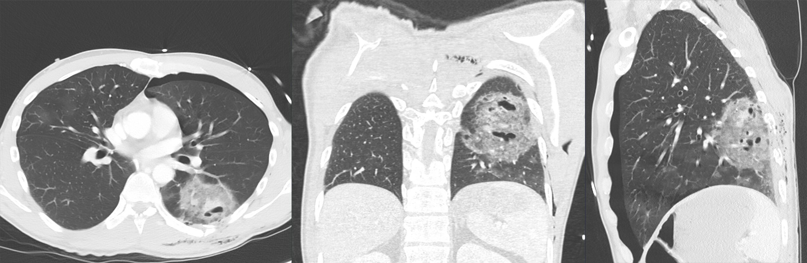

# 080 — Chấn thương ngực kín / Blunt chest trauma

**Tags:** `pattern:chan-thuong` `vung:nguc` `protocol:CT-chan-thuong`
**Mức chắc chắn (certainty):** tổng hợp y văn (literature synthesis) — nhóm tự biên từ y văn mở, chưa gắn ca nguyên văn đơn lẻ.

## 1. Tổng quan — đọc theo ABCDE chấn thương + số

- Chấn thương kín: tai nạn, ngã cao, đè ép. Đọc CT theo **xương → màng phổi → nhu mô → mạch → hoành**: gãy xương sườn (số lượng, flail ≥ 3 xương kề gãy 2 nơi), tràn khí/máu, đụng dập/rách, tổn thương ĐMC (eo), vỡ hoành.
- **Flail chest:** ≥ 3 xương sườn kề nhau gãy ≥ 2 vị trí → mảng sườn di động nghịch thường — thở máy khi suy hô hấp.
- TẠI SAO đụng dập không giống viêm: máu/khí trong nang theo **vùng va đập** (không theo thùy), **tan trong 3–7 ngày** (nhanh hơn viêm nhiều); rách tạo **pneumatocele** (nang khí mỏng sau chấn thương).

## 2. Gamut sau chấn thương

- **Đụng dập (contusion):** mờ quanh vùng va đập, tan 3–7 ngày — đừng kháng sinh mù.
- **Rách + pneumatocele:** nang khí mỏng sau chấn thương, tự xẹp dần — đừng gọi kén bẩm sinh.
- **Tràn khí/máu + gãy xương:** dẫn lưu + giảm đau (thở kém vì đau → xẹp/viêm).
- **Tổn thương ĐMC eo:** giả phình eo + máu trung thất + gãy xương sườn 1–2/clavicle — CTA + mổ/TEVAR cấp cứu.
- **Vỡ hoành:** tạng lên ngực (bài 045) — CT tìm khuyết hoành.

*CT 3 bình diện: đụng dập + rách có pneumatocele, tràn khí trước, gãy xương sườn, khí dưới da. Nguồn: Hellerhoff, CC BY-SA 4.0.*

## 3. Bảng tổn thương

| Tổn thương | Hình ảnh | Chốt | Xử trí |
|---|---|---|---|
| Đụng dập | Mờ vùng va đập, **tan 3–7 ngày** | Tan nhanh + chấn thương | Hỗ trợ hô hấp, không kháng sinh thường quy |
| Rách/pneumatocele | Nang khí mỏng sau chấn thương | **Tiền sử chấn thương + tự xẹp** | Theo dõi (nhiễm trùng hóa mới can thiệp) |
| Tràn khí/máu | Khí + dịch màng phổi + gãy xương | Dẫn lưu khi ép/tăng | Dẫn lưu + giảm đau tốt |
| Tổn thương ĐMC eo | Giả phình + máu trung thất | **CTA + eo ĐMC** | TEVAR/mổ cấp cứu |
| Vỡ hoành | Tạng qua hoành (bài 045) | Khuyết hoành CT | Mổ |

## 4. Protocol CT chấn thương

- **CT cản quang ngực-bụng-tiểu khung 1 lần** (pan-scan) ở đa chấn thương nặng; MPR 3 bình diện (như ảnh trên).
- X-quang tại giường: theo dõi dẫn lưu + ống (bài 015), không thay CT tìm tổn thương ẩn.
- Lặp lại khi diễn biến xấu (tràn khí tăng, tụt HA).

## 5. Cạm bẫy

- **Đụng dập gọi nhầm viêm phổi** → kháng sinh vô ích; chìa khóa là thời gian tan + bối cảnh.
- **Pneumatocele gọi nhầm kén bẩm sinh/áp-xe** — hỏi chấn thương, theo dõi xẹp.
- **Tổn thương ĐMC bỏ sót** khi chỉ chụp X-quang — trung thất bè + cơ chế nặng = CTA ngay.
- **Vỡ hoành phải** khó thấy (gan che) — tìm dấu khuyết + tạng lạc chỗ.

## 6. Tự lượng giá — Blind Quiz

**Ca 1 — Tai nạn, gãy nhiều xương sườn. Đọc CT 3 bình diện, liệt kê tổn thương.**

- Hỏi: mấy loại tổn thương? Pneumatocele khác áp-xe ở điểm gì? Có cần kháng sinh không?

<b>Bấm để hiện đáp án</b>

- **Đụng dập + rách có pneumatocele + tràn khí trước + gãy xương sườn + khí dưới da.** Pneumatocele sau chấn thương tự xẹp — khác áp-xe (sốt + mủ + mức dịch). Không kháng sinh thường quy.
- Nguồn: Hellerhoff, CC BY-SA 4.0.

**Ca 2 — Trung thất bè + gãy xương sườn 1–2 sau tai nạn tốc độ cao:** tổn thương nào phải loại trừ đầu + bằng gì? *(Bảng mục 3.)*

<b>Bấm để hiện đáp án</b>

- **Tổn thương ĐMC eo:** CTA ngay (giả phình + máu trung thất) — TEVAR/mổ, không chờ.

## Bài liên quan chéo
- [001 – Tổng quan hệ Ngực](../001-tong-quan-he-nguc/lesson.md)
- [025 – Hang & nấm phổi](../025-ton-thuong-phoi-tao-hang/lesson.md) (pneumatocele vs áp-xe)
- [041 – Tràn khí màng phổi](../041-tran-khi-mang-phoi/lesson.md) (dẫn lưu)
- [045 – Thành ngực & hoành](../045-thanh-nguc-hoanh/lesson.md) (vỡ hoành)

> Không dùng để chẩn đoán độc lập khi chưa có người hướng dẫn.
